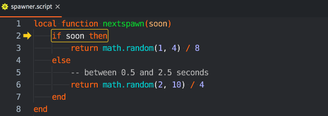
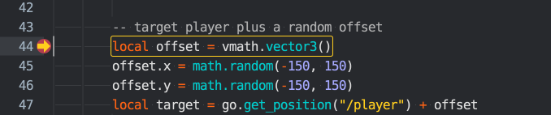
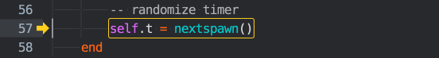
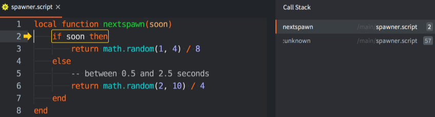
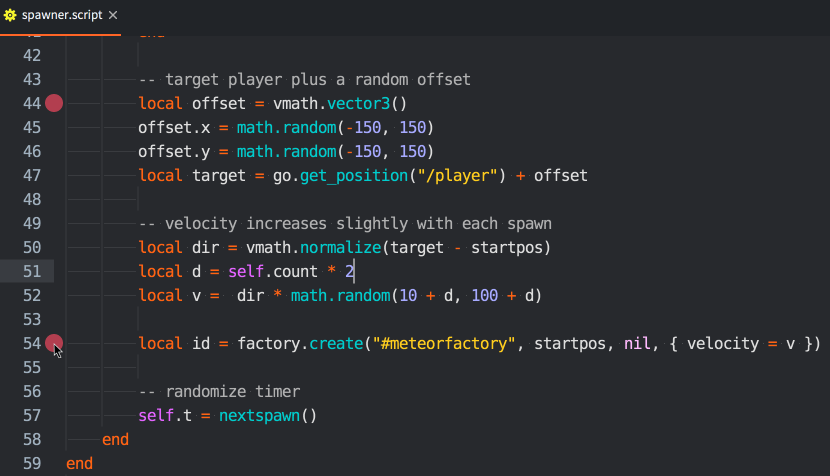
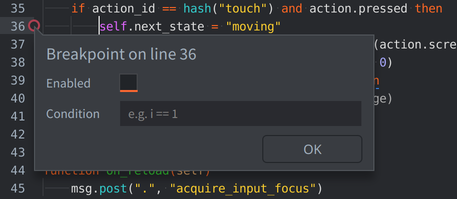
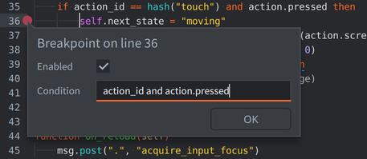
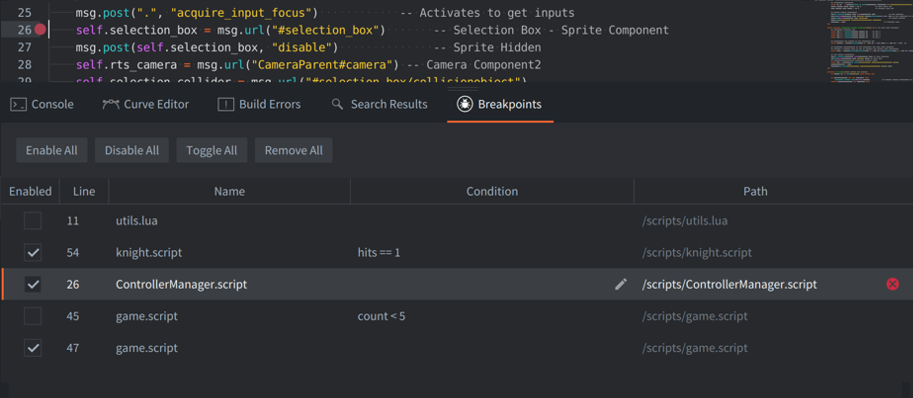
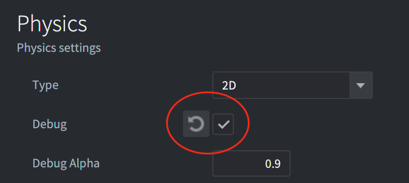
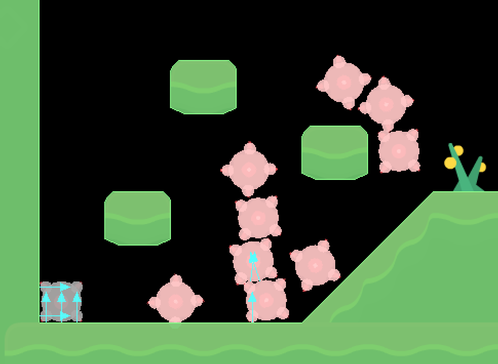

# Debugging game logic

Defold contains an integrated Lua debugger with an inspection facility. Together with the built-in [profiling tools](/manuals/profiling) it is a powerful tool that can help finding the cause of bugs in your game logic or help analyze performance issues.

## Print and visual debugging

The simplest way to debug your game in Defold is to use [print debugging](http://en.wikipedia.org/wiki/Debugging#Techniques). Use `print()` or [`pprint()`](/ref/builtins#pprint) statements to watch variables or indicate the flow of execution. If a game object without a script acts weird, you can just attach a script to it with the sole purpose of debugging. Using any of the printing functions will print to the *Console* view in the editor and to the [game log](/manuals/debugging-game-and-system-logs).

In addition to printing, the engine can also draw debug text and straight lines on the screen. This is done by posting messages to the `@render` socket:

```lua
-- Draw value of "my_val" with debug text on the screen
msg.post("@render:", "draw_text", { text = "My value: " .. my_val, position = vmath.vector3(200, 200, 0) })

-- Draw colored text on the screen
local color_green = vmath.vector4(0, 1, 0, 1)
msg.post("@render:", "draw_debug_text", { text = "Custom color", position = vmath.vector3(200, 180, 0), color = color_green })

-- Draw debug line between player and enemy on the screen
local start_p = go.get_position("player")
local end_p = go.get_position("enemy")
local color_red = vmath.vector4(1, 0, 0, 1)
msg.post("@render:", "draw_line", { start_point = start_p, end_point = end_p, color = color_red })
```

The visual debug messages adds data to the rendering pipeline and is drawn as part of the regular render pipeline.

* `"draw_line"` adds data that is rendered with the `render.draw_debug3d()` function in the render script.
* `"draw_text"` is rendered with the `/builtins/fonts/debug/always_on_top.font` that uses the `/builtins/fonts/debug/always_on_top_font.material` material.
* `"draw_debug_text"` is the same as `"draw_text"`, but it's rendered in a custom color.

Note that you probably want to update this data every frame so posting the messages in the `update()` function is a good idea.

## Running the debugger

Since Defold 1.14.1, the editor uses the engine's native Debug Adapter Protocol (DAP) server. Use a native debug or headless engine from the same Defold version. Release engines and Web builds do not provide the TCP debugger, and the current editor cannot connect to older engines that only support MobDebug. No `require "builtins.scripts.mobdebug"` call is needed or available in current versions.

To run the debugger, select <kbd>Debug ▸ Start/Attach</kbd>. This starts the game with the debugger attached, or attaches to an already running game. When starting a game for debugging, the editor installs enabled breakpoints before startup scripts run, so you can set a breakpoint in `init()` before launching.

To attach to a device, select it under <kbd>Project ▸ Targets</kbd>, then choose <kbd>Debug ▸ Start/Attach</kbd>. Attachment pauses at the next Lua line. The editor starts the native listener automatically for supported local and remote targets. See [Remote targets](#remote-targets) for connection requirements, or [Native DAP connections](#native-dap-connections) to connect an external debugger.

As soon as the debugger is attached, you have control of the execution of the game through the debugger control buttons in the console, or through the <kbd>Debug</kbd> menu:

Break
: {width=60px .left}
  Pause Lua execution at the next source line. You are now able to inspect the state of the game, advance the game step by step, or continue running it until the next breakpoint. The current point of execution is marked in the code editor:

  

Continue
: {width=60px .left}
  Continue running the game. The game code will continue to run until you either press pause or the execution hits a breakpoint that you have set. If execution breaks at a set breakpoint, the the execution point is marked in the code editor on top of the breakpoint marker:

  

Stop
: {width=60px .left}
  Stop the debugger. Pressing this button will immediately stop the debugger, detach it from the game and terminate the running game.

Step Over
: {width=60px .left}
  Advance execution of the program one step. If the execution involves running another Lua function, the execution _will not step into the function_ but continue running and stop on the next line below the function call. In this example, if the user presses "step over", the debugger will execute code and stop at the `end` statement below the line with the call to the function `nextspawn()`:

  

Stepping follows Lua source lines.

Step Into
: {width=60px .left}
  Advance execution of the program one step. If the execution involves running another Lua function, the execution _will step into the function_. Calling the function adds an entry to the call stack. You can click each entry in the call stack list to view the entry point and the content of all variables in that closure. Here, the user has stepped into the function `nextspawn()`:

  

Step Out
: {width=60px .left}
  Continue execution until it returns from the current function. If you have stepped execution into a function, pressing the button "step out" will continue execution until the function returns.

Setting and clearing breakpoints
: You can set an arbitrary number of breakpoints in your Lua code. When the game runs with the debugger attached, it will stop execution at the next breakpoint it encounters and wait for further interaction from you.

  

  To set or clear a breakpoint, click in the column just right of the line numbers in the code editor. You can also select <kbd>Edit ▸ Toggle Breakpoint</kbd> from the menu.

Disabling and enabling breakpoints
: Breakpoints can be temporarily disabled without removing them. When disabled, they are ignored during execution but can be re-enabled at any time. Right-click it in the code editor gutter, then toggle the `Enabled` checkbox. Disabled breakpoints appear hollowed out to indicate they are inactive.

  

Setting conditional breakpoints
: You can configure your breakpoint to contain a condition that needs to evaluate to true for the breakpoint to trigger. The condition can access local variables available at the line during code execution.

  

  To edit the breakpoint condition, right-click in the column just right of the line numbers in the code editor, or select <kbd>Edit ▸ Edit Breakpoint</kbd> from the menu.

Evaluating Lua expressions
: With the game paused, select a frame in the *Call Stack*, type a Lua expression or statement in the bottom of the console, and press <kbd>Enter</kbd>. Evaluation uses the selected frame's locals, upvalues, and globals. Table results include their nested contents.

  You can also change values through assignments, for example `self.score = 100` in a frame where `self` is available. Evaluated code has the same effects on game state as code executed by your game.

Inspecting variables
: Select a frame in the *Call Stack* to inspect its locals and upvalues in the *Variables* view. Expand `_G` to inspect globals, and expand tables or `self` to inspect their fields. The editor preserves expanded paths, selection, and scroll position when stepping, switching frames, or refreshing after evaluation, while fetching current values.

Detaching the debugger
: Select <kbd>Debug ▸ Detach Debugger</kbd> to detach the debugger from the game. It will continue running immediately. Use <kbd>Debug ▸ Start/Attach</kbd> to attach again without restarting the game.

## Native DAP connections

For an external DAP client, start the listener in a native Defold debug or headless engine, then connect the client to the engine's address and port. This workflow is available since Defold 1.14.1. The editor handles listener setup automatically when you use <kbd>Debug ▸ Start/Attach</kbd>.

### Starting the listener

Build your project first. From the project directory containing `build/default/game.projectc`, run the native debug engine with these [startup configuration overrides](/manuals/project-settings/#setting-config-values-on-engine-startup):

```sh
dmengine --config=debugger.enabled=1 \
  --config=debugger.port=8172 --config=debugger.wait=1
```

Connect your DAP client to `127.0.0.1:8172`. The engine waits for the client to configure breakpoints before running startup scripts.

| Setting | Default | Purpose |
| --- | --- | --- |
| `debugger.enabled` | `0` | Set to `1` to start the listener during engine startup. |
| `debugger.address` | `127.0.0.1` | IPv4 address on which to listen. The default accepts connections from the same computer. |
| `debugger.port` | `8172` | TCP listening port. Use `0` to select an available port. |
| `debugger.wait` | `0` | Set to `1` to wait for the debugger client's configuration before running startup scripts. |

The engine log reports the selected address and port. With `debugger.wait=0`, the game starts immediately and you can attach later. For local debug launches, the editor selects an available port automatically.

### Enabling the listener while running

To enable the listener from a script without restarting the game:

```lua
if debugger then
    local port = debugger.start(0)
    print("DAP listener port:", port)
end
```

`debugger.start([port [, address]])` returns the listening port immediately. It does not wait for a client or pause the game. Omitted arguments use `debugger.port` and `debugger.address`; passing `0` selects an available port. Repeated calls return the existing listener's port and do not change its address or port. The `debugger` module is provided by native debug and headless engines.

### Remote targets

For a direct connection from another computer, bind the listener to the device's IPv4 interface or to `0.0.0.0` (all IPv4 interfaces). For example, use `debugger.start(8172, "0.0.0.0")`, or add `--config=debugger.address=0.0.0.0` to the startup command above. Connect the client to the device's actual IP address and allow TCP access to the listening port. `0.0.0.0` is a bind address, not the address to enter in the client.

The Defold editor requests this remote bind automatically and uses port `8172 + project.instance_index` for remote targets. It cannot discover a dynamically selected remote port. If you already started the remote listener on localhost or a different port, restart the engine before attaching from the editor.

The debugger can evaluate Lua and has no authentication. Enable remote access only on a trusted development network.

### External clients

Use a client that supports attaching directly to a DAP server over TCP. Configure its source mapping to the folder containing `game.project` (the DAP `localRoot` attach argument). Start the engine listener first, then attach the client. A concrete [VS Code configuration](https://github.com/defold/defold/blob/1.14.1-beta/engine/debugger/README.md#vs-code) is available in the native debugger guide.

The [legacy ZeroBrane workflow](/manuals/zerobrane) uses MobDebug, a different protocol. Its debugger server cannot connect to the native DAP listener.

## Breakpoints Tab

  

  When working with multiple breakpoints across different scripts, the Breakpoints tab provides a centralized view for managing all your breakpoints in one place.

##### Individual Breakpoint Controls

  For working with individual breakpoints:
  - Click the red trash icon to remove a breakpoint
  - Double-click the row (outside the condition area) to navigate to that line in the Code View
  - Double-click the condition cell or click the pen icon to edit conditional breakpoints
  - Click the X clear button when hovering over a condition cell to clear the condition

##### Batch Operations

  Select multiple breakpoints using Ctrl/Cmd+click or Shift+click, then right-click to perform bulk actions. You can edit conditions across several breakpoints simultaneously, toggle their active state, or remove them entirely.

  The toolbar buttons allow you to enable, disable, or toggle all breakpoints at once, useful when you want to run your game without stopping but don't want to lose their positions. You can also remove all when you're done with your debugging session.

## Lua debug library

Lua comes with a debug library that is useful in some situations, particularly if you need to inspect the innards of your Lua environment. You can find more information about it in [the chapter about the Debug Library in the Lua manual](http://www.lua.org/pil/contents.html#23).

## Debugging checklist

If you encounter an error or if your game does not behave like expected, here is a debugging checklist:

1. Check the console output and verify that there are no runtime errors.

2. Add `print` statements to your code to verify that the code is actually running.

3. If it's not running, check that you have done the proper setup in the editor required for the code to run. Is the script added to the right game object? Have your script acquired input focus? Are the input-triggers correct? Is the shader code added to the material? Etc.

4. If your code is depending on the values of variables (in an if-statement, for example), either `print` those values where they are used or checked, or inspect them with the debugger.

Sometimes finding a bug can be a hard and time consuming process, requiring you to go through your code bit by bit, checking everything and narrowing down the faulty code and eliminating sources of error. This is best done by a method called "divide and conquer":

1. Figure out which half (or less) of the code that must contain the bug.
2. Again, figure out which half, of that half, must contain the bug.
3. Continue narrowing down the code that must cause the bug until you find it.

Happy hunting!

## Debugging problems with physics

If you have problems with physics and collisions aren't working as expected it is recommended to enable physics debugging. Check the *Debug* checkbox in the *Physics* section of the *game.project* file:



When this checkbox is enabled Defold will draw all collision shapes and contact points of collisions:


