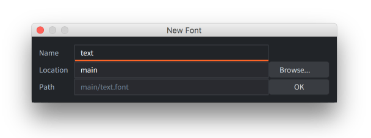
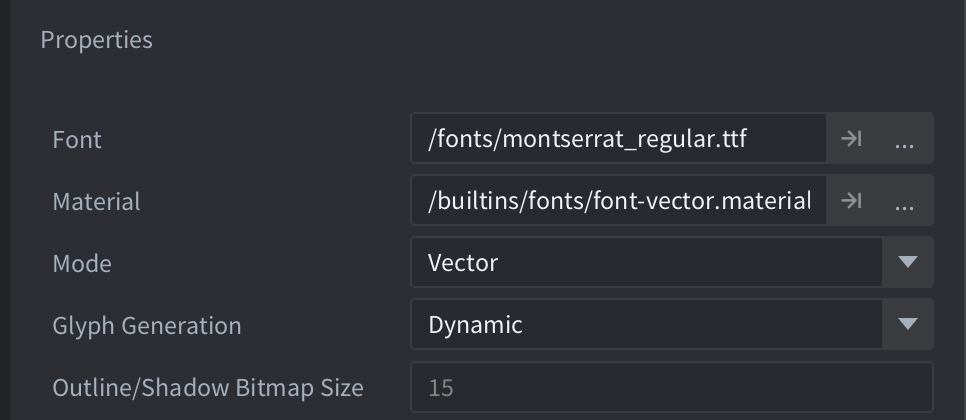
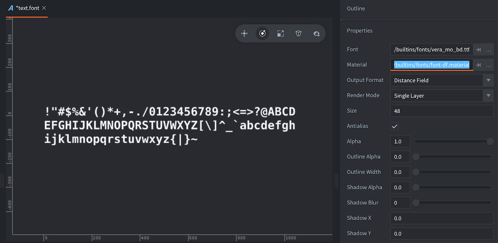
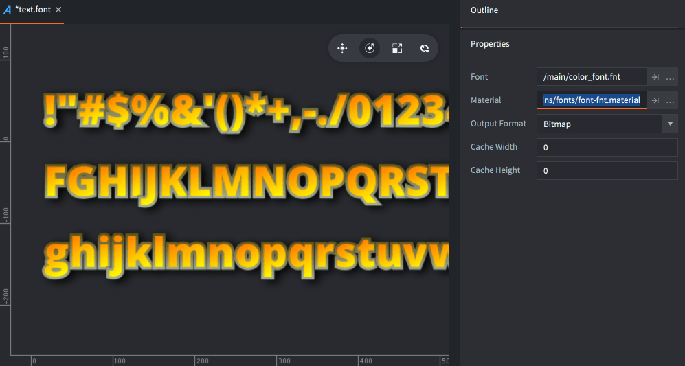
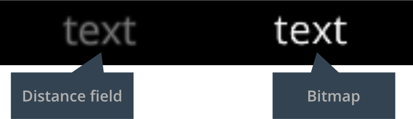

# Font files

Fonts are used to render text on Label components and GUI text nodes. Defold supports several font file formats:

- TrueType
- OpenType
- BMFont

Both the legacy and full text layout engines support TrueType outlines and OpenType CFF1/CFF2 outlines, including runtime generation from `.ttf` and `.otf` resources.

For information about styling individual text spans and working with links and inline sprites, see the [Rich text markup manual](/manuals/font-richtext).

For TrueType and OpenType fonts, the *Mode* property selects how glyphs are rendered:

- **Bitmap** uses rasterized glyph images.
- **SDF** (signed distance field) stores distances to glyph edges in a texture, allowing more flexible scaling than Bitmap.
- **Vector** renders glyph faces from curve data, keeping them sharp when scaled. Outline and shadow effects still use bitmap data.

Newly created font resources use **Vector** mode and **Dynamic** glyph generation. Existing font resources keep their Bitmap or SDF mode. BMFont sources always use their supplied bitmap.

Vector mode requires graphics support for `RGBA16F` and `R32UI` textures and is not supported on OpenGL ES 2 or WebGL 1. Use Bitmap or SDF fonts and matching materials when targeting unsupported graphics adapters; there is no automatic fallback from Vector to SDF. See [Vector fonts](#vector-fonts) for setup.

## Offline or Runtime fonts

The *Glyph Generation* property selects when each font's glyph data is generated:

- **Static** generates the selected glyphs at build time (offline). *Characters* and *All Chars* control which glyphs are included. The source `.ttf` or `.otf` file is not bundled for runtime generation.
- **Dynamic** bundles the source `.ttf` or `.otf` file and generates glyphs on demand at runtime. *Prewarm Text* prepares glyphs when the font loads. Other glyphs can be generated later as needed.

SDF and Vector fonts support both choices. Bitmap fonts and BMFont sources use Static generation. Each font resource is configured independently, so a project can mix Static and Dynamic fonts.

Dynamic generation can reduce bundle size and runtime memory use, particularly for fonts with large character sets. It requires the full text layout system in the engine; see [Enabling Runtime Fonts](#enabling-runtime-fonts).

## Text layout support (e.g. Right-to-left)

The runtime fonts also have the benefit of supporting full text layout, e.g. right-to-left.
We currently use the libraries [HarfBuzz](https://github.com/harfbuzz/harfbuzz), [SheenBidi](https://github.com/Tehreer/SheenBidi), [libunibreak](https://github.com/adah1972/libunibreak) and [SkriBidi](https://github.com/memononen/Skribidi).

See [Enabling Runtime Fonts](/manuals/font#enabling-runtime-fonts)

The editor uses the engine's font renderer for font and scene text previews. Text shaping and right-to-left layout require [runtime fonts](#enabling-runtime-fonts) and the **Use full text layout system** option in the App Manifest. For offline fonts, the preview respects the font's **Characters** and **All Chars** settings.

## Font collection

The `.fontc` file format is also known as a font collection. In offline mode, only one font is associated with it.
When using runtime fonts, you can associate more than one font file (`.ttf` or `.otf`) with the font collection.

This allows for using the a font collection when rendering multiple texts in different languages, while also keeping the memory footprint low.
E.g. loading a collection with the Japanese font, then associate that font with the current main font, followed by unloading the Japanese font collection.

## Creating a font

To create a font for use in Defold, create a new Font file by selecting <kbd>File ▸ New...</kbd> from the menu, then select <kbd>Font</kbd>. You can also <kbd>right click</kbd> a location in the *Assets* browser and select <kbd>New... ▸ Font</kbd>.



Give the new font file a name and click <kbd>Ok</kbd>. The new font file now opens in the editor.

Drag the font you wish to use into the *Assets* browser and drop it in a good spot.

Set the *Font* property to the font file. For a `.ttf` or `.otf` source, select *Mode* and *Glyph Generation*, then configure the remaining properties as needed. For Dynamic generation, also complete the [runtime font setup](#enabling-runtime-fonts).



Use *Font Size* on a Label component or GUI text node to change the displayed text size. For Vector fonts, *Outline/Shadow Bitmap Size* controls the resolution of the effect bitmaps, independently of the displayed text size.

## Properties

*Font*
: The TTF, OTF or *`.fnt`* file to use for generating the font data.

*Material*
: The material to use when rendering this font. It must match the font mode; see [Font materials](#font-materials).

*Mode*
: The rendering technique for a `.ttf` or `.otf` source: **Bitmap**, **SDF** or **Vector**. This replaces the former *Output Format* property. The property is not shown for BMFont sources.

*Glyph Generation*
: **Static** generates glyph data at build time. **Dynamic** generates it at runtime and requires the [full text layout system](#enabling-runtime-fonts). This property is available for SDF and Vector fonts. For Bitmap mode it is fixed to Static, and it is not shown for BMFont sources.

*Render Mode*
: The layer arrangement for generated Bitmap fonts. This property is only shown in Bitmap mode for `.ttf` and `.otf` sources. For SDF, Vector and BMFont sources, Defold selects the layer arrangement automatically.

  - **Single Layer** produces a single quad for each character.
  - **Multi Layer** produces separate quads for the glyph shape, outline and shadow. The layers are rendered in back-to-front order, which prevents a character from obscuring previously rendered characters if the outline is wider than the distance between glyphs. This also enables shadow offsets from the *Shadow X/Y* properties.

*Size*
: The glyph size in pixels used when generating Bitmap or SDF font data. For BMFont sources, the size is read from the `.fnt` file and cannot be edited here.

*Outline/Shadow Bitmap Size*
: In Vector mode, this replaces *Size*. It controls the bitmap resolution of enabled outline and shadow effects for both Static and Dynamic generation. It is disabled when neither effect is enabled, because the glyph faces use curve data. Changing a Label or GUI text node's *Font Size* does not change this shared bitmap resolution.

*Antialias*
: Whether to antialias glyphs when generating Bitmap font data. Disable it for pixel perfect rendering. This property is only shown in Bitmap mode for `.ttf` and `.otf` sources.

*Alpha*
: The transparency of the glyph. 0.0--1.0 where 0.0 means transparent and 1.0 opaque.

*Outline Alpha*
: The transparency of the generated outline. 0.0--1.0.

*Outline Width*
: The width of the generated outline in pixels. Set to 0 for no outline.

*Shadow Alpha*
: The transparency of the generated shadow. 0.0--1.0.

::: sidenote
The built-in Bitmap font shader supports shadows in both *Single Layer* and *Multi Layer* render modes. For generated Bitmap fonts that use *Single Layer* rendering and do not need shadows, a custom material can use `/builtins/fonts/font-singlelayer.fp`. SDF and Vector fonts require shaders matching their mode; see [Font materials](#font-materials).
:::

*Shadow Blur*
: The amount of blur applied to the generated shadow. Set to 0 for a sharp shadow.

*Shadow X/Y*
: The horizontal and vertical offset in pixels of the generated shadow. For generated Bitmap fonts, use *Multi Layer* render mode to apply these offsets. Defold selects the appropriate layers automatically for SDF and Vector fonts.

*Characters*
: For Static generation, the characters to include in the built font. By default this field contains the ASCII printable characters (character codes 32-126). Add or remove characters to control which glyphs are available at runtime.

*Prewarm Text*
: For Dynamic generation, this replaces *Characters*. The text is used to generate glyphs and prewarm the cache when the font loads. It does not restrict which characters can be generated later. You can also prewarm text from a script with [`font.prewarm_text()`](/ref/font/#font.prewarm_text).

::: sidenote
The ASCII printable characters are:
space ! " # $ % & ' ( ) * + , - . / 0 1 2 3 4 5 6 7 8 9 : ; < = > ? @ A B C D E F G H I J K L M N O P Q R S T U V W X Y Z [ \ ] ^ _ \` a b c d e f g h i j k l m n o p q r s t u v w x y z { | } ~
:::

*All Chars*
: For Static generation, include every glyph available in the source instead of limiting the font to *Characters*. This property is hidden for Dynamic fonts.

*Cache Width/Height*
: Constrains the size of the glyph cache bitmap used by Bitmap and SDF fonts, and by Vector outline and shadow effects. When the engine renders text, it looks up the glyph from the cache bitmap. If it does not exist there, it will be added to the cache before rendering. If the cache bitmap is too small to contain all the glyphs the engine is asked to render, an error is signalled (`ERROR:RENDER: Out of available cache cells! Consider increasing cache_width or cache_height for the font.`).

  If set to 0 the cache size is set automatically, and will grow to 2048x4096 max.

## Font materials

Use a material that matches the font mode. The font resource's *Material* is used by GUI text nodes. Label components have a separate *Material* property that must also match the font:

| Font mode or source | Font material for GUI text | Label component material |
| --- | --- | --- |
| Bitmap | `/builtins/fonts/font.material` | `/builtins/fonts/label.material` |
| SDF | `/builtins/fonts/font-df.material` | `/builtins/fonts/label-df.material` |
| Vector | `/builtins/fonts/font-vector.material` | `/builtins/fonts/label-vector.material` |
| BMFont (`.fnt`) | `/builtins/fonts/font-fnt.material` | `/builtins/fonts/label-fnt.material` |

Changing *Mode* in the font editor switches between the corresponding built-in Bitmap, SDF and Vector materials when one of those materials is already assigned to the font. Custom materials are not replaced automatically. Check the *Material* property on any Label components that use the font as well.

## Vector fonts

Vector fonts render glyph faces from curves so they remain sharp as the displayed text size changes. To set up a font that generates its glyphs at runtime:

1. Create a `.font` resource, for example `/fonts/ui.font`, and select a TrueType or OpenType source in its *Font* property. The built-in `/builtins/fonts/vera_mo_bd.ttf` can be used for ordinary text.
2. Set *Mode* to **Vector**, *Glyph Generation* to **Dynamic**, and *Material* to `/builtins/fonts/font-vector.material`. These are the defaults for newly created font resources.
3. Enable **Use full text layout system** in an App Manifest assigned to your project. Follow [Enabling Runtime Fonts](#enabling-runtime-fonts) to configure the custom engine.
4. Enable [Shader ▸ Exclude GLES 2.0](/manuals/project-settings/#exclude-gles-20) in *game.project*.
5. Assign the font to a [Label](/manuals/label/) or add it to a GUI scene's *Fonts* and select it on a [text node](/manuals/gui-text/). For a Label, also set the component's *Material* to `/builtins/fonts/label-vector.material`. Set the component or node's *Font Size* to the desired display size.

Vector glyph faces use curve textures, but enabled outlines and shadows still generate SDF bitmap data and consume glyph-cache texture memory. *Outline/Shadow Bitmap Size* sets that bitmap resolution independently of the Label or GUI text node's *Font Size*. Set *Outline Alpha* and *Shadow Alpha* to `0` when those effects are not needed to avoid generating their bitmap data.

### Color emoji

Vector fonts can render COLRv1 color emoji, including palette colors and linear and radial gradients. Bitmap and SDF modes do not render COLRv1 colors. Use the Dynamic Vector setup above, then add a COLRv1 emoji font as a fallback to the font collection. Ordinary text continues using the original font.

For example, copy the COLRv1 [Noto Color Emoji font](https://github.com/google/fonts/blob/main/ofl/notocoloremoji/NotoColorEmoji-Regular.ttf) into your project as `/fonts/NotoColorEmoji-Regular.ttf`. Choose the COLRv1 version: other emoji fonts may use a different color format even when their filename ends in `.ttf`.

Append `/fonts/NotoColorEmoji-Regular.ttf` to **Project ▸ Custom Resources** in *game.project*. With no other custom resources, the setting is:

```ini
[project]
custom_resources = /fonts/NotoColorEmoji-Regular.ttf
```

A font path written in Lua does not cause the font file to be bundled. [Custom Resources](/manuals/project-settings/#custom-resources) makes this source font available to [`font.add_font()`](/ref/font/#font.add_font), which loads it through the resource system. Pass the source font's string path when loading it from the bundle.

Add the fallback once per shared font resource. The change affects every Label and GUI text node using that font, and adding the same fallback twice raises an error. If using both the [Label example](/manuals/label/#vector-fonts-and-color-emoji) and the [GUI example](/manuals/gui-text/#vector-fonts-and-color-emoji) with the same `.font`, coordinate initialization so the fallback is added once before either example prewarms or displays text. The examples prewarm the complete text after adding the fallback and display it when the callback succeeds.

## Distance field fonts

Distance field fonts store the distance to the edge of the glyph in the texture instead of bitmap data. When the engine renders the font, a special shader is required to interpret the distance data and use that to draw the glyph. Distance field fonts are more resource intensive than bitmap fonts, but allow for greater sizing flexibility.



Select **SDF** in *Mode* and choose **Static** or **Dynamic** in *Glyph Generation*. Use *`/builtins/fonts/font-df.material`* for the font and *`/builtins/fonts/label-df.material`* for Label components, or custom materials that handle distance field data.

## Bitmap BMFonts

In addition to generated bitmaps Defold supports prebaked bitmap "BMFont" format fonts. These fonts consists of a PNG font sheet with all the glyphs. In addition, a *`.fnt`* file contains information on where on the sheet each glyph can be found as well as size and kerning information. (Note that Defold does not support the XML version of the *`.fnt`* format that is used by Phaser and some other tools)

These types of fonts provide no performance improvement from bitmap fonts generated from TrueType or OpenType font files, but can include arbitrary graphics, coloring and shadows right in the image.

Add the generated *`.fnt`* and *`.png`* files to your Defold project. These files should reside in the same folder. Create a new font file and set the *Font* property to the *`.fnt`* file. Defold uses the supplied bitmap and reads its size from the `.fnt` file. *Mode* and *Glyph Generation* are not shown for BMFont sources.

::: sidenote
To create a BMFont, you need to use a tool that can generate the appropriate files. Several options exist:

* [Bitmap Font Generator](http://www.angelcode.com/products/bmfont/), a Windows only tool provided by AngelCode.
* [Shoebox](http://renderhjs.net/shoebox/), a free Adobe Air based app for Windows and macOS.
* [Hiero](https://libgdx.com/wiki/tools/hiero), an open source Java based tool.
* [Glyph Designer](https://71squared.com/glyphdesigner), a commercial macOS tool from 71 Squared.
* [bmGlyph](https://www.bmglyph.com), a commercial macOS tool from Sovapps.
:::



Set the font's *Material* to *`/builtins/fonts/font-fnt.material`*. For Label components, use *`/builtins/fonts/label-fnt.material`*.

## Artifacts and best practices

Generally, bitmap fonts are best when the font is rendered with no scaling. They are faster to render to screen than distance field fonts.

Distance field fonts respond very good to upscaling. Bitmap fonts, on the other hand, being just pixelated images will increase in size so the pixels will grow as the font is scaled, resulting in blocky artifacts. The following is a sample at font size 48 pixels, scaled up 4 times.


When scaling down, bitmap textures can be nicely and efficiently scaled down and antialiased by the GPU. A bitmap font keeps its color better than a distance field font. Here is a zoom of the same sample font at size 48 pixels, scaled down to 1/5 of the size:



Distance field fonts need to be rendered to a target size that is big enough to hold distance information that can express the curves of the font glyphs. This is the same font as above, but at 18 pixels size and scaled up 10 times. It is clear that this is too small to encode the shapes of this typeface:


If you don't want shadow or outline support, set their respective alpha values to zero. Otherwise, shadow and outline data will still be generated, taking up unnecessary memory. In Vector mode, disabling both effects avoids generating their bitmap data; the glyph faces continue to use curve data.

## Font Cache
Bitmap and SDF font resources use a glyph cache texture and font data at runtime. Vector fonts store their glyph faces as curve data and use a bitmap cache for enabled outline and shadow effects. The texture layout described below applies to Bitmap and SDF fonts.

* The font data consist of a list of glyph entries, each containing some basic kerning info and the bitmap data for that glyph.
* The texture is internally called the "glyph cache texture" and it will be used when rendering text for a specific font.

At runtime, when rendering text, the engine will first loop through the glyphs to be rendered to check which glyphs are available in the texture cache. Each glyph that is missing from the glyph texture cache will trigger a texture upload from the bitmap data stored in the font data.

Each glyph is placed internally in the cache according to the font baseline, which enables calculating local texture coordinates of the glyph within its corresponding cache cell in a shader. This means that you can achieve certain text effects such as gradients or texture overlays dynamically. The engine exposes metrics about the cache to the shader via a special shader constant called `texture_size_recip`, which contains the following information in the vector components:

* `texture_size_recip.x` is the inverse of the cache width
* `texture_size_recip.y` is the inverse of the cache height
* `texture_size_recip.z` is the ratio of cache cell width to the cache width
* `texture_size_recip.w` is the ratio of cache cell height to the cache height

For example - to generate a gradient in a shader fragment, simply write:

`float horizontal_gradient = fract(var_texcoord0.y / texture_size_recip.w);`

For more information about shader uniforms, see the [Shader manual](/manuals/shader).

## Enabling Runtime Fonts

Runtime generation is configured per font resource:

1. Open the `.font` resource and select a TrueType (`.ttf`) or OpenType (`.otf`) source.
2. Set *Mode* to **SDF** or **Vector** and *Glyph Generation* to **Dynamic**.
3. Choose the matching [font and Label materials](#font-materials).
4. Add an [App Manifest](/manuals/app-manifest), assign it to *Native Extensions ▸ App Manifest* in *game.project*, and enable **Use full text layout system**. This builds a custom engine with runtime font generation and full text layout support.
5. Set *Prewarm Text* to text that will be displayed soon after the font loads. For text needed later, use [`font.prewarm_text()`](/ref/font/#font.prewarm_text) and wait for its callback before displaying it.

New font resources already use Vector mode and Dynamic generation, but still require the App Manifest configuration above.

### Migrating from earlier versions

`font.runtime_generation` in *game.project* is deprecated and has no effect. If your project previously enabled runtime fonts with that setting, set *Glyph Generation* to **Dynamic** in each SDF or Vector font that needs runtime generation. Keep **Use full text layout system** enabled in the App Manifest. You can then remove the obsolete project setting.

Existing font files are not automatically changed to Vector or Dynamic. The former *Output Format* choices map to *Mode*: Bitmap remains Bitmap, and Distance Field becomes SDF. Font files without a per-resource Dynamic setting use Static generation.


### Font Scripting

#### Prewarming glyph cache

Dynamic fonts generate the glyphs needed by *Prewarm Text* when the font loads. The field is interpreted as text to be laid out, so the cache is prepared for the glyphs that the text needs. *All Chars* is not available for Dynamic fonts.

You can also call `font.prewarm_text(font_collection, text, callback)` for a Dynamic font. The callback tells you when all the missing glyphs have been added to the cache and it is safe to display the text. This function cannot be used with Static fonts.

### Adding/removing fonts to a font collection

For Dynamic fonts, it's possible to add or remove source fonts (`.ttf` or `.otf`) to a font collection.
This is useful when a large font has been split up into multiple files for different character sets (e.g. CJK)

::: important
Adding a font to a font collection doesn't automatically load or render all the glyphs.
:::

```lua
function init(self)
    -- Get the target font collection.
    self.font_collection = go.get("#label", "font")

    -- Get the first font assigned to the selected language collection.
    local language_collection = go.get("localization_japanese#label", "font")
    local font_info = font.get_info(language_collection)
    self.language_ttf_hash = font_info.fonts[1].path_hash

    -- Associate it with the target collection and increase its reference count.
    font.add_font(self.font_collection, self.language_ttf_hash)
end
```

```lua
function final(self)
    -- Remove the association and release the font reference.
    font.remove_font(self.font_collection, self.language_ttf_hash)
end
```

### Prewarming glyphs

To properly show a text with a runtime font, the glyphs need to be resolved. The `font.prewarm_text()` does this for you.
It is an asynchronous operation, and once it's done and you get the callback, it's safe to progress to show any message containing the glyphs.

::: important
If the glyph cache gets full, the oldest glyph in the cache will be evicted.
:::

```lua
font.prewarm_text(self.font_collection, info.text, function (self, request_id, result, err)
    if result then
      print("PREWARMING OK!")
      go.set(self.label, "text", info.text)
    else
      print("Error prewarming text:", err)
    end
  end)
```
