# Defold for Godot users

If you have experience with Godot, you already know much of what you need to make a game in Defold. This guide explains where that experience can help you quickly make a game in Defold and points out where it works differently to avoid common pitfalls. For the purpose of this article, we used Godot 4.7.

## Introduction

Defold is a free, cross-platform game engine for 2D and 3D games, with an editor for Windows, Linux, and macOS. The full engine and editor source is available on [GitHub](https://github.com/defold/defold/) and you can build it on your own or download a version for your OS.

On the surface, Defold is very similar to Godot. Both engines let you compose a game from reusable pieces and add behavior with scripts. Godot provides many specialized nodes. Defold has a smaller set of more general components, with Lua scripts and modules supplying the gameplay behavior around them. For example, a Defold player character might consist of a game object with components: a sprite or a model, a collision object, and a script.

Defold focuses on a small runtime and efficient use of resources, which is especially useful for web and mobile games. Some engine capacities are set in advance so that memory can be preallocated.

You may find fewer ready-made gameplay and UI elements than Godot, but the underlying Defold components can be combined, or extended to achieve the same results. Defold puts a lot of effort into ensuring the core engine is as lightweight as possible and can be scaled down further by excluding unneeded features, or extended with Native Extensions and Lua modules. [Defold Asset Portal](https://defold.com/assets/) contains hundreds of modules, libraries and extensions that can help you e.g. build complex user interfaces, more advanced rendering pipelines or simplify certain development tasks.

More details about Defold features can be found [here](https://defold.com/product/).

## Installation

1. Download Defold for your operating system from the [download page](https://defold.com/download/).
2. Extract it and launch the editor.

You can create and run your first project without installing a separate hub or export templates. See the [Installation manual](/manuals/install/) for platform-specific instructions.

Defold can update itself from the editor. When you update an existing project, check the release notes and test your game on its target platforms.

## Welcome screen

Defold opens with a welcome screen where you can open recent projects or create a new one. This serves a similar purpose to Godot's project manager.

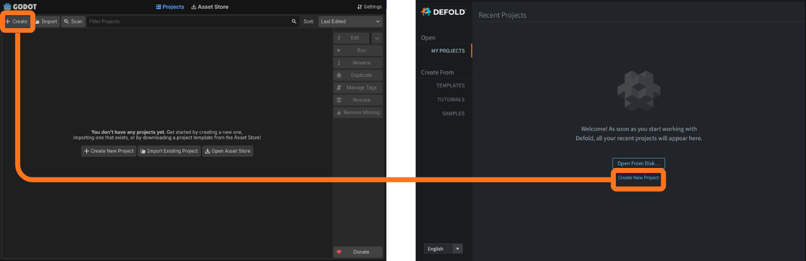

You can create a new project in Defold from:

- **Templates** for basic empty or platform specific projects.
- **Tutorials** for guided introduction projects.
- **Samples** for examples and starter kits you can run and explore.                    

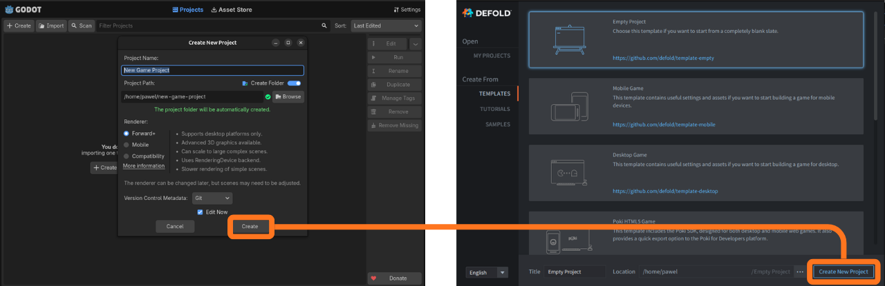

Defold Samples include starter projects and examples, similar to the starter kits and examples in the Godot Asset Store:

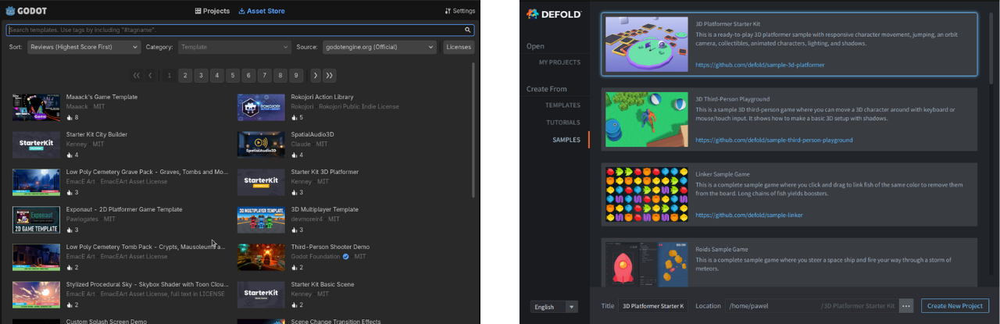

:[Hello World](../shared/hello-world.md)

---

## Defold editor overview

The main panes will look familiar, although their names and positions differ. We adjusted the panels in the Godot Editor to make it similar to the default Defold view for a quick comparison:

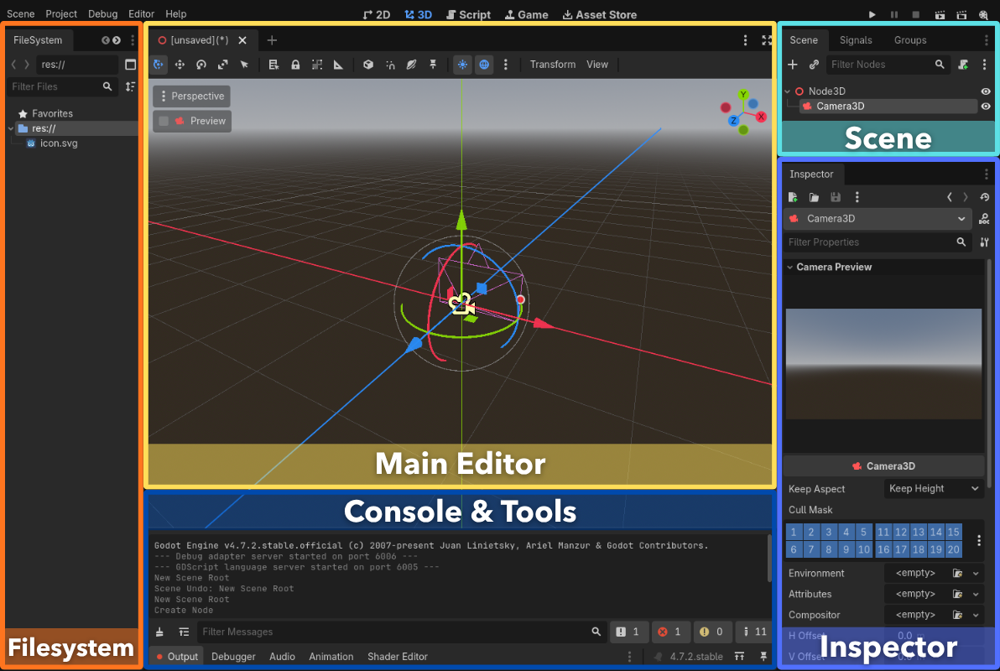
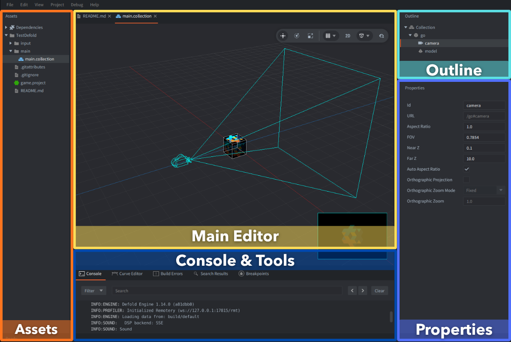

| Godot | Defold | Comments for Defold editor |
|---|---|---|
| FileSystem dock | Assets | To manage files and folders in your project - 1:1 with your project directory on your disk. |
| 2D/3D view and resource editors | Main editor | Changes with the file you open: a collection, GUI, atlas, script, and so on. Can be split into two panes. |
| Scene dock | Outline | Shows the structure of the current resource. It is not a global runtime scene tree. |
| Inspector | Properties | Shows properties for the selected object, component, or resource. |
| Output and Debugger | Tools | Includes Console, Build Errors, Search Results, and the debugger. |
| Version control integration | Changed Files | Shows changes when the project uses Git. |

In the 3D Editor in Defold, you can also see a toolbar in the top right corner - read more about it [in the Scene Editing manual](/manuals/scene-editing/#toolbar-overview).

### 2D and 3D scene orientation

:[2D and 3D scene orientation](../shared/2d-and-3d-scene-orientation.md)

### Panes

Defold panes cannot be undocked, but you can resize them by dragging their edges. You can also toggle their visibility with `F6`, `F7`, and `F8` or through the `View` menu:

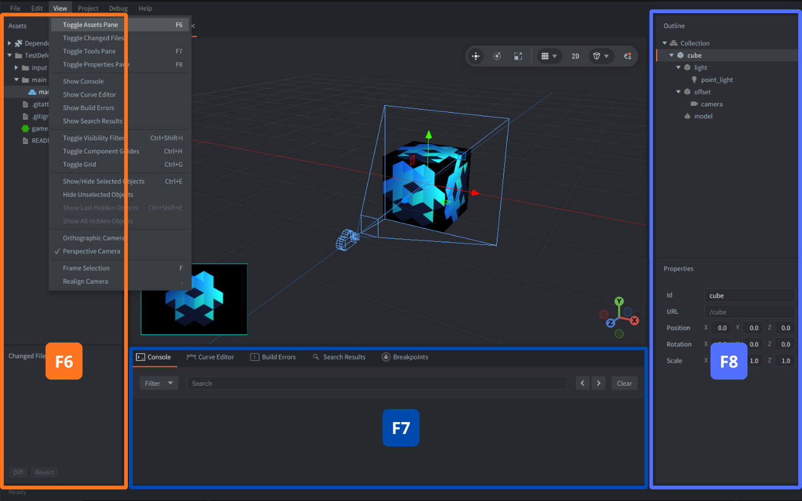

### Coordinates

With the default render script and no camera component in your Defold collection, the coordinates `(0, 0)` will appear at the bottom-left of the game window in a 2D setup, where positive Y points **up**, and positive X - right.

Godot's usual 2D screen coordinates have positive Y pointing **down**. Keep this difference in mind when transferring positions or movement code.

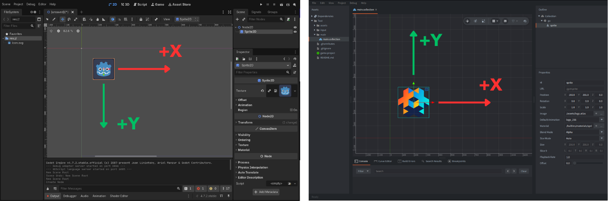

In Godot's 3D coordinate system, positive Y points up, as it does in Defold. Defold supports both 2D and 3D games using a shared 3D coordinate system. A typical 2D setup uses the XY plane with an orthographic projection. You can configure the camera differently if needed.

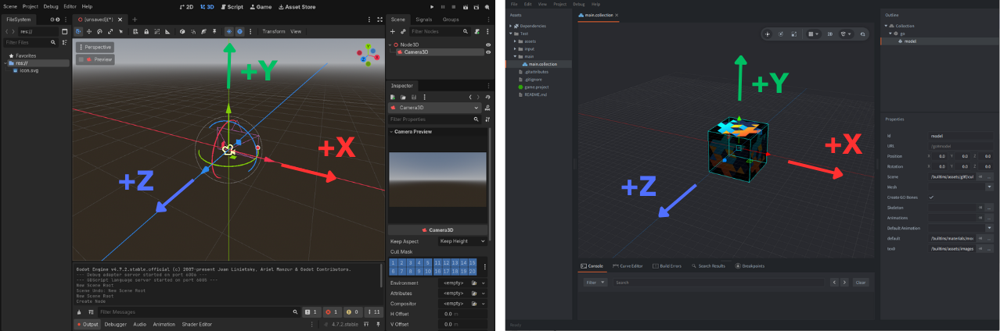

Read more details about the Defold Editor in the [Editor overview manual](/manuals/editor/).

---

## Key concepts

In Godot, you build **Scenes** from nodes. In Defold, you work with components, game objects, and collections of game objects.

In Godot, you might build e.g. a player from a `Node2D` with a `Sprite2D` child and attach a script to the root. You would put it in your first `Scene`.
In Defold, you might build the player from a game object containing `Sprite` and `Script` components. You would put it in a collection.

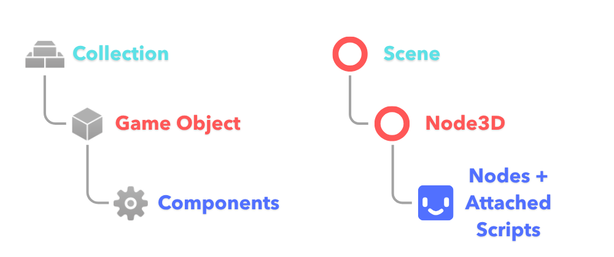

The [Building blocks manual](/manuals/building-blocks/) explains these concepts in detail.

### Game Objects

In Defold, a **Game Object** is a *container* for components and provides:

- **identity**
- **transform** (position, rotation, scale)

A game object can serve a role similar to a `Node2D` or `Node3D` in Godot. Defold has no separate 2D game-object type: all game objects use a 3D transform, including those in 2D games.

In Defold, game objects can be parented to other game objects so they inherit transforms. You can arrange these relationships in a collection or change them at runtime. Parenting does not change a game object's address.

In a collection, a game object can be defined directly in the `.collection` file as an **embedded** object, or added as a reference to a reusable `.go` prototype. Editing an embedded object's definition changes that collection, but it does not change other independently defined objects. Editing a `.go` prototype updates the instances that reference it, subject to any instance-specific overrides. Referenced component resources can also be shared, even by embedded objects, so edits to those resources can affect other objects using them. If a collection is reused, changes to its embedded objects appear wherever that collection is referenced.

### Components

Components are specialized building blocks that can supply e.g. visual appearance, physics functionality, audio or behavior for Game Objects.

Add a `Sprite` component to a game object to display an image, a `Sound` component to play audio, or a `Script` component to run Lua code.

Components belong to game objects and cannot have child components. To build a hierarchy, parent game objects to one another in a collection.

You also can't modify a component's behavior by attaching a script like in Godot. You can adjust the component via its Properties and you can create new custom components through Native Extensions, similarly to GDExtensions. Defold supports custom components, e.g. official [Rive](https://github.com/defold/extension-rive) and [Spine](https://github.com/defold/extension-spine) components, or community [Sprite Loop](https://github.com/Balkan-Ram-Games/spriteloop-defold) or [Object Interpolation](https://github.com/indiesoftby/defold-object-interpolation) components.

A script in Defold is a separate component that can be added to any Game Object. You can attach multiple components to a single game object, including scripts.

Because components are flat and decoupled from custom scripts, Defold packs them efficiently into memory taking advantage of a data-oriented design.

| Godot Node | Defold Component | Notes |
|---|---|---|
| `Sprite2D` / `AnimatedSprite2D` | [Sprite](/manuals/sprite/) | Renders 2D textures and flipbook animations from an atlas (texture of multiple images) or a tile source. |
| `Area2D` / `RigidBody2D` / `StaticBody2D` and their 3D counterparts | [Collision object](/manuals/physics-objects/) | Handles physics and triggers. Collision shapes are defined directly inside this component rather than as separate child Nodes. You can select static, dynamic, kinematic, or trigger type. |
| `.gd` script attached to a node | Script | Contains Lua code to drive logic, handle input, and control other components and game objects. |
| `TileMapLayer` | [Tilemap](/manuals/tilemap/) | Renders a grid-based map using a tile source and tilemap layers. |
| `Label` | [GUI text node](/manuals/gui-text/) | Use GUI text for interface text. For text in the game world, use a [Label component](/manuals/label/). |
| `AudioStreamPlayer` | [Sound](/manuals/sound/) | Plays audio. Configure Speed, Pan, and Gain. |
| `Camera2D` / `Camera3D` | [Camera](/manuals/camera/) | Supports orthographic and perspective projection. |
| `Control` hierarchy / `CanvasLayer` | [GUI](/manuals/gui/) | Defold has a separate hierarchy of nodes (e.g. Box, Text, Pie) inside a GUI component and a dedicated `.gui_script` for GUI handling. |
| `MeshInstance3D` | [Model](/manuals/model/) or [Mesh](/manuals/mesh/) | Model supports imported 3D content, and Mesh supports custom geometry from a buffer. |
| `CPUParticles2D` / `GPUParticles2D` and their 3D counterparts | [ParticleFX](/manuals/particlefx/) | Emits 2D/3D particles configured in Defold's particle editor. |
| `PackedScene.instantiate()` | Factory / Collection Factory | Defold has separate components for defining which game objects or collections can be spawned at runtime. |

### Collections and worlds

A **Collection** describes game objects, their components, and their parent-child relationships. You can include collections inside other collections to reuse a group of objects. It's similar to a Nested Scene in Godot. Defold does not provide Godot's general-purpose inherited-scene workflow. Instead, reuse prototypes and collections, and customize instances through properties or scripts.

Note that a collection file is not a runtime entity. There is no collection object you can call methods on, and no root node corresponding to the collection itself. The collection file contains definitions that Defold uses to create game objects, components, and their hierarchy at runtime.

Defold starts your game by reading the `game.project` file, which defines which collection to load first - configured in **Bootstrap ▸ Main Collection**. This loads your initial game world. Objects placed in nested collections become part of that same world.

A **Collection Factory** component instantiates a group of game objects and their components in the **existing** world that contains the factory.

A **Collection Proxy**, however, loads a separate collection - creating a **new world** with its own address namespace and physics simulation. This distinction matters when choosing e.g. how to spawn an enemy in an existing level to react to its geometry or load a completely new level, possibly asynchronously. Those operations are covered below.

Godot uses `PackedScene` for both instantiation and scene switching. As a comparison, switching scenes with the `SceneTree` is similar to loading a separate world with a collection proxy.

Let's summarize it all:

| Godot | Defold | Notes |
|---|---|---|
| `Node3D` with child nodes | Game object with components | Components provide capabilities and behaviour. Game objects provide transforms and identity. |
| `Node2D` / `Node3D` transform | Game object's transform | Built into every game object. |
| Scene / `PackedScene` | Game object prototype (`.go`) or collection (`.collection`) | A prototype describes one object. A collection describes a group of objects with hierarchy. |
| `PackedScene.instantiate()` | Factory or collection factory | Creates a game object or a group of game objects in the current world and returns their identifiers. |
| Scene switching through `SceneTree` + `PackedScene.instantiate()` | Collection proxy | Loads and creates a new separate world and spawns game objects inside it. |

---

## Code writing

Defold Editor comes with a built-in text editor for all text files and scripts. Defold supports auto-completion, formatting, Structure (layout with data and functions) and more. Check out the details in [Using the built-in Code Editor manual](/manuals/writing-code/#using-the-built-in-code-editor).

You can also open all Defold text-based files and scripts in an external editor. Defold supports a handful of features for easier integration and usage of Defold from external tools, like VS Code. Read more details in [Using an external code editor manual](/manuals/writing-code/#using-an-external-code-editor)

### Lua and scripts

Defold gameplay scripts use the Lua language. It might feel similar to GDScript, but there are some meaningful differences. Defold also supports Teal - a statically typed dialect of Lua. Defold can also utilise Native Extensions written in C, C++, C#, Objective-C, Java, or JavaScript, depending on the target platform, similar to GDExtensions, but we'll talk about them separately.

In Defold you will mainly work with these Lua files:

| File | Purpose |
|---|---|
| `.script` | Game logic and behavior, using APIs such as `go`, `factory`, `sprite`, `tilemap`, or `physics` to control other game objects and components. |
| `.gui_script` | Specialized for GUI, defines behavior using the `gui` API. |
| `.render_script` | Rendering, using the `render` API. |
| `.lua` | Reusable Lua modules loaded with `require()`, imagine code libraries or utility scripts. |

Lua tables can hold data, functions, or both. You do not need to recreate GDScript's class hierarchy to organize your code. Put reusable logic in modules, and call it from the script that owns the relevant behavior.

Defold uses Lua 5.1-compatible scripting. For language differences and platform details, read [Lua in Defold](/manuals/lua/).

### Application lifecycle

In general a Defold game starts with an initialization phase and ends with a finalization phase. Between these phases, each frame an update loop is running, updating transforms, components, executing code and handling messages.

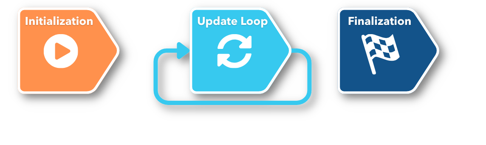

Defold scripts use a set of application lifetime Lua function callbacks, similarly to other game engines, including Godot. The callback names in Defold are different, but their roles should be familiar:

| Godot | Defold | Notes |
|---|---|---|
| `_ready()` | `init(self)` | Initialize instance data and acquire input focus if needed. |
| `_process(delta)` | `update(self, dt)` | Update once per frame. |
| `_physics_process(delta)` | `fixed_update(self, dt)` | Update at a fixed timestep when enabled. |
| `_input(event)` | `on_input(self, action_id, action)` | Handle input delivered to the object's input listeners. |
| Signal callback | `on_message(self, message_id, message, sender)` | Receive messages from scripts or engine components. |
| `_exit_tree()` | `final(self)` | Clean up when the script instance is finalized. |

Godot calls children's `_ready()` before their parent's. Defold does not guarantee initialization or update order between game objects and components. Use messages to coordinate objects instead of relying on one object's `init()` running first.

If you intend to use `fixed_update()`, set **Engine ▸ Fixed Update Frequency** to a positive value in `game.project`, such as 60 and enable **Physics ▸ Use Fixed Timestep**.

Defold also provides `late_update(self, dt)` for work after regular updates and before rendering, such as adjusting a camera. A final transform update can still follow it if needed.

Note that disabling a component is different from deleting it.

Read the [Application lifecycle manual](/manuals/application-lifecycle/) for the full sequence and the callbacks available to each script type.

### Instance data vs local data

Each script component instance receives its own `self` in callbacks for storing instance state, such as `self.health` or `self.target`. Even two script components on the same game object have separate `self` values. `self` is userdata with table-like field access, not a Lua table, so operations such as `pairs(self)` do not work. In Godot, instance variables (`var`) serve a similar purpose.

Godot treats every `.gd` file as a Class Blueprint. When you attach a `.gd` file to 10 enemies, Godot instantiates 10 separate class objects, giving each one its own copy of top-level var declarations.

Defold runs a `.script` file as a chunk of Lua code when the script resource is loaded. Each script component instance receives its own `self` in lifecycle callbacks such as `init(self)` and `update(self, dt)`.

This is different from a local variable declared at the top of a Defold `.script` file - as it is then shared by **all instances** of that script. In Godot, static variables (`static var`) map to Defold's file-level local variables.

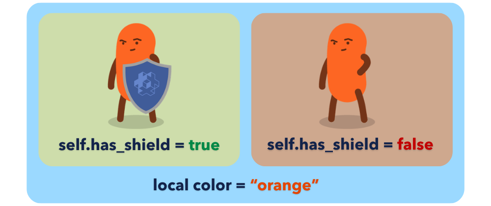

In the above example, changing one instance's `self.has_shield` to `true` does not affect the other instances. On the other hand, the local variable `color` is shared by instances using this script file, so changing it could affect all of those instances.

### Properties

For an editable instance's **property**, use `go.property()`. The property is available through `self`. Like `@export`, this exposes a value in the editor. In Defold you will see them in `Properties`:

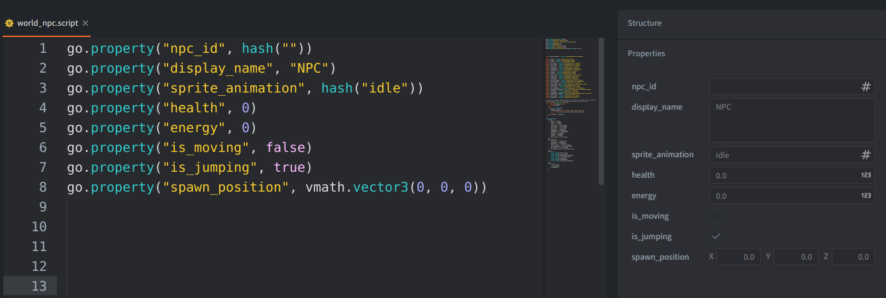

For comparison, in Godot **GDScript**, attached to a `Node3D`:

```gdscript
extends Node3D

@export var speed: float = 100.0

func _process(delta):
    position.x += speed * delta
```

In Defold **Lua**, attached as a script component:

```lua
go.property("speed", 100)

function update(self, dt)
    local position = go.get_position()
    position.x = position.x + self.speed * dt
    go.set_position(position)
end
```

The Lua property is available as `self.speed`, and can also be supplied when spawning an object. Defold transforms use `vector3` even in 2D, so you still specify a Z coordinate.

See [Script properties](/manuals/script-properties/) for supported property types and [Scripts](/manuals/script/) for more examples.

---

## Messages and addressing

Godot Signals let an object announce an event to connected listeners. Defold scripts commonly communicate by posting a message to an object or component address.

In Defold you can post a message using the `msg.post()` function from any script and receive and handle any messages in the script's `on_message()` callback.

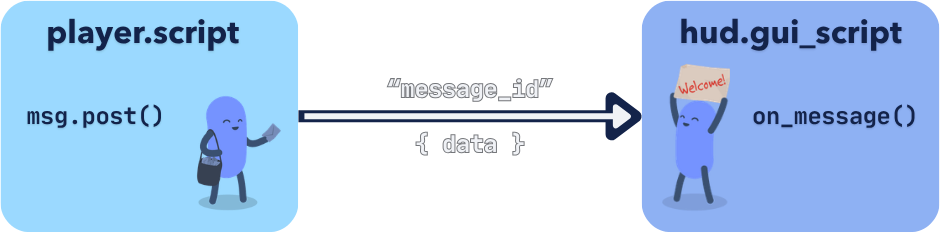

For example, a player can report a score change to a HUD.

In Godot, the `Player` (`Node2D`) uses `player.gd`. Its sibling `GUI` (`CanvasLayer`) uses `gui.gd` and contains a `ScoreText` Label:

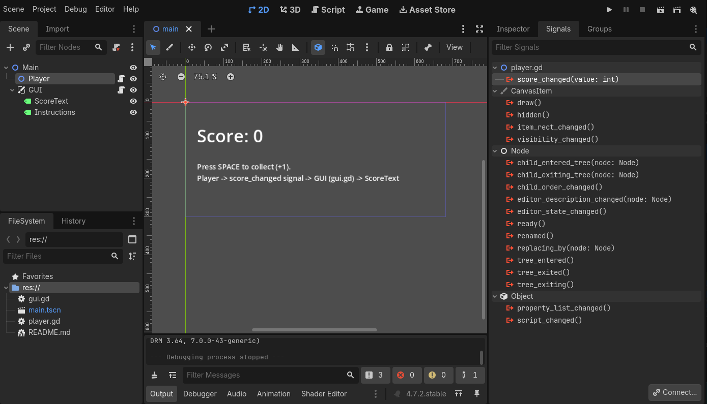

In Defold, the `player` game object has `player.script`. The `hud` game object has a `gui` component containing a `score` text node and using `hud.gui_script`:

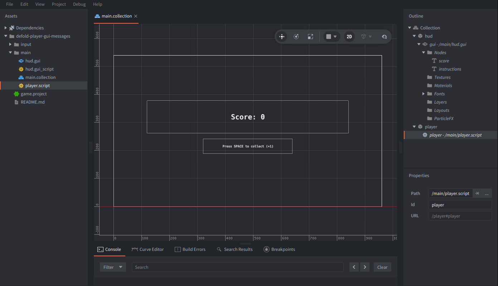

### Sending messages

The Player and GUI are siblings in Godot. The Player connects its `score_changed` signal to a method in the GUI script, which then updates the Label.

**GDScript**, `player.gd`:

```gdscript
extends Node2D

signal score_changed(value: int)
var score: int = 0

func _ready() -> void:
    score_changed.connect(get_node("../GUI").set_score)

func collect() -> void:
    score += 1
    score_changed.emit(score)

func _unhandled_input(event: InputEvent) -> void:
    if event is InputEventKey and event.pressed and not event.echo:
        if event.keycode == KEY_SPACE:
            collect()
```

In Godot, the `Player` defines a signal named `score_changed`. During `_ready()`, it connects that signal to the GUI script's `set_score()` method. Whenever `collect()` is called, the score increases and the signal emits the new value.

In Defold, bind the **Space** key to the `collect` action in your input bindings. The `player` initializes its score in `init()` and requests input focus to receive input events. When `collect(self)` is called, it increments the score and posts a `score_changed` message to `/hud#gui`, carrying the new score in the message table.

**Lua**, `player.script`:

```lua
function init(self)
    self.score = 0
    msg.post(".", "acquire_input_focus")
end

local function collect(self)
    self.score = self.score + 1
    msg.post("/hud#gui", "score_changed", { value = self.score })
end

function on_input(self, action_id, action)
    if action_id == hash("collect") and action.pressed then
        collect(self)
    end
end
```

Unlike Godot, Defold does not require the Player to connect a signal to the GUI beforehand. Instead, it sends the message to the receiver's address. Using it with Defold's relative addressing allows you to write reusable functions and scripts.

### Receiving and handling messages

Then, the GUI receives the value and updates its score text.

**GDScript**, `gui.gd`, attached to `GUI` (`CanvasLayer`):

```gdscript
extends CanvasLayer

func set_score(value: int) -> void:
    $ScoreText.text = str(value)
```

The GUI script receives the emitted value through `set_score()`. It then updates its child `ScoreText` Label. The Player does not access or modify the Label directly.

The Defold GUI script first retrieves its score text node using `gui.get_node()`. When the GUI component receives a message, `on_message()` checks its identifier. If it is `score_changed`, the script reads `message.value` and updates the text using `gui.set_text()`.

**Lua**, `hud.gui_script`, assigned to the GUI component:

```lua
function init(self)
    self.score_node = gui.get_node("score")
end

function on_message(self, message_id, message, sender)
    if message_id == hash("score_changed") then
        gui.set_text(self.score_node, tostring(message.value))
    end
end
```

Importantly, the Defold message is addressed to the GUI **component**, not directly to the score text node. The receiving GUI script decides how to use the message and which text node to update.

Both screenshots show the initial text `Score: 0`. These example scripts replace the entire text with the numeric value after a score change.

`msg.post()` queues the message for later dispatch instead of immediately calling the receiver, and it does not return a result from the receiving script. Messages are often dispatched within the same frame, but this is not guaranteed: dispatch passes are bounded, so a long message chain may extend beyond the frame. If the receiver needs to reply, it can post another message to the original sender using the sender URL supplied to `on_message()`. See [Message chains](/manuals/message-passing/#message-chains) for details.

There is also a difference when communicating with multiple listeners. A Godot signal can be connected to several methods, and emitting it notifies all connected listeners. A Defold message is sent to a particular address. To notify multiple recipients, the sender can post separate messages or the game can implement a subscription system.

### Finding an object - addressing in Defold

There is no general `get_node()` equivalent that returns a Lua object representing another script instance. You use an identifier or **URL** with an engine API, such as `go.get_position()`, `go.set()`, or `msg.post()`.

A URL in Defold has three parts:

```lua
socket:/path#component
```

- **Socket** - identifies a world, such as a bootstrap main collection, or a world loaded through a collection proxy.
- **Path** - identifies a game object within that world.
- **Component** - identifies a component on that object.

You can use a full URL or omit parts to form a relative address. For example, a script can use only the component part to address a component on the same game object. Common forms are:

| Address | Meaning |
|---|---|
| `"#sprite"` | The sprite component on the current game object. |
| `"/player#controller"` | The controller component on the player in the current world. |
| `"level:/player#controller"` | The controller component in the loaded world named level. |
| `"."` | Shorthand for the current `Game Object`. A message is delivered to its components. |
| `"#"` | Shorthand for the current `Script` component. |

Nested collections can contribute prefixes to object paths, but transform parenting does not change an object's address.

For dynamically spawned objects, keep the identifiers returned by `factory.create()` or `collectionfactory.create()` in the code.

Godot groups used for gameplay queries or `call_group()` have no built-in equivalent counterpart in Defold and will require your own registry or message routing.

Defold's physics groups of the collision objects are collision filters (which group collides with other groups defined as a mask) and are not related to messaging.

Read the [Addressing](/manuals/addressing/) and [Message passing](/manuals/message-passing/) manuals early. Many first-project questions are answered there.

---

## Autoloads and shared state

You can also use Lua modules for direct Lua function calls instead of communication using the Defold messaging system.

If you use an **Autoload** in Godot to hold shared data, a Lua module in Defold can serve that purpose. Save the module as e.g. `modules/game_state.lua`, then load it with `require "modules.game_state"`.

**GDScript**, with `game_state.gd` registered as an Autoload named `GameState`:

```gdscript
extends Node
var score: int = 0
```

Equivalent in **Lua**, `modules/game_state.lua`:

```lua
local M = { score = 0 }
return M
```

Another script can then use the shared data:

**GDScript**:

```gdscript
func add_point():
    GameState.score += 1
```

**Lua**:

```lua
local game_state = require "modules.game_state"

local function add_point()
    game_state.score = game_state.score + 1
end
```

Function `require()` caches the module, so callers share its returned table. Game object, GUI, and render scripts share the Lua state. Note that unloading a collection proxy does not reset module data. You can reset it explicitly when starting a new game.

Remember that a Lua module in Defold is not a game object and does not receive lifecycle, message or input callbacks. If you're using Autoload to run logic every frame, play sounds, or manage level transitions, put that behavior in a script of an object in the collection. You can also explicitly create and call a function to handle the lifecycle callbacks in the scripts.

Lua module `my_module`:

```lua
local M = {}

function M.init(self)
    print("My init")
end

return M
```

Lua script:
```lua
local my_module = require "my_module"

function init(self)
    my_module.init(self)
end
```

For per-instance data, a module can return a function that creates a new table, which you then can store on `self`. See the [Modules manual](/manuals/modules/) for more details and hot reload considerations.

---

## Spawning objects and loading levels

### Factories

To spawn one game object in Defold, add a **Factory** component and set its **Prototype** to a given `.go` file.

Similarly for collections, add a **Collection Factory** to use a given `.collection` file and it will spawn a group of objects, preserving their parent-child relationships.

For example in Godot, the spawner below is a `Node2D` at the origin of our scene with a script that instantiates bullets:

**GDScript**:

```gdscript
extends Node2D

const BULLET = preload("res://bullet.tscn")

func spawn_bullet():
    var bullet = BULLET.instantiate()
    bullet.position = Vector2(200, 100)
    add_child(bullet)
    return bullet
```

In Defold, we have a game object with the factory component with the id `bullet_factory` and we can use the `factory.create()` function to use it to spawn the game object it references as `Prototype`:

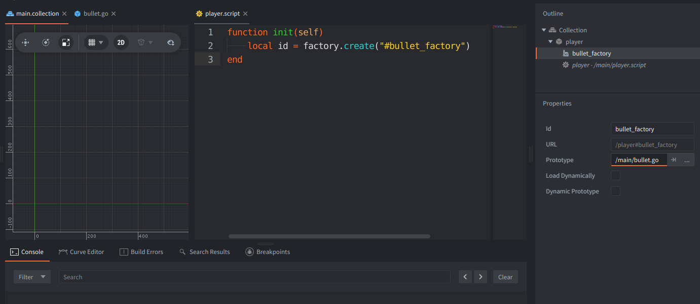

The screenshot calls the factory in `init()`. The following helper shows how to supply a spawn position and return the identifier:

**Lua**:

```lua
local function spawn_bullet()
    local position = vmath.vector3(200, 100, 0)
    local id = factory.create("#bullet_factory", position)
    return id
end
```

The Defold function returns an object **identifier** - it's not an object with methods. Pass it to `go` functions, or construct a component URL with `msg.url(nil, id, "controller")` if the spawned object has a script component named `controller`.

A collection factory returns a table mapping prototype object ids to spawned ids. Keep it to delete the spawned objects later:

```lua
local ids = collectionfactory.create("#collection_factory")
-- Later, when the spawned objects are no longer needed:
go.delete(ids)
```

Unlike Godot's `queue_free()`, `go.delete(id)` does not recursively delete children by default. Use `go.delete(id, true)` to delete an object and its current descendants. Passing the factory's table to `go.delete(ids)` deletes the listed objects without recursively deleting other objects parented to them later. Recursive deletion of a known root also deletes any other objects currently parented beneath it. See [`go.delete()`](/ref/go/#go.delete).

Defold allocates capacity for game objects and components in advance. If spawning fails because a limit is reached, check **Collection ▸ Max Instances** and the relevant component limits in `game.project`. Increasing every limit also increases memory use.

Read the [Factory](/manuals/factory/) and [Collection factory](/manuals/collection-factory/) manuals for properties, transforms, and dynamic loading.

### Collection proxies

For collection loading in Defold, e.g. for level loading, put a **Collection Proxy** component on a persistent object and set its **Collection** property to the proper `.collection` file.

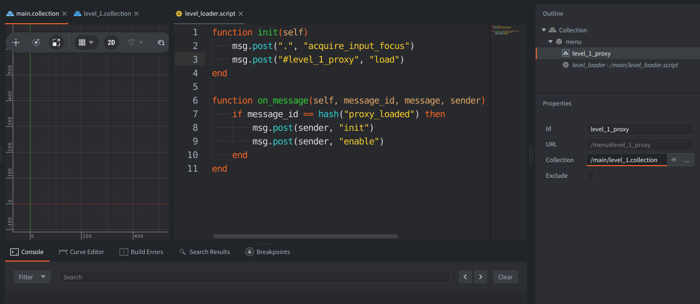

Request `"load"` or `"async_load"` with `msg.post()`. The proxy will reply with a `"proxy_loaded"` message when loading is finished. You can then send `"init"` and `"enable"` to the loaded collection (using its address passed to on_message via `sender`) to initialize and start the world.

This gives you explicit control over which worlds are loaded and running. It does not automatically replace the current scene as a Godot scene change does, so if you want to unload other collections do it using an `"unload"` message to remove the world. The proxy will automatically disable and finalize it before unloading, and then reply with `"proxy_unloaded"`. You can also send `"disable"` and `"final"` separately if you need control over those stages.

Note that collision objects in different proxy worlds do not collide with each other, even if both are loaded at the same time and e.g. visible on your screen. Game objects and components can, however, exchange messages using URLs that include the destination socket.

Read the [Collection proxy manual](/manuals/collection-proxy/) before implementing transitions. It covers loading, unloading, input forwarding, and controlling the update rate of a loaded world.

## Project resources and assets

A Defold project is a folder containing `game.project`, scripts, and resources. The **Assets** pane mirrors that folder structure. Most Defold resource definitions are text files, so you can inspect changes in version control systems.

Defold builds source resources into runtime formats when you build or bundle the game. Resources referenced from the main collection, factories, and collection proxies form a dependency tree. When you put an unreferenced file in the project folder it is not included in the bundle.

Godot's custom `Resource` classes and `.tres` files do not have one general-purpose equivalent in Defold. Use Defold's resource types for engine content and Lua tables or data files for your own game data. The [`resource` API](/ref/resource/) lets you create or modify supported resources at runtime.

Resources for a normal factory are loaded with that factory. Enable **Load Dynamically** if you want to defer loading, and use `factory.load()` or `collectionfactory.load()` to prepare them asynchronously. Collection proxy content is loaded when you request it.

Loading content later from the bundle and downloading content later are different tasks. [Live Update](/manuals/live-update/) in Defold supports excluding content from the initial bundle and making it available separately.

Read more about [Resource management in the manual](/manuals/resource/).

---

## Input

Godot's `InputMap` corresponds to Defold's `.input_binding` file. You can assign a device (keyboard, gamepad, mouse, touch, text) trigger to an action name, and select the binding file under **Input ▸ Game Binding** in `game.project`.

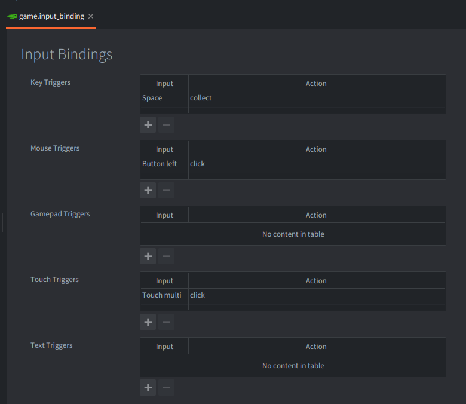

In Defold, the receiving game object must **acquire input focus**. This places it on the input stack. Its script and GUI components can then receive `on_input()` callbacks.

The screenshot shows Space bound to `collect`. The following separate example uses an action named `fire`, which you must also add to your input bindings:

**GDScript**:

```gdscript
extends Node

func _input(event):
    if event.is_action_pressed("fire"):
        print("Fire")
```

**Lua**:

```lua
function init(self)
    msg.post(".", "acquire_input_focus")
end

function on_input(self, action_id, action)
    if action_id == hash("fire") and action.pressed then
        print("Fire")
    end
end
```

The `action` table includes values such as `pressed`, `released`, and `value`, depending on the input.

Input travels through the stack from the most recently focused listener. Return `true` from `on_input()` to consume an action, for example when a menu handles a click.

For a proxy-loaded world, the object holding the proxy must acquire input focus as well as the listeners inside that world. Missing either step is a common reason for a working input script to stop receiving input after a level change.

Read the [Input manual](/manuals/input/), [Mouse and touch](/manuals/input-mouse-and-touch/), and [Gamepads](/manuals/input-gamepads/) for more details.

---

## Physics and collisions

A Defold **Collision Object** is an equivalent to Godot's physics bodies. It combines physics settings **and** collision shapes in a single component. In Defold you can choose to use 2D or 3D physics in `game.project`, and additionally choose which physics engine version is used or disable physics altogether in the App Manifest.

Defold offers 4 Collision Object types:

| Godot | Defold type | Notes |
|---|---|---|
| `StaticBody2D` / `3D` | `Static` | Does not move. Dynamic objects react to it. |
| `RigidBody2D` / `3D` | `Dynamic` | The physics engine simulates motion and resolves collisions. |
| `CharacterBody2D` / `3D` | `Kinematic` | The physics engine gives you all data about collisions, but your code must react to and resolve them. |
| `Area2D` | `Trigger` | Reports only entry and exit events without a physical response. |

A kinematic object in Defold does not behave exactly like a `CharacterBody2D` with `move_and_slide()`. Defold detects contacts and gives you all data in the collision response message, but your script supplies the movement and response. Check the [Resolving collisions manual](/manuals/physics-resolving-collisions/) when building a character controller.

Groups and Masks use names rather than numbered collision layers. **Both objects must include the other's group in their masks** for a collision to be registered.

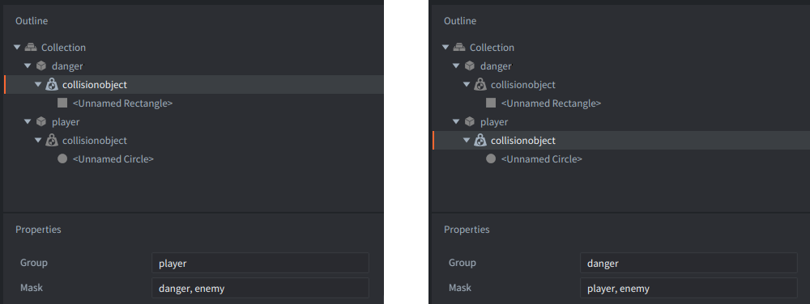

In this screenshot, the game object named `danger` uses the `player` group, while the object named `player` uses the `danger` group. Group names do not have to match object ids, and the masks still allow these two groups to interact.

By default, collision objects send messages to scripts on their game objects. Handle `"collision_response"`, `"contact_point_response"`, or `"trigger_response"` in `on_message()`. Trigger messages include an `enter` field to distinguish entry from exit. Collision and contact messages can recur while objects remain in contact, so do not assume each message represents a new hit.

You can also handle physics events through a [collision events listener](/manuals/physics-events/). You have to choose one approach deliberately, as using a listener replaces the default physics message dispatch, and messages won't be sent anymore.

There are different primitive and complex collision shapes available. Read more in the [Shapes manual](/manuals/physics-shapes).

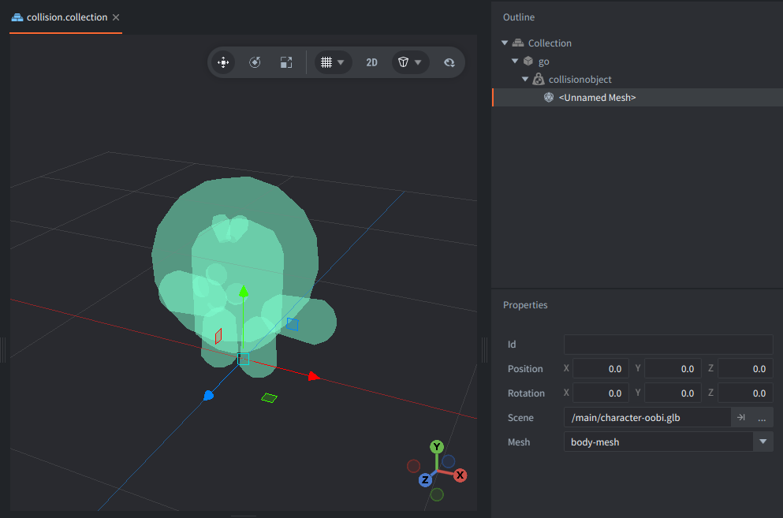

Read the [Physics overview](/manuals/physics/), [Collision objects](/manuals/physics-objects/), [Collision messages](/manuals/physics-messages/), and [Ray casts](/manuals/physics-ray-casts/) for more information and APIs.

---

## GUI

Defold's UI lives in a **GUI component**, created from a `.gui` file. Inside it, you can arrange GUI nodes such as boxes, text, and pies. A dedicated `.gui_script` controls the GUI component, similar to a script attached to a `CanvasLayer` in Godot.

These nodes belong to the GUI, not the game object's transform hierarchy. By default, GUI is drawn on top of the game and does not move with the game camera or the object holding the GUI component.

Assign a `.gui_script` to control the nodes with `gui.get_node()`, `gui.set_text()`, and other `gui` functions. The `gui` API is available only in GUI scripts, while the `go` API is only for game object scripts. Use messages between the two, as in the score example above.

Templates let you reuse another GUI's node hierarchy - it's similar to reusing a node in Godot.

Defold supplies very simple nodes as building blocks for UI rather than a set of ready-made widgets such as Godot's Button or layout Containers. To make a button, combine e.g. a box and text with input handling in the GUI script, and use `gui.pick_node()` to check whether a pointer is over it.

Defold also supports **Layers** in GUI, similarly to layers in Godot's `CanvasLayer`. The layers in Defold are names rather than numbers, and their order in "Layers" defines the draw order.

Anchors, pivots, adjust modes, and [GUI layouts](/manuals/gui-layouts/) help adapt your interface to different screens. They are similar, but do not perform the exact same job as Godot's layout Containers.

For a larger or more complex UI, you can add your own layout and widget code or use a community library such as [Druid](https://defold.com/assets/druid/).

Read the [GUI](/manuals/gui/) and [GUI script](/manuals/gui-script/) manuals for more details.

## Animation

Defold has several animation tools rather than a single equivalent to `AnimationPlayer`:

- **Flipbook animation** plays image sequences on sprites and GUI boxes.
- **Model animation** plays imported skeletal animations on 3D models.
- **Property animation** interpolates values with `go.animate()` or `gui.animate()`.
- **[Spine](https://github.com/defold/extension-spine)**, **[Rive](https://github.com/defold/extension-rive)** or **[SpriteLoop](https://github.com/Balkan-Ram-Games/spriteloop-defold)** are additional animation formats available through extensions.

### Tweens - Defold property animations

A simple Godot Tween maps well to a property animation in Defold. These examples both move an object to `X = 200` over half a second:

**GDScript**, on a `Node2D`:

```gdscript
func move_to_target():
    var tween = create_tween()
    tween.set_trans(Tween.TRANS_QUAD)
    tween.set_ease(Tween.EASE_OUT)
    tween.tween_property(self, "position:x", 200.0, 0.5)
```

**Lua**, in a game object script:

```lua
local function move_to_target()
    go.animate(".", "position.x", go.PLAYBACK_ONCE_FORWARD,
        200, go.EASING_OUTQUAD, 0.5)
end
```

For sequences that change several properties, play sounds, or trigger gameplay events, coordinate the steps in Lua. Defold does not yet have a specialized animation timeline editor. The Curve Editor in Defold's Tools pane is used to edit ParticleFX property curves over a particle's lifetime.

See [Animation](/manuals/animation/), [Property animation](/manuals/property-animation/), [Flipbook animation](/manuals/flipbook-animation/), and [Model animation](/manuals/model-animation/). The overview also links to the Spine and Rive extensions.

## Tilemaps

A Defold `Tilemap` component uses a **tile source** containing a grid of tiles. You can paint tiles on layers in the built-in tilemap editor and change them at runtime through the `tilemap` API.

Defold's built-in tilemap uses a rectangular grid. Godot terrain sets and autotiling rules do not transfer directly to Defold yet. You can recreate the needed behavior in code or use a suitable external map tool with export to Defold, e.g. [Tiled](https://doc.mapeditor.org/en/stable/manual/export-defold/?utm_source=defold&utm_medium=referral&utm_campaign=defold&utm_content=defold-website) or [TileSetter](https://www.tilesetter.org/docs/exporting?utm_source=defold&utm_medium=referral&utm_campaign=defold&utm_content=defold-website#defold).

See the [Tilemap manual](/manuals/tilemap/).

---

## Rendering pipeline

Defold offers a fully scriptable rendering pipeline with a custom `.render` file, a `.render_script` and support for shaders. Defold does provide a built-in default rendering pipeline that can be used for most of the games.

The default render script in Defold handles common 2D and 3D content. A custom `.render_script` controls draw passes, render targets, and other rendering operations. Material tags let it select groups of components through render predicates. Defold supports PBR rendering out of the box. Additionally, there are a lot of custom rendering pipelines and shaders created by the community.


Defold uses GLSL shaders, with separate vertex and fragment files. Godot uses its own GLSL-like shading language with engine-specific built-ins, so shaders from Godot or other sources such as Shadertoy may need adaptation. See the [Shaders manual](/manuals/shader/) for Defold's shader requirements.

Defold **Materials** connect vertex and fragment programs (shaders), textures, and shader constants and attributes. The `builtins` folder contains the default materials, which are useful starting points.

Read [Rendering](/manuals/render/), [Materials](/manuals/material/), and [Shaders](/manuals/shader/) when you need to change the default behavior.

### Draw order and layers

Godot's integer `z_index` does not translate directly into a Defold property, as Z axis will always depend on the rendering setup and might not be the same as depth, when we move it. Defold is fundamentally a 3D engine under the hood, so it uses an actual spatial Z-axis coordinate rather than a dedicated 2D sorting integer like Godot's.

Nonetheless, in Defold's **default** orthographic setup, we only render objects with a Z-position between -1.0 and 1.0 (using decimals like 0.1 or 0.2 for layers), but this can be easily changed by sending a message to the render script. Within that range, in a simple default setup Defold uses the physical Z-position of a Game Object or Sprite component to sort depth, so higher Z values draw on top of lower Z values, so it can feel similar to `z_index` in Godot. However, if you switch to a perspective camera or modify the `.render_script` this may be changed.

GUI Nodes in Defold ignore world Z - by default GUI components are rendered in a separate pass after world sprites. Thus changing a GUI node's Z-position does not affect its draw order. Instead, GUI draw order is strictly determined by hierarchy order (top-to-bottom in the GUI's hierarchy in the Outline) and GUI `Layers`, which override node order to batch draw calls, so it's a bit similar to `CanvasLayer` layers.

### Cameras and coordinates

Attach a `Camera` component to a game object and move that object to move the camera. Configure orthographic projection for a typical 2D view or perspective projection for 3D.

With the default render script, the last enabled camera is used automatically. If you have zero cameras, the rendering will default to a 2D orthographic view. If you have one camera, it will be utilised. You can start with this setup and customize rendering when your game needs it.

A camera changes how world coordinates map to the screen. When handling pointer input in the world, use the [Camera API](/ref/camera/) conversion functions instead of assuming the pointer coordinates are world positions. GUI nodes picking still uses GUI coordinates, by default.

Read the [Camera manual](/manuals/camera/) for projection, zoom, and coordinate conversion.

---

## Exporting a game

Defold calls exporting **bundling**. Choose **Project ▸ Bundle**, select a target platform, and configure the bundle options. The editor provides all the build tools, so you do not need to install anything like Godot-style export templates separately.

The `game.project` holds project and platform settings, including the main collection, input bindings, display size, and more. Platform signing and store requirements may still apply, and projects with native extensions need a network connection to build a custom engine through the cloud build service, or you can set it up manually to work locally.

Your final bundle size depends on assets, extensions, and build settings. Generate a `Build Report` to see what your game includes.

Read [Bundling](/manuals/bundling/), [Project settings](/manuals/project-settings/), and [HTML5](/manuals/html5/). Test a bundle on your target platform early, especially if your game uses shaders, native extensions or platform services.

## Libraries and extensions

Defold projects can add **Library Dependencies** containing shared scripts and resources. Add their archive URLs in `game.project` and fetch the libraries. Defold [Asset Portal](https://defold.com/assets/) is a useful and recommended place to find them. There is a useful editor extension **Asset Store** that allows you to search for and download assets directly in Defold Editor, like in Godot.

For editor customization, **Editor Scripts and UI** can add commands, automate tasks, and create custom editor UI - maybe for faster level editing, resources creation, auto-tiling, or other common development tasks. They serve some of the purposes of Godot's `EditorPlugin` and `@tool`, but use Defold's own `editor` API and lifecycle.

For engine functionality beyond Lua, **Native Extensions** can expose native code to scripts or add components and platform integrations. They fill a similar role to GDExtension, with a different API and build process.

See [Libraries](/manuals/libraries/), [Editor scripts](/manuals/editor-scripts/), and [Native extensions](/manuals/extensions/).

## Hot reload

In Defold you can Hot Reload a running game. Build and run the game, edit a supported resource, save it, and then choose **File ▸ Hot Reload** to update it. Hot reload also works with a targeted debug build on a device.

Note that reloading a script does not call `init()` again. Existing instance data remains, so a new initialization value will not automatically appear on `self`. Use `on_reload(self)` if you need to adjust existing state, or rebuild when you need a fresh start. Reloading a Lua module that returns a new table does not replace references to the old table held by other scripts. See the [Modules manual](/manuals/modules/) for more details.

Read [Hot reload manual](/manuals/hot-reload/).

## Breakpoints and debugging

The editor provides breakpoints, stepping, and inspection through its built-in debugger. Use the Console for runtime output and Build Errors for build problems. The profiler helps you inspect frame time, memory, and rendering, while build reports show which resources contribute to bundle size.

See [Debugging game logic](/manuals/debugging-game-logic/), and [Profiling](/manuals/profiling/).

## Automated workflows

Defold supports automated workflows or AI-assisted development through several interfaces. Editor Scripts can automate repetitive tasks, while the editor's HTTP API, documented through OpenAPI, lets external tools and AI agents inspect projects, execute commands, and trigger builds. The engine's HTTP service and Automation Bridge extension enable runtime inspection, input simulation, and screenshots. Together, these tools allow AI coding agents such as Codex, Claude Code, and Cursor to modify projects, build games, test behavior, and fix problems in repeated cycles.

See [Automation](/manuals/automation/), [Editor HTTP API](/manuals/editor-http-api/), [Engine service](/manuals/engine-service/), and [Automated testing](/manuals/automated-testing/) for more details.

---

## Common pitfalls

### Treating a collection as a root node

A Defold collection describes game objects and their relationships, but it does not become a runtime root object. To coordinate the objects in a level, add a game object with its own script. See [Collections and worlds](#collections-and-worlds).

### Deleting a hierarchy

In Godot, `queue_free()` also deletes the node's descendants. In Defold, `go.delete(id)` leaves child game objects in place unless you request recursive deletion. See [Factories](#factories) for an example and for cleanup of objects spawned by a collection factory.

### Expecting scene inheritance

Defold does not provide the same inherited-scene workflow as Godot, so you cannot freely override a derived scene's structure in the same way. You can reuse prototypes and collections and customize instances through properties or scripts. See [Collections and worlds](#collections-and-worlds).

### Calling another script through an object reference

A Defold game object identifier does not provide general access to functions in another script instance. Use messages to communicate between components, or put shared functions in a Lua module. See [Messages and addressing](#messages-and-addressing) and [Autoloads and shared state](#autoloads-and-shared-state).

### Keeping instance state in a top-level local

A top-level local variable in a script file is shared by instances using that file. Changing it for one instance can therefore affect the others. Store individual instance state in `self`, as explained in [Instance data vs local data](#instance-data-vs-local-data).

### Assuming input is enabled automatically

A Defold game object must acquire input focus before its components can receive input. For a proxy-loaded world, the object holding the proxy also needs focus. See [Input](#input) for bindings, focus, and input-stack behavior.

### Expecting automatic sliding from a kinematic collider

Defold detects contacts for kinematic collision objects, but it does not automatically provide Godot's `move_and_slide()` behavior. Your script must handle the movement and collision response. See [Physics and collisions](#physics-and-collisions).

### Configuring only one collision mask

A collision will not be registered if only one object is configured to interact with the other. Both objects must include the other's group in their masks. See [Physics and collisions](#physics-and-collisions).

### Copying 2D coordinates unchanged

Godot and a typical Defold 2D setup use opposite Y-axis directions, so copied movement code may move objects in the wrong direction. Screen and world positions also differ when a camera is involved. See [Coordinates](#coordinates) and [Cameras and coordinates](#cameras-and-coordinates).

### Using world Z to sort GUI nodes

Changing a GUI node's Z position does not control its draw order in Defold. Use the GUI node order and layers instead, as explained in [Draw order and layers](#draw-order-and-layers).

### Expecting hot reload to restart the object

Hot reloading a script does not rerun `init()`, so existing instance state can retain its previous values. See [Hot reload](#hot-reload) for ways to handle state and module reloads.

### Expecting a level unload to clear shared state

Both Godot Autoload state and cached Lua-module state can persist across level changes, so reset shared data explicitly when needed. Unlike an Autoload node, a Lua module does not receive callbacks automatically. See [Autoloads and shared state](#autoloads-and-shared-state).

## Where to go from here?

Check out [Defold Learn Hub](https://defold.com/learn/) - it collects all manuals, examples, tutorials, videos, courses and more to help you get started and understand Defold more deeply. These are recommended to follow and check:

- [Building blocks](/manuals/building-blocks/)
- [Addressing](/manuals/addressing/)
- [Message passing](/manuals/message-passing/)
- [Defold examples](/examples/)
- [Tutorials](/tutorials/)
- [API reference](/ref/go/)

If you get stuck, ask on the [Defold Forum](https://forum.defold.com/) or [Discord](https://defold.com/discord/). A small project and a description of the Godot behavior you want to recreate make it easier for others to help.
