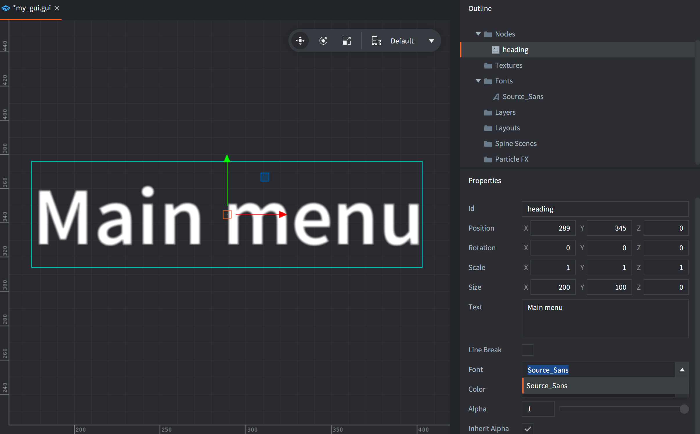
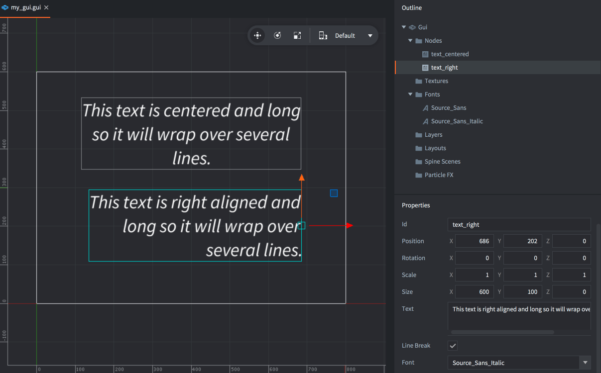

# GUI text nodes

Defold supports a specific type of GUI node that allows text to be rendered in a GUI scene. Any font resource added to a project can be used for text node rendering.

The editor preview supports text shaping and right-to-left layout using the engine's font renderer. See [text layout support](/manuals/font/#text-layout-support-eg-right-to-left) for the required font and App Manifest settings.

## Adding text nodes

The fonts that you wish to use in GUI text nodes must be added to the GUI component. Either right-click the *Fonts* folder, use the <kbd>GUI</kbd> top menu or press the corresponding keyboard shortcut.



Text nodes have a set of special properties:

*Font*
: Any text node you create must have the *Font* property set.

*Text*
: This property contains the text displayed.

*Line Break*
: Text alignment follows the pivot setting and setting this property allows the text to flow over several lines. The width of the node determines where the text will wrap.

## Vector fonts and color emoji

Follow the [Vector font setup](/manuals/font/#vector-fonts), add the `.font` resource to the GUI scene's *Fonts*, and select it on the text node. Set the font resource's *Material* to `/builtins/fonts/font-vector.material`. Use the node's *Font Size* to control the displayed size.

For color emoji, also complete the [COLRv1 fallback and bundling setup](/manuals/font/#color-emoji). Create a text node with the id `text`, leave its *Text* empty, and add the following to the GUI scene's `.gui_script`:

```lua
function init(self)
    local node = gui.get_node("text")
    local text = "Hello 😀 🍎 🚀"
    local font_resource = gui.get_font_resource(gui.get_font(node))
    -- Add the fallback once for this shared font resource.
    font.add_font(font_resource, "/fonts/NotoColorEmoji-Regular.ttf")
    font.prewarm_text(font_resource, text, function(self, request_id, result, err)
        if result then
            gui.set_text(node, text)
        else
            print("Could not prepare GUI text:", err)
        end
    end)
end
```

[`gui.get_font()`](/ref/gui/#gui.get_font) returns the font name within the GUI scene; [`gui.get_font_resource()`](/ref/gui/#gui.get_font_resource) resolves that name to the font resource used by `font.add_font()`. Other nodes and Labels sharing that resource also receive the fallback, so initialize it only once. The text is set after prewarming succeeds.

## Alignment

By setting the node pivot you can change the alignment mode for the text.

*Center*
: If the pivot is set to `Center`, `North` or `South`, the text is center-aligned.

*Left*
: If the pivot is set to any of the `West` modes, the text is left-aligned.

*Right*
: If the pivot is set to any of the `East` modes, the text is right-aligned.



## Modifying text nodes in runtime

Text nodes respond to any generic node manipulation functions for setting size, pivot, color and so forth. A few text node only functions exist:

* To change the font of a text node, use the [`gui.set_font()`](/ref/gui/#gui.set_font) function.
* To change the line break behavior of a text node, use the [`gui.set_line_break()`](/ref/gui/#gui.set_line_break) function.
* To change the content of a text node, use the [`gui.set_text()`](/ref/gui/#gui.set_text) function.

```lua
function on_message(self, message_id, message, sender)
    if message_id == hash("set_score") then
        local s = gui.get_node("score")
        gui.set_text(s, message.score)
    end
end
```
