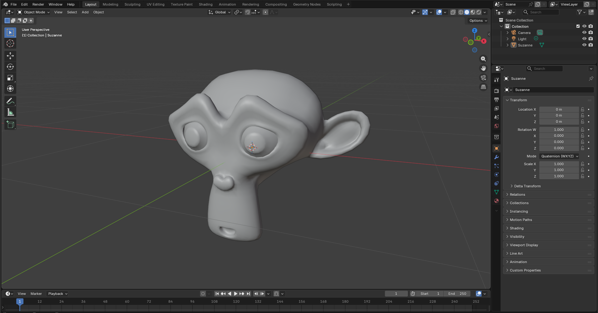
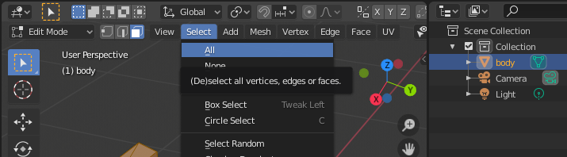
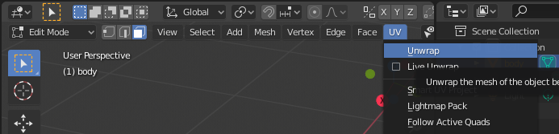
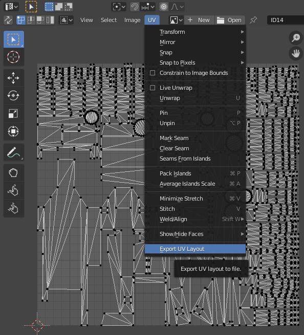
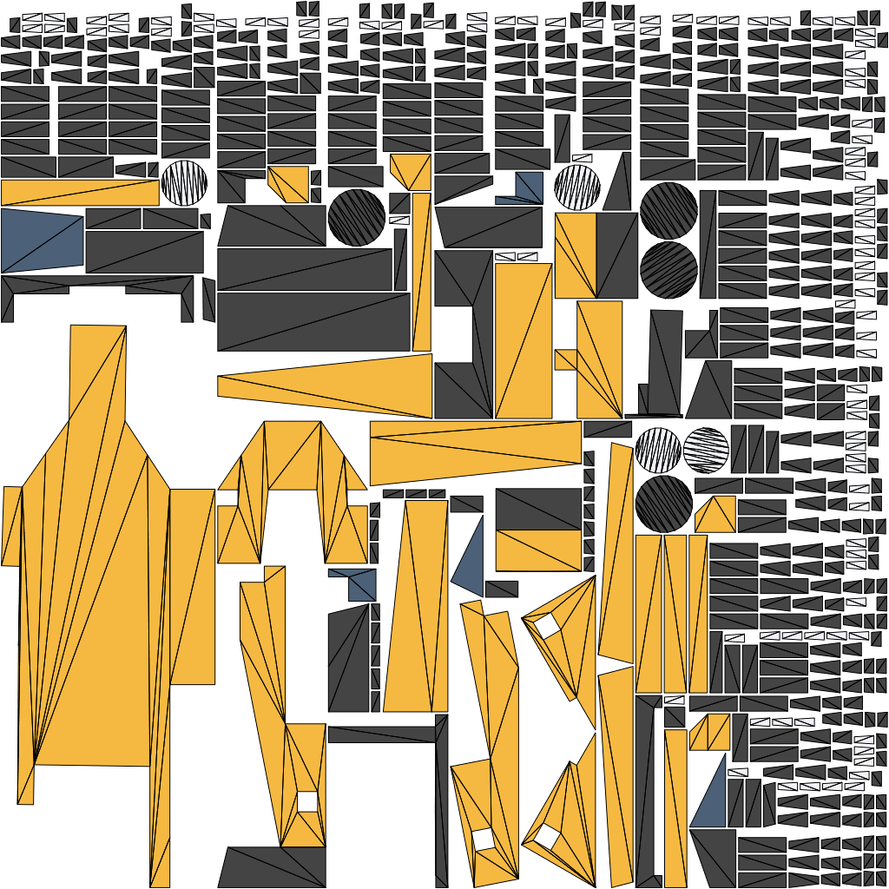
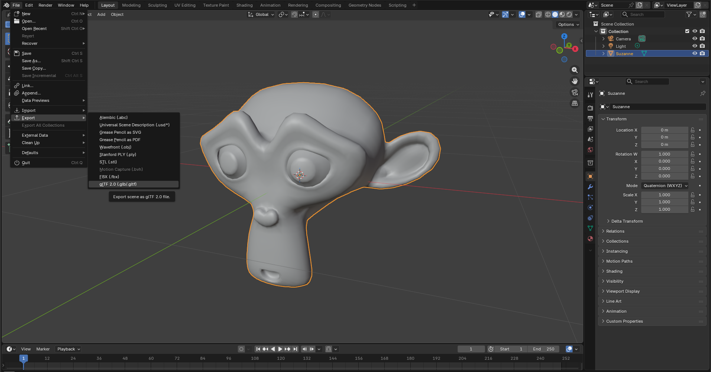
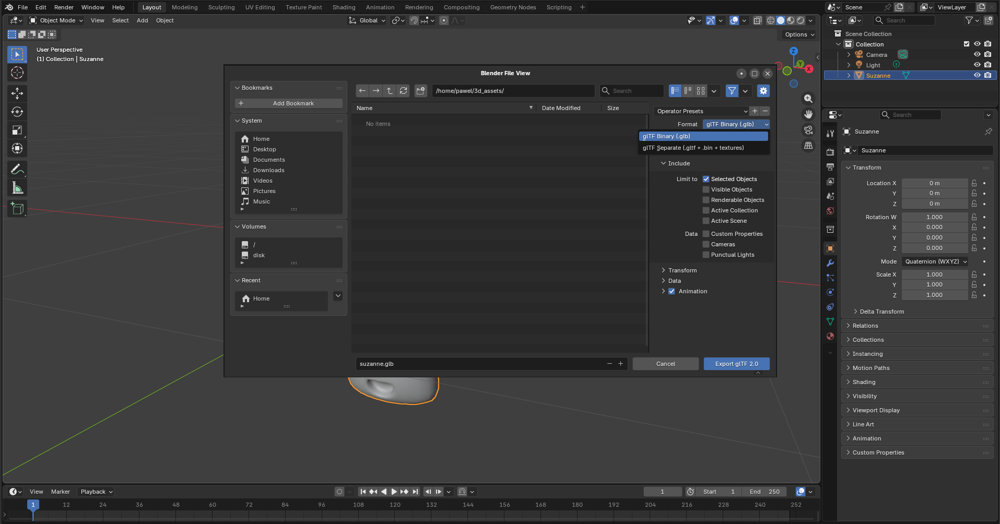

# Importing 3D models
Defold supports models, skeletons and animations in the glTF 2.0 (GL Transmission Format) format. Use *.gltf* or *.glb* files for 3D models. The glTF is a modern format designed for transferring and loading 3D data in game engines and real-time applications.

You can use tools such as Maya, 3ds Max, SketchUp and Blender to create or convert 3D models to glTF.

Blender is a powerful and popular 3D modeling, animation and rendering program. It runs on Windows, macOS and Linux and is freely available from [https://www.blender.org](https://www.blender.org).

## Importing to Defold
To import a model, drag and drop the *.gltf* or *.glb* file into the Defold editor *Assets pane*.

glTF can be stored in two common ways:

* *.glb* is a single binary file. It contains the model data and may also contain packed texture images. This is convenient when you want to move or store a model as one file.
* *.gltf* is a text-based JSON file. It usually references a separate *.bin* file for mesh data and separate texture images such as *.png*, *.jpg* or *.ktx2*. When using this variant, add all referenced files to the project and keep their relative paths intact.

Since Defold 1.14.1, embedded images can be used directly from a glTF or GLB file without extracting them into separate assets. External image and buffer files must still be imported with the model, with their relative paths preserved.

::: sidenote
Starting with Defold 1.13.0, Defold preserves the positions and transforms from the imported glTF file and does not automatically re-center the model during import. The editor preview and runtime use the imported transforms consistently: skinned or bone-parented meshes preserve their local, skeleton-relative transforms, while rigid meshes retain their flattened world placement.

Since Defold 1.13.2, a [Model component](/manuals/model/#model-properties) can select a single named mesh from the imported scene. Leaving its *Mesh* field empty uses the whole scene and preserves the transforms described above. Selecting a mesh uses its local geometry without the glTF node transforms, so place it using the model component or game object's transform.

If a model created with an older version of Defold changes position or orientation after being reimported, correct the transform in Blender or another authoring tool and export the *.gltf* or *.glb* file again.
:::

### Compressed geometry

Since Defold 1.14.1, *.gltf* and *.glb* sources can contain geometry compressed with Draco or Meshopt. The supported glTF compression extensions are:

| Compression | glTF extension |
| --- | --- |
| Draco | `KHR_draco_mesh_compression` |
| Meshopt | `EXT_meshopt_compression` and `KHR_meshopt_compression` |

Export or optimize your glTF 2.0 asset using one of these extensions, then import it using the same steps as an uncompressed model. Include any external buffers and textures and preserve their relative paths. Assign the imported file to a Model component's *Scene* property as usual.

Defold decodes the compressed geometry during import and build. The resulting model uses Defold's normal runtime geometry representation. This support does not enable Draco or Meshopt compression in the running engine, and a smaller source file does not guarantee a smaller game bundle.

### Browsing the imported scene

Expand a *.gltf* or *.glb* file in the *Assets* pane to browse its meshes, generated materials and embedded images. Opening the scene previews it with its defined materials and textures. You can also open an individual mesh for a preview.

The resources exposed inside the file are read-only. To create an editable Model resource for a mesh, copy the mesh and paste it into a project folder. The resulting *.model* file still references the imported glTF or GLB file. To change the source geometry or embedded images, edit the asset in your authoring tool and export it again.

### KTX2 textures

Since Defold 1.14.1, model textures can use *.ktx2* sources, either as external files or as images embedded in a *.gltf* or *.glb* file. Import external files alongside the model. Embedded KTX2 images appear under the scene in the *Assets* pane and can be assigned directly to material texture fields or through <kbd>Auto Fill</kbd>.

[Texture profiles](/manuals/texture-profiles/#ktx2-source-textures) determine whether to keep the KTX2 source format or convert it to the configured output formats. **Keep KTX2 Format** preserves the source encoding format when texture compression is enabled, but image processing can still require re-encoding. Check the format's support on your target devices and account for possible additional quality loss when recompressing an already compressed texture. See [KTX2 input formats and previews](/manuals/importing-graphics/#ktx2-textures).

## Using a model
Once you have imported the model, use it in a [Model component](/manuals/model):

1. Create a Model file from the *Assets* pane with <kbd>New... ▸ Model</kbd>, or add a Model component directly to a game object with <kbd>Add Component ▸ Model</kbd>.
2. Set the *Scene* property to the imported *.gltf* or *.glb* file.
3. When the *Auto Fill Model Fields?* dialog appears, choose <kbd>Auto Fill</kbd> to assign the scene's generated materials and referenced textures. This replaces existing material and texture bindings. Choose <kbd>Keep Current</kbd> to preserve your bindings; the new scene selection still takes effect.
4. Leave *Mesh* empty to use the whole scene, or select a named mesh to use only its local geometry. Changing the mesh selection can show the same dialog: selecting a mesh offers its materials, while clearing the selection offers all materials in the scene. <kbd>Keep Current</kbd> preserves bindings while applying the new mesh selection.
5. For an animated model, set the *Skeleton* property to the *.gltf* or *.glb* file containing the skeleton. This is often the same file used for *Scene* when mesh, skeleton and animations are exported together.
6. Create an *Animation Set* file for the animations and assign it to the *Animations* property. Set *Default Animation* if you want an animation to start automatically.

The editor offers to fill bindings when the selected glTF or GLB source exposes materials. It resolves both embedded images and external image references. The generated materials use the built-in glTF shaders; see the [PBR manual](/manuals/physically-based-rendering/#built-in-pbr-materials) for lighting and supported material effects.

### Assigning materials and textures manually

If you choose <kbd>Keep Current</kbd>, or need custom shading, set each *Material* property to a suitable material. The built-in `gltf` materials provide PBR shading; the built-in `model` materials and your own materials are also available. See the [Model manual](/manuals/model/#material) for the static, skinned and instanced variants and their requirements.

Assign each texture to the corresponding material texture field. You can use an embedded image exposed under the glTF or GLB file in the *Assets* pane, or a separate image asset in the project. For materials with multiple samplers, match each texture to its intended sampler; the [PBR manual lists the built-in glTF sampler names](/manuals/physically-based-rendering/#built-in-pbr-materials).

## Exporting to glTF
The exported *.gltf* or *.glb* file contains all the vertices, edges and faces that make up the model, as well as _UV coordinates_ (what part of the texture image maps to a certain part of the mesh) if you have defined them, the bones in the skeleton and animation data.

* A detailed description on polygon meshes can be found on http://en.wikipedia.org/wiki/Polygon_mesh.

* UV coordinates and UV mapping is described at http://en.wikipedia.org/wiki/UV_mapping.

Defold imposes some limitations on exported animation data:

* Defold currently only supports baked animations. Animations need to have matrices for each animated bone each keyframe, and not position, rotation and scale as separate keys.

* Animations are also linearly interpolated. If you do more advanced curve interpolation the animations needs to be prebaked from the exporter.

### Requirements
When you export a model, keep in mind that glTF support can differ between tools and engines. Use glTF 2.0 and make sure the model has correct UV coordinates if it uses textures. Images can be embedded in the glTF or GLB file, or stored in separate files referenced by the scene. Include all external image and buffer files when importing the model into Defold.

While our ambition is to fully support the glTF format, we're not fully there yet.
If a feature is missing, please make a feature request for it in [our repo](https://github.com/defold/defold/issues)

### Exporting a texture
If you want to create a texture image manually, you can export the UV layout from Blender as a template. Start by selecting the mesh and all of its vertices:

When all vertices are selected you unwrap the mesh to get the UV layout:

You can then proceed to export the UV layout to an image that can be used as a texture:

### Exporting using Blender
Export your model from Blender using <kbd>File ▸ Export ▸ glTF 2.0 (.glb/.gltf)</kbd>.

Select the object or objects before exporting and enable *Selected Objects* if you only want to export the selection.

Choose one of the *Format* options:

* *glTF Binary (.glb)* creates one file. Use this when you want the model to be easy to move or store as a single asset.
* *glTF Separate (.gltf + .bin + textures)* creates separate files for the model description, binary data and textures. Use this when you want to edit texture images or assign them in Defold separately.

If the model contains animations, enable animation export and make sure the animations are baked. If the model uses textures, make sure the mesh has a UV unwrap and that texture images are exported in a format Defold can import, such as PNG or JPEG.

