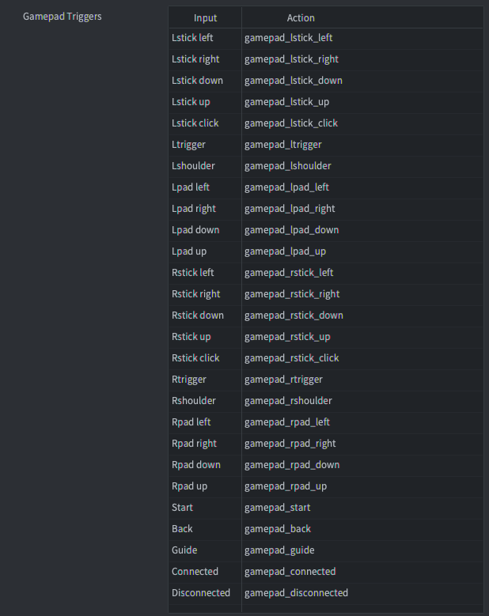
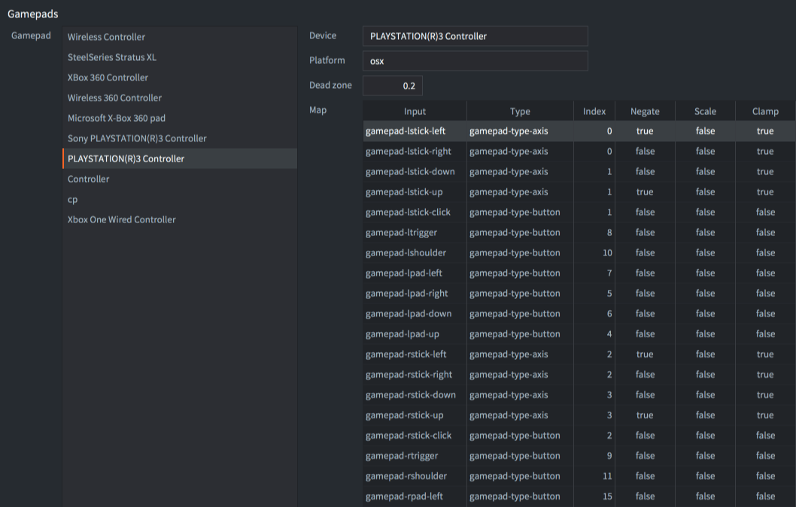
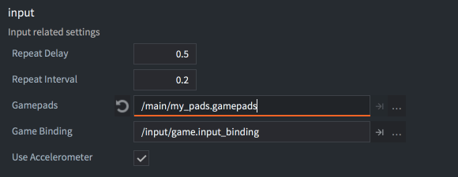

::: sidenote
It is recommended that you familiarize yourself with the general way in which input works in Defold, how to receive input and in which order input is received in your script files. Learn more about the input system in the [Input Overview manual](/manuals/input).
:::

# Gamepads
Gamepad triggers allow you to bind standard gamepad input to game functions. Gamepad input offers bindings for:

- Left and right sticks (direction and clicks)
- Left and right digital pads. Right pad usually translates to the "A", "B", "X" and "Y" buttons on the Xbox controller and "square", "circle", "triangle" and "cross" buttons on the Playstation controller.
- Left and right triggers
- Left and right shoulder buttons
- Start, Back and Guide buttons



::: important
The examples below use the actions shown in the image above. As with all input you are free to name your input actions any way you want to.
:::

## Digital buttons
Digital buttons generate `pressed`, `released` and `repeated` events. Example showing how to detect input for a digital button (either pressed or released):

```lua
function on_input(self, action_id, action)
    if action_id == hash("gamepad_lpad_left") then
        if action.pressed then
            -- start moving left
        elseif action.released then
            -- stop moving left
        end
    end
end
```

## Analog sticks
Analog sticks generate continuous input events when the stick is moved outside the dead zone defined in the gamepad settings file (see below). Example showing how to detect input for an analog stick:

```lua
function on_input(self, action_id, action)
    if action_id == hash("gamepad_lstick_down") then
        -- left stick was moved down
        print(action.value) -- a value between 0.0 an -1.0
    end
end
```

Analog sticks also generate `pressed` and `released` events when moved in the cardinal directions above a certain threshold value. This makes it easy to also use an analog stick as digital directional input:

```lua
function on_input(self, action_id, action)
    if action_id == hash("gamepad_lstick_down") and action.pressed then
        -- left stick was moved to its extreme down position
    end
end
```

## Multiple gamepads
Defold supports multiple gamepads through the host operating system, actions set the `gamepad` field of the `action` table to the gamepad number the input originated from:

```lua
function on_input(self, action_id, action)
    if action_id == hash("gamepad_start") then
        if action.gamepad == 0 then
          -- gamepad 0 wants to join the game
        end
    end
end
```

## Connect and Disconnect
Gamepad input bindings also provide two separate bindings named `Connected` and `Disconnected` to detect when a gamepad is connected (even those connected from the start) or disconnected.

```lua
function on_input(self, action_id, action)
    if action_id == hash("gamepad_connected") then
        if action.gamepad == 0 then
          -- gamepad 0 was connected
        end
    elseif action_id == hash("gamepad_disconnected") then
        if action.gamepad == 0 then
          -- gamepad 0 was disconnected
        end
    end
end
```

## Raw gamepads

Gamepad input bindings also provide a separate binding named `Raw` to give the unfiltered (without applied deadzone) button, axis and hat input of any connected gamepad.

```lua
function on_input(self, action_id, action)
    if action_id == hash("raw") then
        pprint(action.gamepad_buttons)
        pprint(action.gamepad_axis)
        pprint(action.gamepad_hats)
    end
end
```

## Gamepads settings file

Gamepad mappings translate a controller's buttons, axes and hats into the standard controls used by your input bindings. Defold combines two mapping sources configured in the *Input* section of *game.project*:

| Setting | Mapping format | Default |
| --- | --- | --- |
| [Gamepad Database](/manuals/project-settings/#gamepad-database) | SDL-format text database, matched using the controller's GUID | `/builtins/input/gamecontrollerdb.txt` |
| [Gamepads](/manuals/project-settings/#gamepads) | Legacy `.gamepads` entries for device names and platforms | `/builtins/input/default.gamepads` |

SDL database mappings and automatic platform mappings use [Gamepad Deadzone](/manuals/project-settings/#gamepad-deadzone). Legacy `.gamepads` entries define their own dead zones. On Android, a controller without a database entry may also receive an [automatic mapping](#gamepads-on-android).

### Legacy .gamepads mappings

A `.gamepads` file can contain mappings for multiple controllers. Existing legacy mappings remain supported. Defold includes mappings for common controllers in the default file:



If you need to create a legacy `.gamepads` mapping on a desktop platform, the following tool can help. For Android, first use the [diagnostics below](#diagnosing-an-android-controller) to check the selected mapping and raw layout.

[Click to download gdc.zip](https://forum.defold.com/t/big-thread-of-gamepad-testing/56032).

It includes binaries for Windows, Linux and macOS. Run it from the command line:

```sh
./gdc
```

The tool will ask you to press different buttons on your connected controller. It will then output a new gamepads file with correct mappings for your controller. Save the new file, or merge it with your existing gamepads file, then update the setting in *game.project*:



### Unidentified gamepads

When neither a configured mapping nor an automatic platform mapping is available, the gamepad only generates the actions bound to `Connected`, `Disconnected` and `Raw`. You can add a controller mapping or handle its raw input in your game. A missing SDL database entry alone does not mean that the controller is unidentified: Android can provide mapped controls based on the device's reported capabilities.

It is possible to check if an input action for a gamepad is from an unknown gamepad or not by reading the `gamepad_unknown` value from the `action`:

```lua
function on_input(self, action_id, action)
    if action_id == hash("connected") then
        if action.gamepad_unknown then
            print("The connected gamepad is unidentified and will only generate raw input")
        else
            print("The connected gamepad is known and will generate input actions for buttons and sticks")
        end
    end
end
```

## Gamepads in HTML5
Gamepads are supported in HTML5 builds and generate the same input events as on other platforms. Support for gamepads is based on the [Gamepad API](https://www.w3.org/TR/gamepad/) which is supported in most browsers ([refer to this support chart](https://caniuse.com/?search=gamepad)). If the browser doesn't support the Gamepad API Defold will silently ignore any Gamepad triggers in your project. You can check if the browser supports the Gamepad API by checking if the `getGamepads` function exists on the `navigator` object:

```lua
local function supports_gamepads()
    return not html5 or (html5.run('typeof navigator.getGamepads === "function"') == "true")
end

if supports_gamepads() then
    print("Platform supports gamepads")
end
```

If your game is running from inside an `iframe` you must also make sure that the `iframe` has the `gamepad` permission added:

```html
<iframe allow="gamepad"></iframe>
```

### Standard gamepad

If a connected gamepad is identified by the browser as a standard gamepad it will use the mapping for `Standard Gamepad` in the [gamepads settings file](/manuals/input-gamepads/#gamepads-settings-file) (a `Standard Gamepad` mapping is included in the `default.gamepads` file in `/builtins`). A standard gamepad is defined as having 16 buttons and 2 analog sticks with a button layout similar to a PlayStation or Xbox controller (see the [W3C definition and button layout](https://w3c.github.io/gamepad/#dfn-standard-gamepad) for more information). If the connected gamepad is not identified as a standard gamepad Defold will look for a mapping matching the hardware gamepad type in the gamepad settings file.

## Gamepads on Windows
On Windows, only XBox 360 controllers are currently supported. To hook up your 360 controller to your Windows machine, [make sure it is setup correctly](http://www.wikihow.com/Use-Your-Xbox-360-Controller-for-Windows).

## Gamepads on Android

Gamepads are supported in Android builds and generate the same input actions as on other platforms. Support is based on the [Android input system for key and motion events](https://developer.android.com/training/game-controllers/controller-input).

Android controller GUIDs and the raw layout used by SDL mappings follow SDL's Android conventions. Defold selects a mapping in this order:

1. A matching GUID entry from the configured SDL gamepad database.
2. A matching legacy `.gamepads` entry for the device name.
3. An automatic mapping based on the buttons and axes reported by the Android device, if eligible.
4. Raw input only, with `action.gamepad_unknown` set to `true`.

The automatic fallback requires an Android capability GUID reporting at least one standard face button. Controllers reporting Nintendo's vendor ID require a dedicated mapping and are excluded from this fallback. Automatic mapping therefore does not cover every controller, but an eligible controller can generate normal button and stick actions without a database entry.

Legacy mappings continue to use the original Android button and axis layout. The fixed tables below describe that layout; SDL database mappings use SDL's layout, and the automatic fallback produces standard mapped controls.

### Diagnosing an Android controller

Before authoring a mapping, run a debug build on the Android device and inspect the connection and raw input. In your input bindings, add `Connected` as `gamepad_connected`, `Disconnected` as `gamepad_disconnected`, and `Raw` as `raw`. Also bind the buttons and sticks you want to test. Add this `.script` to a game object:

```lua
function init(self)
    msg.post(".", "acquire_input_focus")
end

function on_input(self, action_id, action)
    if action_id == hash("gamepad_connected") then
        print("Gamepad:", action.gamepad, action.gamepad_name)
        print("GUID:", action.gamepad_guid)
        print("Unmapped:", action.gamepad_unknown)
    elseif action_id == hash("gamepad_disconnected") then
        print("Disconnected gamepad:", action.gamepad)
    elseif action_id == hash("raw") then
        print("Raw gamepad:", action.gamepad)
        pprint(action.gamepad_buttons)
        pprint(action.gamepad_axis)
        pprint(action.gamepad_hats)
    elseif action.gamepad ~= nil then
        print("Mapped gamepad action:", action.gamepad, action_id, action.value)
    end
end
```

The name and GUID are supplied with the connected action. `gamepad_unknown == false` means a mapping was selected, including an automatic mapping; test each control to check that the mapping is correct. The [engine connection log](/manuals/debugging-game-and-system-logs) includes the GUID and reports automatic, legacy or raw fallback use.

If the controller is unmapped or its controls are incorrect, record its name, GUID and raw button/axis/hat values on the Android device. Use an Android SDL mapping for that GUID in the configured *Gamepad Database*, or add a legacy `.gamepads` entry for its device name. Test again after rebuilding and reconnecting the controller.

Raw indices depend on the selected layout. An unidentified Android controller uses the legacy raw layout, so do not copy those indices into an SDL database entry. The Lua raw-input arrays start at index `1`, while mapping indices start at `0`.

### Legacy Android mapping tables

Use the following tables when writing a legacy `.gamepads` mapping. These indices remain valid for existing legacy bindings; they do not describe the SDL database or automatic mapping layouts.

| Key event to button index   | Index |
|-----------------------------|-------|
| `AKEYCODE_BUTTON_A`           | 0     |
| `AKEYCODE_BUTTON_B`           | 1     |
| `AKEYCODE_BUTTON_C`           | 2     |
| `AKEYCODE_BUTTON_X`           | 3     |
| `AKEYCODE_BUTTON_L1`          | 4     |
| `AKEYCODE_BUTTON_R1`          | 5     |
| `AKEYCODE_BUTTON_Y`           | 6     |
| `AKEYCODE_BUTTON_Z`           | 7     |
| `AKEYCODE_BUTTON_L2`          | 8     |
| `AKEYCODE_BUTTON_R2`          | 9     |
| `AKEYCODE_DPAD_CENTER`        | 10    |
| `AKEYCODE_DPAD_DOWN`          | 11    |
| `AKEYCODE_DPAD_LEFT`          | 12    |
| `AKEYCODE_DPAD_RIGHT`         | 13    |
| `AKEYCODE_DPAD_UP`            | 14    |
| `AKEYCODE_BUTTON_START`       | 15    |
| `AKEYCODE_BUTTON_SELECT`      | 16    |
| `AKEYCODE_BUTTON_THUMBL`      | 17    |
| `AKEYCODE_BUTTON_THUMBR`      | 18    |
| `AKEYCODE_BUTTON_MODE`        | 19    |
| `AKEYCODE_BUTTON_1`           | 20    |
| `AKEYCODE_BUTTON_2`           | 21    |
| `AKEYCODE_BUTTON_3`           | 22    |
| `AKEYCODE_BUTTON_4`           | 23    |
| `AKEYCODE_BUTTON_5`           | 24    |
| `AKEYCODE_BUTTON_6`           | 25    |
| `AKEYCODE_BUTTON_7`           | 26    |
| `AKEYCODE_BUTTON_8`           | 27    |
| `AKEYCODE_BUTTON_9`           | 28    |
| `AKEYCODE_BUTTON_10`          | 29    |
| `AKEYCODE_BUTTON_11`          | 30    |
| `AKEYCODE_BUTTON_12`          | 31    |
| `AKEYCODE_BUTTON_13`          | 32    |
| `AKEYCODE_BUTTON_14`          | 33    |
| `AKEYCODE_BUTTON_15`          | 34    |
| `AKEYCODE_BUTTON_16`          | 35    |

([Android `KeyEvent` definitions](https://developer.android.com/ndk/reference/group/input#group___input_1gafccd240f973cf154952fb917c9209719))

| Motion event to axis index  | Index |
|-----------------------------|-------|
| `AMOTION_EVENT_AXIS_X`        | 0     |
| `AMOTION_EVENT_AXIS_Y`        | 1     |
| `AMOTION_EVENT_AXIS_Z`        | 2     |
| `AMOTION_EVENT_AXIS_RZ`       | 3     |
| `AMOTION_EVENT_AXIS_LTRIGGER` | 4     |
| `AMOTION_EVENT_AXIS_RTRIGGER` | 5     |
| `AMOTION_EVENT_AXIS_HAT_X`    | 6     |
| `AMOTION_EVENT_AXIS_HAT_Y`    | 7     |

([Android `MotionEvent` definitions](https://developer.android.com/ndk/reference/group/input#group___input_1ga157d5577a5b2f5986037d0d09c7dc77d))

Compare the Android key and motion events reported by the device with these tables when assigning indices in a legacy `.gamepads` entry.
