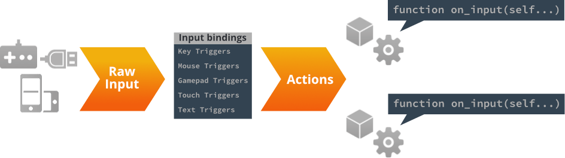
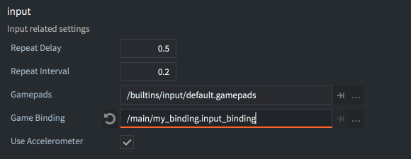
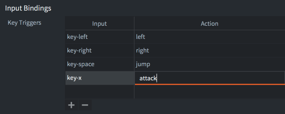
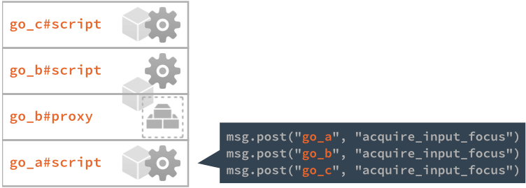
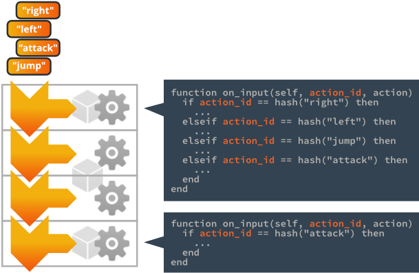
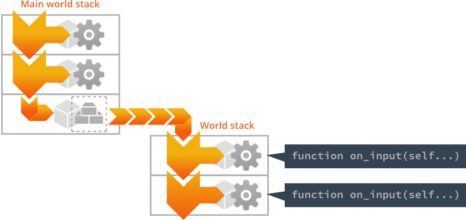
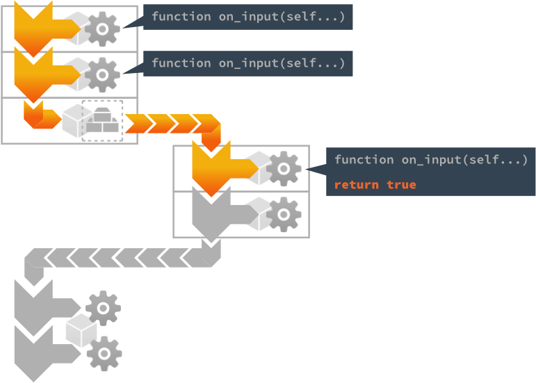
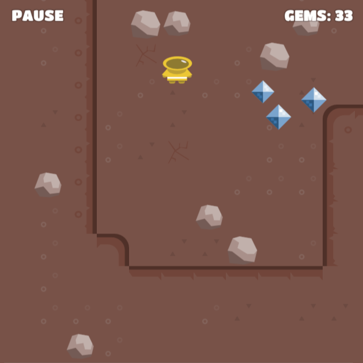
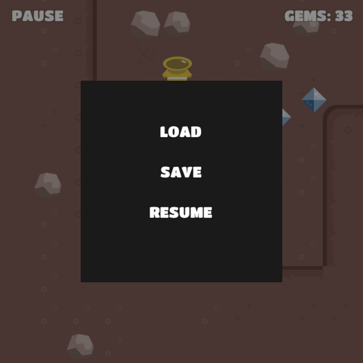

# Input

All user input is captured by the engine and dispatched as actions to script- and GUI script components in game objects that have acquired input focus and that implement the `on_input()` function. This manual explains how you set up bindings to capture input and how you create code that responds to it.

The input system uses a set of simple and powerful concepts, allowing you to manage input as you see fit for your game.



Devices
: Input devices that are either part of, or plugged into, your computer or mobile device provide raw system level input to the Defold runtime. The following device types are supported:

  1. Keyboard (single key as well as text input)
  2. Mouse (position, button clicks and mouse wheel actions)
  3. Single and multi-touch (on iOS and Android devices and HTML5 on mobile)
  4. Gamepads (using [controller mappings and platform support](/manuals/input-gamepads/#gamepads-settings-file))

Input bindings
: Before input is sent to a script the raw input from the device is translated into meaningful *actions* via the input bindings table.

Actions
: Actions are identified by the (hashed) names that you list in the input bindings file. Each action also contain relevant data about the input: if a button is pressed or released, the coordinates of the mouse and touch etc.

Input listeners
: Any script component or GUI script can receive input actions by *acquiring input focus*. Several listeners can be active at the same time.

Input stack
: The list of input listeners with the first acquirer of focus at the bottom of the stack and the last acquirer at the top.

Consuming input
: A script may choose to consume the input it received, preventing listeners further down the stack to receive it.

## Setting up input bindings

The input bindings is a project wide table that allows you to specify how device input should translate into named *actions* before they are dispatched to your script components and GUI scripts. You can create a new input binding file, <kbd>right click</kbd> a location in the *Assets* view and select <kbd>New... ▸ Input Binding</kbd>. To make the engine use the new file, change the *Game Binding* entry in *game.project*.



A default input binding file is automatically created with all new project templates so there is usually no need to create a new binding file. The default file is called `game.input_binding` and can be found in the `input` folder in the project root. <kbd>Double click</kbd> the file to open it in the editor:



To create a new binding, click the <kbd>+</kbd> button at the bottom of the relevant trigger type section. Each entry has two fields:

*Input*
: The raw input to listen for, selected from a scroll list of available inputs.

*Action*
: The action name given to input actions when they are created and dispatched to your scripts. The same action name can be assigned to multiple inputs. For instance, you can bind the <kbd>Space</kbd> key and the gamepad `A` button to the action `jump`. Note that there is a known bug where touch inputs unfortunately cannot have the same action names as other inputs.

## Trigger types

There are five device specific types of triggers that you can create:

Key Triggers
: Single key keyboard input. Each key is mapped separately into a corresponding action. Learn more in the [key and text input manual](/manuals/input-key-and-text).

Text Triggers
: Text triggers are used to read arbitrary text input. Learn more in the [key and text input manual](/manuals/input-key-and-text)

Mouse Triggers
: Input from mouse buttons and scroll wheels. Learn more in the [mouse and touch input manual](/manuals/input-mouse-and-touch).

Touch Triggers
: Single-touch and Multi-touch type triggers are available on iOS and Android devices in native applications and in HTML5 bundles. Learn more in the [mouse and touch manual](/manuals/input-mouse-and-touch).

Gamepad Triggers
: Gamepad triggers allow you to bind standard gamepad input to game functions. Learn more in the [gamepads manual](/manuals/input-gamepads).

### Accelerometer input

In addition to the five different trigger types listed above Defold also supports accelerometer input in native Android and iOS applications. Check the *Use Accelerometer* box in the *Input* section of your *game.project* file.

```lua
function on_input(self, action_id, action)
    if action.acc_x and action.acc_y and action.acc_z then
        -- react to accelerometer data
    end
end
```

## Input focus

To listen to input actions in a script component or GUI script, the message `acquire_input_focus` should be sent to the game object holding the component:

```lua
-- tell the current game object (".") to acquire input focus
msg.post(".", "acquire_input_focus")
```

This message instructs the engine to add input capable components (script components, GUI components and collection proxies) in the game objects to the *input stack*. The game object components are put on top of the input stack; the component that is added last will be top of the stack. Note that if the game object contains more than one input capable component, all components will be added to the stack:



If a game object that has already acquired input focus does so again, its component(s) will be moved to the top of the stack.


## Input dispatch and on_input() {#input-dispatch-and-on_input}

Input actions are dispatched according to the input stack, from the top to the bottom.



Any component that is on the stack containing an `on_input()` function will have that function called, once for each input action during the frame, with the following arguments:

`self`
: The current script instance.

`action_id`
: The hashed name of the action, as set up in the input bindings, or `nil` for pointer movement and accelerometer samples. Use `action.source` to distinguish these unnamed actions.

`action`
: A table containing the useful data about the action, like the value of the input, its location (absolute and delta positions), whether button input was `pressed` etc. See [on_input()](/ref/go#on_input) for details on the available action fields.

```lua
function on_input(self, action_id, action)
  if action_id == hash("left") and action.pressed then
    -- move left
    local pos = go.get_position()
    pos.x = pos.x - 100
    go.set_position(pos)
  elseif action_id == hash("right") and action.pressed then
    -- move right
    local pos = go.get_position()
    pos.x = pos.x + 100
    go.set_position(pos)
  end
end
```

### Input device source

Since Defold 1.14.1, `action.source` identifies the input device category independently of the action name. It is available in both script and GUI script `on_input()` callbacks and is one of these hashes:

| `action.source` | Input category |
|-----------------|----------------|
| `hash("keyboard")` | Individual key input from Key Triggers. |
| `hash("text")` | Text and marked-text input from Text Triggers, including text entered with a physical keyboard. |
| `hash("mouse")` | Physical mouse buttons, wheel input and pointer movement. |
| `hash("touch")` | Touch input, including mouse clicks and pointer movement simulated from touch. |
| `hash("gamepad")` | Gamepad input, including raw input and connection events. |
| `hash("accelerometer")` | Accelerometer samples. |

Compare `action.source` with a hash, such as `hash("touch")`, rather than a string. For example, a left mouse button action can come from either a physical mouse or a tap. The source distinguishes them even on the initial press; see [Distinguishing mouse clicks from touch](/manuals/input-mouse-and-touch/#distinguishing-mouse-clicks-from-touch).

When several devices share a named action, their contributions can be combined. Sources are processed in this order: keyboard, text, mouse, then touch; the last source contributing to the action is reported. Key and mouse button releases keep the previous source unless another input contributes in the same frame. Gamepad actions remain separate per controller. Use separate action names when you need to handle each binding independently.

Pointer movement and accelerometer samples have no action name, so both use `action_id == nil`. They arrive in separate callbacks: pointer movement has coordinates and a mouse or touch source, while accelerometer samples have `acc_x`, `acc_y` and `acc_z` and an accelerometer source. If both occur in a frame, each callback can be consumed independently. Accelerometer samples are delivered even if their values have not changed.

The following example handles these unnamed actions. Set up at least one Mouse Trigger to receive pointer movement, and enable [Use Accelerometer](/manuals/project-settings/#use-accelerometer) on a supported device to receive accelerometer samples:

```lua
function init(self)
    msg.post(".", "acquire_input_focus")
end

function on_input(self, action_id, action)
    if action_id == nil then
        if action.source == hash("mouse") or action.source == hash("touch") then
            print("Pointer position:", action.x, action.y)
        elseif action.source == hash("accelerometer") then
            print("Acceleration:", action.acc_x, action.acc_y, action.acc_z)
        end
    end
end
```


### Input focus and collection proxy components

Each game world that is dynamically loaded through a collection proxy has its own input stack. For action dispatch to reach the loaded world's input stack, the proxy component must be on the main world's input stack. All components on a loaded world's stack are handled before dispatch continues down the main stack:



::: important
It is a common error to forget to send `acquire_input_focus` to the game object holding the collection proxy component. Skipping this step prevents input from reaching any of the components on the loaded world's input stack.
:::


### Releasing input

To stop listening to input actions, send a `release_input_focus` message to the game object. This message will remove any of the game object's components from the input stack:

```lua
-- tell the current game object (".") to release input focus.
msg.post(".", "release_input_focus")
```


## Consuming input

A component's `on_input()` can actively control whether actions should be passed on further down the stack or not:

- If `on_input()` returns `false`, or a return is omitted (this implies a `nil` return which is a false value in Lua) input actions will be passed on to the next component on the input stack.
- If `on_input()` returns `true` input is consumed. No component further down the input stack will receive the input. Note that this applies to *all* input stacks. A component on a proxy-loaded world's stack can consume input preventing components on the main stack to receive input:



There are many good use cases where input consumption provides a simple and powerful way to shift input between different parts of a game. For example, if you need a pop-up menu that temporarily is the only part of the game that listens to input:



The pause menu is initially hidden (disabled) and when the player touches the `PAUSE` HUD item, it is enabled:

```lua
function on_input(self, action_id, action)
    if action_id == hash("mouse_press") and action.pressed then
        -- Did the player press PAUSE?
        local pausenode = gui.get_node("pause")
        if gui.pick_node(pausenode, action.x, action.y) then
            -- Tell the pause menu to take over.
            msg.post("pause_menu", "show")
        end
    end
end
```



The pause menu GUI acquires input focus and consumes input, preventing any input other than what's relevant for the pop-up menu:

```lua
function on_message(self, message_id, message, sender)
  if message_id == hash("show") then
    -- Show the pause menu.
    local node = gui.get_node("pause_menu")
    gui.set_enabled(node, true)

    -- Acquire input.
    msg.post(".", "acquire_input_focus")
  end
end

function on_input(self, action_id, action)
  if action_id == hash("mouse_press") and action.pressed then

    -- do things...

    local resumenode = gui.get_node("resume")
    if gui.pick_node(resumenode, action.x, action.y) then
        -- Hide the pause menu
        local node = gui.get_node("pause_menu")
        gui.set_enabled(node, false)

        -- Release input.
        msg.post(".", "release_input_focus")
    end
  end

  -- Consume all input. Anything below us on the input stack
  -- will never see input until we release input focus.
  return true
end
```
