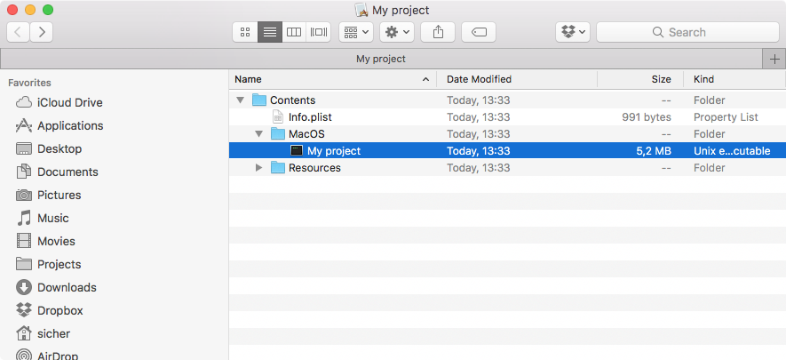
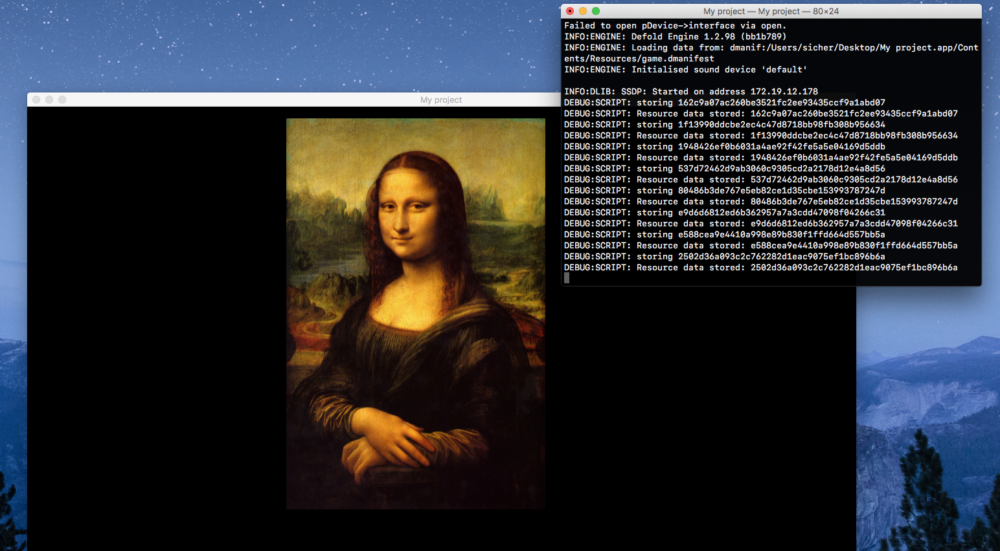
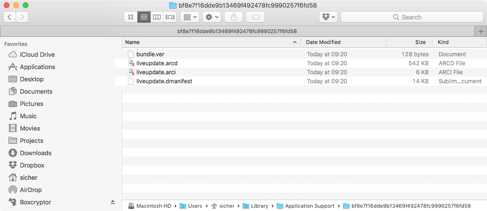

# Live update

When bundling a game, Defold packs all the game resources into the resulting platform specific package. In most cases this is preferred since the running engine has instant access to all resources and can load them swiftly from storage. However, there are instances where you might want to postpone the loading of resources to a later stage. For instance:

- Your game features a series of episodes and you wish to include only the first one for players to try out before they decide if they want to continue with the rest of the game.
- Your game is targeted for HTML5. On the browser, loading an application from storage means that the entire application package has to be downloaded before startup. On such a platform you may wish to send a minimal start package and get the app up and running quickly before you download the rest of the game resources.
- Your game contains very large resources (images, videos etc) that you wish to postpone the downloading of until they are about to show in the game. This is to keep the install size down.

The Live update functionality expands the concept of the collection proxy with a mechanism allowing the runtime to fetch and store resources to the application bundle that were intentionally left out of the bundle at build time.

## Archive manifests

An archive manifest splits game content into **Base**, which ships with the application, and named packages that you can distribute separately. For example, put optional episodes in their own packages and mount the relevant package before loading an episode.

1. In the Assets pane, create an **Archive Manifest** (`.archivemanifest`) and select it under **Archive → Manifest** in *game.project*.
2. Open the manifest. In the outline, add a named package and an **Add** rule. Select **Path** and enter a regular expression such as `/episodes/01/.*`. A path rule matches the entire source path, including its leading slash. Defold includes the compiled outputs and their runtime dependencies. Raw files such as JSON or text can also be selected directly and read with `sys.load_resource()` after mounting.
3. Select the package in the outline to preview its contents. Use the preview's search to find resources and inspect which rules and dependencies brought them in. The preview also reflects unsaved edits. Use a [bundle report](/manuals/profiling/#build-reports) to inspect the output for the actual target.
4. Choose <kbd>Project ▸ Bundle</kbd>, select the platform, and enable **Publish Live Update content**. The bundle gets the split Base and Defold exports the named packages. With publishing disabled, the application includes the package content in Base so it can run on its own. For selective exports, use [Bob's package options](/manuals/bob/#selecting-archive-packages).
5. Distribute the generated packages with your delivery service. In the game, [download and mount the packages](/manuals/live-update-scripting/) before loading resources from them.

Rules are applied from top to bottom. A rule can target a path or the final contents of another named package. To keep shared dependencies in a separate package, add the episode first, then use a **Remove** rule targeting the shared package. Mount both packages before loading the episode. Resources needed at startup always stay in Base. Use collection proxies for content you load later. The archive manifest controls package membership whenever it is selected in *game.project*.

For a path rule that matches no sources, **No matches** controls whether to warn, fail the build, or ignore the empty match. Warn is the default.

For example, this manifest places `/episodes/01/` in a package called `episode01`. With the default presets, publishing writes `build/packages/episode01.zip`.

```protobuf
packages {
  name: "episode01"
  rules {
    name: "Episode 1"
    path: "/episodes/01/.*"
  }
}
```

### Package output and compression

Select the manifest in the outline to set **Output Directory**. It defaults to `build/packages`. Relative paths resolve from the project root. Absolute paths and environment variables such as `${PACKAGE_OUTPUT}` are supported. Keep package outputs outside the application directory that bundling recreates.

Under **Compression Types**, define presets for the package container and for individual files. Each named package selects one of each. Base selects only file compression, which supersedes `project.compress_archive` in manifest mode.

| Preset group | Options |
| --- | --- |
| Container | **ZIP** writes `<name>.zip` and accepts levels from `-1` to `9`. **Folder** writes `<name>/`. A [Java package provider](https://github.com/defold/defold/blob/1.14.2-beta/com.dynamo.cr/com.dynamo.cr.bob/README.md#java-providers) can supply another output format. |
| File | **LZ4** accepts levels from `1` to `12`. **None** leaves individual files uncompressed by the archive writer. |

Mount a ZIP with a `zip:` URI or a folder of compiled files with a `file:` URI. The game is responsible for choosing which packages to download and the order in which to mount them.

## Legacy Live Update settings

Projects can still use a legacy `liveupdate.settings` file and the **Exclude** property of collection proxies. This workflow is deprecated. Select the settings file under **Live Update → Settings** in *game.project*. Clear that setting before selecting an archive manifest.

1. Check **Exclude** on the collection proxies whose content you want to publish separately. Resources also required by Base stay in the application.
2. Open <kbd>Project ▸ Live Update Settings...</kbd> and select **Zip** (the default) or **Folder**. Configure the export path in the settings file. For Amazon settings, see [migrating from built-in S3 publishing](/manuals/live-update-aws/).
3. Enable **Publish Live Update content** in the bundle dialog. This exports one external package, which Bob can also select as `--package liveupdate`. The legacy published `liveupdate.game.dmanifest` retains the resource list needed for delivery. The application's manifest omits the entries exclusive to the external package.

Bundle and launch the application to test package delivery. <kbd>Project ▸ Build</kbd> runs game content from the editor's build output.

## Live Update on Android

It is possible to use Play Asset Delivery to download and mount Live Update content. Learn more [in the official manual](https://defold.com/extension-pad/).

## Content verification

One of the major features of the live update system, is that you can now use many content archives, potentially from many different Defold versions.

The `liveupdate.add_mount()` default behavior, is to add an engine version check when attaching a mount.
This means that both the game base archive and live update archive(s) need to be created at the same time  with the same engine version, using the bundle option. This will invalidate any previously downloaded archives by the client, forcing them to re-download the content.

This behavior can be turned off with an options flag.
When turned off, the content verification responsibility lies entirely with the developer, to guarantee that each live update archive will work with the running engine.

We recommend storing metadata for each mount so the application can decide whether the package should remain mounted. Validate it after adding the mount, including when the application re-adds its required mounts during startup.
One way to do so is to add an extra file to the zip archive after the game has been bundled. For instance, insert a `metadata.json` with any information that the game requires, then retrieve it with `sys.load_resource("/metadata.json")` after mounting. _Use a unique resource path for each mount's custom data, or resource lookup will return the file from the mount with the highest priority._

Failure to do so, you may end up in a situation where the content is not compatible with the engine at all, forcing it to quit.

## Mounts

The live update system can use multiple content archives at the same time.
Each archive is "mounted" to the engine's resource system, with a name and priority.

If two archives have the same file `sprite.texturec`, the engine will load the file from the mount with the highest priority.

The engine doesn't keep a reference to any resource in a mount. Once a resource is loaded into memory, the archive may be unmounted. The resource will remain in memory until it is unloaded.

Mounts are active for the current engine session only. The application must call `liveupdate.add_mount()` again for every package it needs after a restart. Store the package location, mount name and priority in application-managed persistent data if those choices need to survive between sessions.

::: sidenote
Mounting a Zip archive or folder doesn't copy or move it. The mounted content must remain at the specified location for as long as the mount is in use.
:::

## Scripting with Live Update

To actually use the live update content, you need to download and mount the data to your game.
Read more about about how to [script with live update here](/manuals/live-update-scripting).

## Development caveats

Debugging
: When running a bundled version of your game, you don't have direct access to a console. This causes problems for debugging. However, you can run the application from the command line or by double clicking the executable in the bundle directly:

  

  Now the game starts with a shell window that will output any `print()` statements:

  

Forcing re-download of resources
: The developer can download the content to any file/folder they wish, but often it is located under the application path. The location of the application support folder depends on the operating system. It can be found with `print(sys.get_save_file("", ""))`. To force a download, remove the downloaded package and the corresponding entry from any application-managed state. There is no engine-managed mount list to delete; mounts do not persist across restarts.

  
