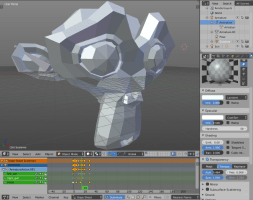
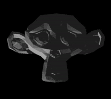

# 3D model animation

Model components can play skeletal animations and morph target animations imported from glTF files. Skeletal animation uses the bones of the model to apply deformation to vertices in the model. Morph target animation, also known as blend shape animation, changes the shape of the model by animating weights for alternate vertex positions.

For details on how to import 3D data into a Model for animation, see the [Model documentation](/manuals/model).

  
  


## Playing animations

Models are animated with the [`model.play_anim()`](/ref/model#model.play_anim) function. Without a layer option, the animation plays on the base layer:

```lua
function init(self)
    -- Start the "wiggle" animation back and forth on #model
    model.play_anim("#model", "wiggle", go.PLAYBACK_LOOP_PINGPONG)
end
```

::: important
Defold currently supports only baked skeletal animations. Skeletal animations need to have matrices for each animated bone each keyframe, and not position, rotation and scale as separate keys.

Animations are also linearly interpolated. If you do more advanced curve interpolation the animations needs to be prebaked from the exporter.
:::

### Morph targets

Morph targets are alternative shapes for the same mesh. Each target stores position, normal and tangent deltas, and each target has a blend weight that controls how much of that shape is applied. A weight of `0` means that the target has no effect, while a weight of `1` applies the full target shape. Values outside that range can also be useful for exaggerated effects if the shader and asset are authored for it.

Defold imports morph targets and initial morph weights from glTF model data. glTF animations that animate morph weights are imported into the model animation set and can be played with [`model.play_anim()`](/ref/model#model.play_anim), just like skeletal animations:

```lua
function init(self)
    model.play_anim("#model", "smile", go.PLAYBACK_LOOP_FORWARD)
end
```

Morph target data can be used on its own or together with skeletal animation. Morph weights are animated by the base layer. [Additional animation layers](#playing-multiple-animations) affect only the skeleton and ignore morph weight tracks, so separate morph target clips cannot be played on additional layers. You can play a morph target clip on the base layer while playing skeletal clips on additional layers. If a model has animation data but no skeleton, only morph target animation data will be used, and additional layers are unavailable.

You can still combine skeletal animation playback with morph target changes that come from other sources, for example by setting morph target weights from script with `model.set_blend_weights()`.

You can also read and override morph target weights from script. [`model.get_blend_weights()`](/ref/model#model.get_blend_weights) returns the current weights for the first mesh in the model that has morph targets. [`model.set_blend_weights()`](/ref/model#model.set_blend_weights) applies a script override to every morphed mesh in the model:

```lua
function init(self)
    local weights = model.get_blend_weights("#model")
    weights[1] = 0.75
    weights[2] = 0.25
    model.set_blend_weights("#model", weights)
end
```

The weight table uses one-based Lua indices in the same order as the morph targets in the mesh. Extra values are ignored, and missing values are treated as zero for meshes with more morph targets than the table contains. The script override is applied after animation every frame until it is cleared:

```lua
model.set_blend_weights("#model")     -- clear the override
model.set_blend_weights("#model", nil) -- also clears the override
```

### Shader support

To render morph targets, the model material vertex shader needs to sample the generated `morph_targets` texture and apply the weighted deltas to the vertex data. The morph target texture is a 2D array texture where each morph target uses three array layers: position delta, normal delta and tangent delta.

The engine provides the current morph weights to a vertex shader uniform named `morph_targets_weights`. Each `vec4` stores four weights, so `morph_targets_weights[2]` has room for eight morph targets.

The following example shows the relevant vertex shader parts for a non-instanced model material:

```glsl
#version 140

in highp vec4 position;
in mediump vec2 texcoord0;
in mediump vec3 normal;
in mediump vec4 tangent;

out mediump vec2 var_texcoord0;
out mediump vec3 var_normal;
out mediump vec4 var_tangent;

uniform vs_uniforms
{
    mediump mat4 mtx_worldview;
    mediump mat4 mtx_proj;
    mediump mat4 mtx_normal;
    // Each vec4 stores four blend weights. Use morph_targets_weights[1]
    // for up to 4 morph targets, [2] for up to 8, [3] for up to 12, etc.
    mediump vec4 morph_targets_weights[2];
};

uniform sampler2DArray morph_targets;

vec2 get_morph_uv(int vertex_index, int width, int height)
{
    int x = vertex_index % width;
    int y = vertex_index / width;
    return vec2(
        (float(x) + 0.5) / float(width),
        (float(y) + 0.5) / float(height)
    );
}

void apply_morph_target(vec2 uv, float weight, int target,
    inout vec3 position_delta, inout vec3 normal_delta, inout vec3 tangent_delta)
{
    if (weight == 0.0) {
        return;
    }

    int position_layer = target * 3 + 0;
    int normal_layer = target * 3 + 1;
    int tangent_layer = target * 3 + 2;

    position_delta += weight * texture(morph_targets, vec3(uv, position_layer)).xyz;
    normal_delta += weight * texture(morph_targets, vec3(uv, normal_layer)).xyz;
    tangent_delta += weight * texture(morph_targets, vec3(uv, tangent_layer)).xyz;
}

void get_morph_target_data(int vertex_index,
    out vec3 position_delta, out vec3 normal_delta, out vec3 tangent_delta)
{
    position_delta = vec3(0.0);
    normal_delta = vec3(0.0);
    tangent_delta = vec3(0.0);

#ifndef EDITOR
    ivec3 texture_size = textureSize(morph_targets, 0);
    vec2 uv = get_morph_uv(vertex_index, texture_size.x, texture_size.y);

    apply_morph_target(uv, morph_targets_weights[0].x, 0, position_delta, normal_delta, tangent_delta);
    apply_morph_target(uv, morph_targets_weights[0].y, 1, position_delta, normal_delta, tangent_delta);
    apply_morph_target(uv, morph_targets_weights[0].z, 2, position_delta, normal_delta, tangent_delta);
    apply_morph_target(uv, morph_targets_weights[0].w, 3, position_delta, normal_delta, tangent_delta);
    apply_morph_target(uv, morph_targets_weights[1].x, 4, position_delta, normal_delta, tangent_delta);
    apply_morph_target(uv, morph_targets_weights[1].y, 5, position_delta, normal_delta, tangent_delta);
    apply_morph_target(uv, morph_targets_weights[1].z, 6, position_delta, normal_delta, tangent_delta);
    apply_morph_target(uv, morph_targets_weights[1].w, 7, position_delta, normal_delta, tangent_delta);
#endif
}

void main()
{
    vec3 position_delta;
    vec3 normal_delta;
    vec3 tangent_delta;
    get_morph_target_data(gl_VertexIndex, position_delta, normal_delta, tangent_delta);

    vec3 morphed_position = position.xyz + position_delta;
    vec3 morphed_normal = normalize(normal + normal_delta);
    vec3 morphed_tangent = normalize(tangent.xyz + tangent_delta);

    var_texcoord0 = texcoord0;
    var_normal = normalize((mtx_normal * vec4(morphed_normal, 0.0)).xyz);
    var_tangent = vec4(normalize((mtx_normal * vec4(morphed_tangent, 0.0)).xyz), tangent.w);

    gl_Position = mtx_proj * mtx_worldview * vec4(morphed_position, 1.0);
}
```

The `#ifndef EDITOR` wrapper is needed because model animation preview is not available in the editor yet, so the generated morph target texture data is only available at runtime. Increase the `morph_targets_weights` array size and add more `apply_morph_target()` calls if the mesh has more morph targets.

::: important
The shader example above uses `textureSize()` and does not work on OpenGL ES 2.0.
:::

### The bone hierarchy

The bones in the Model skeleton are represented internally as game objects.

You can retrieve the instance id of the bone game object in runtime. The function [`model.get_go()`](/ref/model#model.get_go) returns the id of the game object for the specified bone.

```lua
-- Get the middle bone go of our wiggler model
local bone_go = model.get_go("#wiggler", "Bone_002")

-- Now do something useful with the game object...
```

### Cursor animation

In addition to using the `model.play_anim()` to advance a model animation, *Model* components expose a `cursor` property that can be manipulated with `go.animate()` (more about [property animations](/manuals/property-animation)):

```lua
-- Set the animation on #model but don't start it
model.play_anim("#model", "wiggle", go.PLAYBACK_NONE)
-- Set the cursor to the beginning of the animation
go.set("#model", "cursor", 0)
-- Tween the cursor between 0 and 1 pingpong with in-out quad easing.
go.animate("#model", "cursor", go.PLAYBACK_LOOP_PINGPONG, 1, go.EASING_INOUTQUAD, 3)
```

## Playing multiple animations

Animation layers let a model play several skeletal animations at the same time. For example, a character can run on the base layer while waving on an upper-body layer. Each layer has its own animation, cursor, playback rate and completion callback.

Create a layer definition with [`model.animation_layer()`](/ref/model#model.animation_layer), then pass its numeric handle in the `layer` option to `model.play_anim()`. Creating the definition does not start playback or attach it to a model.

The following example assumes the model's animation set contains `run` and `wave`, and its skeleton has a bone named `spine`. Replace these names with the names from your assets:

```lua
local function wave_done(self, message_id, message, sender)
    if message.layer == hash("upper_body") then
        -- Reveal the running animation beneath the upper-body layer.
        model.cancel("#model", { layer = self.upper_body })
    end
end

function init(self)
    self.upper_body = model.animation_layer("upper_body", {
        order = 1,
        weight = 1,
        bones = { "spine" }
    })

    -- Run on the base layer.
    model.play_anim("#model", "run", go.PLAYBACK_LOOP_FORWARD)

    -- Wave with the spine and its descendants while the legs keep running.
    model.play_anim("#model", "wave", go.PLAYBACK_ONCE_FORWARD, {
        layer = self.upper_body,
        blend_duration = 0.15
    }, wave_done)
end

function final(self)
    model.destroy_animation_layer(self.upper_body)
end
```

### Layer definitions and bone masks

A layer name can be a string or hash. The options passed to `model.animation_layer()` describe how the layer affects the pose:

| Option | Description |
|---|---|
| `order` | Required positive integer. The base layer is evaluated first, followed by additional layers in increasing order. |
| `weight` | Influence from `0` to `1`, defaulting to `1`. A weight of `0` leaves the pose unchanged, but playback and completion still occur. |
| `bones` | Optional array of bone names, as strings or hashes. Each listed bone and all its descendants are included. Omit the option or use an empty array to affect all bones. |

Names and orders must each be unique among the layers attached to a particular model. Bone names must exist in that model's skeleton. Playing another animation with the same handle replaces playback on that layer; creating a different definition with a conflicting name or order and playing it on the same model raises an error.

The bone mask selects local bone transforms. A selected bone still inherits movement from its parents, even when those parents are animated by another layer. Within the mask, channels missing from the layer's animation use the skeleton's rest transforms.

A layer blends its pose over the result of the layers below it. With a weight of `1`, it fully overrides the selected bones; a smaller weight blends between the underlying pose and the layer's pose. Weights are not normalized across layers, and layers do not add animation offsets together. Later layers can override earlier layers where their masks overlap.

Definitions are immutable: changing the options table after creation does not change the layer. You can reuse one handle on several models, including models with different skeletons if the selected bone names exist in each. Each model keeps independent playback state, so playing, changing the cursor or cancelling the layer on one model does not affect the others. Keep shared definitions alive until all code that uses their handles is finished with them.

### Blending and completion

When a layer first starts playing, `blend_duration` fades its influence from zero to its configured weight. Playing another animation on the same layer uses `blend_duration` to crossfade between that layer's clips. Replacing a clip does not restart the layer's initial fade-in. The base animation and other layers continue playing independently.

Playing an animation without the `layer` option changes only the base animation. It does not remove additional layers.

A layer that finishes a once-mode animation holds its final pose until you play another animation on it or cancel it. Completion does not automatically remove the layer. The example above cancels the waving layer in its completion callback so that the running animation becomes visible again. See [Completion callbacks](#completion-callbacks) for the completion message fields.

### Reading and changing layer playback

Use the layer's **name hash** in the options to `go.get()` and `go.set()`:

```lua
local options = { key = hash("upper_body") }
local animation = go.get("#model", "animation", options)
local cursor = go.get("#model", "cursor", options)
local playback_rate = go.get("#model", "playback_rate", options)

go.set("#model", "cursor", 0.5, options)
go.set("#model", "playback_rate", 0.5, options)
```

`animation` is read-only. `cursor` is normalized from `0` to `1`, and `playback_rate` is a speed multiplier; setting a negative rate clamps it to `0`. These properties describe playback on the target model, not the shared layer definition. During a crossfade, they address the incoming animation.

Omit the options to access the base animation. Property access uses the layer name, while `model.play_anim()` and `model.cancel()` use the numeric handle. A handle is not a valid property key. The layer must be attached to the target model before you access its properties; an unknown or cancelled layer raises an error.

### Cancelling and destroying layers

Cancel one layer using its handle:

```lua
model.cancel("#model", { layer = self.upper_body })
```

The layer's contribution disappears on the next pose update, revealing the base and remaining layers. Its completion callback is not invoked. The handle stays valid and can be used to play the layer again. Cancelling a valid layer that is not attached to the model has no effect.

Call `model.cancel("#model")` without a layer to cancel all animations on that model, freeze the base pose and remove all additional layers.

When you no longer need a definition, release it with [`model.destroy_animation_layer()`](/ref/model#model.destroy_animation_layer). To remove its contribution on the next pose update, cancel it before destroying the handle:

```lua
model.cancel("#model", { layer = self.upper_body })
model.destroy_animation_layer(self.upper_body)
self.upper_body = nil
```

Destroying a handle invalidates it, including for further play, cancel or destroy calls. It does not stop existing playback on any model: models retain the definition while the layer is attached, including when it holds a completed pose. Property access by name remains available while the layer is attached. After destroying the handle, you can remove retained layers with `model.cancel()` without a layer, or by destroying or reloading their model.

Discarding the numeric handle or running Lua garbage collection does not release the definition. Use explicit destruction, as in the `final()` function of the first example. Definitions that have not been explicitly destroyed are released when their script context is finalized.

## Completion callbacks

The `model.play_anim()` function supports an optional Lua callback as its last argument. It is called when a once-mode animation finishes. Looping animations do not invoke it, and cancelling an animation with `model.cancel()` or replacing it with another animation on the same layer does not invoke the old callback. The callback can be used to trigger events on animation completion or to chain animations together.

```lua
local function wiggle_done(self, message_id, message, sender)
    -- Done animating
end

function init(self)
    model.play_anim("#model", "wiggle", go.PLAYBACK_ONCE_FORWARD, nil, wiggle_done)
end
```

The callback receives a [`model_animation_done`](/ref/model#model_animation_done) message with `animation_id` and `playback`. For an additional layer, `message.layer` contains the layer's name hash, so you can distinguish the same clip playing on different layers. For the base animation, `message.layer` is absent (`nil`).

If you omit the callback, the message is sent to the script that started the animation and can be handled in `on_message()`:

```lua
function on_message(self, message_id, message, sender)
    if message_id == hash("model_animation_done") then
        if message.layer == hash("upper_body") then
            -- A once-mode animation finished on the upper-body layer.
        elseif message.layer == nil then
            -- A once-mode animation finished on the base layer.
        end
    end
end
```

## Playback Modes

Animations can be played either once or in a loop. How the animation plays is determined by the playback mode:

* `go.PLAYBACK_NONE`
* `go.PLAYBACK_ONCE_FORWARD`
* `go.PLAYBACK_ONCE_BACKWARD`
* `go.PLAYBACK_ONCE_PINGPONG`
* `go.PLAYBACK_LOOP_FORWARD`
* `go.PLAYBACK_LOOP_BACKWARD`
* `go.PLAYBACK_LOOP_PINGPONG`
