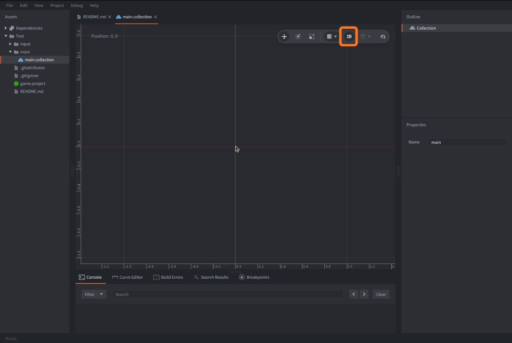
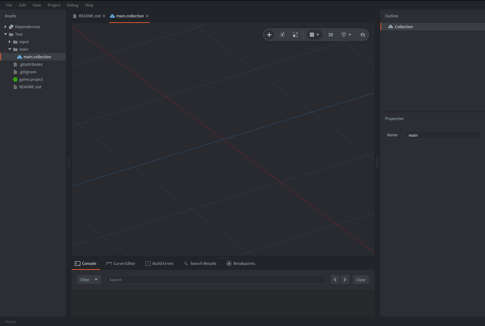
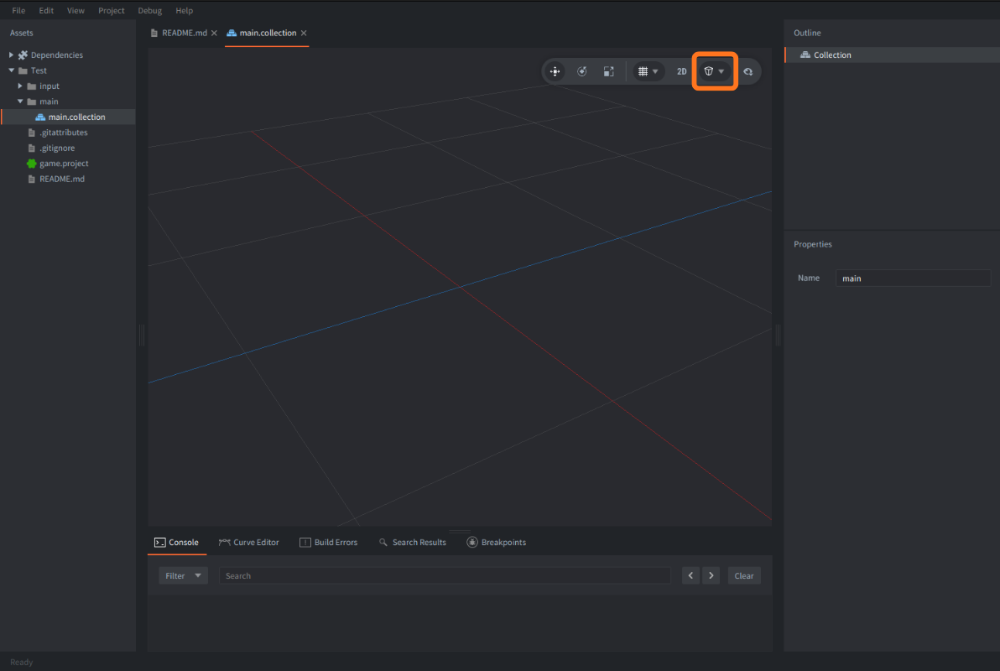

The scene view can be used in both 2D and 3D workflows. A typical 2D setup uses an orthographic view with the grid on the X-Y plane:

To work in 3D, turn off the **2D** toggle in the toolbar. This changes the view orientation and switches to the 3D grid settings. You can use the **Grid Settings** dropdown to adjust the grid plane and appearance.

For a perspective view, enable **Perspective camera** in the toolbar:

You can also change the view through the **View** menu.
