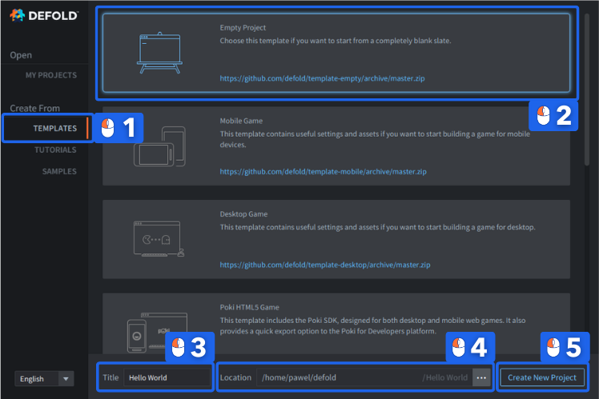
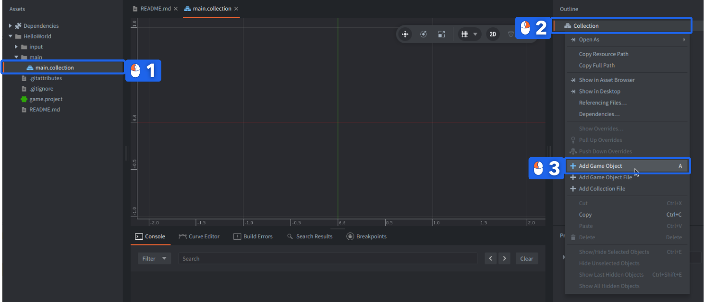
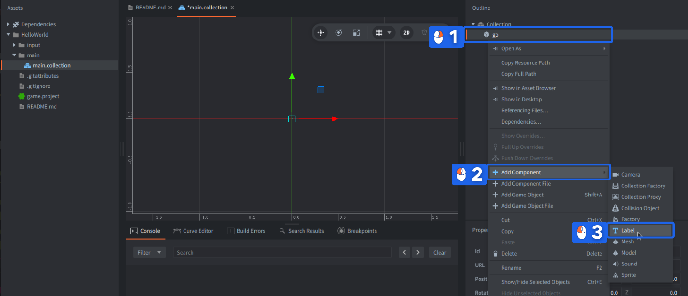
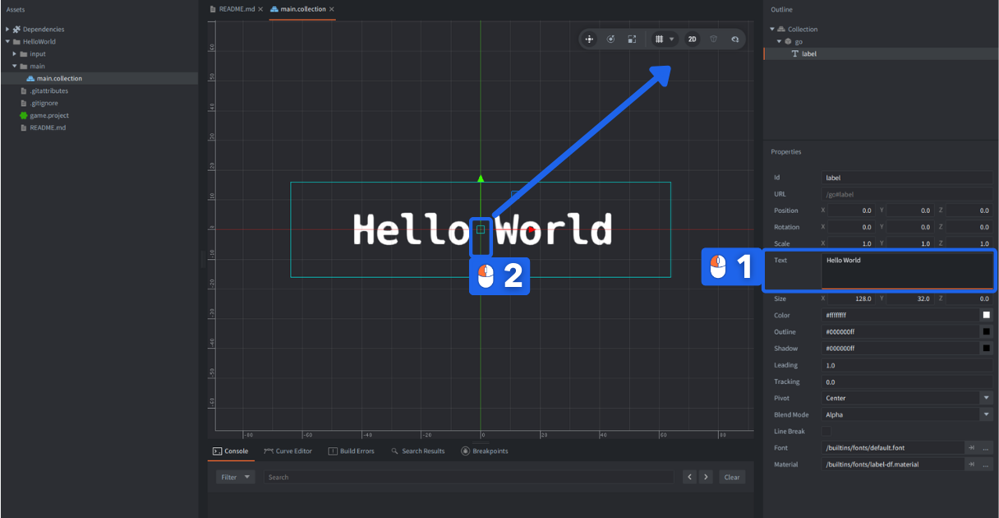
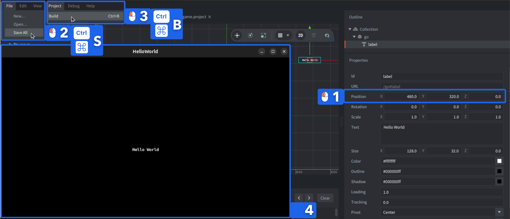

## Hello World

This is a quick way to get something done in Defold quickly, follow the steps, and then get back to read the rest of the manual.

1. Select an empty project from `Templates`, name it in `Title`, choose location and create it by clicking `Create New Project`. It will open in the Defold Editor.

2. On the left side, in the `Assets` pane, open the `main` folder and double click on the `main.collection` to open it.
3. On the right side, in the `Outline` pane right-click on the `Collection` and select `Add Game Object`.

4. Right-click on the created `go` game object and select `Add Component`, and then `Label`.

5. Below, on the left side, in the `Properties` pane type something in the `Text` property.
6. In the main, central scene view, drag, move and drop the label to position around `(480,320,0)`, or change it in `Properties`: `Position`.

7. After changing the label position, save the project by clicking `File` -> `Save All` or shortcut <kbd>Ctrl</kbd>+<kbd>S</kbd> (<kbd>Cmd</kbd>+<kbd>S</kbd> on Mac).
8. Built your project by clicking `Project` -> `Build` or shortcut <kbd>Ctrl</kbd>+<kbd>B</kbd> (<kbd>Cmd</kbd>+<kbd>B</kbd> on Mac).

You just build your first project in Defold and should see your text in the window. The concepts of game object and component should be familiar to you. The collections, outline, properties and why we needed to move the label a bit in the top-right direction are explained below.
