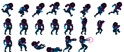
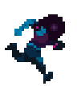

# 플립북 애니메이션

플립북 애니메이션은 연속으로 표시하는 정지 이미지의 모음입니다. 전통적인 셀 애니메이션과 매우 비슷한 기법입니다(http://en.wikipedia.org/wiki/Traditional_animation 참고). 각 프레임을 개별적으로 조작할 수 있으므로 표현의 가능성이 넓습니다. 하지만 서로 다른 이미지를 많이 저장하면 텍스쳐 메모리가 많이 필요할 수 있습니다. 애니메이션의 부드러움은 초당 표시하는 이미지 수에도 달려 있지만, 이미지 수를 늘리면 보통 작업량도 늘어납니다. Defold 플립북 애니메이션은 [아틀라스](/manuals/atlas)에 추가한 개별 이미지 또는 [타일 소스](/manuals/tilesource)의 타일로 저장됩니다. 타일 소스 애니메이션은 *Frames* 목록으로 이미지 격자의 타일을 임의의 순서로 선택하며 같은 타일을 반복할 수도 있습니다.

  {.inline}
  {.inline}

## 플립북 애니메이션 재생

Sprites와 GUI box nodes는 플립북 애니메이션을 재생할 수 있으며, 런타임에 세밀하게 제어할 수 있습니다.

Sprites
: 런타임 중 애니메이션을 실행하려면 [`sprite.play_flipbook()`](/ref/sprite/?q=play_flipbook#sprite.play_flipbook:url-id-[complete_function]-[play_properties]) 함수를 사용합니다. 예시는 아래를 참고하세요.

GUI box nodes
: 런타임 중 애니메이션을 실행하려면 [`gui.play_flipbook()`](/ref/gui/?q=play_flipbook#gui.play_flipbook:node-animation-[complete_function]-[play_properties]) 함수를 사용합니다. 예시는 아래를 참고하세요.

::: sidenote
`Once Ping Pong` 재생 모드는 애니메이션을 마지막 프레임까지 재생한 다음 순서를 반대로 하여 애니메이션의 **두 번째** 프레임까지 되돌아가며 재생합니다. 첫 번째 프레임까지 돌아가지 않습니다. 이렇게 하면 애니메이션을 이어 붙이기 더 쉬워집니다.
:::

### 스프라이트 예제

플레이어가 특정 버튼을 눌러 회피할 수 있는 "dodge" 기능이 게임에 있다고 가정해 봅시다. 이 기능의 시각적 피드백을 지원하기 위해 네 가지 애니메이션을 만들었습니다:

"idle"
: 플레이어 캐릭터가 대기 상태에 있는 루프 애니메이션입니다.

"dodge_idle"
: 플레이어 캐릭터가 회피 자세에서 대기하는 루프 애니메이션입니다.

"start_dodge"
: 플레이어 캐릭터를 서 있는 상태에서 회피 상태로 전환하는 한 번만 재생되는 전환 애니메이션입니다.

"stop_dodge"
: 플레이어 캐릭터를 회피 상태에서 다시 서 있는 상태로 전환하는 한 번만 재생되는 전환 애니메이션입니다.

다음 스크립트는 이 로직을 제공합니다:

```lua

local function play_idle_animation(self)
    if self.dodge then
        sprite.play_flipbook("#sprite", hash("dodge_idle"))
    else
        sprite.play_flipbook("#sprite", hash("idle"))
    end
end

function on_input(self, action_id, action)
    -- "dodge"는 입력 동작입니다
    if action_id == hash("dodge") then
        if action.pressed then
            sprite.play_flipbook("#sprite", hash("start_dodge"), play_idle_animation)
            -- 회피 중임을 기억합니다
            self.dodge = true
        elseif action.released then
            sprite.play_flipbook("#sprite", hash("stop_dodge"), play_idle_animation)
            -- 더 이상 회피 중이 아닙니다
            self.dodge = false
        end
    end
end
```

### GUI box node 예제

노드의 애니메이션이나 이미지를 선택할 때는 실제로 이미지 소스(아틀라스 또는 타일 소스)와 기본 애니메이션을 한 번에 할당하는 것입니다. 이미지 소스는 노드에 정적으로 설정되지만, 현재 재생할 애니메이션은 런타임에 변경할 수 있습니다. 정지 이미지는 한 프레임 애니메이션으로 취급되므로 이미지를 변경한다는 것은 런타임에 해당 노드에서 다른 플립북 애니메이션을 재생하는 것과 같습니다:

```lua
function init(self)
    local character_node = gui.get_node("character")
    -- 이 코드는 노드가 새로 재생할 애니메이션/이미지와 같은 atlas 또는 tile source에
    -- 있는 기본 애니메이션을 가지고 있어야 합니다.
    gui.play_flipbook(character_node, "jump_left")
end
```


## 완료 콜백

`sprite.play_flipbook()` 및 `gui.play_flipbook()` 함수는 마지막 인자로 선택적 Lua 콜백 함수를 지원합니다. 이 함수는 애니메이션이 끝까지 재생되면 호출됩니다. 루프 애니메이션에서는 이 함수가 호출되지 않습니다. 콜백은 애니메이션 완료 시 이벤트를 트리거하거나 여러 애니메이션을 이어 붙이는 데 사용할 수 있습니다. 예:

```lua
local function flipbook_done(self)
    msg.post("#", "jump_completed")
end

function init(self)
    sprite.play_flipbook("#character", "jump_left", flipbook_done)
end
```

```lua
local function flipbook_done(self)
    msg.post("#", "jump_completed")
end

function init(self)
    gui.play_flipbook(gui.get_node("character"), "jump_left", flipbook_done)
end
```
