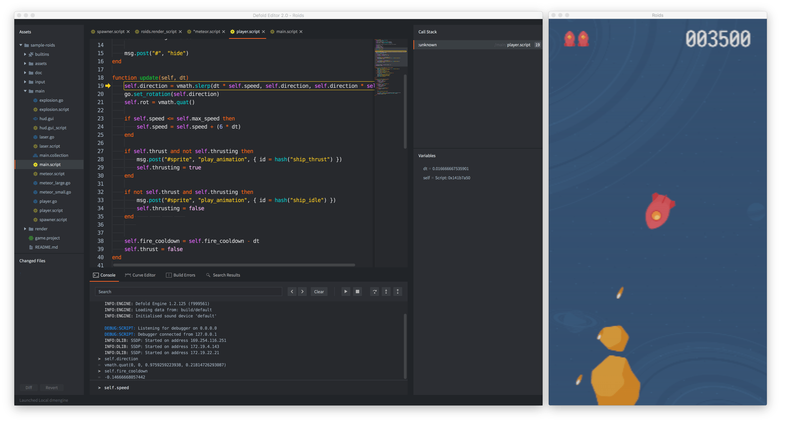
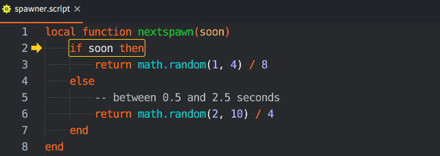
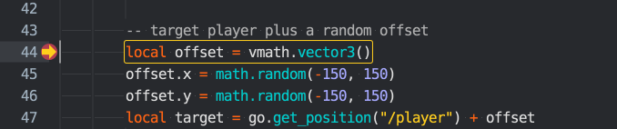
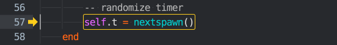
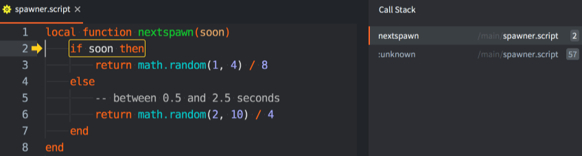
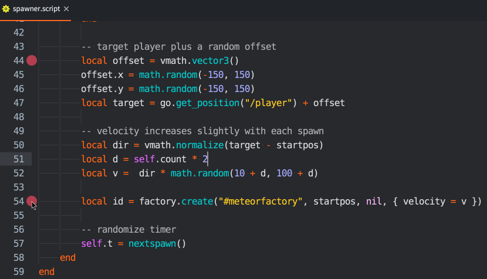
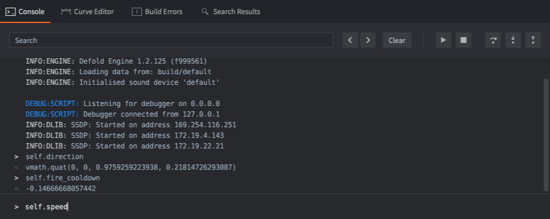
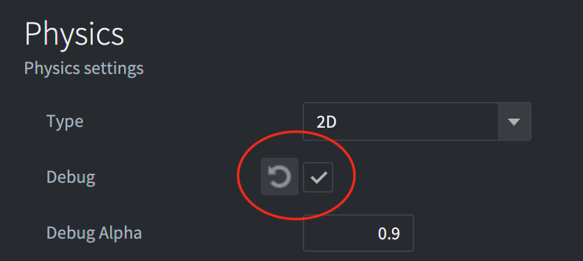
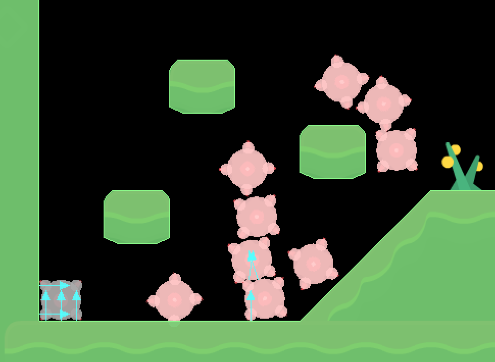

# Debugowanie logiki gry

Defold zawiera zintegrowany debugger Lua z możliwością inspekcji. W połączeniu z wbudowanymi [narzędziami profilowania](/manuals/profiling) jest to potężne narzędzie, które może pomóc znaleźć przyczynę błędów w logice gry albo przeanalizować problemy z wydajnością.

## Debugowanie za pomocą print i wizualne

Najprostszym sposobem debugowania gry w Defold jest [debugowanie za pomocą print](http://en.wikipedia.org/wiki/Debugging#Techniques). Używaj instrukcji `print()` lub [`pprint()`](/ref/builtins#pprint), aby obserwować zmienne lub wskazywać przepływ wykonania. Jeśli obiekt gry bez skryptu zachowuje się dziwnie, możesz po prostu dołączyć do niego skrypt wyłącznie do debugowania. Korzystanie z dowolnej z funkcji wypisywania spowoduje wyświetlenie wyniku w widoku *Console* w edytorze oraz w [logach gry](/manuals/debugging-game-and-system-logs).

Oprócz wypisywania, silnik może też rysować na ekranie tekst debugowania i proste linie. Robi się to przez wysyłanie wiadomości do socketu `@render`:

```lua
-- Narysuj na ekranie wartość "my_val" jako tekst debugowania
msg.post("@render:", "draw_text", { text = "My value: " .. my_val, position = vmath.vector3(200, 200, 0) })

-- Narysuj na ekranie kolorowy tekst
local color_green = vmath.vector4(0, 1, 0, 1)
msg.post("@render:", "draw_debug_text", { text = "Custom color", position = vmath.vector3(200, 180, 0), color = color_green })

-- Narysuj na ekranie linię debugowania między playerem a enemy
local start_p = go.get_position("player")
local end_p = go.get_position("enemy")
local color_red = vmath.vector4(1, 0, 0, 1)
msg.post("@render:", "draw_line", { start_point = start_p, end_point = end_p, color = color_red })
```

Wizualne wiadomości debugowania dodają dane do potoku renderowania i są rysowane jako część zwykłego potoku renderowania.

* `"draw_line"` dodaje dane renderowane przez funkcję `render.draw_debug3d()` w skrypcie do renderowania.
* `"draw_text"` jest renderowany przy użyciu `/builtins/fonts/debug/always_on_top.font`, który korzysta z materiału `/builtins/fonts/debug/always_on_top_font.material`.
* `"draw_debug_text"` jest tym samym co `"draw_text"`, ale jest renderowany w niestandardowym kolorze.

Pamiętaj, że prawdopodobnie chcesz aktualizować te dane co klatkę, więc wysyłanie tych wiadomości w funkcji `update()` jest dobrym pomysłem.

## Uruchamianie debugera

Debugger Lua jest dostępny w natywnych buildach debug i headless. Używaj silnika z tej samej wersji Defold co edytor. Buildy release i webowe nie obsługują dołączania debuggera.

Aby uruchomić debugger, wybierz <kbd>Debug ▸ Start/Attach</kbd>. Uruchamia to grę z dołączonym debuggerem albo dołącza go do już działającej gry. Przy uruchamianiu gry do debugowania edytor ustawia włączone punkty przerwania przed wykonaniem skryptów startowych, więc możesz ustawić punkt przerwania w `init()` przed uruchomieniem.

Aby dołączyć do urządzenia, wybierz je w <kbd>Project ▸ Targets</kbd>, a następnie wybierz <kbd>Debug ▸ Start/Attach</kbd>. Dołączenie wstrzymuje wykonanie na następnej linii Lua. Edytor automatycznie konfiguruje połączenie debuggera dla obsługiwanych celów lokalnych i zdalnych. Wymagania połączenia opisano w sekcji [Cele zdalne](#remote-targets); możesz też [podłączyć zewnętrzny debugger](#native-dap-connections).



Gdy tylko debuger zostanie dołączony, możesz sterować wykonaniem gry za pomocą przycisków sterowania debugerem w konsoli albo przez menu <kbd>Debug</kbd>:

Break
: {width=60px .left}
  Wstrzymuje wykonanie Lua na następnej linii kodu źródłowego. Możesz teraz sprawdzić stan gry, wykonywać ją krok po kroku albo kontynuować działanie do następnego punktu przerwania. Bieżący punkt wykonania jest oznaczony w edytorze kodu:

  

Continue
: {width=60px .left}
  Kontynuuje wykonywanie gry. Kod gry będzie działał dalej, dopóki nie naciśniesz pauzy albo wykonanie nie trafi w ustawiony punkt przerwania. Jeśli wykonanie zostanie zatrzymane na punkcie przerwania, punkt wykonania jest oznaczony w edytorze kodu nad znacznikiem breakpointa:

  

Stop
: {width=60px .left}
  Zatrzymuje debuger. Naciśnięcie tego przycisku natychmiast zatrzyma debuger, odłączy go od gry i zakończy uruchomioną grę.

Step Over
: {width=60px .left}
  Przechodzi o jeden krok dalej. Jeśli wykonanie obejmuje uruchomienie innej funkcji Lua, debuger nie wejdzie do tej funkcji, tylko będzie kontynuował działanie i zatrzyma się na następnej linii poniżej wywołania funkcji. W tym przykładzie, jeśli użytkownik naciśnie "step over", debuger wykona kod i zatrzyma się na instrukcji `end` poniżej linii z wywołaniem funkcji `nextspawn()`:

  

::: sidenote
Wykonywanie krokowe podąża za liniami kodu źródłowego Lua. Krok może ponownie odwiedzić tę samą linię, na przykład przy kolejnej iteracji pętli, więc nie zawsze przechodzi do następnej linii w pliku.
:::

Step Into
: {width=60px .left}
  Przechodzi o jeden krok dalej. Jeśli wykonanie obejmuje uruchomienie innej funkcji Lua, debuger wejdzie do tej funkcji. Wywołanie funkcji dodaje wpis na stosie wywołań. Możesz kliknąć każdy wpis na liście stosu wywołań, aby zobaczyć punkt wejścia i zawartość wszystkich zmiennych w tym domknięciu. W tym przykładzie użytkownik wszedł do funkcji `nextspawn()`:

  

Step Out
: {width=60px .left}
  Kontynuuje wykonywanie do momentu powrotu z bieżącej funkcji. Jeśli wszedłeś do funkcji podczas debugowania, naciśnięcie przycisku "step out" będzie kontynuować wykonanie aż do momentu zwrócenia przez funkcję.

Ustawianie i usuwanie breakpointów
: Możesz ustawić dowolną liczbę breakpointów w kodzie Lua. Gdy gra działa z dołączonym debugerem, zatrzyma się na następnym napotkanym breakpointcie i poczeka na dalszą interakcję z twojej strony.

  

  Aby ustawić lub usunąć breakpoint, kliknij w kolumnie bezpośrednio po prawej stronie numerów linii w edytorze kodu. Możesz też wybrać <kbd>Edit ▸ Toggle Breakpoint</kbd> z menu.

Wyłączanie i włączanie breakpointów
: Breakpointy można tymczasowo wyłączyć bez ich usuwania. Gdy są wyłączone, są ignorowane podczas wykonywania, ale można je włączyć ponownie w dowolnym momencie. Kliknij je prawym przyciskiem myszy w marginesie edytora kodu, a następnie przełącz pole wyboru <kbd>`Enabled`</kbd>. Wyłączone breakpointy są pokazane jako puste, aby zaznaczyć, że są nieaktywne.

  

Ustawianie breakpointów warunkowych
: Możesz skonfigurować breakpoint tak, aby zawierał warunek, który musi zostać spełniony, żeby breakpoint został wyzwolony. Warunek może korzystać z lokalnych zmiennych dostępnych w danym wierszu podczas wykonywania kodu.

  

  Aby edytować warunek breakpointa, kliknij prawym przyciskiem myszy w kolumnie bezpośrednio po prawej stronie numerów linii w edytorze kodu albo wybierz <kbd>Edit ▸ Edit Breakpoint</kbd> z menu.

Obliczanie wyrażeń Lua
: Gdy gra jest zatrzymana, wybierz ramkę w *Call Stack*, wpisz wyrażenie lub instrukcję Lua na dole konsoli i naciśnij <kbd>Enter</kbd>. Obliczanie korzysta ze zmiennych lokalnych, upvalues i zmiennych globalnych wybranej ramki. Wyniki będące tabelami zawierają również ich zagnieżdżoną zawartość.

  

  Możesz też zmieniać wartości przez przypisanie, na przykład `self.score = 100` w ramce, w której dostępne jest `self`. Obliczany kod wpływa na stan gry tak samo jak kod wykonywany przez grę.

Sprawdzanie zmiennych
: Wybierz ramkę w *Call Stack*, aby sprawdzić jej zmienne lokalne i upvalues w widoku *Variables*. Rozwiń `_G`, aby zobaczyć zmienne globalne, albo tabele i `self`, aby zobaczyć ich pola. Edytor zachowuje rozwinięte ścieżki, zaznaczenie i pozycję przewijania podczas wykonywania krokowego, przełączania ramek i odświeżania po obliczeniu wyrażenia, jednocześnie pobierając aktualne wartości.

Odłączanie debuggera
: Wybierz <kbd>Debug ▸ Detach Debugger</kbd>, aby odłączyć debugger od gry. Gra natychmiast wznowi działanie. Użyj <kbd>Debug ▸ Start/Attach</kbd>, aby dołączyć ponownie bez restartowania gry.

## Natywne połączenia DAP {#native-dap-connections}

Silnik udostępnia natywny serwer Debug Adapter Protocol (DAP) przez TCP. Aby użyć zewnętrznego klienta DAP, uruchom nasłuchiwanie w natywnym silniku Defold debug lub headless, a następnie połącz klienta z adresem i portem silnika. Edytor automatycznie konfiguruje nasłuchiwanie przy użyciu <kbd>Debug ▸ Start/Attach</kbd>.

Obecny edytor nie może łączyć się ze starszymi silnikami obsługującymi wyłącznie MobDebug. W bieżących wersjach wywołanie `require "builtins.scripts.mobdebug"` nie jest potrzebne ani dostępne.

### Uruchamianie nasłuchiwania {#starting-the-listener}

Najpierw zbuduj projekt. W katalogu projektu zawierającym `build/default/game.projectc` uruchom natywny silnik debug z następującymi [nadpisaniami konfiguracji przy starcie](/manuals/project-settings/#setting-config-values-on-engine-startup):

```sh
dmengine --config=debugger.enabled=1 \
  --config=debugger.port=8172 --config=debugger.wait=1
```

Połącz klienta DAP z `127.0.0.1:8172`. Silnik czeka, aż klient skonfiguruje punkty przerwania, zanim wykona skrypty startowe.

| Ustawienie | Domyślne | Zastosowanie |
| --- | --- | --- |
| `debugger.enabled` | `0` | Ustaw `1`, aby włączyć nasłuchiwanie podczas uruchamiania silnika. |
| `debugger.address` | `127.0.0.1` | Adres IPv4 do nasłuchiwania. Domyślnie przyjmowane są połączenia z tego samego komputera. |
| `debugger.port` | `8172` | Port nasłuchiwania TCP. Użyj `0`, aby wybrać dostępny port. |
| `debugger.wait` | `0` | Ustaw `1`, aby przed wykonaniem skryptów startowych czekać na konfigurację klienta debuggera. |

Możesz też dodać te wartości do [sekcji Debugger w game.project](/manuals/project-settings/#debugger). Edytor konfiguruje nasłuchiwanie automatycznie dla <kbd>Debug ▸ Start/Attach</kbd>, więc ręczna konfiguracja jest potrzebna tylko wtedy, gdy uruchamiasz nasłuchiwanie samodzielnie.

Log silnika podaje wybrany adres i port. Przy `debugger.wait=0` gra uruchamia się natychmiast i możesz dołączyć później. Przy `debugger.wait=1` czeka, aż klient zakończy konfigurację sesji, w tym punktów przerwania. Przy lokalnym uruchamianiu do debugowania edytor automatycznie wybiera dostępny port.

Odłączenie klienta wznawia wykonywanie i pozostawia nasłuchiwanie dostępne dla kolejnego połączenia. Rozłączenie podczas oczekiwania na konfigurację startową również zwalnia silnik. Jeśli nasłuchiwanie nie może się rozpocząć, silnik zapisuje błąd w logu i kontynuuje uruchamianie; możesz ponowić próbę z Lua przez `debugger.start(0)`, aby wybrać dostępny port.

### Włączanie nasłuchiwania podczas działania {#enabling-the-listener-while-running}

Aby włączyć nasłuchiwanie ze skryptu bez restartowania gry:

```lua
if debugger then
    local port = debugger.start(0)
    print("DAP listener port:", port)
end
```

`debugger.start([port [, address]])` natychmiast zwraca port nasłuchiwania. Nie czeka na klienta ani nie zatrzymuje gry. Pominięte argumenty korzystają z `debugger.port` i `debugger.address`; przekazanie `0` wybiera dostępny port. Kolejne wywołania zwracają port istniejącego nasłuchiwania i nie zmieniają jego adresu ani portu. Moduł `debugger` jest dostępny w natywnych silnikach debug i headless.

Port musi być liczbą całkowitą od `0` do `65535`. Przekaż `nil` jako pierwszy argument, aby nadpisać tylko adres. Nieprawidłowe argumenty lub niepowodzenie powiązania adresu nasłuchiwania powodują błąd Lua.

### Cele zdalne {#remote-targets}

Aby połączyć się bezpośrednio z innego komputera, powiąż nasłuchiwanie z interfejsem IPv4 urządzenia albo z `0.0.0.0` (wszystkie interfejsy IPv4). Użyj na przykład `debugger.start(8172, "0.0.0.0")` albo dodaj `--config=debugger.address=0.0.0.0` do powyższego polecenia startowego. Połącz klienta z rzeczywistym adresem IP urządzenia i zezwól na dostęp TCP do portu nasłuchiwania. `0.0.0.0` jest adresem powiązania, a nie adresem do wpisania w kliencie.

Edytor Defold automatycznie żąda takiego zdalnego powiązania i dla celów zdalnych używa portu `8172 + project.instance_index`. Nie potrafi wykryć dynamicznie wybranego portu zdalnego. Jeśli zdalne nasłuchiwanie uruchomiono już na localhost lub innym porcie, zrestartuj silnik przed dołączeniem z edytora.

Debugger może wykonywać Lua i nie ma uwierzytelniania. Włączaj dostęp zdalny tylko w zaufanej sieci programistycznej.

### Klienty zewnętrzne {#external-clients}

Użyj klienta obsługującego bezpośrednie dołączenie do serwera DAP przez TCP. Skonfiguruj mapowanie źródeł na folder zawierający `game.project` (argument dołączenia DAP `localRoot`). Najpierw uruchom nasłuchiwanie silnika, a następnie dołącz klienta.

#### VS Code

Zainstaluj [rozszerzenie Lua Debug](https://marketplace.visualstudio.com/items?itemName=actboy168.lua-debug) (`actboy168.lua-debug`), otwórz folder zawierający `game.project` w VS Code i dodaj następującą konfigurację do `.vscode/launch.json`:

```json
{
  "version": "0.2.0",
  "configurations": [
    {
      "name": "Attach to Defold Lua",
      "type": "lua",
      "request": "attach",
      "address": "127.0.0.1:8172",
      "debugServer": 8172,
      "localRoot": "${workspaceFolder}",
      "stopOnEntry": false
    }
  ]
}
```

Jeśli VS Code otwiera plik `.script`, `.gui_script` lub `.render_script` jako zwykły tekst, przed ustawieniem punktów przerwania wybierz **Lua** ze wskaźnika języka na pasku stanu.

Ustaw punkt przerwania, na przykład w funkcji `init()` skryptu. Uruchom silnik za pomocą [powyższego polecenia startowego](#starting-the-listener), a następnie wybierz **Attach to Defold Lua** w widoku **Run and Debug** programu VS Code. Przy `debugger.wait=1` silnik uruchamia skrypty startowe po ustawieniu punktów przerwania przez klienta. Ustaw `stopOnEntry` na `true`, jeśli chcesz dodatkowo zatrzymać wykonanie na następnej linii Lua po dołączeniu.

[Ustawienie `debugServer` programu VS Code](https://code.visualstudio.com/api/extension-guides/debugger-extension#development-setup-for-mock-debug) łączy bezpośrednio z lokalnym nasłuchiwaniem TCP silnika. Pole `address` jest wymagane przez konfigurację dołączenia rozszerzenia Lua Debug. Jeśli zmienisz port nasłuchiwania, zaktualizuj oba pola. `localRoot` musi wskazywać folder projektu, aby klient mógł mapować nazwy źródeł Lua silnika na twoje pliki.

W przypadku zdalnego silnika przekieruj jego port DAP na localhost i wpisz przekierowany port w obu polach albo użyj klienta DAP łączącego się bezpośrednio ze zdalnym hostem.

## Karta Breakpoints

  

  Podczas pracy z wieloma breakpointami w różnych skryptach karta <kbd>Breakpoints</kbd> zapewnia scentralizowany widok do zarządzania wszystkimi breakpointami w jednym miejscu.

##### Sterowanie pojedynczym breakpointem

  Do pracy z pojedynczymi breakpointami:
  - Kliknij czerwoną ikonę kosza, aby usunąć breakpoint
  - Kliknij dwukrotnie wiersz poza obszarem warunku, aby przejść do tej linii w widoku kodu
  - Kliknij dwukrotnie komórkę warunku albo kliknij ikonę pióra, aby edytować breakpointy warunkowe
  - Kliknij przycisk czyszczenia `X`, gdy najedziesz na komórkę warunku, aby wyczyścić warunek

##### Operacje zbiorcze

  Zaznacz wiele breakpointów za pomocą Ctrl/Cmd+klik lub Shift+klik, a następnie kliknij prawym przyciskiem myszy, aby wykonać operacje zbiorcze. Możesz jednocześnie edytować warunki kilku breakpointów, przełączać ich stan aktywności albo usuwać je całkowicie.

  Przyciski na pasku narzędzi pozwalają włączyć, wyłączyć lub przełączyć wszystkie breakpointy naraz, co jest przydatne, gdy chcesz uruchomić grę bez zatrzymywania, ale nie chcesz stracić ich położeń. Możesz też usunąć wszystkie, gdy skończysz sesję debugowania.

## Biblioteka debugowania Lua

Lua zawiera bibliotekę debugowania, która bywa przydatna w niektórych sytuacjach, szczególnie gdy trzeba zajrzeć do wnętrza środowiska Lua. Więcej informacji znajdziesz w [rozdziale o bibliotece debugowania (Debug Library) w podręczniku Lua](http://www.lua.org/pil/contents.html#23).

## Lista kontrolna debugowania

Jeśli napotkasz błąd albo gra nie zachowuje się zgodnie z oczekiwaniami, skorzystaj z poniższej listy kontrolnej debugowania:

1. Sprawdź zawartość konsoli i upewnij się, że nie ma błędów wykonania.

2. Dodaj do kodu instrukcje `print`, aby potwierdzić, że kod rzeczywiście się wykonuje.

3. Jeśli kod się nie wykonuje, sprawdź, czy w edytorze wykonano wszystkie wymagane czynności konfiguracyjne. Czy skrypt został dodany do właściwego obiektu gry? Czy skrypt przechwycił fokus wejścia? Czy wyzwalacze wejścia są poprawne? Czy kod shadera został dodany do materiału? I tak dalej.

4. Jeśli kod zależy od wartości zmiennych, na przykład w instrukcji `if`, wypisz te wartości za pomocą `print` tam, gdzie są używane lub sprawdzane, albo zbadaj je za pomocą debugera.

Czasami znalezienie błędu jest trudnym i czasochłonnym procesem, który wymaga przechodzenia przez kod krok po kroku, sprawdzania wszystkiego, zawężania obszaru błędu i eliminowania źródeł problemu. Najlepiej zrobić to metodą „dziel i rządź”:

1. Ustal, która połowa kodu, albo mniejsza część, musi zawierać błąd.
2. Ponownie ustal, która połowa z tej połowy musi zawierać błąd.
3. Kontynuuj zawężanie kodu, który musi powodować błąd, aż go znajdziesz.

Powodzenia w poszukiwaniach!

## Debugowanie problemów z fizyką {#debugging-problems-with-physics}

Jeśli masz problemy z fizyką i kolizje nie działają zgodnie z oczekiwaniami, zaleca się włączenie debugowania fizyki. Zaznacz pole wyboru *Debug* w sekcji *Physics* pliku *game.project*:



Gdy to pole wyboru jest zaznaczone, Defold będzie rysować wszystkie kształty kolizji i punkty kontaktu kolizji:


