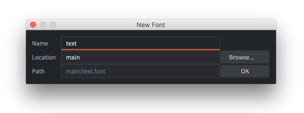
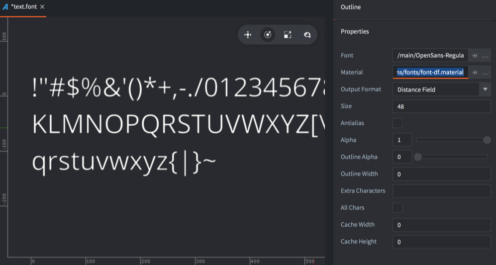
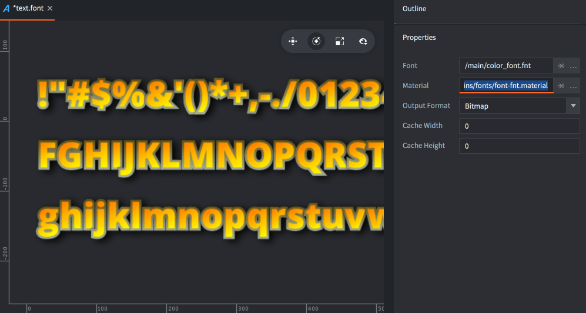
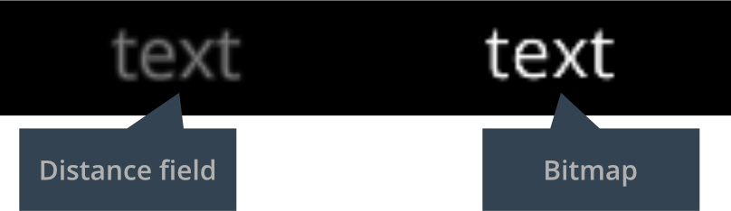

# Pliki fontów

Fonty służą do renderowania tekstu w komponentach Label oraz węzłach tekstowych GUI. Defold obsługuje kilka formatów plików fontów:

- TrueType
- OpenType
- BMFont

Zarówno starszy, jak i pełny system układu tekstu obsługują kontury TrueType oraz kontury OpenType CFF1/CFF2, w tym generowanie w czasie działania z zasobów `.ttf` i `.otf`.

Informacje o stylizowaniu poszczególnych fragmentów tekstu oraz pracy z odnośnikami i obrazami osadzonymi w tekście znajdziesz w [instrukcji znaczników tekstu formatowanego](/manuals/font-richtext).

Dla fontów TrueType i OpenType właściwość *Mode* wybiera sposób renderowania glifów:

- **Bitmap** używa zrasteryzowanych obrazów glifów.
- **SDF** (signed distance field) zapisuje w teksturze odległości do krawędzi glifów, umożliwiając bardziej elastyczne skalowanie niż Bitmap.
- **Vector** renderuje kształty glifów z danych krzywych, zachowując ostrość przy skalowaniu. Efekty obrysu i cienia nadal używają danych bitmapowych.

Nowo tworzone zasoby fontów używają trybu **Vector** i generowania glifów **Dynamic**. Istniejące zasoby zachowują tryb Bitmap lub SDF. Źródła BMFont zawsze używają dostarczonej bitmapy.

Tryb Vector wymaga obsługi tekstur `RGBA16F` i `R32UI` i nie jest obsługiwany w OpenGL ES 2 ani WebGL 1. Dla nieobsługiwanych adapterów graficznych używaj fontów Bitmap lub SDF i pasujących materiałów; nie ma automatycznego przełączania z Vector na SDF. Konfigurację opisuje sekcja [Fonty wektorowe](#vector-fonts).

## Fonty offline i runtime fonts

Właściwość *Glyph Generation* wybiera moment generowania danych glifów każdego fontu:

- **Static** generuje wybrane glify podczas budowania (offline). *Characters* i *All Chars* określają, które glify zostaną dołączone. Źródłowy plik `.ttf` lub `.otf` nie jest dołączany do paczki do generowania w czasie działania.
- **Dynamic** dołącza źródłowy plik `.ttf` lub `.otf` i generuje glify na żądanie w czasie działania. *Prewarm Text* przygotowuje glify podczas ładowania fontu. Pozostałe glify mogą być generowane później według potrzeb.

Fonty SDF i Vector obsługują obie opcje. Fonty Bitmap i źródła BMFont używają generowania Static. Każdy zasób fontu jest konfigurowany niezależnie, więc projekt może łączyć fonty Static i Dynamic.

Generowanie dynamiczne może zmniejszyć rozmiar paczki i zużycie pamięci w czasie działania, szczególnie dla fontów z dużym zestawem znaków. Wymaga pełnego systemu układu tekstu w silniku; zobacz [Włączanie generowania fontów w czasie działania](#enabling-runtime-fonts).

<a id="text-layout-support-eg-right-to-left"></a>

## Obsługa układu tekstu, np. right-to-left

Runtime fonts mają też tę zaletę, że obsługują pełny układ tekstu, np. right-to-left.
Obecnie używamy bibliotek [HarfBuzz](https://github.com/harfbuzz/harfbuzz), [SheenBidi](https://github.com/Tehreer/SheenBidi), [libunibreak](https://github.com/adah1972/libunibreak) oraz [SkriBidi](https://github.com/memononen/Skribidi).

Zobacz [Włączanie runtime fonts](/manuals/font#enabling-runtime-fonts)

Edytor używa mechanizmu renderowania fontów silnika do podglądu fontów i tekstu w scenach. Kształtowanie tekstu i układ od prawej do lewej wymagają [fontów generowanych w czasie działania](#enabling-runtime-fonts) oraz opcji **Use full text layout system** w manifeście aplikacji. Dla fontów przygotowywanych offline podgląd uwzględnia ustawienia **Characters** i **All Chars** fontu.

## Kolekcja fontów

Format pliku `.fontc` jest też znany jako font collection, czyli kolekcja fontów. W trybie offline jest z nim powiązany tylko jeden font.
W przypadku runtime fonts możesz powiązać z kolekcją fontów więcej niż jeden plik fontu (`.ttf` lub `.otf`).

Dzięki temu można używać kolekcji fontów podczas renderowania wielu tekstów w różnych językach, a jednocześnie utrzymać niski ślad pamięciowy.
Na przykład można załadować kolekcję z japońskim fontem, skojarzyć ten font z bieżącym głównym fontem, a następnie zwolnić japońską kolekcję fontów.

## Tworzenie fontu

Aby utworzyć font do użycia w Defold, wybierz z menu <kbd>File ▸ New...</kbd>, a następnie <kbd>Font</kbd>. Możesz też <kbd>right click</kbd> w wybranym miejscu panelu *Assets* i wybrać <kbd>New... ▸ Font</kbd>.



Nadaj nowemu plikowi nazwę i kliknij <kbd>Ok</kbd>. Nowy plik otworzy się teraz w edytorze.


Przeciągnij font, którego chcesz użyć, do panelu *Assets* i upuść go w odpowiednim miejscu.

Ustaw właściwość *Font* na plik fontu. Dla źródła `.ttf` lub `.otf` wybierz *Mode* i *Glyph Generation*, a następnie skonfiguruj pozostałe właściwości według potrzeb. Dla generowania Dynamic wykonaj też [konfigurację fontów generowanych w czasie działania](#enabling-runtime-fonts).


W przypadku fontów Vector używaj *Font Size* komponentu Label lub węzła tekstowego GUI do zmiany wyświetlanego rozmiaru tekstu. *Outline/Shadow Bitmap Size* steruje rozdzielczością bitmap efektów niezależnie od rozmiaru wyświetlanego tekstu.

Dla fontów Bitmap i SDF ustaw *Size* w zasobie fontu, aby wybrać rozmiar generowanych glifów. Rozmiary BMFont pochodzą ze źródłowego pliku `.fnt`. Aby zmienić wyświetlany rozmiar tych fontów, skaluj komponent Label lub węzeł tekstowy GUI.

## Właściwości {#properties}

*Font*
: Plik TTF, OTF albo *`.fnt`* używany do wygenerowania danych fontu.

*Material*
: Materiał używany do renderowania fontu. Musi pasować do trybu fontu; zobacz [Materiały fontów](#font-materials).

*Mode*
: Technika renderowania źródła `.ttf` lub `.otf`: **Bitmap**, **SDF** albo **Vector**. Zastępuje dawną właściwość *Output Format*. Nie jest wyświetlana dla źródeł BMFont.

*Glyph Generation*
: **Static** generuje dane glifów podczas budowania. **Dynamic** generuje je w czasie działania i wymaga [pełnego systemu układu tekstu](#enabling-runtime-fonts). Ta właściwość jest dostępna dla fontów SDF i Vector. W trybie Bitmap jest ustalona na Static, a dla źródeł BMFont nie jest wyświetlana.

*Render Mode*
: Układ warstw generowanych fontów Bitmap. Ta właściwość jest wyświetlana tylko w trybie Bitmap dla źródeł `.ttf` i `.otf`. Dla SDF, Vector i BMFont silnik Defold wybiera układ warstw automatycznie.

  - **Single Layer** tworzy pojedynczy czworokąt dla każdego znaku.
  - **Multi Layer** tworzy osobne czworokąty dla kształtu glifu, obrysu i cienia. Warstwy są renderowane od tyłu do przodu, co zapobiega zasłanianiu poprzednio wyrenderowanych znaków, gdy obrys jest szerszy niż odstęp między glifami. Umożliwia to również przesunięcia cienia określone przez *Shadow X/Y*.

*Size*
: Rozmiar glifów w pikselach używany do generowania danych fontów Bitmap lub SDF. Dla źródeł BMFont rozmiar jest odczytywany z pliku `.fnt` i nie można go tu edytować.

*Outline/Shadow Bitmap Size*
: W trybie Vector zastępuje *Size*. Steruje rozdzielczością bitmap włączonych efektów obrysu i cienia, zarówno dla generowania Static, jak i Dynamic. Jest wyłączone, gdy żaden efekt nie jest włączony, ponieważ kształty glifów używają danych krzywych. Zmiana *Font Size* etykiety lub węzła tekstowego GUI nie zmienia tej współdzielonej rozdzielczości bitmapy.

*Antialias*
: Określa, czy wygładzać glify podczas generowania danych fontu Bitmap. Wyłącz je, aby uzyskać renderowanie z zachowaniem pojedynczych pikseli. Ta właściwość jest wyświetlana tylko w trybie Bitmap dla źródeł `.ttf` i `.otf`.

*Alpha*
: Przezroczystość glifu. Zakres 0.0-1.0, gdzie 0.0 oznacza pełną przezroczystość, a 1.0 pełną nieprzezroczystość.

*Outline Alpha*
: Przezroczystość wygenerowanego obrysu. Zakres 0.0-1.0.

*Outline Width*
: Szerokość wygenerowanego obrysu w pikselach. Ustaw 0, jeśli obrys nie jest potrzebny.

*Shadow Alpha*
: Przezroczystość wygenerowanego cienia. Zakres 0.0-1.0.

::: sidenote
Wbudowany shader fontów Bitmap obsługuje cienie w trybach renderowania *Single Layer* i *Multi Layer*. Dla generowanych fontów Bitmap używających *Single Layer* i niewymagających cieni własny materiał może używać `/builtins/fonts/font-singlelayer.fp`. Fonty SDF i Vector wymagają shaderów pasujących do ich trybu; zobacz [Materiały fontów](#font-materials).
:::

*Shadow Blur*
: Stopień rozmycia wygenerowanego cienia. Ustaw 0, aby uzyskać ostry cień.

*Shadow X/Y*
: Poziome i pionowe przesunięcie wygenerowanego cienia w pikselach. Dla generowanych fontów Bitmap użyj trybu *Multi Layer*, aby zastosować te przesunięcia. Defold automatycznie wybiera odpowiednie warstwy dla fontów SDF i Vector.

*Characters*
: Dla generowania Static określa znaki dołączane do zbudowanego fontu. Domyślnie zawiera drukowalne znaki ASCII (kody 32-126). Dodawaj lub usuwaj znaki, aby określić glify dostępne w czasie działania.

*Prewarm Text*
: Dla generowania Dynamic zastępuje *Characters*. Tekst służy do generowania glifów i przygotowania pamięci podręcznej podczas ładowania fontu. Nie ogranicza znaków, które mogą zostać wygenerowane później. Możesz też przygotować tekst ze skryptu przez [`font.prewarm_text()`](/ref/font/#font.prewarm_text).

::: sidenote
Drukowalne znaki ASCII to:
space ! " # $ % & ' ( ) * + , - . / 0 1 2 3 4 5 6 7 8 9 : ; < = > ? @ A B C D E F G H I J K L M N O P Q R S T U V W X Y Z [ \ ] ^ _ \` a b c d e f g h i j k l m n o p q r s t u v w x y z { | } ~
:::

*All Chars*
: Dla generowania Static dołącza każdy glif dostępny w źródle zamiast ograniczać font do *Characters*. Ta właściwość jest ukryta dla fontów Dynamic.

*Cache Width/Height*
: Ogranicza rozmiar bitmapy cache glifów używanej przez fonty Bitmap i SDF oraz efekty obrysu i cienia fontów Vector. Gdy silnik renderuje tekst, wyszukuje glif w bitmapie cache. Jeśli go tam nie ma, zostanie on dodany do cache przed renderowaniem. Jeśli bitmapa cache jest zbyt mała, aby pomieścić wszystkie glify, które silnik ma wyrenderować, zostanie zgłoszony błąd (`ERROR:RENDER: Out of available cache cells! Consider increasing cache_width or cache_height for the font.`).

  Jeśli ustawisz tę właściwość na 0, rozmiar cache zostanie dobrany automatycznie i może wzrosnąć maksymalnie do 2048x4096.

## Materiały fontów {#font-materials}

Używaj materiału pasującego do trybu fontu. *Material* zasobu fontu jest używany przez węzły tekstowe GUI. Komponenty Label mają osobną właściwość *Material*, która również musi pasować do fontu:

| Tryb lub źródło fontu | Materiał fontu dla tekstu GUI | Materiał komponentu Label |
| --- | --- | --- |
| Bitmap | `/builtins/fonts/font.material` | `/builtins/fonts/label.material` |
| SDF | `/builtins/fonts/font-df.material` | `/builtins/fonts/label-df.material` |
| Vector | `/builtins/fonts/font-vector.material` | `/builtins/fonts/label-vector.material` |
| BMFont (`.fnt`) | `/builtins/fonts/font-fnt.material` | `/builtins/fonts/label-fnt.material` |

Zmiana *Mode* w edytorze fontów przełącza między odpowiadającymi wbudowanymi materiałami Bitmap, SDF i Vector, jeśli jeden z nich jest już przypisany do fontu. Własne materiały nie są zastępowane automatycznie. Sprawdź również właściwość *Material* komponentów Label korzystających z fontu.

## Fonty wektorowe {#vector-fonts}

Fonty wektorowe renderują kształty glifów z krzywych, dzięki czemu zachowują ostrość przy zmianie wyświetlanego rozmiaru tekstu. Aby skonfigurować font generujący glify w czasie działania:

1. Utwórz zasób `.font`, na przykład `/fonts/ui.font`, i wybierz źródło TrueType lub OpenType we właściwości *Font*. Do zwykłego tekstu możesz użyć wbudowanego `/builtins/fonts/vera_mo_bd.ttf`.
2. Ustaw *Mode* na **Vector**, *Glyph Generation* na **Dynamic**, a *Material* na `/builtins/fonts/font-vector.material`. Są to wartości domyślne nowo tworzonych zasobów fontów.
3. Włącz **Use full text layout system** w manifeście aplikacji przypisanym do projektu. Postępuj zgodnie z sekcją [Włączanie generowania fontów w czasie działania](#enabling-runtime-fonts), aby skonfigurować niestandardowy silnik.
4. Włącz [Shader ▸ Exclude GLES 2.0](/manuals/project-settings/#exclude-gles-20) w *game.project*.
5. Przypisz font do [etykiety](/manuals/label/) albo dodaj go do *Fonts* sceny GUI i wybierz we [węźle tekstowym](/manuals/gui-text/). Dla etykiety ustaw również *Material* komponentu na `/builtins/fonts/label-vector.material`. Ustaw *Font Size* komponentu lub węzła na żądany rozmiar wyświetlania.

Kształty glifów Vector używają tekstur krzywych, ale włączone obrysy i cienie nadal generują dane bitmapowe SDF i zajmują pamięć tekstury cache glifów. *Outline/Shadow Bitmap Size* ustala rozdzielczość bitmapy niezależnie od *Font Size* etykiety lub węzła tekstowego GUI. Ustaw *Outline Alpha* i *Shadow Alpha* na `0`, gdy te efekty nie są potrzebne, aby uniknąć generowania ich danych bitmapowych.

### Kolorowe emoji {#color-emoji}

Fonty Vector mogą renderować kolorowe emoji COLRv1, w tym kolory palety oraz gradienty liniowe i promieniste. Tryby Bitmap i SDF nie renderują kolorów COLRv1. Użyj powyższej konfiguracji Dynamic Vector, a następnie dodaj font emoji COLRv1 jako font zapasowy do kolekcji. Zwykły tekst nadal korzysta z oryginalnego fontu.

Na przykład skopiuj [font Noto Color Emoji COLRv1](https://github.com/google/fonts/blob/main/ofl/notocoloremoji/NotoColorEmoji-Regular.ttf) do projektu jako `/fonts/NotoColorEmoji-Regular.ttf`. Wybierz wersję COLRv1: inne fonty emoji mogą używać odmiennego formatu kolorów nawet wtedy, gdy nazwa ich pliku kończy się na `.ttf`.

Dopisz `/fonts/NotoColorEmoji-Regular.ttf` do **Project ▸ Custom Resources** w *game.project*. Jeśli nie ma innych zasobów niestandardowych, ustawienie wygląda tak:

```ini
[project]
custom_resources = /fonts/NotoColorEmoji-Regular.ttf
```

Ścieżka fontu zapisana w Lua nie powoduje dołączenia pliku fontu do paczki. [Custom Resources](/manuals/project-settings/#custom-resources) udostępnia ten font źródłowy funkcji [`font.add_font()`](/ref/font/#font.add_font), która ładuje go przez system zasobów. Przy ładowaniu z paczki przekaż ścieżkę fontu źródłowego jako ciąg znaków.

Dodawaj font zapasowy tylko raz dla współdzielonego zasobu fontu. Zmiana wpływa na każdą etykietę i węzeł tekstowy GUI korzystający z tego fontu, a dwukrotne dodanie tego samego fontu zapasowego powoduje błąd. Jeśli używasz [przykładu etykiety](/manuals/label/#vector-fonts-and-color-emoji) i [przykładu GUI](/manuals/gui-text/#vector-fonts-and-color-emoji) z tym samym `.font`, skoordynuj inicjalizację, aby font zapasowy został dodany raz, zanim którykolwiek przykład przygotuje lub wyświetli tekst. Przykłady przygotowują cały tekst po dodaniu fontu zapasowego i wyświetlają go po pomyślnym wywołaniu zwrotnym.

## Fonty typu Distance field

Fonty typu Distance field przechowują w teksturze odległość do krawędzi glifu zamiast danych bitmapowych. Gdy silnik renderuje taki font, potrzebny jest specjalny shader interpretujący dane odległości i używający ich do rysowania glifu. Fonty typu Distance field są bardziej zasobożerne niż fonty bitmapowe, ale zapewniają większą elastyczność skalowania.



Wybierz **SDF** w *Mode* oraz **Static** albo **Dynamic** w *Glyph Generation*. Używaj *`/builtins/fonts/font-df.material`* dla fontu i *`/builtins/fonts/label-df.material`* dla komponentów Label albo własnych materiałów obsługujących dane pola odległości.

## Bitmap BMFonts

Oprócz generowanych bitmap Defold obsługuje także wstępnie przygotowane fonty bitmapowe w formacie BMFont. Taki font składa się z arkusza fontu PNG zawierającego wszystkie glify. Dodatkowo plik *`.fnt`* zawiera informacje o położeniu każdego glifu na arkuszu, a także o jego rozmiarze i kerningu. Pamiętaj, że Defold nie obsługuje wersji XML formatu *`.fnt`*, używanej przez Phaser i niektóre inne narzędzia.

Tego typu fonty nie dają poprawy wydajności względem fontów bitmapowych generowanych z plików TrueType albo OpenType, ale mogą zawierać dowolną grafikę, kolorowanie i cienie bezpośrednio w obrazie.

Dodaj wygenerowane pliki *`.fnt`* i *`.png`* do projektu Defold. Pliki te powinny znajdować się w tym samym folderze. Utwórz nowy plik fontu i ustaw *Font* na plik *`.fnt`*. Defold używa dostarczonej bitmapy i odczytuje jej rozmiar z pliku `.fnt`. *Mode* i *Glyph Generation* nie są wyświetlane dla źródeł BMFont.

::: sidenote
Aby utworzyć BMFont, potrzebujesz narzędzia, które potrafi wygenerować odpowiednie pliki. Dostępnych jest kilka opcji:

* [Bitmap Font Generator](http://www.angelcode.com/products/bmfont/), narzędzie tylko dla Windows od AngelCode.
* [Shoebox](http://renderhjs.net/shoebox/), darmowa aplikacja oparta na Adobe Air dla Windows i macOS.
* [Hiero](https://libgdx.com/wiki/tools/hiero), narzędzie open source oparte na Javie.
* [Glyph Designer](https://71squared.com/glyphdesigner), komercyjne narzędzie dla macOS od 71 Squared.
* [bmGlyph](https://www.bmglyph.com), komercyjne narzędzie dla macOS od Sovapps.
:::



Ustaw *Material* fontu na *`/builtins/fonts/font-fnt.material`*. Dla komponentów Label używaj *`/builtins/fonts/label-fnt.material`*.

## Artefakty i dobre praktyki

Zasadniczo fonty bitmapowe sprawdzają się najlepiej wtedy, gdy font nie jest skalowany. Są też szybsze w renderowaniu na ekranie niż fonty typu distance field.

Fonty typu Distance field bardzo dobrze znoszą powiększanie. Fonty bitmapowe natomiast są po prostu obrazami pikselowymi, więc przy skalowaniu ich piksele rosną razem z fontem, co powoduje blokowe artefakty. Poniżej znajduje się przykład fontu o rozmiarze 48 pikseli, powiększonego 4 razy.


Podczas zmniejszania tekstury bitmapowe można ładnie i wydajnie skalować w dół oraz wygładzać przez GPU. Font bitmapowy lepiej zachowuje też kolor niż font typu distance field. Oto zbliżenie tego samego przykładowego fontu o rozmiarze 48 pikseli, zmniejszonego do 1/5 oryginalnego rozmiaru:



Fonty typu Distance field muszą być renderowane do docelowego rozmiaru wystarczająco dużego, aby pomieścić informacje o odległości opisujące krzywizny glifów. Poniżej pokazano ten sam font co wyżej, ale w rozmiarze 18 pikseli i powiększony 10 razy. Widać wyraźnie, że to za mały rozmiar, aby poprawnie zakodować kształty tego kroju pisma:


Jeśli nie chcesz obsługi cienia ani obrysu, ustaw ich odpowiednie wartości alfa na zero. W przeciwnym razie dane cienia i obrysu nadal będą generowane i zajmą niepotrzebnie pamięć. W trybie Vector wyłączenie obu efektów zapobiega generowaniu ich danych bitmapowych; kształty glifów nadal używają danych krzywych.

## Pamięć podręczna fontu

Zasoby fontów Bitmap i SDF używają podczas działania tekstury cache glifów oraz danych fontu. Fonty Vector przechowują kształty glifów jako dane krzywych i używają cache bitmap dla włączonych efektów obrysu i cienia. Opisany poniżej układ tekstury dotyczy fontów Bitmap i SDF.

* Dane fontu składają się z listy wpisów glifów, z których każdy zawiera podstawowe informacje o kerningu oraz dane bitmapowe tego glifu.
* Tekstura jest wewnętrznie nazywana "glyph cache texture" i jest używana podczas renderowania tekstu dla konkretnego fontu.

Podczas renderowania tekstu w runtime silnik najpierw przechodzi po glifach, które mają zostać wyrenderowane, i sprawdza, które z nich są dostępne w pamięci podręcznej tekstury. Każdy brakujący glif powoduje przesłanie do tekstury danych bitmapowych przechowywanych w danych fontu.

Każdy glif jest wewnętrznie umieszczany w cache zgodnie z linią bazową fontu, co umożliwia obliczanie lokalnych współrzędnych tekstury glifu wewnątrz odpowiadającej mu komórki cache bezpośrednio w shaderze. Dzięki temu można dynamicznie uzyskiwać pewne efekty tekstowe, takie jak gradienty albo nakładki tekstur. Silnik udostępnia metryki cache shaderowi przez specjalną stałą shadera `texture_size_recip`, która zawiera następujące informacje w komponentach wektora:

* `texture_size_recip.x` to odwrotność szerokości cache
* `texture_size_recip.y` to odwrotność wysokości cache
* `texture_size_recip.z` to stosunek szerokości komórki cache do szerokości całego cache
* `texture_size_recip.w` to stosunek wysokości komórki cache do wysokości całego cache

Na przykład, aby wygenerować gradient w shaderze fragmentu, wystarczy napisać:

`float horizontal_gradient = fract(var_texcoord0.y / texture_size_recip.w);`

Więcej informacji o uniformach shaderów znajdziesz w [Shader manual](/manuals/shader).

## Włączanie runtime fonts {#enabling-runtime-fonts}

Generowanie w czasie działania jest konfigurowane osobno dla każdego zasobu fontu:

1. Otwórz zasób `.font` i wybierz źródło TrueType (`.ttf`) lub OpenType (`.otf`).
2. Ustaw *Mode* na **SDF** albo **Vector**, a *Glyph Generation* na **Dynamic**.
3. Wybierz pasujące [materiały fontu i etykiety](#font-materials).
4. Dodaj [manifest aplikacji](/manuals/app-manifest), przypisz go do *Native Extensions ▸ App Manifest* w *game.project* i włącz **Use full text layout system**. Spowoduje to zbudowanie niestandardowego silnika z generowaniem fontów w czasie działania i obsługą pełnego układu tekstu.
5. Ustaw *Prewarm Text* na tekst, który zostanie wyświetlony niedługo po załadowaniu fontu. Dla tekstu potrzebnego później użyj [`font.prewarm_text()`](/ref/font/#font.prewarm_text) i poczekaj na wywołanie zwrotne przed wyświetleniem.

Nowe zasoby fontów już używają trybu Vector i generowania Dynamic, ale nadal wymagają powyższej konfiguracji manifestu aplikacji.


### Skryptowanie fontów

#### Wstępne podgrzewanie cache glifów

Fonty Dynamic generują glify wymagane przez *Prewarm Text* podczas ładowania fontu. Pole jest interpretowane jako tekst do ułożenia, więc pamięć podręczna jest przygotowywana dla glifów potrzebnych temu tekstowi. *All Chars* nie jest dostępne dla fontów Dynamic.

Możesz też wywołać `font.prewarm_text(font_collection, text, callback)` dla fontu Dynamic. Wywołanie zwrotne informuje, kiedy wszystkie brakujące glify zostaną dodane do cache i można bezpiecznie wyświetlić tekst. Tej funkcji nie można używać z fontami Static.

### Dodawanie i usuwanie fontów z kolekcji fontów

Dla fontów Dynamic można dodawać i usuwać fonty źródłowe (`.ttf` lub `.otf`) z kolekcji fontów.
Jest to przydatne, gdy duży font podzielono na kilka plików dla różnych zestawów znaków (np. CJK).

::: important
Dodanie fontu do font collection nie powoduje automatycznego załadowania ani wyrenderowania wszystkich glifów.
:::

```lua
function init(self)
    -- Pobierz docelową kolekcję fontów.
    self.font_collection = go.get("#label", "font")

    -- Pobierz pierwszy font przypisany do kolekcji wybranego języka.
    local language_collection = go.get("localization_japanese#label", "font")
    local font_info = font.get_info(language_collection)
    self.language_ttf_hash = font_info.fonts[1].path_hash

    -- Powiąż go z kolekcją docelową i zwiększ jego licznik referencji.
    font.add_font(self.font_collection, self.language_ttf_hash)
end
```

```lua
function final(self)
    -- Usuń powiązanie i zwolnij referencję do fontu.
    font.remove_font(self.font_collection, self.language_ttf_hash)
end
```

### Wstępne podgrzewanie glifów

Aby poprawnie wyświetlić tekst przy użyciu runtime font, glify muszą zostać rozwiązane. `font.prewarm_text()` robi to za ciebie.
Jest to operacja asynchroniczna. Gdy się zakończy i otrzymasz callback, możesz bezpiecznie przejść do wyświetlenia dowolnej wiadomości zawierającej te glify.

::: important
Jeśli cache glifów się zapełni, najstarszy glif zostanie z niego usunięty.
:::

```lua
font.prewarm_text(self.font_collection, info.text, function (self, request_id, result, err)
    if result then
      print("PREWARMING OK!")
      go.set(self.label, "text", info.text)
    else
      print("Error prewarming text:", err)
    end
  end)
```
