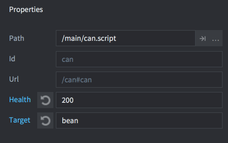

# Defold dla użytkowników Godot {#defold-for-godot-users}

Jeśli masz już doświadczenie z Godot, wiele rzeczy potrzebnych do stworzenia gry w Defold już znasz. Ten przewodnik pokazuje, jak wykorzystać tę wiedzę, żeby szybko zacząć pracę, oraz na jakie różnice uważać, by uniknąć typowych pułapek. W przykładach używamy Godot 4.7.

## Wprowadzenie {#introduction}

Defold to darmowy, wieloplatformowy silnik do gier 2D i 3D z edytorem dla systemów Windows, Linux i macOS. Pełny kod źródłowy silnika i edytora jest dostępny na [GitHubie](https://github.com/defold/defold/). Możesz samodzielnie zbudować Defold lub pobrać gotową wersję dla swojego systemu.

Na pierwszy rzut oka Defold bardzo przypomina Godot. W obu silnikach składasz grę z elementów wielokrotnego użytku, a ich zachowanie opisujesz w skryptach. Godot udostępnia wiele wyspecjalizowanych węzłów. Defold ma mniej komponentów, za to mają one bardziej ogólne zastosowanie. Logikę rozgrywki dodajesz w skryptach i modułach Lua. Na przykład postać gracza może być obiektem gry (ang. game object) z kilkoma komponentami: sprite’em lub modelem, obiektem kolizji i skryptem.

Defold kładzie nacisk na mały rozmiar silnika i oszczędne wykorzystanie zasobów. Ma to szczególne znaczenie w grach przeglądarkowych i mobilnych. Niektóre limity silnika określasz z góry, dzięki czemu może on zawczasu zarezerwować pamięć.

Defold ma mniej gotowych elementów rozgrywki i interfejsu niż Godot, ale możesz łączyć lub rozszerzać jego podstawowe komponenty, aby uzyskać ten sam efekt. Sam rdzeń silnika jest możliwie mały. Możesz go jeszcze zmniejszyć, wykluczając zbędne funkcje, albo rozbudować za pomocą rozszerzeń natywnych (Native Extensions) i modułów Lua. W [Defold Asset Portal](https://defold.com/assets/) znajdziesz setki modułów, bibliotek i rozszerzeń, które pomagają na przykład budować złożone interfejsy, tworzyć bardziej zaawansowane potoki renderowania czy upraszczać codzienne zadania.

Więcej informacji znajdziesz na [stronie opisującej możliwości silnika Defold](https://defold.com/product/).

## Instalacja {#installation}

1. Ze [strony pobierania](https://defold.com/download/) pobierz Defold dla swojego systemu operacyjnego.
2. Rozpakuj pobrane archiwum i uruchom edytor.

Możesz od razu utworzyć i uruchomić pierwszy projekt, bez instalowania osobnego programu do zarządzania wersjami czy szablonów eksportu. Wskazówki dla poszczególnych platform znajdziesz w [instrukcji instalacji](/manuals/install/).

Defold możesz aktualizować z poziomu edytora. Przy aktualizacji istniejącego projektu sprawdź informacje o wydaniu i przetestuj grę na platformach docelowych.

## Ekran powitalny {#welcome-screen}

Po uruchomieniu Defold pojawia się ekran powitalny, z którego możesz otworzyć jeden z ostatnich projektów lub utworzyć nowy. Pełni podobną funkcję jak menedżer projektów w Godot.


Nowy projekt w Defold możesz utworzyć, wybierając jedną z zakładek:

- **Templates** zawiera puste szablony projektów oraz szablony dla konkretnych platform.
- **Tutorials** zawiera projekty, które krok po kroku przeprowadzą cię przez podstawy.
- **Samples** zawiera przykłady i projekty startowe, które możesz uruchomić i przeanalizować.


W zakładce Samples znajdziesz projekty startowe i przykłady podobne do tych, które znasz z Godot Asset Store.


:[Hello World](../shared/hello-world.md)

---

## Przegląd edytora Defold {#defold-editor-overview}

Główne panele łatwo rozpoznasz, chociaż różnią się nazwami i położeniem. Dla ułatwienia porównania na poniższych ilustracjach ustawiliśmy panele w edytorze Godot podobnie jak w domyślnym układzie Defold.


| Godot | Defold | Funkcja w edytorze Defold |
|---|---|---|
| Panel FileSystem | Assets | Służy do zarządzania plikami i katalogami projektu. Ich układ odpowiada dokładnie zawartości katalogu projektu na dysku. |
| Widok 2D/3D i edytory zasobów | Main editor | Dostosowuje się do otwartego pliku, na przykład kolekcji, GUI, atlasu lub skryptu. Możesz go podzielić na dwa panele. |
| Panel Scene | Outline | Pokazuje strukturę bieżącego zasobu. Globalne drzewo scen działającej gry nie ma tu swojego odpowiednika. |
| Inspector | Properties | Pokazuje właściwości zaznaczonego obiektu, komponentu lub zasobu. |
| Output i Debugger | Tools | Zawiera konsolę (Console), błędy budowania (Build Errors), wyniki wyszukiwania (Search Results) i debugger. |
| Integracja z systemem kontroli wersji | Changed Files | Pokazuje zmienione pliki, jeśli projekt korzysta z systemu Git. |

W prawym górnym rogu edytora 3D w Defold znajdziesz również pasek narzędzi. Jego funkcje opisuje [instrukcja edycji scen](/manuals/scene-editing/#toolbar-overview).

### Orientacja sceny 2D i 3D {#2d-and-3d-scene-orientation}

:[Orientacja sceny 2D i 3D](../shared/2d-and-3d-scene-orientation.md)

### Panele {#panes}

Panele Defold są częścią jednego okna. Możesz zmieniać ich rozmiar, przeciągając krawędzie. Możesz też pokazywać i ukrywać panele klawiszami `F6`, `F7` i `F8` lub z menu `View`.


### Współrzędne {#coordinates}

Jeśli używasz domyślnego skryptu do renderowania, a kolekcja nie zawiera komponentu kamery, punkt `(0, 0)` w widoku 2D leży w lewym dolnym rogu okna gry. Wartości Y rosną **w górę**, a X w prawo.

W typowym ekranowym układzie współrzędnych 2D w Godot wartości Y rosną **w dół**. Pamiętaj o tym, gdy przenosisz pozycje lub kod ruchu.


W układzie współrzędnych 3D w Godot oś Y jest skierowana w górę, tak samo jak w Defold. Defold używa wspólnego układu współrzędnych 3D w grach dwu- i trójwymiarowych. W typowej grze 2D korzystasz z płaszczyzny XY i projekcji ortograficznej. W razie potrzeby możesz zmienić ustawienia kamery.


Więcej o edytorze Defold przeczytasz w [instrukcji obsługi edytora](/manuals/editor/).

---

## Podstawowe pojęcia {#key-concepts}

W Godot budujesz **sceny** z węzłów. W Defold pracujesz z komponentami, obiektami gry i kolekcjami obiektów gry.

W Godot możesz na przykład utworzyć postać gracza z węzła `Node2D` z potomnym `Sprite2D`, dołączyć skrypt do korzenia i umieścić postać w swojej pierwszej scenie (`Scene`).
W Defold możesz zbudować tę samą postać z obiektu gry z komponentami `Sprite` i `Script`, a następnie umieścić go w kolekcji.


Pojęcia te omawiamy dokładniej w [instrukcji dotyczącej elementów składowych gry](/manuals/building-blocks/).

### Obiekty gry {#game-objects}

W Defold **obiekt gry** (Game Object) to *kontener* na komponenty. Ma on:

- **własną tożsamość**,
- **transformację** (pozycję, obrót i skalę).

Obiekt gry może pełnić podobną funkcję jak `Node2D` lub `Node3D` w Godot. Defold nie ma osobnego typu obiektu dla 2D. Każdy obiekt gry ma transformację 3D, również w grach dwuwymiarowych.

W Defold obiekt gry może być potomkiem innego obiektu gry i dziedziczyć jego transformację. Hierarchię możesz ustalić w kolekcji lub zmienić w trakcie działania gry. Zmiana rodzica nie zmienia adresu obiektu.

Obiekt gry możesz zdefiniować bezpośrednio w pliku `.collection` jako obiekt **osadzony** (embedded) albo dodać do kolekcji jako odwołanie do prototypu `.go` wielokrotnego użytku. Zmiana definicji osadzonego obiektu dotyczy tej kolekcji i nie wpływa na inne, niezależnie zdefiniowane obiekty. Z kolei zmiana prototypu `.go` aktualizuje wszystkie instancje, które się do niego odwołują, z uwzględnieniem wartości nadpisanych w poszczególnych instancjach. Również osadzone obiekty mogą odwoływać się do wspólnych zasobów komponentów. Zmiana takiego zasobu może wpłynąć na wszystkie używające go obiekty. Jeśli używasz tej samej kolekcji w kilku miejscach, zmiany jej osadzonych obiektów pojawią się w każdym z nich.

### Komponenty {#components}

Komponenty to wyspecjalizowane elementy składowe obiektu gry. Mogą odpowiadać na przykład za jego wygląd, fizykę, dźwięk lub zachowanie.

Dodaj do obiektu gry komponent `Sprite`, aby wyświetlić obraz, `Sound`, aby odtworzyć dźwięk, lub `Script`, aby wykonać kod Lua.

Komponenty należą do obiektów gry i nie mogą mieć własnych komponentów potomnych. Aby zbudować hierarchię, ustal relacje rodzic–dziecko między obiektami gry w kolekcji.

W odróżnieniu od Godot nie możesz zmienić zachowania komponentu, dołączając do niego skrypt. Możesz go skonfigurować w panelu Properties. Możesz też tworzyć własne komponenty za pomocą rozszerzeń natywnych, podobnie jak w GDExtensions. Przykłady to oficjalne komponenty [Rive](https://github.com/defold/extension-rive) i [Spine](https://github.com/defold/extension-spine) oraz opracowane przez społeczność [Sprite Loop](https://github.com/Balkan-Ram-Games/spriteloop-defold) i [Object Interpolation](https://github.com/indiesoftby/defold-object-interpolation).

Skrypt w Defold jest osobnym komponentem, który możesz dodać do dowolnego obiektu gry. Jeden obiekt może mieć wiele komponentów, w tym kilka skryptów.

Komponenty mają płaską strukturę i są niezależne od skryptów użytkownika. Dzięki tej organizacji zorientowanej na dane Defold może wydajnie rozmieszczać je w pamięci.

| Węzeł Godot | Komponent Defold | Uwagi |
|---|---|---|
| `Sprite2D` / `AnimatedSprite2D` | [Sprite](/manuals/sprite/) | Wyświetla tekstury 2D i animacje poklatkowe z atlasu (tekstury zawierającej wiele obrazów) lub źródła kafelków. |
| `Area2D` / `RigidBody2D` / `StaticBody2D` i ich odpowiedniki 3D | [Obiekt kolizji](/manuals/physics-objects/) | Obsługuje fizykę i wyzwalacze. Kształty kolizji definiujesz bezpośrednio w komponencie, bez osobnych węzłów potomnych. Dostępne typy to obiekt statyczny, dynamiczny, kinematyczny i wyzwalacz. |
| Skrypt `.gd` dołączony do węzła | Script | Zawiera kod Lua odpowiedzialny za logikę gry, obsługę wejścia i sterowanie innymi komponentami i obiektami gry. |
| `TileMapLayer` | [Mapa kafelków](/manuals/tilemap/) | Rysuje mapę na siatce, korzystając ze źródła kafelków i warstw mapy. |
| `Label` | [Węzeł tekstowy GUI](/manuals/gui-text/) | Do tekstu w interfejsie użyj węzła tekstowego GUI. Do tekstu w świecie gry służy [komponent Label](/manuals/label/). |
| `AudioStreamPlayer` | [Sound](/manuals/sound/) | Odtwarza dźwięk. Właściwości Speed, Pan i Gain określają prędkość odtwarzania, panoramę i wzmocnienie. |
| `Camera2D` / `Camera3D` | [Kamera](/manuals/camera/) | Obsługuje projekcję ortograficzną i perspektywiczną. |
| Hierarchia `Control` / `CanvasLayer` | [GUI](/manuals/gui/) | Komponent GUI zawiera osobną hierarchię węzłów (np. Box, Text, Pie), a jego zachowaniem steruje dedykowany skrypt `.gui_script`. |
| `MeshInstance3D` | [Model](/manuals/model/) lub [Mesh](/manuals/mesh/) | Model obsługuje importowane modele 3D, a Mesh pozwala użyć własnej geometrii z bufora. |
| `CPUParticles2D` / `GPUParticles2D` i ich odpowiedniki 3D | [ParticleFX](/manuals/particlefx/) | Emituje cząstki 2D lub 3D, które konfigurujesz w edytorze cząstek Defold. |
| `PackedScene.instantiate()` | Factory / Collection Factory | Defold ma osobne komponenty określające, jakie obiekty gry lub kolekcje możesz tworzyć w trakcie działania gry. |

### Kolekcje i światy {#collections-and-worlds}

**Kolekcja** (Collection) opisuje obiekty gry, ich komponenty i relacje rodzic–dziecko. Możesz umieścić kolekcję w innej kolekcji, aby wielokrotnie wykorzystać tę samą grupę obiektów, podobnie jak zagnieżdżoną scenę w Godot. Defold nie oferuje równie ogólnego mechanizmu dziedziczenia scen. Możesz za to wykorzystywać ponownie prototypy i kolekcje, a ich instancje dostosowywać za pomocą właściwości lub skryptów.

Plik kolekcji służy jedynie do opisu świata. Podczas działania gry nie istnieje obiekt reprezentujący samą kolekcję, na którym można wywołać metodę, ani odpowiadający jej węzeł główny. Defold używa zapisanych w pliku definicji, by utworzyć obiekty gry, komponenty i ich hierarchię.

Uruchamiając grę, Defold odczytuje z pliku `game.project`, którą kolekcję ma wczytać jako pierwszą. Wskazujesz ją w ustawieniu **Bootstrap ▸ Main Collection**. W ten sposób powstaje początkowy świat gry. Obiekty z zagnieżdżonych kolekcji należą do tego samego świata.

Komponent **fabryki kolekcji** (Collection Factory) tworzy grupę obiektów gry wraz z komponentami w **istniejącym** świecie, do którego należy fabryka.

Z kolei **pełnomocnik kolekcji** (Collection Proxy) wczytuje osobną kolekcję i tworzy **nowy świat** z własną przestrzenią adresową i symulacją fizyki. To rozróżnienie jest ważne. Aby przeciwnik mógł zderzać się z geometrią istniejącego poziomu, tworzysz go w tym samym świecie. Do wczytania zupełnie nowego poziomu, również asynchronicznie, użyjesz pełnomocnika. Obie operacje opisujemy poniżej.

Godot używa `PackedScene` zarówno do tworzenia instancji, jak i do przełączania scen. Przełączanie scen za pomocą `SceneTree` przypomina wczytywanie osobnego świata przez pełnomocnika kolekcji.

Poniższa tabela zestawia odpowiadające sobie pojęcia.

| Godot | Defold | Uwagi |
|---|---|---|
| `Node3D` z węzłami potomnymi | Obiekt gry z komponentami | Komponenty określają możliwości i zachowanie obiektu. Obiekt gry zapewnia transformację i tożsamość. |
| Transformacja `Node2D` / `Node3D` | Transformacja obiektu gry | Jest wbudowana w każdy obiekt gry. |
| Scena / `PackedScene` | Prototyp obiektu gry (`.go`) lub kolekcja (`.collection`) | Prototyp opisuje jeden obiekt. Kolekcja opisuje grupę obiektów i ich hierarchię. |
| `PackedScene.instantiate()` | Fabryka lub fabryka kolekcji | Tworzy obiekt gry lub grupę obiektów w bieżącym świecie i zwraca ich identyfikatory. |
| Przełączanie scen przez `SceneTree` + `PackedScene.instantiate()` | Pełnomocnik kolekcji | Wczytuje kolekcję, tworzy osobny świat i umieszcza w nim obiekty gry. |

---

## Pisanie kodu {#code-writing}

Edytor Defold ma wbudowany edytor tekstu do wszystkich plików tekstowych i skryptów. Oferuje między innymi autouzupełnianie, formatowanie i widok Structure, który pokazuje dane i funkcje w pliku. Szczegóły znajdziesz w [instrukcji korzystania z wbudowanego edytora kodu](/manuals/writing-code/#using-the-built-in-code-editor).

Wszystkie pliki tekstowe i skrypty Defold możesz też otwierać w zewnętrznym edytorze. Defold udostępnia kilka funkcji ułatwiających integrację i pracę z narzędziami takimi jak VS Code. Opisuje je [instrukcja korzystania z zewnętrznego edytora kodu](/manuals/writing-code/#using-an-external-code-editor).

### Lua i skrypty {#lua-and-scripts}

Skrypty rozgrywki w Defold piszesz w Lua. Język ten może przypominać GDScript, choć są między nimi istotne różnice. Defold obsługuje również Teal, dialekt Lua z typowaniem statycznym. Rozszerzenia natywne, podobne do GDExtensions, mogą być napisane w C, C++, C#, Objective-C, Javie lub JavaScripcie, zależnie od platformy docelowej. Omówimy je osobno.

W Defold będziesz pracować głównie z następującymi plikami Lua:

| Plik | Przeznaczenie |
|---|---|
| `.script` | Logika i zachowanie gry. Za pomocą API takich jak `go`, `factory`, `sprite`, `tilemap` czy `physics` sterujesz innymi obiektami gry i komponentami. |
| `.gui_script` | Zachowanie interfejsu użytkownika, definiowane za pomocą API `gui`. |
| `.render_script` | Renderowanie przy użyciu API `render`. |
| `.lua` | Moduły Lua wielokrotnego użytku wczytywane przez `require()`, na przykład biblioteki lub zestawy funkcji pomocniczych. |

Tablice Lua mogą zawierać dane, funkcje lub jedno i drugie. Do uporządkowania kodu nie musisz odtwarzać hierarchii klas z GDScript. Logikę wielokrotnego użytku umieść w modułach i wywołuj ją ze skryptu, który odpowiada za dane zachowanie.

Skrypty w Defold są zgodne z Lua 5.1. Informacje o różnicach językowych i specyfice poszczególnych platform znajdziesz w instrukcji [Lua w Defold](/manuals/lua/).

### Cykl życia aplikacji {#application-lifecycle}

Gra w Defold zaczyna się od fazy inicjalizacji, a kończy fazą finalizacji. Między nimi w każdej klatce wykonuje się pętla aktualizacji. Silnik aktualizuje transformacje i komponenty, wykonuje kod i obsługuje wiadomości.


Podobnie jak w Godot i innych silnikach, na poszczególnych etapach życia aplikacji Defold wywołuje odpowiednie funkcje skryptów Lua. Nazwy w Defold się różnią, ale funkcje pełnią znajome role.

| Godot | Defold | Przeznaczenie |
|---|---|---|
| `_ready()` | `init(self)` | Inicjalizacja danych instancji i, w razie potrzeby, przejęcie skupienia wejścia (ang. input focus). |
| `_process(delta)` | `update(self, dt)` | Aktualizacja raz na klatkę. |
| `_physics_process(delta)` | `fixed_update(self, dt)` | Aktualizacja ze stałym krokiem czasowym, jeśli jest włączona. |
| `_input(event)` | `on_input(self, action_id, action)` | Obsługa wejścia przekazanego nasłuchującym komponentom obiektu. |
| Funkcja obsługująca sygnał | `on_message(self, message_id, message, sender)` | Odbieranie wiadomości od skryptów lub komponentów silnika. |
| `_exit_tree()` | `final(self)` | Sprzątanie podczas finalizacji instancji skryptu. |

Godot wywołuje `_ready()` w węzłach potomnych przed wywołaniem tej funkcji u rodzica. Defold nie gwarantuje kolejności inicjalizacji ani aktualizacji poszczególnych obiektów gry i komponentów. Koordynuj obiekty za pomocą wiadomości, zamiast zakładać, że `init()` jednego z nich wykona się jako pierwsze.

Aby korzystać z `fixed_update()`, ustaw w pliku `game.project` dodatnią wartość **Engine ▸ Fixed Update Frequency**, na przykład 60, i włącz **Physics ▸ Use Fixed Timestep**.

Defold udostępnia również `late_update(self, dt)` do zadań wykonywanych po zwykłych aktualizacjach, a przed renderowaniem, na przykład do ustawiania kamery. W razie potrzeby silnik może potem wykonać jeszcze końcową aktualizację transformacji.

Pamiętaj, że wyłączenie komponentu i jego usunięcie to dwie różne operacje.

Pełną kolejność zdarzeń i funkcje dostępne dla poszczególnych typów skryptów opisuje [instrukcja dotycząca cyklu życia aplikacji](/manuals/application-lifecycle/).

### Dane instancji a dane lokalne {#instance-data-vs-local-data}

Każda instancja komponentu skryptowego otrzymuje w wywołaniach zwrotnych własne `self`, w którym przechowuje swój stan, na przykład `self.health` czy `self.target`. Nawet dwa skrypty na tym samym obiekcie gry mają osobne wartości `self`. Choć do pól `self` odwołujesz się jak do pól tablicy, jest to typ userdata. Nie działają na nim operacje właściwe dla tablic Lua, takie jak `pairs(self)`. W Godot podobną rolę pełnią zmienne instancji (`var`).

Godot traktuje każdy plik `.gd` jako definicję klasy. Kiedy dołączysz ten sam plik `.gd` do dziesięciu przeciwników, silnik tworzy dziesięć osobnych obiektów tej klasy. Każdy ma własną kopię zmiennych zadeklarowanych przez var na poziomie klasy.

Defold wykonuje plik `.script` jako blok kodu Lua w chwili wczytania zasobu skryptu. Każda instancja komponentu skryptowego dostaje własne `self` w funkcjach cyklu życia, takich jak `init(self)` i `update(self, dt)`.

Inaczej działa zmienna lokalna zadeklarowana na poziomie pliku `.script` w Defold. Korzystają z niej wspólnie **wszystkie instancje** danego skryptu. W Godot jej odpowiednikiem jest zmienna statyczna (`static var`).


W powyższym przykładzie ustawienie `self.has_shield` na `true` w jednej instancji nie wpływa na pozostałe. Zmienna lokalna `color` jest z kolei wspólna dla instancji używających tego pliku skryptu, więc zmiana jej wartości może mieć wpływ na każdą z nich.

### Właściwości {#properties}

Aby zdefiniować edytowalną **właściwość** instancji, użyj `go.property()`. Skrypt odczytuje ją przez `self`. Podobnie jak `@export`, mechanizm ten udostępnia wartość w edytorze. W Defold znajdziesz ją w panelu `Properties`.



Dla porównania, w Godot możesz dołączyć taki skrypt **GDScript** do węzła `Node3D`:

```gdscript
extends Node3D

@export var speed: float = 100.0

func _process(delta):
    position.x += speed * delta
```

W Defold taki skrypt **Lua** dodajesz jako komponent:

```lua
go.property("speed", 100)

function update(self, dt)
    local position = go.get_position()
    position.x = position.x + self.speed * dt
    go.set_position(position)
end
```

W Lua właściwość odczytasz jako `self.speed`. Możesz też podać jej wartość przy tworzeniu obiektu. W Defold transformacje używają typu `vector3` nawet w 2D, więc podajesz również współrzędną Z.

Obsługiwane typy właściwości znajdziesz w instrukcji [Właściwości skryptów](/manuals/script-properties/), a więcej przykładów w instrukcji [Skrypty](/manuals/script/).

---

## Wiadomości i adresowanie {#messages-and-addressing}

W Godot obiekt może za pomocą sygnału powiadomić o zdarzeniu wszystkich podłączonych odbiorców. W Defold skrypty zwykle komunikują się, wysyłając wiadomość na adres obiektu lub komponentu.

W Defold możesz wysłać wiadomość z dowolnego skryptu za pomocą funkcji `msg.post()`. Do odbierania i obsługi wiadomości w skrypcie służy funkcja `on_message()`.


Na przykład postać gracza może powiadomić interfejs gry (HUD) o zmianie wyniku.

W Godot węzeł `Player` (`Node2D`) używa skryptu `player.gd`. Węzeł `GUI` (`CanvasLayer`) ma tego samego rodzica, korzysta ze skryptu `gui.gd` i zawiera etykietę Label o nazwie `ScoreText`.


W Defold obiekt gry `player` ma skrypt `player.script`. Obiekt gry `hud` ma komponent `gui` z węzłem tekstowym `score` i skryptem `hud.gui_script`.


### Wysyłanie wiadomości {#sending-messages}

W Godot węzły Player i GUI mają wspólnego rodzica. Player łączy swój sygnał `score_changed` z metodą skryptu GUI, która aktualizuje etykietę.

**GDScript**, plik `player.gd`:

```gdscript
extends Node2D

signal score_changed(value: int)
var score: int = 0

func _ready() -> void:
    score_changed.connect(get_node("../GUI").set_score)

func collect() -> void:
    score += 1
    score_changed.emit(score)

func _unhandled_input(event: InputEvent) -> void:
    if event is InputEventKey and event.pressed and not event.echo:
        if event.keycode == KEY_SPACE:
            collect()
```

W Godot węzeł `Player` definiuje sygnał `score_changed`. W funkcji `_ready()` łączy ten sygnał z metodą `set_score()` skryptu GUI. Każde wywołanie `collect()` zwiększa wynik i emituje sygnał z nową wartością.

W Defold przypisz klawisz **Space** do akcji `collect` w wiązaniach wejścia. Obiekt `player` ustawia początkowy wynik w `init()` i prosi o skupienie wejścia, by odbierać zdarzenia wejściowe. Wywołanie `collect(self)` zwiększa wynik i wysyła wiadomość `score_changed` pod adres `/hud#gui`. Nowy wynik znajduje się w tablicy danych wiadomości.

**Lua**, plik `player.script`:

```lua
function init(self)
    self.score = 0
    msg.post(".", "acquire_input_focus")
end

local function collect(self)
    self.score = self.score + 1
    msg.post("/hud#gui", "score_changed", { value = self.score })
end

function on_input(self, action_id, action)
    if action_id == hash("collect") and action.pressed then
        collect(self)
    end
end
```

W Defold gracz nie musi wcześniej łączyć sygnału z GUI, jak ma to miejsce w Godot. Wystarczy wysłać wiadomość na adres odbiorcy. Adresowanie względne ułatwia pisanie funkcji i skryptów wielokrotnego użytku.

### Odbieranie i obsługa wiadomości {#receiving-and-handling-messages}

GUI odbiera teraz nową wartość i zmienia wyświetlany wynik.

**GDScript**, plik `gui.gd` dołączony do węzła `GUI` (`CanvasLayer`):

```gdscript
extends CanvasLayer

func set_score(value: int) -> void:
    $ScoreText.text = str(value)
```

Skrypt GUI odbiera wartość sygnału w metodzie `set_score()`, po czym aktualizuje potomną etykietę `ScoreText`. Węzeł gracza nie musi mieć bezpośredniego dostępu do etykiety, aby zmienić wyświetlany wynik.

Skrypt GUI w Defold najpierw pobiera węzeł tekstowy z wynikiem za pomocą `gui.get_node()`. Gdy komponent GUI otrzyma wiadomość, funkcja `on_message()` sprawdza jej identyfikator. Jeśli jest nim `score_changed`, skrypt odczytuje `message.value` i ustawia tekst za pomocą `gui.set_text()`.

**Lua**, plik `hud.gui_script` przypisany do komponentu GUI:

```lua
function init(self)
    self.score_node = gui.get_node("score")
end

function on_message(self, message_id, message, sender)
    if message_id == hash("score_changed") then
        gui.set_text(self.score_node, tostring(message.value))
    end
end
```

Zwróć uwagę na adres odbiorcy: w Defold wiadomość trafia do **komponentu** GUI, bez wskazywania konkretnego węzła tekstowego. To skrypt GUI decyduje, jak obsłużyć wiadomość i który tekst zmienić.

Na obu zrzutach ekranu widać początkowy tekst `Score: 0`. Po zmianie wyniku powyższe skrypty zastępują cały tekst samą liczbą.

Funkcja `msg.post()` odkłada wiadomość w kolejce do późniejszego dostarczenia. Nie wywołuje natychmiast odbiorcy ani nie zwraca wyniku z jego skryptu. Wiadomości często docierają jeszcze w tej samej klatce, ale liczba przebiegów dostarczania jest ograniczona. Obsługa długiego łańcucha wiadomości może więc przejść na następną klatkę. Aby odpowiedzieć, odbiorca może wysłać osobną wiadomość na adres URL nadawcy przekazany do `on_message()`. Więcej informacji znajdziesz w sekcji [Łańcuchy wiadomości](/manuals/message-passing/#message-chains).

Różni się również obsługa wielu odbiorców. W Godot możesz połączyć sygnał z kilkoma metodami. Emisja sygnału powiadomi wszystkich podłączonych odbiorców. W Defold wysyłasz wiadomość na określony adres. Aby powiadomić kilku odbiorców, wyślij osobne wiadomości albo zaimplementuj w grze mechanizm subskrypcji.

### Jak znaleźć obiekt – adresowanie w Defold {#finding-an-object-addressing-in-defold}

Defold nie ma ogólnego odpowiednika `get_node()`, który zwracałby obiekt Lua reprezentujący inną instancję skryptu. Przekazujesz identyfikator lub adres **URL** do funkcji API silnika, na przykład `go.get_position()`, `go.set()` lub `msg.post()`.

Adres URL w Defold składa się z trzech części:

```lua
socket:/path#component
```

- **Gniazdo** (socket) wskazuje świat, na przykład świat głównej kolekcji startowej lub świat wczytany przez pełnomocnika kolekcji.
- **Ścieżka** (path) wskazuje obiekt gry w tym świecie.
- **Komponent** (component) wskazuje komponent tego obiektu.

Możesz podać pełny URL lub pominąć jego części, tworząc adres względny. Na przykład skrypt może wskazać komponent tego samego obiektu gry, podając tylko część z nazwą komponentu. Oto typowe zapisy:

| Adres | Znaczenie |
|---|---|
| `"#sprite"` | Komponent sprite w bieżącym obiekcie gry. |
| `"/player#controller"` | Komponent controller obiektu player w bieżącym świecie. |
| `"level:/player#controller"` | Komponent controller obiektu player we wczytanym świecie o nazwie level. |
| `"."` | Skrót oznaczający bieżący obiekt gry (`Game Object`). Wiadomość trafi do jego komponentów. |
| `"#"` | Skrót oznaczający bieżący komponent skryptowy (`Script`). |

Zagnieżdżone kolekcje mogą dodawać przedrostki do ścieżek obiektów. Zmiana rodzica, po którym obiekt dziedziczy transformację, nie zmienia jego adresu.

W przypadku obiektów tworzonych w trakcie gry zapisz w kodzie identyfikatory zwracane przez `factory.create()` lub `collectionfactory.create()`.

Grupy, których w Godot używasz do wyszukiwania obiektów w logice gry czy do wywołań `call_group()`, nie mają wbudowanego odpowiednika w Defold. Możesz utworzyć własny rejestr lub mechanizm rozsyłania wiadomości.

Grupy fizyczne obiektów kolizji w Defold służą do filtrowania kolizji. Maska określa, z jakimi innymi grupami dana grupa wchodzi w kolizję. Grupy te nie uczestniczą w przesyłaniu wiadomości.

Już na początku pracy zajrzyj do instrukcji [Adresowanie](/manuals/addressing/) i [Przekazywanie wiadomości](/manuals/message-passing/). Znajdziesz tam odpowiedzi na wiele pytań, które pojawiają się przy pierwszym projekcie.

---

## Autoload i współdzielony stan {#autoloads-and-shared-state}

Moduły Lua pozwalają też wywoływać funkcje bezpośrednio zamiast komunikować się przez system wiadomości Defold.

Jeśli w Godot przechowujesz wspólne dane za pomocą **Autoload**, w Defold możesz do tego użyć modułu Lua. Zapisz go na przykład jako `modules/game_state.lua`, a następnie wczytaj przez `require "modules.game_state"`.

**GDScript** z plikiem `game_state.gd` zarejestrowanym jako Autoload o nazwie `GameState`:

```gdscript
extends Node
var score: int = 0
```

Odpowiednik w **Lua**, w pliku `modules/game_state.lua`:

```lua
local M = { score = 0 }
return M
```

Inny skrypt może teraz skorzystać ze wspólnych danych:

**GDScript**:

```gdscript
func add_point():
    GameState.score += 1
```

**Lua**:

```lua
local game_state = require "modules.game_state"

local function add_point()
    game_state.score = game_state.score + 1
end
```

Funkcja `require()` zapamiętuje wczytany moduł, więc korzystające z niego skrypty otrzymują tę samą tablicę. Skrypty obiektów gry, skrypty GUI i skrypty do renderowania współdzielą stan Lua. Zwolnienie kolekcji wczytanej przez pełnomocnika nie zeruje danych modułu. Możesz je jawnie wyzerować przy rozpoczęciu nowej gry.

Moduł Lua w Defold nie jest obiektem gry. Silnik nie wywołuje w nim automatycznie funkcji cyklu życia ani funkcji obsługujących wiadomości czy wejście. Jeśli w Godot wykorzystujesz Autoload do wykonywania logiki co klatkę, odtwarzania dźwięków lub przełączania poziomów, w Defold umieść to zachowanie w skrypcie obiektu w kolekcji. Możesz też zdefiniować w module funkcję i jawnie wywołać ją z odpowiedniej funkcji cyklu życia skryptu.

Moduł Lua `my_module`:

```lua
local M = {}

function M.init(self)
    print("My init")
end

return M
```

Skrypt Lua:
```lua
local my_module = require "my_module"

function init(self)
    my_module.init(self)
end
```

Aby przechowywać osobne dane każdej instancji, moduł może zwracać funkcję tworzącą nową tablicę, którą zapiszesz w `self`. Więcej szczegółów, w tym o szybkim przeładowaniu modułów, znajdziesz w [instrukcji dotyczącej modułów](/manuals/modules/).

---

## Tworzenie obiektów i wczytywanie poziomów {#spawning-objects-and-loading-levels}

### Fabryki {#factories}

Aby utworzyć w trakcie gry jeden obiekt, dodaj komponent **Factory** (fabryka) i w jego właściwości **Prototype** wskaż odpowiedni plik `.go`.

W przypadku kolekcji dodaj **Collection Factory** (fabrykę kolekcji) i wskaż plik `.collection`. Fabryka utworzy grupę obiektów, zachowując ich relacje rodzic–dziecko.

W poniższym przykładzie z Godot za tworzenie pocisków odpowiada skrypt węzła `Node2D` umieszczonego w początku układu współrzędnych sceny.

**GDScript**:

```gdscript
extends Node2D

const BULLET = preload("res://bullet.tscn")

func spawn_bullet():
    var bullet = BULLET.instantiate()
    bullet.position = Vector2(200, 100)
    add_child(bullet)
    return bullet
```

W Defold mamy obiekt gry z komponentem fabryki o identyfikatorze `bullet_factory`. Wywołując `factory.create()`, tworzymy obiekt z pliku wskazanego we właściwości `Prototype`.


Na ilustracji fabryka jest wywoływana w `init()`. Poniższa funkcja pomocnicza pokazuje, jak określić miejsce utworzenia obiektu i zwrócić jego identyfikator:

**Lua**:

```lua
local function spawn_bullet()
    local position = vmath.vector3(200, 100, 0)
    local id = factory.create("#bullet_factory", position)
    return id
end
```

Funkcja w Defold zwraca **identyfikator** obiektu, więc nie możesz wywoływać na nim metod. Przekaż go do funkcji z API `go`. Możesz też użyć `msg.url(nil, id, "controller")`, aby złożyć adres URL komponentu skryptowego o nazwie `controller` w utworzonym obiekcie.

Fabryka kolekcji zwraca tablicę, która przypisuje identyfikatorom obiektów z prototypu identyfikatory utworzonych instancji. Zachowaj ją, aby później usunąć te obiekty:

```lua
local ids = collectionfactory.create("#collection_factory")
-- Later, when the spawned objects are no longer needed:
go.delete(ids)
```

W odróżnieniu od `queue_free()` w Godot, funkcja `go.delete(id)` domyślnie pozostawia potomków w świecie gry. Aby usunąć obiekt i wszystkich jego obecnych potomków, użyj `go.delete(id, true)`. Przekazanie tablicy z fabryki do `go.delete(ids)` usuwa wymienione w niej obiekty. Inne obiekty dodane później do nich jako potomkowie pozostają w grze. Jeśli natomiast usuniesz rekurencyjnie znany korzeń hierarchii, usunięte zostaną wszystkie obiekty, które w tej chwili są jego potomkami. Zobacz [opis funkcji `go.delete()`](/ref/go/#go.delete).

Defold z góry rezerwuje pamięć dla określonej liczby obiektów gry i komponentów. Jeśli utworzenie obiektu się nie powiodło z powodu przekroczenia limitu, sprawdź **Collection ▸ Max Instances** i limity odpowiednich komponentów w `game.project`. Podniesienie wszystkich limitów zwiększy także zużycie pamięci.

Więcej o właściwościach, transformacjach i dynamicznym wczytywaniu znajdziesz w instrukcjach [Fabryka](/manuals/factory/) i [Fabryka kolekcji](/manuals/collection-factory/).

### Pełnomocniki kolekcji {#collection-proxies}

Aby wczytać kolekcję, na przykład jako nowy poziom gry, dodaj komponent **Collection Proxy** do obiektu, który ma pozostać w grze. W jego właściwości **Collection** wskaż odpowiedni plik `.collection`.


Wyślij wiadomość `"load"` lub `"async_load"` za pomocą `msg.post()`. Po zakończeniu wczytywania pełnomocnik odpowie wiadomością `"proxy_loaded"`. Wyślij wówczas `"init"` i `"enable"` na adres przekazany do funkcji on_message w parametrze `sender`, aby zainicjalizować i uruchomić wczytany świat.

Decydujesz więc, które światy są wczytane i które działają. Wczytanie świata nie zastępuje automatycznie bieżącej sceny, jak ma to miejsce przy zmianie sceny w Godot. Aby usunąć inny świat, wyślij do jego pełnomocnika wiadomość `"unload"`. Pełnomocnik najpierw wyłączy i sfinalizuje świat, następnie zwolni go z pamięci i odpowie wiadomością `"proxy_unloaded"`. Jeśli chcesz sterować tymi etapami osobno, możesz też wysłać `"disable"` i `"final"`.

Obiekty kolizji w światach różnych pełnomocników nie zderzają się ze sobą, nawet jeśli oba światy są jednocześnie wczytane i widoczne na ekranie. Obiekty gry i komponenty mogą jednak wymieniać między sobą wiadomości, podając w adresie URL gniazdo docelowego świata.

Zanim zaimplementujesz przejścia między poziomami, przeczytaj [instrukcję dotyczącą pełnomocników kolekcji](/manuals/collection-proxy/). Omawia ona wczytywanie i zwalnianie świata, przekazywanie wejścia oraz sterowanie częstotliwością aktualizacji wczytanego świata.

## Pliki i zasoby projektu {#project-resources-and-assets}

Projekt Defold to katalog zawierający plik `game.project`, skrypty i zasoby. Panel **Assets** odzwierciedla strukturę tego katalogu. Definicje większości zasobów są plikami tekstowymi, więc możesz przeglądać zmiany w systemie kontroli wersji.

Podczas budowania lub pakowania gry Defold przekształca źródłowe zasoby do formatów używanych przez uruchomioną grę. Zasoby wskazane w głównej kolekcji, fabrykach i pełnomocnikach kolekcji tworzą drzewo zależności. Samo umieszczenie pliku w katalogu projektu nie wystarczy, aby trafił do pakietu. Musi się do niego odwoływać któryś z zasobów.

Własne klasy `Resource` i pliki `.tres` z Godot nie mają w Defold jednego uniwersalnego odpowiednika. Do danych używanych przez silnik wybieraj typy zasobów Defold, a do własnych danych gry używaj tablic Lua lub plików z danymi. [API `resource`](/ref/resource/) pozwala tworzyć lub modyfikować obsługiwane zasoby w trakcie działania gry.

Zasoby zwykłej fabryki są wczytywane razem z nią. Aby odłożyć to na później, włącz **Load Dynamically**. Następnie możesz przygotować zasoby asynchronicznie za pomocą `factory.load()` lub `collectionfactory.load()`. Zawartość pełnomocnika kolekcji jest wczytywana na żądanie.

Późniejsze wczytanie zasobów z pakietu gry to inna operacja niż ich późniejsze pobranie. Mechanizm [Live Update](/manuals/live-update/) pozwala wyłączyć wybrane zasoby z początkowego pakietu i udostępnić je osobno.

Więcej na ten temat znajdziesz w [instrukcji zarządzania zasobami](/manuals/resource/).

---

## Obsługa wejścia {#input}

Odpowiednikiem `InputMap` z Godot jest w Defold plik `.input_binding`. Zdarzenia z klawiatury, gamepada, myszy, ekranu dotykowego lub wejścia tekstowego możesz w nim powiązać z nazwami akcji. Plik wiązań wskaż w ustawieniu **Input ▸ Game Binding** w `game.project`.


Aby odbierać wejście, obiekt gry w Defold musi **przejąć skupienie wejścia** (ang. acquire input focus). Trafia wówczas na stos wejścia, a jego komponenty skryptowe i GUI mogą odbierać wywołania `on_input()`.

Na ilustracji klawisz spacji jest przypisany do akcji `collect`. Poniższy niezależny przykład używa akcji `fire`, którą również musisz dodać do wiązań wejścia:

**GDScript**:

```gdscript
extends Node

func _input(event):
    if event.is_action_pressed("fire"):
        print("Fire")
```

**Lua**:

```lua
function init(self)
    msg.post(".", "acquire_input_focus")
end

function on_input(self, action_id, action)
    if action_id == hash("fire") and action.pressed then
        print("Fire")
    end
end
```

W zależności od rodzaju wejścia tablica `action` zawiera pola takie jak `pressed`, `released` i `value`.

Akcja przechodzi przez stos, zaczynając od obiektu, który ostatnio przejął skupienie wejścia. Zwróć `true` z `on_input()`, by zatrzymać dalsze przekazywanie akcji, na przykład gdy menu obsłuży kliknięcie.

Jeśli świat został wczytany przez pełnomocnika, skupienie wejścia muszą przejąć zarówno obiekt z pełnomocnikiem, jak i odbiorcy we wczytanym świecie. Pominięcie jednego z tych kroków często sprawia, że działający wcześniej skrypt przestaje odbierać wejście po zmianie poziomu.

Więcej szczegółów znajdziesz w instrukcjach [Obsługa wejścia](/manuals/input/), [Mysz i dotyk](/manuals/input-mouse-and-touch/) oraz [Gamepady](/manuals/input-gamepads/).

---

## Fizyka i kolizje {#physics-and-collisions}

W Defold **obiekt kolizji** (Collision Object) odpowiada ciału fizycznemu w Godot. Łączy ustawienia fizyki **i** kształty kolizji w jednym komponencie. W pliku `game.project` możesz wybrać fizykę 2D lub 3D, a w manifeście aplikacji (App Manifest) wskazać wersję silnika fizycznego lub zupełnie wyłączyć fizykę.

Defold udostępnia cztery typy obiektów kolizji:

| Godot | Typ w Defold | Zachowanie |
|---|---|---|
| `StaticBody2D` / `3D` | `Static` | Obiekt jest nieruchomy. Obiekty dynamiczne reagują na kontakt z nim. |
| `RigidBody2D` / `3D` | `Dynamic` | Silnik fizyczny symuluje ruch i rozwiązuje kolizje. |
| `CharacterBody2D` / `3D` | `Kinematic` | Silnik fizyczny dostarcza dane o kolizjach. To twój kod musi na nie zareagować i rozwiązać kolizje. |
| `Area2D` | `Trigger` | Zgłasza jedynie zdarzenia wejścia i wyjścia, bez fizycznej reakcji na kontakt. |

Obiekt kinematyczny w Defold zachowuje się inaczej niż `CharacterBody2D` poruszany przez `move_and_slide()`. Defold wykrywa kontakty i przekazuje dane w wiadomości o kolizji. Ruch i reakcję na kolizję określa twój skrypt. Jeśli tworzysz kontroler postaci, zajrzyj do [instrukcji rozwiązywania kolizji](/manuals/physics-resolving-collisions/).

Grupy i maski identyfikujesz za pomocą nazw zamiast numerów warstw kolizji. Aby silnik zarejestrował kolizję, **każdy z dwóch obiektów musi mieć w masce grupę drugiego**.


Na ilustracji obiekt gry o nazwie `danger` należy do grupy `player`, a obiekt `player` do grupy `danger`. Nazwy grup nie muszą odpowiadać identyfikatorom obiektów. Pokazane maski pozwalają tym grupom wchodzić ze sobą w kolizje.

Domyślnie obiekt kolizji wysyła wiadomości do skryptów swojego obiektu gry. Wiadomości `"collision_response"`, `"contact_point_response"` i `"trigger_response"` możesz obsłużyć w funkcji `on_message()`. Wiadomość wyzwalacza ma pole `enter`, które pozwala odróżnić wejście od wyjścia. Wiadomości o kolizjach i punktach kontaktu mogą się powtarzać, dopóki obiekty się stykają. Nie traktuj więc każdej z nich jako osobnego uderzenia.

Zdarzenia fizyczne możesz też obsługiwać przez [funkcję nasłuchującą zdarzeń kolizji](/manuals/physics-events/). Wybierz jeden z tych mechanizmów. Po zarejestrowaniu funkcji nasłuchującej silnik przekazuje zdarzenia do niej i przestaje wysyłać domyślne wiadomości o kolizjach.

Do wyboru masz proste i złożone kształty kolizji. Opisuje je [instrukcja dotycząca kształtów kolizji](/manuals/physics-shapes).


Więcej o działaniu fizyki i jej API przeczytasz w instrukcjach [Podstawy fizyki](/manuals/physics/), [Obiekty kolizji](/manuals/physics-objects/), [Wiadomości o kolizjach](/manuals/physics-messages/) i [Rzutowanie promieni](/manuals/physics-ray-casts/).

---

## GUI

Interfejs użytkownika budujesz w Defold w **komponencie GUI**, tworzonym z pliku `.gui`. Wewnątrz rozmieszczasz węzły GUI, na przykład prostokąty (Box), tekst (Text) i wycinki koła (Pie). Komponentem steruje osobny skrypt `.gui_script`, który odgrywa rolę podobną do skryptu dołączonego do `CanvasLayer` w Godot.

Te węzły tworzą własną hierarchię GUI, niezależną od hierarchii transformacji obiektów gry. Domyślnie GUI jest rysowane nad światem gry i nie przesuwa się wraz z kamerą ani z obiektem, który zawiera komponent GUI.

Przypisz plik `.gui_script`, aby sterować węzłami za pomocą `gui.get_node()`, `gui.set_text()` i innych funkcji `gui`. API `gui` jest dostępne tylko w skryptach GUI, a API `go` tylko w skryptach obiektów gry. Do komunikacji między nimi używaj wiadomości, tak jak w przykładzie z wynikiem gracza.

Szablony pozwalają ponownie wykorzystać hierarchię węzłów z innego GUI, podobnie jak wykorzystujesz gotowy węzeł w Godot.

W Godot masz do dyspozycji gotowe widżety, takie jak Button czy kontenery układu. W Defold składasz interfejs z prostych węzłów. Na przykład przycisk możesz zbudować z prostokąta i tekstu, dodając obsługę wejścia w skrypcie GUI. Za pomocą `gui.pick_node()` sprawdzisz, czy wskaźnik znajduje się nad przyciskiem.

Defold obsługuje również **warstwy** GUI (Layers), podobne do warstw `CanvasLayer` z Godot. W Defold warstwy mają nazwy zamiast numerów. Ich kolejność na liście Layers określa kolejność rysowania.

Zakotwiczenia, punkty obrotu, tryby dopasowania i [układy GUI](/manuals/gui-layouts/) pomagają dostosować interfejs do różnych ekranów. Mają zastosowania podobne do kontenerów układu w Godot, choć nie pełnią dokładnie tych samych funkcji.

Jeśli budujesz większy lub bardziej złożony interfejs, możesz napisać własny kod układu i widżetów albo wykorzystać bibliotekę społeczności, taką jak [Druid](https://defold.com/assets/druid/).

Więcej informacji znajdziesz w instrukcjach [GUI](/manuals/gui/) i [Skrypty GUI](/manuals/gui-script/).

## Animacja {#animation}

Zamiast jednego odpowiednika `AnimationPlayer` Defold udostępnia kilka narzędzi do animacji:

- **Animacja poklatkowa** odtwarza sekwencje obrazów w komponentach Sprite i węzłach GUI typu Box.
- **Animacja modeli** odtwarza zaimportowane animacje szkieletowe modeli 3D.
- **Animacja właściwości** interpoluje wartości za pomocą `go.animate()` lub `gui.animate()`.
- **[Spine](https://github.com/defold/extension-spine)**, **[Rive](https://github.com/defold/extension-rive)** i **[SpriteLoop](https://github.com/Balkan-Ram-Games/spriteloop-defold)** to dodatkowe formaty animacji dostępne dzięki rozszerzeniom.

### Tween a animacja właściwości w Defold {#tweens-defold-property-animations}

Prosty Tween z Godot łatwo zastąpisz animacją właściwości w Defold. W obu poniższych przykładach obiekt przesuwa się do pozycji `X = 200` w ciągu pół sekundy.

**GDScript**, w skrypcie węzła `Node2D`:

```gdscript
func move_to_target():
    var tween = create_tween()
    tween.set_trans(Tween.TRANS_QUAD)
    tween.set_ease(Tween.EASE_OUT)
    tween.tween_property(self, "position:x", 200.0, 0.5)
```

**Lua**, w skrypcie obiektu gry:

```lua
local function move_to_target()
    go.animate(".", "position.x", go.PLAYBACK_ONCE_FORWARD,
        200, go.EASING_OUTQUAD, 0.5)
end
```

Jeśli sekwencja zmienia kilka właściwości, odtwarza dźwięki lub wyzwala zdarzenia w grze, skoordynuj jej kroki w Lua. Defold nie ma jeszcze osobnego edytora osi czasu animacji. Edytor Curve Editor w panelu Tools służy do edycji krzywych opisujących, jak właściwości cząstki ParticleFX zmieniają się w czasie jej życia.

Zobacz instrukcje [Animacja](/manuals/animation/), [Animacja właściwości](/manuals/property-animation/), [Animacja poklatkowa](/manuals/flipbook-animation/) i [Animacja modeli](/manuals/model-animation/). W pierwszej znajdziesz również odnośniki do rozszerzeń Spine i Rive.

## Mapy kafelków {#tilemaps}

Komponent `Tilemap` w Defold korzysta ze **źródła kafelków** (tile source), w którym kafelki są rozmieszczone na siatce. We wbudowanym edytorze map możesz malować kafelkami na poszczególnych warstwach, a za pomocą API `tilemap` zmieniać je w trakcie gry.

Wbudowana mapa kafelków w Defold ma prostokątną siatkę. Zestawów terenu i reguł automatycznego układania kafelków z Godot nie można jeszcze przenieść bezpośrednio. Możesz odtworzyć potrzebne zachowanie w kodzie albo użyć zewnętrznego edytora map z eksportem do Defold, na przykład [Tiled](https://doc.mapeditor.org/en/stable/manual/export-defold/?utm_source=defold&utm_medium=referral&utm_campaign=defold&utm_content=defold-website) lub [TileSetter](https://www.tilesetter.org/docs/exporting?utm_source=defold&utm_medium=referral&utm_campaign=defold&utm_content=defold-website#defold).

Więcej informacji znajdziesz w [instrukcji dotyczącej map kafelków](/manuals/tilemap/).

---

## Potok renderowania {#rendering-pipeline}

Defold udostępnia w pełni programowalny potok renderowania z obsługą shaderów. Możesz skonfigurować własny plik `.render` i skrypt `.render_script`. Wbudowany, domyślny potok renderowania wystarcza jednak w większości gier.

Domyślny skrypt do renderowania w Defold obsługuje typową grafikę 2D i 3D. We własnym pliku `.render_script` możesz sterować przebiegami rysowania, celami renderowania i innymi operacjami. Znaczniki materiałów pozwalają skryptowi wybierać grupy komponentów za pomocą predykatów renderowania. Defold ma wbudowaną obsługę renderowania opartego na fizyce (PBR). Społeczność udostępnia też wiele własnych potoków renderowania i shaderów.


Defold używa shaderów w języku GLSL. Program wierzchołków i program fragmentów zapisujesz w osobnych plikach. Godot ma własny język podobny do GLSL, z funkcjami i zmiennymi specyficznymi dla tego silnika. Dlatego shadery z Godot lub innych źródeł, takich jak Shadertoy, mogą wymagać dostosowania. Wymagania Defold znajdziesz w [instrukcji dotyczącej shaderów](/manuals/shader/).

**Materiały** w Defold łączą programy wierzchołków i fragmentów (shadery), tekstury oraz stałe i atrybuty shaderów. Jeśli tworzysz własny materiał, dobrym punktem wyjścia jest jeden z domyślnych materiałów z katalogu `builtins`.

Jeśli chcesz zmienić domyślne renderowanie, zajrzyj do instrukcji [Renderowanie](/manuals/render/), [Materiały](/manuals/material/) i [Shadery](/manuals/shader/).

### Kolejność rysowania i warstwy {#draw-order-and-layers}

Całkowitoliczbowa właściwość `z_index` z Godot nie ma bezpośredniego odpowiednika w Defold. Defold jest silnikiem 3D, więc zamiast osobnej liczby do sortowania obiektów 2D używa rzeczywistej współrzędnej Z w przestrzeni. To, czy przesunięcie wzdłuż osi Z zmieni głębokość obiektu względem kamery, zależy od konfiguracji renderowania.

W **domyślnej** konfiguracji ortograficznej Defold rysuje jedynie obiekty o współrzędnej Z od −1,0 do 1,0. Poszczególne warstwy możesz więc rozmieścić na przykład na wysokościach 0,1 i 0,2. Zakres ten łatwo zmienić, wysyłając wiadomość do skryptu do renderowania. Przy ustawieniach domyślnych o kolejności w tym zakresie decyduje fizyczna pozycja Z obiektu gry lub komponentu Sprite. Wyższa wartość oznacza rysowanie nad obiektami o niższej wartości, co przypomina `z_index` w Godot. Zmiana kamery na perspektywiczną lub modyfikacja `.render_script` może zmienić to zachowanie.

Węzły GUI w Defold ignorują współrzędną Z świata. Domyślnie silnik renderuje komponenty GUI w osobnym przebiegu po sprite’ach świata, więc zmiana pozycji Z węzła GUI nie wpływa na kolejność rysowania. Decyduje o niej kolejność węzłów w hierarchii GUI, od góry do dołu w panelu Outline, oraz warstwy GUI (`Layers`). Warstwy mają pierwszeństwo przed kolejnością węzłów i umożliwiają grupowanie wywołań rysowania. Przypominają pod tym względem warstwy `CanvasLayer`.

### Kamery i współrzędne {#cameras-and-coordinates}

Dodaj komponent `Camera` do obiektu gry. Aby przesunąć kamerę, przesuń ten obiekt. Do typowego widoku 2D ustaw projekcję ortograficzną, a do widoku 3D możesz użyć projekcji perspektywicznej.

Domyślny skrypt do renderowania automatycznie wybiera ostatnią włączoną kamerę. Bez kamer silnik używa widoku ortograficznego 2D. Jeśli masz jedną kamerę, silnik użyje właśnie jej. Możesz zacząć od takiej konfiguracji i dostosować renderowanie, gdy gra będzie tego wymagać.

Kamera zmienia sposób odwzorowania współrzędnych świata na ekran. Obsługując wskaźnik w świecie gry, przelicz jego współrzędne za pomocą funkcji z [API kamery](/ref/camera/). Pozycja wskaźnika na ekranie nie musi odpowiadać pozycji w świecie. Przy wskazywaniu węzłów GUI domyślnie nadal obowiązują współrzędne GUI.

Projekcję, powiększenie i przeliczanie współrzędnych opisuje [instrukcja dotycząca kamery](/manuals/camera/).

---

## Eksportowanie gry {#exporting-a-game}

Eksport gry w Defold nazywamy **pakowaniem** (bundling). Wybierz **Project ▸ Bundle**, wskaż platformę docelową i skonfiguruj opcje pakietu. Edytor dostarcza narzędzia do budowania, więc nie musisz osobno instalować szablonów eksportu, jak w Godot.

W pliku `game.project` znajdują się ustawienia projektu i poszczególnych platform, między innymi główna kolekcja, wiązania wejścia i rozmiar wyświetlanego obrazu. Nadal mogą obowiązywać wymagania platformy lub sklepu, na przykład dotyczące podpisywania aplikacji. Projekty z rozszerzeniami natywnymi wymagają połączenia z siecią, by zbudować własną wersję silnika za pomocą usługi w chmurze. Możesz też samodzielnie skonfigurować tę usługę lokalnie.

Ostateczny rozmiar pakietu zależy od zasobów, rozszerzeń i ustawień budowania. Wygeneruj raport `Build Report`, aby sprawdzić, co weszło w skład gry.

Zobacz instrukcje [Pakowanie](/manuals/bundling/), [Ustawienia projektu](/manuals/project-settings/) i [HTML5](/manuals/html5/). Jak najwcześniej przetestuj pakiet na platformie docelowej, zwłaszcza jeśli gra korzysta z shaderów, rozszerzeń natywnych lub usług danej platformy.

## Biblioteki i rozszerzenia {#libraries-and-extensions}

Do projektu Defold możesz dodać zależności biblioteczne (**Library Dependencies**) zawierające wspólne skrypty i zasoby. Dodaj adresy URL ich archiwów w pliku `game.project`, a następnie pobierz biblioteki. Polecanym miejscem do ich szukania jest [Defold Asset Portal](https://defold.com/assets/). Dzięki rozszerzeniu edytora **Asset Store** możesz też wyszukiwać i pobierać zasoby bezpośrednio z edytora Defold, podobnie jak w Godot.

**Skrypty edytora i narzędzia do tworzenia jego interfejsu** (Editor Scripts and UI) pozwalają dodawać polecenia, automatyzować zadania i budować własne elementy interfejsu. Możesz na przykład usprawnić edycję poziomów, tworzenie zasobów czy automatyczne układanie kafelków. Zastosowania te częściowo pokrywają się z `EditorPlugin` i `@tool` w Godot. Defold udostępnia jednak własne API `editor` i własny cykl życia skryptów edytora.

**Rozszerzenia natywne** (Native Extensions) umożliwiają dostęp do funkcji wykraczających poza Lua. Mogą udostępniać skryptom kod natywny, dodawać komponenty lub integracje z platformą. Pełnią podobną funkcję do GDExtension, ale mają inne API i proces budowania.

Więcej informacji znajdziesz w instrukcjach [Biblioteki](/manuals/libraries/), [Skrypty edytora](/manuals/editor-scripts/) i [Rozszerzenia natywne](/manuals/extensions/).

## Szybkie przeładowanie {#hot-reload}

Defold umożliwia szybkie przeładowanie zasobów w działającej grze. Zbuduj i uruchom grę, zmień obsługiwany zasób, zapisz go i wybierz **File ▸ Hot Reload**, aby zastosować zmianę. Możesz również przeładowywać zasoby w wersji debugowej gry uruchomionej na podłączonym urządzeniu docelowym.

Po przeładowaniu skryptu silnik nie wywołuje ponownie `init()`. Dane istniejących instancji pozostają w pamięci, więc nowa wartość ustawiana przy inicjalizacji nie pojawi się automatycznie w `self`. Jeśli chcesz zmienić istniejący stan, użyj `on_reload(self)`. Aby zacząć od nowa, ponownie zbuduj grę. Jeśli przeładowany moduł Lua zwróci nową tablicę, odwołania do starej tablicy w innych skryptach nie zostaną zastąpione. Więcej informacji znajdziesz w [instrukcji dotyczącej modułów](/manuals/modules/).

Zobacz [instrukcję szybkiego przeładowania](/manuals/hot-reload/).

## Punkty przerwania i debugowanie {#breakpoints-and-debugging}

Wbudowany debugger edytora pozwala ustawiać punkty przerwania, wykonywać kod krok po kroku i sprawdzać wartości zmiennych. Komunikaty działającej gry znajdziesz w panelu Console, a problemy z budowaniem w Build Errors. Profiler pomaga sprawdzać czas klatki, zużycie pamięci i przebieg renderowania. Raport budowania pokazuje, które zasoby składają się na rozmiar pakietu.

Zobacz [Debugowanie logiki gry](/manuals/debugging-game-logic/) i [Profilowanie](/manuals/profiling/).

## Automatyzacja pracy {#automated-workflows}

Defold udostępnia kilka interfejsów do automatyzacji pracy i programowania ze wsparciem AI. Skrypty edytora automatyzują powtarzalne zadania. Interfejs HTTP edytora, opisany w formacie OpenAPI, pozwala zewnętrznym narzędziom i agentom AI sprawdzać zawartość projektu, wykonywać polecenia i uruchamiać budowanie. Usługa HTTP silnika i rozszerzenie Automation Bridge umożliwiają sprawdzanie stanu działającej gry, symulowanie wejścia i robienie zrzutów ekranu. Dzięki tym narzędziom agenty programistyczne, takie jak Codex, Claude Code czy Cursor, mogą modyfikować projekty, budować gry, testować ich zachowanie i poprawiać błędy w kolejnych iteracjach.

Szczegóły znajdziesz w instrukcjach [Automatyzacja](/manuals/automation/), [Interfejs HTTP edytora](/manuals/editor-http-api/), [Usługa silnika](/manuals/engine-service/) i [Testy automatyczne](/manuals/automated-testing/).

---

## Typowe pułapki {#common-pitfalls}

### Traktowanie kolekcji jako węzła głównego {#treating-a-collection-as-a-root-node}

Kolekcja Defold opisuje obiekty gry i ich relacje. Podczas działania gry nie staje się jednak obiektem głównym. Do koordynowania obiektów poziomu dodaj osobny obiekt gry z własnym skryptem. Zobacz [Kolekcje i światy](#collections-and-worlds).

### Usuwanie hierarchii {#deleting-a-hierarchy}

W Godot funkcja `queue_free()` usuwa także potomków węzła. W Defold `go.delete(id)` pozostawia potomne obiekty gry, o ile nie zażądasz usunięcia rekurencyjnego. W sekcji [Fabryki](#factories) znajdziesz przykład oraz opis usuwania obiektów utworzonych przez fabrykę kolekcji.

### Oczekiwanie dziedziczenia scen {#expecting-scene-inheritance}

Defold nie obsługuje dziedziczenia scen w taki sam sposób jak Godot. Nie możesz więc równie swobodnie nadpisywać struktury sceny pochodnej. Możesz jednak ponownie wykorzystywać prototypy i kolekcje, a ich instancje dostosowywać za pomocą właściwości lub skryptów. Zobacz [Kolekcje i światy](#collections-and-worlds).

### Wywoływanie innego skryptu przez odwołanie do obiektu {#calling-another-script-through-an-object-reference}

Identyfikator obiektu gry w Defold nie daje ogólnego dostępu do funkcji w innej instancji skryptu. Do komunikacji między komponentami używaj wiadomości, a wspólne funkcje umieszczaj w module Lua. Zobacz [Wiadomości i adresowanie](#messages-and-addressing) oraz [Autoload i współdzielony stan](#autoloads-and-shared-state).

### Przechowywanie stanu instancji w zmiennej lokalnej na poziomie pliku {#keeping-instance-state-in-a-top-level-local}

Zmienna lokalna zadeklarowana na poziomie pliku skryptu jest wspólna dla wszystkich instancji, które z niego korzystają. Jeśli zmienisz ją dla jednej instancji, zmiana może wpłynąć także na pozostałe. Stan pojedynczej instancji przechowuj w `self`, jak opisano w sekcji [Dane instancji a dane lokalne](#instance-data-vs-local-data).

### Zakładanie, że wejście działa od razu {#assuming-input-is-enabled-automatically}

Obiekt gry w Defold musi przejąć skupienie wejścia, zanim jego komponenty zaczną odbierać akcje. Jeśli świat wczytano przez pełnomocnika, skupienie musi przejąć również obiekt, który go zawiera. Wiązania, skupienie i stos wejścia opisuje sekcja [Obsługa wejścia](#input).

### Oczekiwanie automatycznego ślizgania się obiektu kinematycznego {#expecting-automatic-sliding-from-a-kinematic-collider}

Defold wykrywa kontakty kinematycznych obiektów kolizji, ale nie zapewnia automatycznie zachowania znanego z `move_and_slide()` w Godot. To skrypt musi obsłużyć ruch postaci i reakcję na kolizje. Zobacz [Fizyka i kolizje](#physics-and-collisions).

### Skonfigurowanie tylko jednej maski kolizji {#configuring-only-one-collision-mask}

Jeśli tylko jeden obiekt jest skonfigurowany do interakcji z drugim, silnik nie zarejestruje kolizji. Każdy z obiektów musi zawierać grupę drugiego w swojej masce. Zobacz [Fizyka i kolizje](#physics-and-collisions).

### Kopiowanie współrzędnych 2D bez zmian {#copying-2d-coordinates-unchanged}

W Godot i w typowej grze 2D w Defold oś Y ma przeciwny zwrot. Skopiowany kod ruchu może więc przesuwać obiekty w niewłaściwą stronę. Gdy używasz kamery, współrzędne ekranu i świata również mogą się różnić. Zobacz [Współrzędne](#coordinates) oraz [Kamery i współrzędne](#cameras-and-coordinates).

### Sortowanie węzłów GUI według współrzędnej Z świata {#using-world-z-to-sort-gui-nodes}

Zmiana pozycji Z węzła GUI w Defold nie wpływa na jego kolejność rysowania. Użyj kolejności węzłów i warstw GUI zgodnie z opisem w sekcji [Kolejność rysowania i warstwy](#draw-order-and-layers).

### Oczekiwanie ponownej inicjalizacji obiektu po szybkim przeładowaniu {#expecting-hot-reload-to-restart-the-object}

Szybkie przeładowanie skryptu nie wywołuje ponownie `init()`. Dane istniejącej instancji mogą więc zachować wcześniejsze wartości. W sekcji [Szybkie przeładowanie](#hot-reload) znajdziesz sposoby obsługi stanu i przeładowywania modułów.

### Zakładanie, że zwolnienie poziomu wyczyści wspólny stan {#expecting-a-level-unload-to-clear-shared-state}

Zarówno stan Autoload w Godot, jak i dane wczytanego modułu Lua mogą przetrwać zmianę poziomu. Jeśli chcesz je zresetować, zrób to jawnie. W odróżnieniu od węzła Autoload moduł Lua nie otrzymuje automatycznie wywołań funkcji cyklu życia. Zobacz [Autoload i współdzielony stan](#autoloads-and-shared-state).

## Co dalej? {#where-to-go-from-here}

W [Defold Learn Hub](https://defold.com/learn/) znajdziesz instrukcje, przykłady, samouczki, filmy i kursy. Pomogą ci rozpocząć pracę i lepiej poznać silnik. Na początek polecamy:

- [Elementy składowe gry](/manuals/building-blocks/)
- [Adresowanie](/manuals/addressing/)
- [Przekazywanie wiadomości](/manuals/message-passing/)
- [Przykłady Defold](/examples/)
- [Samouczki](/tutorials/)
- [Dokumentacja API](/ref/go/)

Jeśli utkniesz, zapytaj na [forum Defold](https://forum.defold.com/) lub na [Discordzie](https://defold.com/discord/). Dołącz mały projekt i opisz, jakie zachowanie znane z Godot chcesz odtworzyć. Ułatwi to innym udzielenie pomocy.
