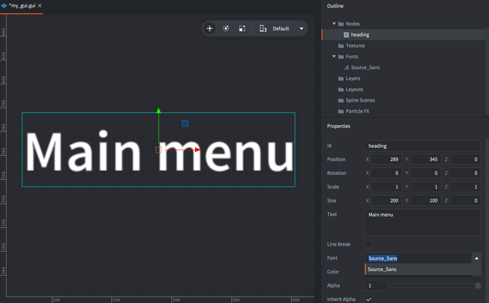
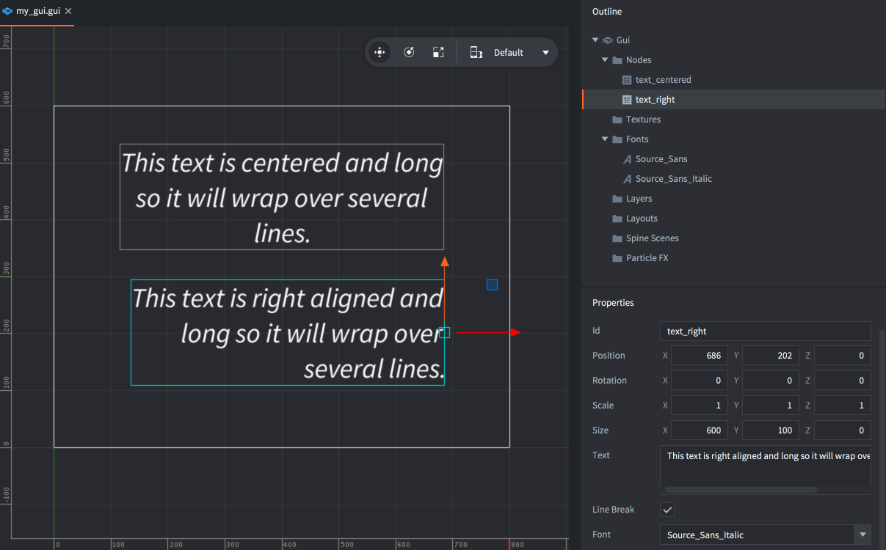

# Węzły tekstowe GUI

Defold obsługuje specjalny typ węzła GUI, który pozwala renderować tekst w scenie GUI. Każdy zasób fontu dodany do projektu może być użyty do renderowania węzłów tekstowych.

Podgląd w edytorze obsługuje kształtowanie tekstu i układ od prawej do lewej, korzystając z mechanizmu renderowania fontów silnika. Wymagane ustawienia fontu i manifestu aplikacji opisano w sekcji [obsługa układu tekstu](/manuals/font/#text-layout-support-eg-right-to-left).

## Dodawanie węzłów tekstowych

Fonty, których chcesz używać we węzłach tekstowych GUI, muszą zostać dodane do komponentu GUI. Kliknij prawym przyciskiem myszy folder *Fonts*, użyj górnego menu <kbd>GUI</kbd> albo naciśnij odpowiedni skrót klawiaturowy.



Węzły tekstowe mają zestaw specjalnych właściwości:

*Font*
: Każdy tworzony przez ciebie węzeł tekstowy musi mieć ustawioną właściwość *Font*.

*Text*
: Ta właściwość zawiera wyświetlany tekst.

*Line Break*
: Wyrównanie tekstu zależy od ustawienia pivot, a włączenie tej właściwości pozwala tekstowi łamać się na kilka linii. Szerokość węzła określa miejsce zawijania tekstu.

## Fonty wektorowe i kolorowe emoji {#vector-fonts-and-color-emoji}

Wykonaj kroki opisane w [konfiguracji fontów wektorowych](/manuals/font/#vector-fonts), dodaj zasób `.font` do *Fonts* sceny GUI i wybierz go we węźle tekstowym. Ustaw *Material* zasobu fontu na `/builtins/fonts/font-vector.material`. Rozmiar wyświetlanego tekstu określa właściwość *Font Size* węzła.

Aby wyświetlać kolorowe emoji, wykonaj również [konfigurację fontu zapasowego COLRv1 i zasobów paczki](/manuals/font/#color-emoji). Utwórz węzeł tekstowy o identyfikatorze `text`, pozostaw jego *Text* puste i dodaj następujący kod do `.gui_script` sceny GUI:

```lua
function init(self)
    local node = gui.get_node("text")
    local text = "Hello 😀 🍎 🚀"
    local font_resource = gui.get_font_resource(gui.get_font(node))
    -- Dodaj font zastępczy raz dla tego współdzielonego zasobu fontu.
    font.add_font(font_resource, "/fonts/NotoColorEmoji-Regular.ttf")
    font.prewarm_text(font_resource, text, function(self, request_id, result, err)
        if result then
            gui.set_text(node, text)
        else
            print("Could not prepare GUI text:", err)
        end
    end)
end
```

[`gui.get_font()`](/ref/gui/#gui.get_font) zwraca nazwę fontu w scenie GUI; [`gui.get_font_resource()`](/ref/gui/#gui.get_font_resource) rozwiązuje tę nazwę do zasobu fontu używanego przez `font.add_font()`. Inne węzły i etykiety korzystające z tego zasobu również otrzymują font zapasowy, dlatego inicjalizuj go tylko raz. Tekst jest ustawiany po pomyślnym przygotowaniu glifów.

## Wyrównanie

Ustawiając pivot węzła, możesz zmienić tryb wyrównania tekstu.

*Center*
: Jeśli pivot jest ustawiony na `Center`, `North` lub `South`, tekst jest wyrównany do środka.

*Left*
: Jeśli pivot jest ustawiony na dowolny z trybów `West`, tekst jest wyrównany do lewej.

*Right*
: Jeśli pivot jest ustawiony na dowolny z trybów `East`, tekst jest wyrównany do prawej.



## Modyfikowanie węzłów tekstowych w czasie działania

Węzły tekstowe reagują na ogólne funkcje manipulowania węzłami, które ustawiają rozmiar, pivot, kolor i inne właściwości. Istnieje też kilka funkcji przeznaczonych wyłącznie dla węzłów tekstowych:

* Aby zmienić font węzła tekstowego, użyj funkcji [`gui.set_font()`](/ref/gui/#gui.set_font).
* Aby zmienić zachowanie łamania linii węzła tekstowego, użyj funkcji [`gui.set_line_break()`](/ref/gui/#gui.set_line_break).
* Aby zmienić treść węzła tekstowego, użyj funkcji [`gui.set_text()`](/ref/gui/#gui.set_text).

```lua
function on_message(self, message_id, message, sender)
    if message_id == hash("set_score") then
        local s = gui.get_node("score")
        gui.set_text(s, message.score)
    end
end
```
