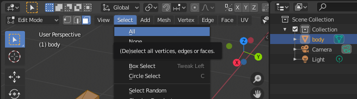
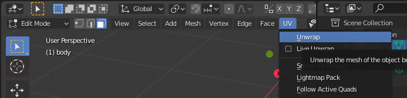
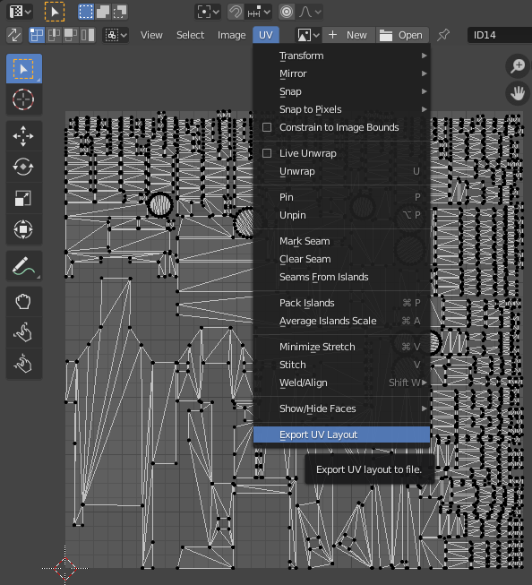
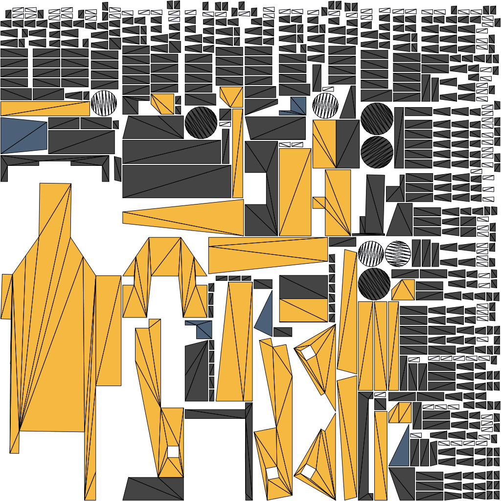

# Importowanie modeli 3D
Defold obsługuje modele, szkielety i animacje w formacie glTF 2.0 (GL Transmission Format). Do modeli 3D używaj plików *.gltf* lub *.glb*. glTF to nowoczesny format przeznaczony do przenoszenia i ładowania danych 3D w silnikach gier i aplikacjach czasu rzeczywistego.

Możesz użyć narzędzi takich jak Maya, 3ds Max, SketchUp i Blender do tworzenia modeli 3D albo konwertowania ich do formatu glTF.

Blender to potężny i popularny program do modelowania 3D, animacji i renderowania. Działa w systemach Windows, macOS i Linux i jest dostępny za darmo na stronie [https://www.blender.org](https://www.blender.org).

## Importowanie do Defold
Aby zaimportować model, przeciągnij i upuść plik *.gltf* lub *.glb* do panelu *Assets* edytora Defold.

glTF może być przechowywany na dwa popularne sposoby:

* *.glb* to pojedynczy plik binarny. Zawiera dane modelu i może też zawierać spakowane obrazy tekstur. Jest wygodny, gdy chcesz przenosić lub przechowywać model jako jeden plik.
* *.gltf* to tekstowy plik JSON. Zwykle odwołuje się do osobnego pliku *.bin* z danymi siatki oraz osobnych obrazów tekstur, takich jak *.png*, *.jpg* lub *.ktx2*. Przy tym wariancie dodaj wszystkie wskazane pliki do projektu i zachowaj ich względne ścieżki.

Osadzonych obrazów można używać bezpośrednio z pliku glTF lub GLB bez wyodrębniania ich do osobnych zasobów. Zewnętrzne pliki obrazów i buforów nadal trzeba zaimportować razem z modelem, zachowując ich względne ścieżki.

::: sidenote
Defold zachowuje pozycje i transformacje z importowanego pliku glTF i nie wyśrodkowuje automatycznie modelu podczas importu. Podgląd w edytorze i środowisko uruchomieniowe używają importowanych transformacji w spójny sposób: siatki ze skinningiem lub powiązane z kośćmi zachowują lokalne transformacje względem szkieletu, a siatki sztywne zachowują spłaszczone położenie w przestrzeni świata.

[Komponent Model](/manuals/model/#model-properties) może wybrać pojedynczą siatkę o określonej nazwie z zaimportowanej sceny. Pozostawienie pustego pola *Mesh* oznacza użycie całej sceny i zachowanie opisanych wyżej transformacji. Wybranie siatki powoduje użycie jej geometrii lokalnej bez transformacji węzłów glTF, dlatego rozmieść ją za pomocą transformacji komponentu modelu lub obiektu gry.

Jeśli model utworzony w starszej wersji Defold zmieni pozycję lub orientację po ponownym zaimportowaniu, popraw transformację w Blenderze lub innym narzędziu autorskim, a następnie ponownie wyeksportuj plik *.gltf* lub *.glb*.
:::

### Skompresowana geometria {#compressed-geometry}

Źródła *.gltf* i *.glb* mogą zawierać geometrię skompresowaną za pomocą Draco lub Meshopt. Obsługiwane są następujące rozszerzenia kompresji glTF:

| Kompresja | Rozszerzenie glTF |
| --- | --- |
| Draco | `KHR_draco_mesh_compression` |
| Meshopt | `EXT_meshopt_compression` i `KHR_meshopt_compression` |

Wyeksportuj lub zoptymalizuj zasób glTF 2.0 za pomocą jednego z tych rozszerzeń, a następnie zaimportuj go tak samo jak model nieskompresowany. Dołącz zewnętrzne bufory i tekstury oraz zachowaj ich względne ścieżki. Jak zwykle przypisz zaimportowany plik do właściwości *Scene* komponentu Model.

Defold dekoduje skompresowaną geometrię podczas importowania i budowania. Wynikowy model używa standardowej reprezentacji geometrii w środowisku uruchomieniowym Defold. Ta obsługa nie włącza kompresji Draco ani Meshopt w działającym silniku, a mniejszy plik źródłowy nie gwarantuje mniejszej paczki gry.

### Przeglądanie zaimportowanej sceny {#browsing-the-imported-scene}

Rozwiń plik *.gltf* lub *.glb* w panelu *Assets*, aby przeglądać siatki, wygenerowane materiały i osadzone obrazy. Otwarcie sceny pokazuje podgląd z jej materiałami i teksturami. Możesz też otworzyć pojedynczą siatkę, aby ją obejrzeć.

Zasoby udostępnione wewnątrz pliku są tylko do odczytu. Aby utworzyć edytowalny zasób Model dla siatki, skopiuj siatkę i wklej ją do folderu projektu. Powstały plik *.model* nadal odwołuje się do zaimportowanego pliku glTF lub GLB. Aby zmienić geometrię źródłową albo osadzone obrazy, edytuj zasób w narzędziu do tworzenia modeli i wyeksportuj go ponownie.

Skrypty edytora mogą wyliczać te zasoby za pomocą `editor.resource_children(path)`. Sekcja [Przechodzenie po zasobach projektu](/manuals/editor-scripts/#traversing-project-resources) zawiera przykład rekurencyjnego odwiedzania zasobów wewnątrz folderów i plików glTF/GLB.

### Tekstury KTX2 {#ktx2-textures}

Tekstury modeli mogą używać źródeł *.ktx2* jako plików zewnętrznych lub obrazów osadzonych w pliku *.gltf* albo *.glb*. Importuj pliki zewnętrzne razem z modelem. Osadzone obrazy KTX2 pojawiają się pod sceną w panelu *Assets* i można przypisać je bezpośrednio do pól tekstur materiału albo przez <kbd>Auto Fill</kbd>.

[Profile teksturowania](/manuals/texture-profiles/#ktx2-source-textures) określają, czy zachować format źródłowy KTX2, czy przekonwertować go na skonfigurowane formaty wyjściowe. **Keep KTX2 Format** zachowuje źródłowy format kodowania przy włączonej kompresji tekstur, ale przetwarzanie obrazu może nadal wymagać ponownego kodowania. Sprawdź obsługę formatu na urządzeniach docelowych i uwzględnij możliwą dodatkową utratę jakości przy ponownej kompresji już skompresowanej tekstury. Zobacz [Formaty wejściowe i podglądy KTX2](/manuals/importing-graphics/#ktx2-textures).

## Używanie modelu {#using-a-model}
Po zaimportowaniu modelu użyj go w [komponencie Model](/manuals/model):

1. Utwórz plik Model z panelu *Assets* za pomocą <kbd>New... ▸ Model</kbd> albo dodaj komponent Model bezpośrednio do obiektu gry za pomocą <kbd>Add Component ▸ Model</kbd>.
2. Ustaw właściwość *Scene* na zaimportowany plik *.gltf* lub *.glb*.
3. Gdy pojawi się okno *Auto Fill Model Fields?*, wybierz <kbd>Auto Fill</kbd>, aby przypisać wygenerowane materiały sceny i wskazane tekstury. Zastąpi to istniejące powiązania materiałów i tekstur. Wybierz <kbd>Keep Current</kbd>, aby zachować swoje powiązania; nowy wybór sceny nadal zostanie zastosowany.
4. Pozostaw *Mesh* puste, aby użyć całej sceny, albo wybierz siatkę o określonej nazwie, aby użyć tylko jej geometrii lokalnej. Zmiana wyboru siatki może wyświetlić to samo okno: wybranie siatki proponuje jej materiały, a wyczyszczenie wyboru proponuje wszystkie materiały sceny. <kbd>Keep Current</kbd> zachowuje powiązania przy zastosowaniu nowego wyboru siatki.
5. W przypadku modelu animowanego ustaw właściwość *Skeleton* na plik *.gltf* lub *.glb* zawierający szkielet. Często jest to ten sam plik co dla *Scene*, jeśli siatka, szkielet i animacje są eksportowane razem.
6. Utwórz plik *Animation Set* dla animacji i przypisz go do właściwości *Animations*. Ustaw *Default Animation*, jeśli animacja ma rozpocząć się automatycznie.

Edytor proponuje wypełnienie powiązań, jeśli wybrane źródło glTF lub GLB udostępnia materiały. Rozwiązuje zarówno osadzone obrazy, jak i odwołania do obrazów zewnętrznych. Wygenerowane materiały używają wbudowanych shaderów glTF; oświetlenie i obsługiwane efekty materiałów opisano w [podręczniku PBR](/manuals/physically-based-rendering/#built-in-pbr-materials).

### Ręczne przypisywanie materiałów i tekstur {#assigning-materials-and-textures-manually}

Jeśli wybierzesz <kbd>Keep Current</kbd> lub potrzebujesz własnego cieniowania, ustaw każdą właściwość *Material* na odpowiedni materiał. Wbudowane materiały `gltf` zapewniają cieniowanie PBR; dostępne są również wbudowane materiały `model` i twoje własne materiały. [Podręcznik Model](/manuals/model/#material) opisuje warianty statyczne, ze skinningiem i instancjonowane oraz ich wymagania.

Przypisz każdą teksturę do odpowiedniego pola tekstury materiału. Możesz użyć osadzonego obrazu widocznego pod plikiem glTF lub GLB w panelu *Assets* albo osobnego zasobu obrazu w projekcie. W materiałach z wieloma samplerami dopasuj każdą teksturę do właściwego samplera; [podręcznik PBR zawiera nazwy wbudowanych samplerów glTF](/manuals/physically-based-rendering/#built-in-pbr-materials).

## Eksport do glTF
Wyeksportowany plik *.gltf* lub *.glb* zawiera wszystkie wierzchołki, krawędzie i ściany tworzące model, a także _współrzędne UV_ (czyli informację o tym, która część obrazu tekstury odpowiada konkretnej części siatki), jeśli zostały zdefiniowane, kości w szkielecie oraz dane animacji.

* Szczegółowy opis siatek wielokątnych można znaleźć na stronie http://en.wikipedia.org/wiki/Polygon_mesh.

* Współrzędne UV i mapowanie UV opisano na stronie http://en.wikipedia.org/wiki/UV_mapping.

Defold nakłada pewne ograniczenia na eksportowane dane animacji:

* Defold obecnie obsługuje tylko animacje wypieczone. Animacje muszą mieć macierze dla każdej animowanej kości w każdej klatce kluczowej, a nie osobne klucze pozycji, rotacji i skali.

* Animacje są również interpolowane liniowo. Jeśli używasz bardziej zaawansowanej interpolacji krzywych, animacje muszą zostać wstępnie wypieczone przez eksporter.

### Wymagania
Przy eksportowaniu modelu pamiętaj, że obsługa glTF może różnić się między narzędziami i silnikami. Używaj glTF 2.0 i upewnij się, że model ma poprawne współrzędne UV, jeśli korzysta z tekstur. Obrazy mogą być osadzone w pliku glTF lub GLB albo przechowywane w osobnych plikach wskazywanych przez scenę. Przy importowaniu modelu do Defold dołącz wszystkie zewnętrzne pliki obrazów i buforów.

Naszym celem jest pełna obsługa formatu glTF, ale nie jesteśmy jeszcze w tym miejscu.
Jeśli brakuje jakiejś funkcji, zgłoś prośbę o jej dodanie w [naszym repozytorium](https://github.com/defold/defold/issues)

### Eksport tekstury
Jeśli chcesz ręcznie utworzyć obraz tekstury, możesz wyeksportować układ UV z Blendera jako szablon. Zacznij od zaznaczenia siatki i wszystkich jej wierzchołków:

Gdy wszystkie wierzchołki są zaznaczone, rozwiń siatkę, aby uzyskać układ UV:

Następnie możesz wyeksportować układ UV do obrazu, którego można użyć jako tekstury:

### Eksportowanie w Blenderze
Eksportuj model z Blendera za pomocą <kbd>File ▸ Export ▸ glTF 2.0 (.glb/.gltf)</kbd>.

Zaznacz obiekt lub obiekty przed eksportem i włącz *Selected Objects*, jeśli chcesz wyeksportować tylko zaznaczenie.

Wybierz jedną z opcji *Format*:

* *glTF Binary (.glb)* tworzy jeden plik. Użyj tej opcji, gdy model ma być łatwy do przenoszenia lub przechowywania jako pojedynczy zasób.
* *glTF Separate (.gltf + .bin + textures)* tworzy osobne pliki dla opisu modelu, danych binarnych i tekstur. Użyj tej opcji, gdy chcesz edytować obrazy tekstur albo przypisywać je osobno w Defold.

Jeśli model zawiera animacje, włącz eksport animacji i upewnij się, że animacje są wypieczone. Jeśli model używa tekstur, upewnij się, że siatka ma rozwinięcie UV i że obrazy tekstur są eksportowane w formacie, który Defold może importować, takim jak PNG lub JPEG.

