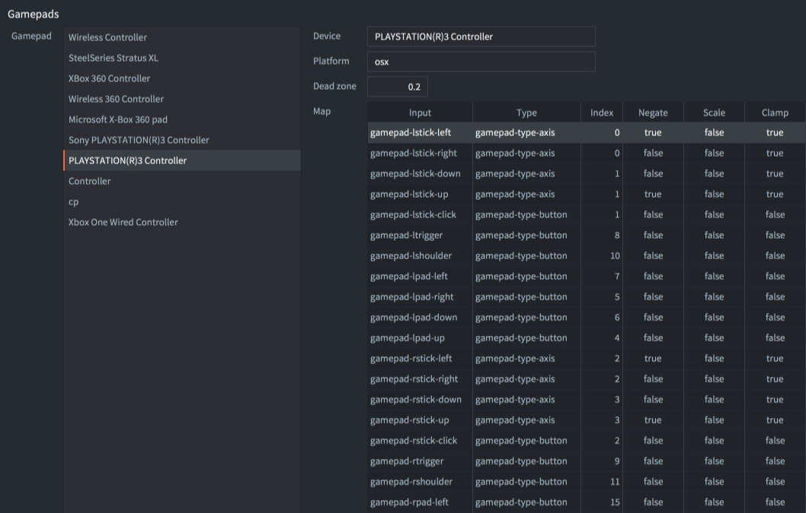
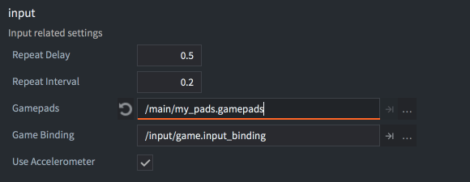

::: sidenote
Zaleca się, aby najpierw zapoznać się z ogólnym sposobem działania wejścia w Defold, z tym, jak odbiera się wejście i w jakiej kolejności trafia ono do plików skryptów. Więcej informacji znajdziesz w [instrukcji Input Overview](/manuals/input).
:::

# Gamepady
Wiązania gamepada pozwalają przypisać standardowe wejście z gamepada do funkcji gry. Wejście z gamepada obejmuje wiązania dla:

- lewej i prawej gałki analogowej: kierunek i kliknięcie
- lewej i prawej krzyżaka cyfrowego. Prawy krzyżak zwykle odpowiada przyciskom "A", "B", "X" i "Y" na kontrolerze Xbox oraz przyciskom "square", "circle", "triangle" i "cross" na kontrolerze PlayStation
- lewego i prawego spustu
- lewego i prawego przycisku naramiennego
- przycisków Start, Back i Guide


::: important
Poniższe przykłady używają akcji pokazanych na obrazie powyżej. Tak jak w przypadku każdego innego wejścia możesz nadać swoim akcjom wejściowym dowolne nazwy.
:::

## Przyciski cyfrowe
Przyciski cyfrowe generują zdarzenia `pressed`, `released` i `repeated`. Poniższy przykład pokazuje, jak wykryć wejście z przycisku cyfrowego (naciśnięcie albo zwolnienie):

```lua
function on_input(self, action_id, action)
    if action_id == hash("gamepad_lpad_left") then
        if action.pressed then
            -- rozpocznij ruch w lewo
        elseif action.released then
            -- zatrzymaj ruch w lewo
        end
    end
end
```

## Gałki analogowe
Gałki analogowe generują ciągłe zdarzenia wejścia, gdy gałka zostanie przesunięta poza martwą strefę zdefiniowaną w pliku ustawień gamepada (patrz niżej). Poniższy przykład pokazuje, jak wykryć wejście z gałki analogowej:

```lua
function on_input(self, action_id, action)
    if action_id == hash("gamepad_lstick_down") then
        -- lewa gałka została przesunięta w dół
        print(action.value) -- wartość między 0.0 a -1.0
    end
end
```

Gałki analogowe generują też zdarzenia `pressed` i `released`, gdy są przesuwane w kierunkach kardynalnych powyżej określonej wartości progowej. Dzięki temu można też używać gałki analogowej jako cyfrowego wejścia kierunkowego:

```lua
function on_input(self, action_id, action)
    if action_id == hash("gamepad_lstick_down") and action.pressed then
        -- lewa gałka została przesunięta do skrajnej dolnej pozycji
    end
end
```

## Wiele gamepadów
Defold obsługuje wiele gamepadów przez system operacyjny hosta, a akcje ustawiają pole `gamepad` w tabeli `action` na numer gamepada, z którego pochodzi dane wejście:

```lua
function on_input(self, action_id, action)
    if action_id == hash("gamepad_start") then
        if action.gamepad == 0 then
          -- gamepad 0 chce dołączyć do gry
        end
    end
end
```

## Podłączanie i odłączanie
Wiązania wejścia z gamepada udostępniają też dwa osobne wiązania o nazwach `Connected` i `Disconnected`, aby wykrywać moment podłączenia gamepada, także wtedy, gdy był podłączony od początku, lub jego odłączenia.

```lua
function on_input(self, action_id, action)
    if action_id == hash("gamepad_connected") then
        if action.gamepad == 0 then
          -- gamepad 0 został podłączony
        end
    elseif action_id == hash("gamepad_disconnected") then
        if action.gamepad == 0 then
          -- gamepad 0 został odłączony
        end
    end
end
```

## Surowe gamepady {#raw-gamepads}

Wiązania wejścia z gamepada udostępniają także osobne wiązanie o nazwie `Raw`, które daje nieprzefiltrowane dane wejściowe przycisków, osi i hatów dowolnego podłączonego gamepada, bez zastosowanej martwej strefy.

```lua
function on_input(self, action_id, action)
    if action_id == hash("raw") then
        pprint(action.gamepad_buttons)
        pprint(action.gamepad_axis)
        pprint(action.gamepad_hats)
    end
end
```

## Plik ustawień gamepadów {#gamepads-settings-file}

Mapowania gamepadów przekształcają przyciski, osie i przełączniki kierunkowe kontrolera w standardowe elementy sterowania używane przez wiązania wejść. Defold łączy dwa źródła mapowań skonfigurowane w sekcji *Input* pliku *game.project*:

| Ustawienie | Format mapowania | Domyślne |
| --- | --- | --- |
| [Gamepad Database](/manuals/project-settings/#gamepad-database) | Tekstowa baza w formacie SDL, dopasowywana przez GUID kontrolera | `/builtins/input/gamecontrollerdb.txt` |
| [Gamepads](/manuals/project-settings/#gamepads) | Starsze wpisy `.gamepads` dla nazw urządzeń i platform | `/builtins/input/default.gamepads` |

Mapowania bazy SDL i automatyczne mapowania platformy używają [Gamepad Deadzone](/manuals/project-settings/#gamepad-deadzone). Starsze wpisy `.gamepads` definiują własne martwe strefy. W systemie Android kontroler bez wpisu w bazie może także otrzymać [automatyczne mapowanie](#gamepads-on-android).

### Starsze mapowania .gamepads {#legacy-gamepads-mappings}

Plik `.gamepads` może zawierać mapowania dla wielu kontrolerów. Istniejące starsze mapowania nadal są obsługiwane. Defold dołącza mapowania popularnych kontrolerów w pliku domyślnym:



Jeśli potrzebujesz utworzyć starsze mapowanie `.gamepads` na platformie desktopowej, poniższe narzędzie może pomóc. W przypadku Androida zobacz [Gamepady na Androidzie](#gamepads-on-android).

[Kliknij, aby pobrać gdc.zip](https://forum.defold.com/t/big-thread-of-gamepad-testing/56032).

Zawiera ono pliki binarne dla systemów Windows, Linux i macOS. Uruchom je z wiersza poleceń:

```sh
./gdc
```

Narzędzie poprosi o naciskanie kolejnych przycisków na podłączonym kontrolerze. Następnie wygeneruje nowy plik gamepads z poprawnymi mapowaniami dla Twojego kontrolera. Zapisz nowy plik albo scal go z istniejącym plikiem gamepads, a potem zaktualizuj ustawienie w *game.project*:



### Niezidentyfikowane gamepady {#unidentified-gamepads}

Gdy nie jest dostępne ani skonfigurowane mapowanie, ani automatyczne mapowanie platformy, gamepad generuje tylko akcje przypisane do `Connected`, `Disconnected` i `Raw`. Możesz dodać mapowanie kontrolera lub obsłużyć jego surowe wejście w grze.

Można sprawdzić, czy akcja wejścia z gamepada pochodzi z nieznanego gamepada, odczytując wartość `gamepad_unknown` z `action`:

```lua
function on_input(self, action_id, action)
    if action_id == hash("connected") then
        if action.gamepad_unknown then
            print("The connected gamepad is unidentified and will only generate raw input")
        else
            print("The connected gamepad is known and will generate input actions for buttons and sticks")
        end
    end
end
```

## Gamepady w HTML5 {#gamepads-in-html5}
Gamepady są obsługiwane w buildach HTML5 i generują te same zdarzenia wejścia co na innych platformach. Obsługa gamepadów opiera się na [Gamepad API](https://www.w3.org/TR/gamepad/), które jest obsługiwane przez większość przeglądarek ([sprawdź tabelę zgodności](https://caniuse.com/?search=gamepad)). Jeśli przeglądarka nie obsługuje Gamepad API, Defold po prostu zignoruje wszystkie wiązania gamepada w projekcie. Możesz sprawdzić, czy przeglądarka obsługuje Gamepad API, testując, czy funkcja `getGamepads` istnieje w obiekcie `navigator`:

```lua
local function supports_gamepads()
    return not html5 or (html5.run('typeof navigator.getGamepads === "function"') == "true")
end

if supports_gamepads() then
    print("Platform supports gamepads")
end
```

Jeśli gra działa wewnątrz `iframe`, upewnij się też, że `iframe` ma dodane uprawnienie `gamepad`:

```html
<iframe allow="gamepad"></iframe>
```

### Standardowe gamepady

Jeśli podłączony gamepad zostanie rozpoznany przez przeglądarkę jako standardowy gamepad, użyje mapowania `Standard Gamepad` z [pliku ustawień gamepads](/manuals/input-gamepads/#gamepads-settings-file) (mapowanie `Standard Gamepad` jest dołączone do pliku `default.gamepads` w `/builtins`). Standardowy gamepad ma 16 przycisków i 2 gałki analogowe, a układ przycisków jest podobny do kontrolera PlayStation lub Xbox (więcej informacji znajdziesz w [definicji i układzie przycisków W3C](https://w3c.github.io/gamepad/#dfn-standard-gamepad)). Jeśli podłączony gamepad nie zostanie rozpoznany jako standardowy, Defold poszuka w pliku ustawień gamepadów mapowania pasującego do jego typu sprzętowego.

## Gamepady w Windows
W systemie Windows obecnie obsługiwane są tylko kontrolery Xbox 360. Aby podłączyć kontroler 360 do komputera z Windows, upewnij się, że został poprawnie skonfigurowany zgodnie z [tym poradnikiem](http://www.wikihow.com/Use-Your-Xbox-360-Controller-for-Windows).

## Gamepady w Android {#gamepads-on-android}

Gamepady są obsługiwane w buildach Android i generują te same akcje wejścia co na innych platformach. Defold korzysta ze skonfigurowanych [mapowań gamepadów](#gamepads-settings-file) i może automatycznie mapować niektóre kontrolery bez pasującego wpisu.

Jeśli kontroler jest nierozpoznany albo jego elementy sterowania działają niepoprawnie, przetestuj go na urządzeniu Android i dodaj lub zaktualizuj mapowanie. W rozwiązywaniu problemów pomogą sekcje [Nierozpoznane gamepady](#unidentified-gamepads) i [Surowe dane gamepadów](#raw-gamepads).
