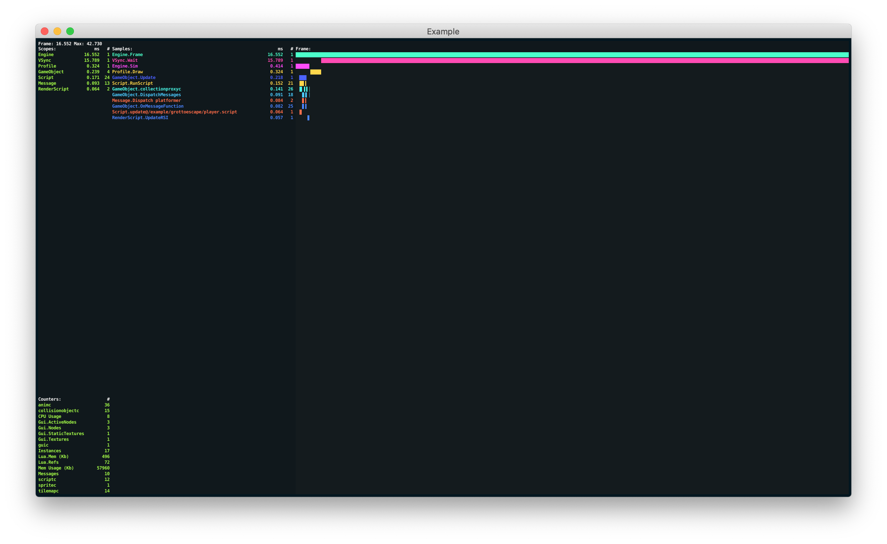
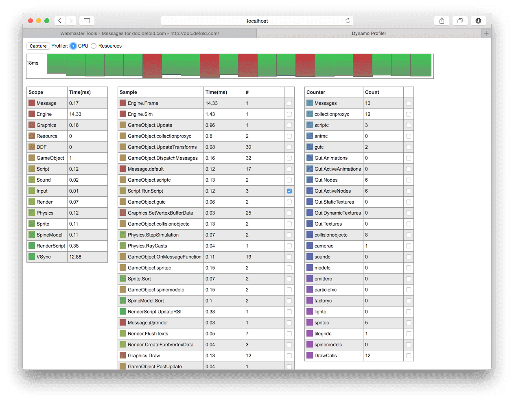
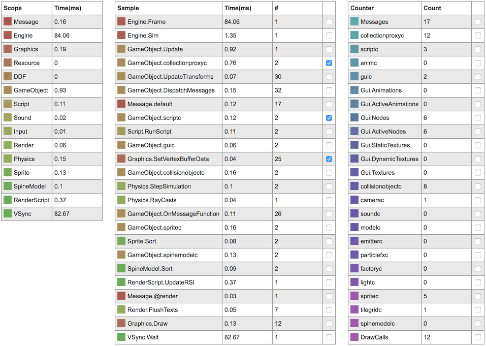
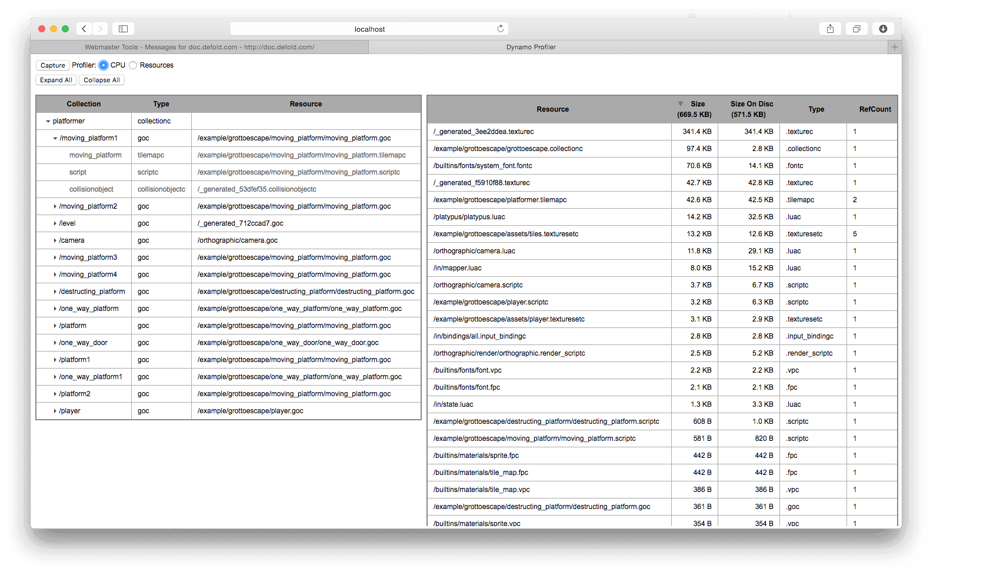
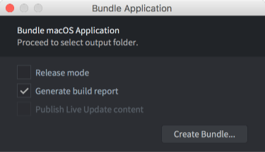
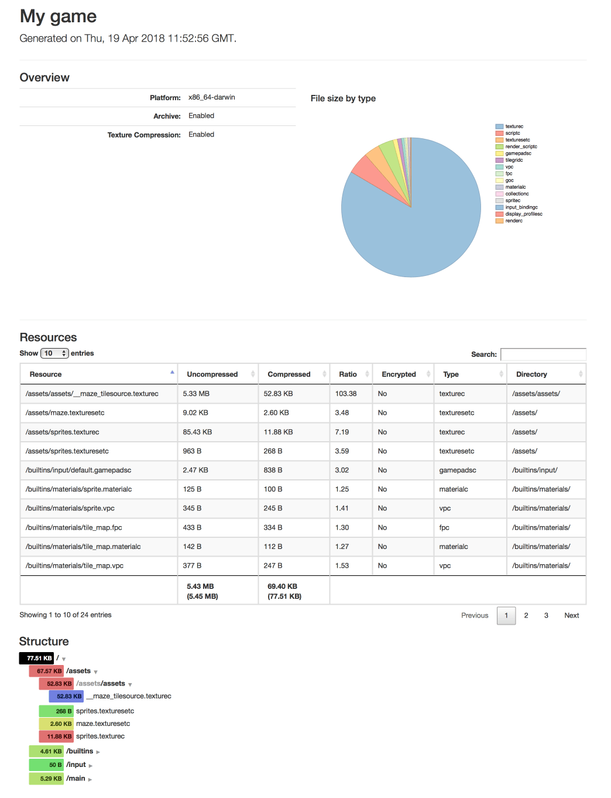
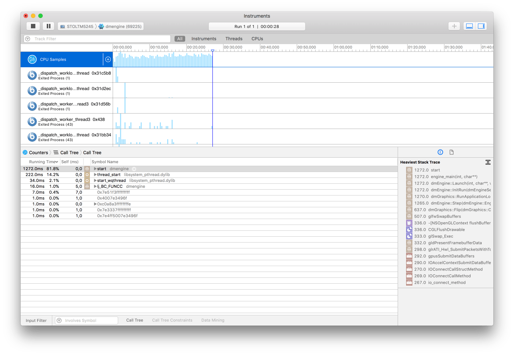
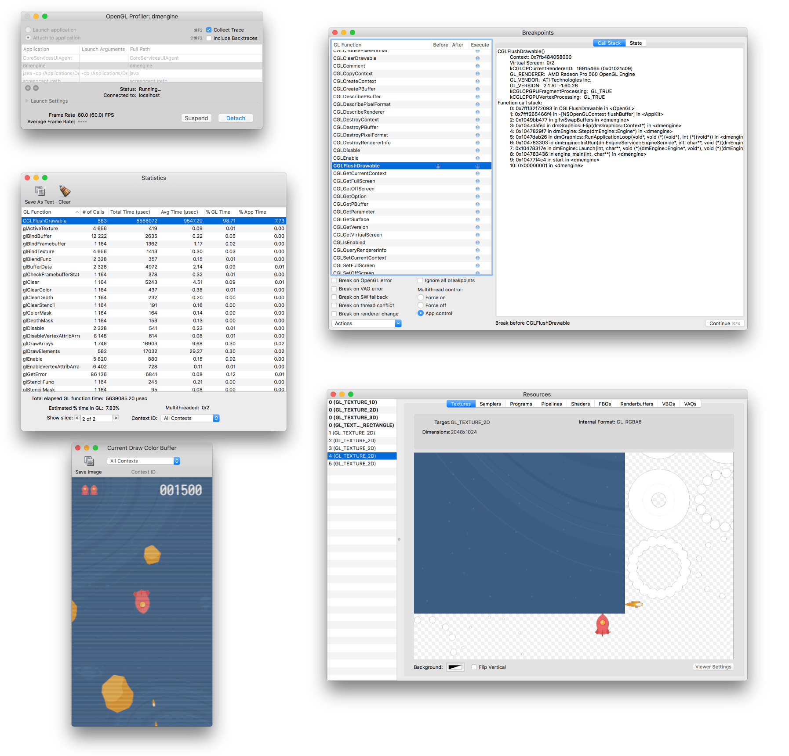
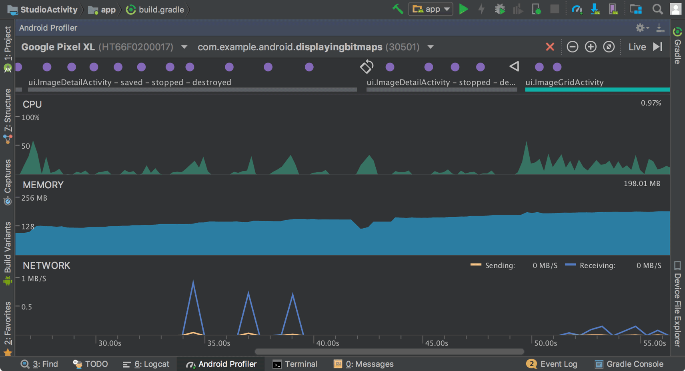
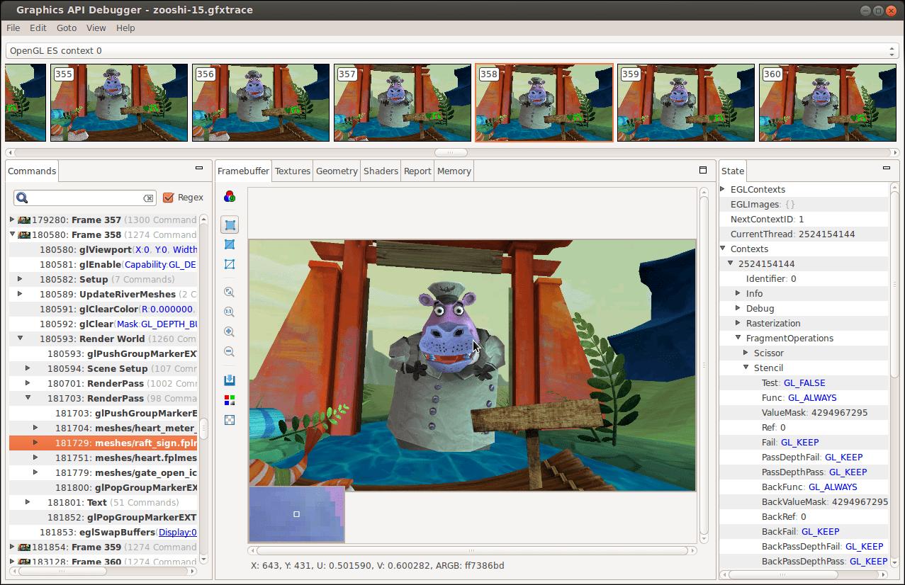

# Profilowanie

Defold zawiera narzędzia profilujące zintegrowane z silnikiem i procesem budowania. Pomagają one wykrywać problemy z wydajnością, pamięcią i użyciem zasobów. Dane profilowania w czasie działania mogą być wykorzystywane przez kilka narzędzi:

* Podstawowy profiler i wizualny profiler w grze są dostępne na wszystkich platformach.
* [Profiler Remotery](https://github.com/Celtoys/Remotery) i interaktywny webowy profiler klatek są dostępne na platformach komputerowych i mobilnych.
* Buildy HTML5 mogą publikować zakresy silnika Defold w Web Performance API przeglądarki.
* Buildy debug dla macOS korzystające z Metal mogą zapisywać [ślady GPU](#metal-gpu-trace-capture) do analizy w Xcode.

Ustawienie **Profiler** w [manifeście aplikacji](/manuals/app-manifest/#profiler) określa, czy kod profilera jest dołączany do buildu. **Debug Only** jest opcją domyślną, **None** go wyklucza, a **Always** dołącza go zarówno do buildów debug, jak i release. Ustawienia `profiler` w pliku *game.project* sterują zachowaniem w czasie działania, ale nie przywracają do buildu wykluczonego kodu profilera. W szczególności ustawienie **Track CPU** steruje próbkowaniem użycia CPU i jest niezależne od wyboru w manifeście aplikacji.

## Wizualny profiler w czasie działania

Buildy z dołączoną obsługą profilera zawierają wizualny profiler działający w czasie rzeczywistym, który wyświetla bieżące informacje jako nakładkę na uruchomioną aplikację:

```lua
function on_reload(self)
    -- Włącz wizualny profiler po szybkim przeładowaniu.
    profiler.enable_ui(true)
end
```



Wizualny profiler udostępnia kilka funkcji, których można użyć do zmiany sposobu prezentacji danych:

```lua

profiler.set_ui_mode()
profiler.set_ui_view_mode()
profiler.view_recorded_frame()
```

Więcej informacji o funkcjach profilera znajdziesz w [dokumentacji API profilera](/ref/profiler/).

## Profiler webowy
Podczas uruchamiania buildu komputerowego lub mobilnego z obsługą profilera można otworzyć w przeglądarce interaktywne profilery klatek i zasobów.

### Profiler klatek Remotery
Profiler klatek pozwala analizować grę podczas działania i szczegółowo badać poszczególne klatki. Aby otworzyć profiler:

1. Uruchom grę na urządzeniu docelowym.
2. Wybierz menu <kbd>Debug ▸ Open Web Profiler</kbd>.

Profiler klatek jest podzielony na kilka sekcji, z których każda pokazuje inny widok uruchomionej gry. Naciśnij przycisk <kbd>Pause</kbd> w prawym górnym rogu, aby tymczasowo zatrzymać odświeżanie widoków przez profiler.



::: sidenote
Gdy używasz jednocześnie wielu urządzeń docelowych, możesz ręcznie przełączać się między nimi, zmieniając pole <kbd>Connection Address</kbd> u góry strony tak, aby odpowiadało adresowi URL profilera Remotery widocznemu w konsoli po uruchomieniu celu:

```
INFO:ENGINE: Defold Engine 1.3.4 (80b1b73)
INFO:DLIB: Initialized Remotery (ws://127.0.0.1:17815/rmt)
INFO:ENGINE: Loading data from: build/default
```
:::

Oś czasu próbek
: Sample Timeline pokazuje klatki danych zebranych w silniku, z osobną poziomą osią czasu dla każdego wątku. Main to główny wątek, w którym uruchamiana jest cała logika gry i większość kodu silnika. Remotery jest używany przez sam profiler, a Sound to wątek miksowania i odtwarzania dźwięku. Możesz przybliżać i oddalać widok kółkiem myszy oraz zaznaczać poszczególne klatki, aby zobaczyć szczegóły klatki w widoku Frame Data.

  


Dane klatki
: Widok Frame Data jest tabelą, w której wszystkie dane dla aktualnie zaznaczonej klatki są rozbite na szczegóły. Możesz sprawdzić, ile milisekund jest zużywanych w każdym zakresie silnika.

  


Właściwości globalne
: Widok Global Properties pokazuje tabelę liczników. Ułatwia to na przykład śledzenie liczby wywołań rysowania albo liczby komponentów określonego typu.

  

::: sidenote
Wartość LuaMem to ilość pamięci w kilobajtach używana przez maszynę wirtualną Lua, raportowana przez garbage collector Lua. Memory to ilość pamięci w kilobajtach używana przez silnik.
:::

::: important
[Ustawienie Max Sample Count](/manuals/project-settings/#max-sample-count) ogranicza liczbę próbek profilera rejestrowanych dla każdego wątku w jednej klatce. Jeśli profiler zgłasza przekroczenie limitu, najpierw sprawdź kod profilowania rozszerzeń natywnych pod kątem niedopasowanej pary rozpoczęcia i zakończenia zakresu. Zwiększ limit tylko wtedy, gdy prawidłowa klatka rzeczywiście zawiera więcej zakresów niż skonfigurowany limit.
:::

### Profiler zasobów
Profiler zasobów pozwala analizować grę podczas działania i szczegółowo badać użycie zasobów. Aby otworzyć profiler:

1. Uruchom build debug gry na urządzeniu docelowym.
2. Otwórz w przeglądarce [adres usługi silnika](/manuals/engine-service/#availability-and-port-discovery): `http://<address>:<port>/`. Użyj adresu i portu zgłoszonych przez działający silnik w konsoli.

Profiler zasobów jest podzielony na 2 sekcje: jedna pokazuje hierarchiczny widok kolekcji, obiektów gry i komponentów aktualnie utworzonych w grze, a druga pokazuje wszystkie aktualnie załadowane zasoby.



Widok kolekcji
: Widok Collection view pokazuje hierarchiczną listę wszystkich obiektów gry i komponentów aktualnie utworzonych w grze oraz kolekcji, z których pochodzą. To bardzo przydatne narzędzie, gdy chcesz dokładnie prześledzić i zrozumieć, co zostało utworzone w grze w danym momencie i skąd pochodzą te obiekty.

Widok zasobów
: Widok Resources view pokazuje wszystkie zasoby aktualnie załadowane do pamięci, ich rozmiar oraz liczbę odwołań do każdego zasobu. Jest to przydatne podczas optymalizowania użycia pamięci w aplikacji, gdy musisz zrozumieć, co jest załadowane do pamięci w danym momencie.

#### Czasy ładowania zasobów {#resource-loading-times}

Możesz również sprawdzić, jak długo ładują się poszczególne zasoby. Przed uruchomieniem gry włącz [Resource → Profile](/manuals/project-settings/#profile) w *game.project*. W widoku tekstowym ustawienie wygląda tak:

```ini
[resource]
profile = 1
```

Ustawienie jest domyślnie wyłączone. Po włączeniu zrestartuj grę, aby zmierzyć ładowanie przy starcie. Każde zakończone powodzeniem lub błędem ładowanie zapisuje wpis poziomu INFO ze ścieżką zasobu, całkowitym czasem i czasami etapów preload, read, create, post-create, queue i wait. Trafienia w pamięć podręczną nie tworzą nowych zapisów ładowania.

W profilerze zasobów kliknij **Capture**, a następnie **Show load times**, aby wyświetlić kolumny czasów. **Capture** odświeża widok zachowanych pomiarów; nie włącza profilowania ani nie mierzy wcześniejszych ładowań wstecznie.

| Kolumna | Znaczenie |
| --- | --- |
| **Load (ms)** | Całkowity czas pierwszego ładowania, w tym zależności, operacji po utworzeniu, kolejkowania i oczekiwania. |
| **Preload (ms)** | Czas przygotowania zasobu w jego wywołaniu zwrotnym preload. |
| **Read (ms)** | Czas odczytu danych zasobu. |
| **Create (ms)** | Czas tworzenia zasobu środowiska uruchomieniowego w jego wywołaniu zwrotnym create. |

Wyświetlenie czasów ładowania sortuje tabelę według czasu całkowitego, od najwolniejszych zasobów. Kliknij nagłówek kolumny czasu, aby sortować według tego etapu; kliknij ponownie, aby odwrócić kolejność. Paski w kolumnie **Load** pokazują każdy czas względem najwolniejszego widocznego zasobu. Kliknij **Hide load times**, aby ponownie ukryć kolumny.

Czasy ładowania i wywołań zwrotnych obejmują zagnieżdżoną pracę nad zależnościami. Nie sumuj czasów zasobów w celu obliczenia czasu startu, ponieważ ta sama praca może pojawić się w pomiarach kilku zasobów. Kolumny **Preload**, **Read** i **Create** również nie obejmują całego czasu ładowania; dodatkowe etapy są dostępne w logu.

Pauza (`—`) oznacza brak ukończonego pomiaru, na przykład z powodu wyłączonego profilowania lub niezakończonego pierwszego ładowania. Zmierzone zero jest wyświetlane jako `0.000`. Pomiary opisują pierwsze ładowanie: trafienia w cache i szybkie przeładowanie ich nie zmieniają, a wyładowanie zasobu usuwa zachowany pomiar.

## Przechwytywanie śladów GPU Metal {#metal-gpu-trace-capture}

[Usługa HTTP silnika](/manuals/engine-service/#metal-gpu-trace-endpoint) może przechwytywać polecenia GPU Metal do dokumentu *.gputrace* w macOS. Otwórz ukończony ślad w Xcode, aby przeanalizować przechwycone klatki. Ta funkcja jest wbudowana w silnik debug.

### Uruchomienie i sprawdzenie obsługi {#launch-and-check-support}

Utwórz [paczkę Debug](/manuals/bundling/#release-vs-debug) dla macOS z dołączonym natywnym backendem graficznym Metal. Jeśli używasz manifestu aplikacji, wybierz opcję **Graphics (macOS)** zawierającą Metal; zobacz [backendy graficzne](/manuals/app-manifest/#graphics).

Uruchom plik wykonywalny paczki z terminala z `METAL_CAPTURE_ENABLED=1` i wybierz adapter Metal. Zastąp ścieżkę paczki i nazwę pliku wykonywalnego w tym przykładzie:

```sh
METAL_CAPTURE_ENABLED=1 \
    "/absolute/path/MyGame.app/Contents/MacOS/MyGame" --graphics-adapter=metal
```

Zmienna środowiskowa musi być ustawiona przy starcie silnika. Ustawienie jej tylko w terminalu używanym do żądań HTTP nie włącza przechwytywania w już działającym silniku.

W drugim terminalu użyj [portu usługi silnika wypisanego w logu](/manuals/engine-service/#availability-and-port-discovery). Poniższe przykłady używają `curl` i `jq`:

```sh
ENGINE_URL="http://127.0.0.1:<port>"
curl -fsS "$ENGINE_URL/openapi.json" | jq '.paths["/profiler/gputrace"]'
curl -sS -i "$ENGINE_URL/profiler/gputrace"
```

Trasa jest rejestrowana tylko w macOS. Wpis `null` w dokumencie OpenAPI oznacza, że ten silnik jej nie udostępnia. Nawet gdy trasa istnieje, obsługa przechwytywania zależy od adaptera graficznego i środowiska uruchomienia. `GET /profiler/gputrace` zwraca HTTP 501 z `error.code: "gputrace_unsupported"`, gdy przechwytywanie Metal jest niedostępne. Przed kontynuowaniem sprawdź, czy silnik używa Metal i został uruchomiony z `METAL_CAPTURE_ENABLED=1`. Obsługiwane żądanie zwraca HTTP 200 ze stanem przechwytywania.

### Przechwytywanie i analiza klatek {#capture-and-inspect-frames}

Wybierz zapisywalną ścieżkę bezwzględną kończącą się na `.gputrace`, z istniejącym katalogiem nadrzędnym i bez istniejącego śladu pod tą ścieżką. Ścieżka znajduje się na komputerze z uruchomionym silnikiem. Dla silnika lokalnego ten przykład tworzy nowy katalog tymczasowy i żąda jednej klatki:

```sh
GPU_TRACE_DIR=$(mktemp -d /tmp/defold-gputrace.XXXXXX)
GPU_TRACE_PATH="$GPU_TRACE_DIR/frame.gputrace"
GPU_TRACE_REQUEST=$(jq -n --arg path "$GPU_TRACE_PATH" '{path: $path, frames: 1}')
curl -fsS -X POST \
    -H 'Content-Type: application/json' \
    --data "$GPU_TRACE_REQUEST" \
    "$ENGINE_URL/profiler/gputrace" | jq
```

`frames` jest opcjonalne, ma domyślną wartość `1` i przyjmuje liczby całkowite od `1` do `10000`. Przechwytywanie rozpoczyna się przed następną renderowaną klatką i kończy po przesłaniu żądanej liczby kompletnych klatek. Podczas oczekiwania gra musi nadal renderować. Tylko jedno przechwytywanie może oczekiwać lub być aktywne; kolejne żądanie startu zwraca HTTP 409 z `error.code: "gputrace_active"`.

`POST` zwraca HTTP 200 z `ok: true` i `data.state: "pending"`, gdy przechwytywanie zostanie zaplanowane. Jego zakończenie jest zgłaszane przez późniejsze żądania stanu. Powtarzaj żądanie stanu, aż `data.state` przyjmie `complete`, `canceled` lub `failed`:

```sh
curl -fsS "$ENGINE_URL/profiler/gputrace" | jq
```

| `data.state` | Znaczenie |
| --- | --- |
| `idle` | Nie zaplanowano przechwytywania. |
| `pending` | Przechwytywanie czeka na rozpoczęcie renderowania. |
| `capturing` | Przechwytywanie trwa; `data.frames_captured` podaje liczbę ukończonych klatek. |
| `complete` | Przechwytywanie zakończyło się i można otworzyć ślad. |
| `canceled` | Oczekujące przechwytywanie anulowano przed rozpoczęciem. |
| `failed` | Nie udało się rozpocząć przechwytywania; sprawdź błąd natywny w `data.error`. |

`GET` opisuje bieżące lub ostatnie przechwytywanie. Sprawdź, czy `data.path` odpowiada żądanej ścieżce. Nieudane przechwytywanie nadal zwraca HTTP 200 z `ok: true`; sprawdź `data.state` i `data.error`, aby ustalić wynik. W kliencie automatycznym odpytuj z opóźnieniem i limitem czasu.

Po osiągnięciu stanu `complete` otwórz ślad w Xcode na Macu z silnikiem:

```sh
open -a Xcode "$GPU_TRACE_PATH"
```

Punkt końcowy HTTP zwraca stan; ślad jest zapisany pod `data.path` na hoście silnika. Dla silnika zdalnego pobierz ukończony dokument z tego hosta przed otwarciem go lokalnie.

### Anulowanie lub zatrzymywanie przechwytywania {#cancel-or-stop-a-capture}

Aby anulować oczekujące przechwytywanie lub wcześniej zakończyć aktywne:

```sh
curl -fsS -X DELETE "$ENGINE_URL/profiler/gputrace" | jq
```

Oczekujące przechwytywanie przechodzi do `canceled`. Dla aktywnego `data.stop_requested` przyjmuje `true`, a przechwytywanie kończy się po przesłaniu bieżącej renderowanej klatki. Odpytuj `GET` do osiągnięcia stanu końcowego. `DELETE` pozostawia ślad już zapisany na dysku. Jeśli żadne przechwytywanie nie oczekuje ani nie trwa, zwraca HTTP 409 z `error.code: "gputrace_inactive"`.

## Oś czasu wydajności przeglądarki HTML5

HTML5 używa Web Performance API zamiast Remotery dla osi czasu przeglądarki. Aby rejestrować zakresy silnika Defold:

1. Upewnij się, że wybrany tryb profilera w manifeście aplikacji dołącza obsługę profilera do uruchamianego wariantu buildu.
2. Włącz **Performance Timeline Enabled** (`profiler.performance_timeline_enabled`) w pliku *game.project*.
3. Uruchom build HTML5 i otwórz narzędzia deweloperskie przeglądarki.
4. Zarejestruj sesję w panelu **Performance** przeglądarki i przejrzyj zakresy silnika Defold na wynikowej osi czasu.

Ta oś czasu przeglądarki jest niezależna zarówno od wizualnego profilera w grze, jak i interaktywnego webowego profilera Remotery.


## Raporty budowania {#build-reports}
Podczas bundlowania gry możesz utworzyć raport budowania. Jest to bardzo przydatne, jeśli chcesz dobrze zorientować się w rozmiarze wszystkich zasobów, które wchodzą w skład bundla gry. Po prostu zaznacz pole *Generate build report* podczas bundlowania gry.



Narzędzie do budowania utworzy plik o nazwie `report.html` obok bundla gry. Otwórz ten plik w przeglądarce internetowej, aby przejrzeć raport:



Sekcja *Overview* pokazuje ogólny podział rozmiaru projektu według typu zasobu.

*Resources* pokazuje szczegółową listę zasobów, którą możesz sortować według rozmiaru, współczynnika kompresji, szyfrowania, typu i nazwy katalogu. Użyj pola "search", aby filtrować wyświetlane wpisy zasobów.

Sekcja *Structure* pokazuje rozmiary na podstawie tego, jak zasoby są zorganizowane w strukturze plików projektu. Wpisy są kolorowane od zielonego (lekkie) do niebieskiego (ciężkie) zgodnie ze względnym rozmiarem zawartości pliku i katalogu.


## Narzędzia zewnętrzne
Oprócz wbudowanych narzędzi dostępny jest szeroki wybór darmowych, wysokiej jakości narzędzi do śledzenia i profilowania. Oto kilka z nich:

ProFi (Lua)
: Nie dostarczamy wbudowanego profilera Lua, ale dostępne są zewnętrzne biblioteki, które są wystarczająco łatwe w użyciu. Aby sprawdzić, gdzie skrypty spędzają czas, możesz samodzielnie wstawić pomiary czasu do kodu albo użyć biblioteki do profilowania Lua, takiej jak [ProFi](https://github.com/jgrahamc/ProFi).

  Pamiętaj, że profilery napisane w czystym Lua dodają dość duży narzut przy każdym instalowanym hooku. Z tego powodu warto podchodzić z ostrożnością do profili czasowych uzyskanych takim narzędziem. Profilery zliczające są jednak wystarczająco dokładne.

Instruments (macOS i iOS)
: To narzędzie do analizy wydajności i wizualizacji, będące częścią Xcode. Umożliwia śledzenie i badanie zachowania jednej lub wielu aplikacji albo procesów, sprawdzanie funkcji specyficznych dla urządzenia, takich jak Wi-Fi i Bluetooth, oraz wiele więcej.

  

Profiler OpenGL (macOS)
: Część pakietu "Additional Tools for Xcode", który możesz pobrać od Apple (wybierz <kbd>Xcode ▸ Open Developer Tool ▸ More Developer Tools...</kbd> w menu Xcode).

  To narzędzie pozwala analizować uruchomioną aplikację Defold i sprawdzać, jak korzysta z OpenGL. Umożliwia śledzenie wywołań funkcji OpenGL, ustawianie breakpointów na funkcjach OpenGL, badanie zasobów aplikacji (tekstur, programów, shaderów itd.), podgląd zawartości buforów i sprawdzanie innych aspektów stanu OpenGL.

  

Android Profiler (Android)
: https://developer.android.com/studio/profile/android-profiler.html

  Zestaw narzędzi profilowania, który zbiera dane w czasie rzeczywistym o CPU, pamięci i aktywności sieciowej gry. Możesz wykonywać próbkowe śledzenie wywołań metod, zrzuty sterty, podglądać alokacje pamięci i analizować szczegóły plików przesyłanych przez sieć. Korzystanie z tego narzędzia wymaga ustawienia `android:debuggable="true"` w `AndroidManifest.xml`.

  

  Uwaga: od Android Studio 4.1 można też [uruchamiać narzędzia profilowania bez uruchamiania Android Studio](https://developer.android.com/studio/profile/android-profiler.html#standalone-profilers).

Graphics API Debugger (Android)
: https://github.com/google/gapid

  To zestaw narzędzi, który pozwala inspekcjonować, dostosowywać i odtwarzać wywołania z aplikacji do sterownika graficznego. Aby użyć tego narzędzia, trzeba ustawić `android:debuggable="true"` w `AndroidManifest.xml`.

  
