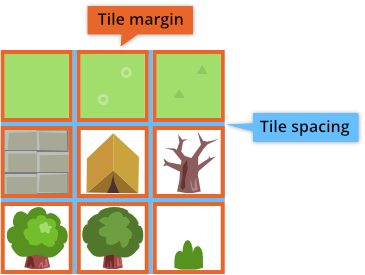
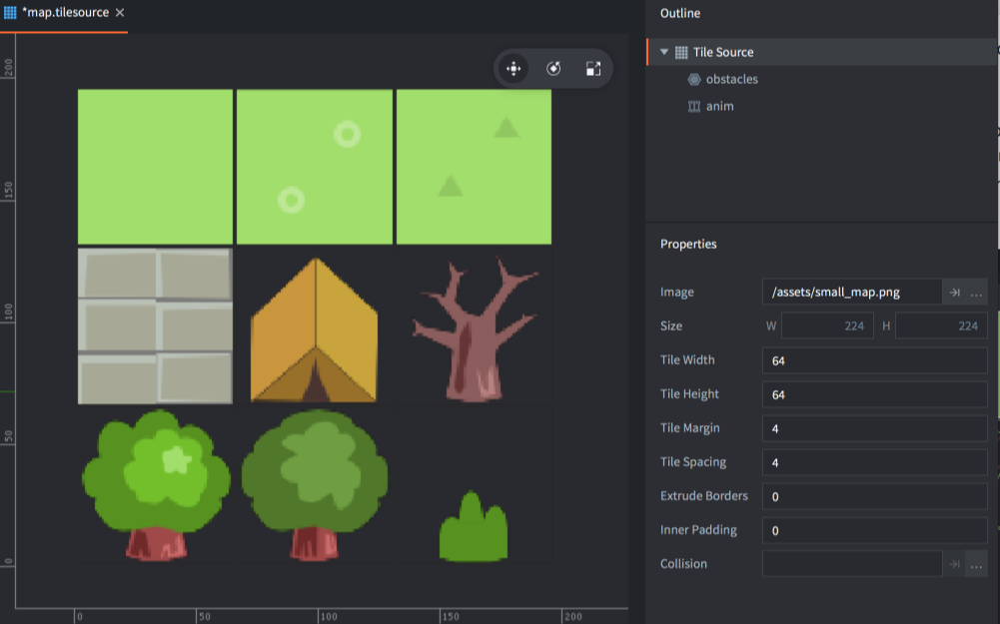
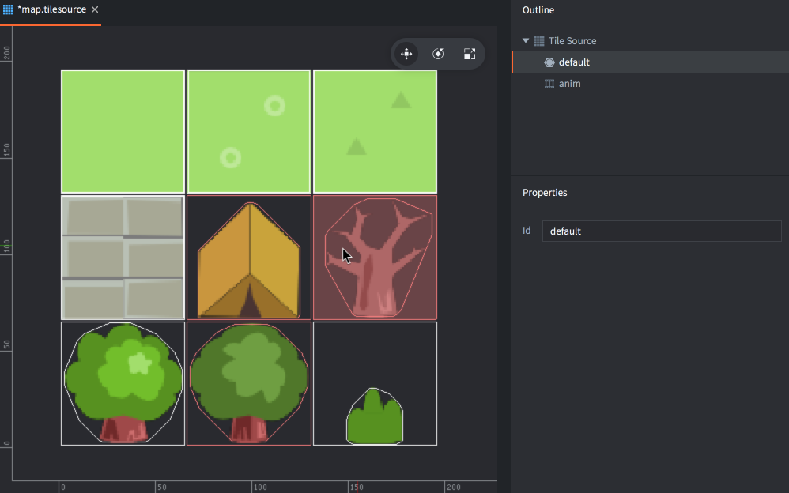

# Źródło kafelków

Źródło kafelków, *Tile Source*, może być używane przez [Tilemap component](/manuals/tilemap) do rysowania kafelków na obszarze siatki albo jako źródło grafiki dla [Sprite](/manuals/sprite) lub [Particle Effect component](/manuals/particlefx). Możesz też użyć *Collision Shapes* ze źródła kafelków w Tilemap do [wykrywania kolizji i symulacji fizycznej](/manuals/physics) ([przykład](/examples/tilemap/collisions/)).

## Tworzenie źródła kafelków

Potrzebujesz obrazu zawierającego wszystkie kafelki. Każdy kafelek musi mieć dokładnie takie same wymiary i być ułożony w siatce. Defold obsługuje odstępy (_spacing_) między kafelkami oraz margines (_margin_) wokół każdego kafelka.

Gdy masz już przygotowany obraz źródłowy, możesz utworzyć źródło kafelków:

- Zaimportuj obraz do projektu, przeciągając go do lokalizacji projektu w panelu *Assets*.
- Utwórz nowy plik źródła kafelków (<kbd>kliknij prawym przyciskiem myszy</kbd> lokalizację w panelu *Assets*, a następnie wybierz <kbd>New... ▸ Tile Source</kbd>).
- Nadaj nowemu plikowi nazwę.
- Plik zostanie otwarty w edytorze źródła kafelków.
- Kliknij przycisk przeglądania obok właściwości *Image* i wybierz obraz. Powinien pojawić się w edytorze.
- Dopasuj *Properties* do obrazu źródłowego. Gdy wszystko jest poprawne, kafelki będą idealnie wyrównane.

Size
: Rozmiar obrazu źródłowego.

Tile Width
: Szerokość każdego kafelka.

Tile Height
: Wysokość każdego kafelka.

Tile Margin
: Liczba pikseli otaczających każdy kafelek (pomarańczowe na ilustracji powyżej).

Tile Spacing
: Liczba pikseli między każdym kafelkiem (niebieskie na ilustracji powyżej).

Inner Padding
: Określa, ile pustych pikseli ma zostać automatycznie dodanych wokół kafelka w wynikowej teksturze używanej podczas uruchamiania gry.

Extrude Border
: Określa, ile razy krawędziowe piksele mają zostać automatycznie powielone wokół kafelka w wynikowej teksturze używanej podczas uruchamiania gry.

Collision
: Określa obraz używany do automatycznego generowania kształtów kolizji dla kafelków.

## Animacje poklatkowe źródła kafelków {#tile-source-flip-book-animations}

Aby zdefiniować animację w źródle kafelków, wybierz kafelki do odtwarzania za pomocą właściwości *Frames* animacji. Kafelki mogą występować w dowolnej kolejności, również z powtórzeniami, więc nie musisz zmieniać układu obrazu źródłowego. Wszystkie nowo utworzone źródła kafelków mają domyślną animację o nazwie "`anim`". Możesz dodać nowe animacje, <kbd>klikając prawym przyciskiem myszy</kbd> korzeń źródła kafelków w *Outline* i wybierając <kbd>Add ▸ Animation</kbd>.

Wybranie animacji wyświetla jej *Properties*.

Id
: Identyfikator animacji. Musi być unikalny dla źródła kafelków.

Frames
: Numery kafelków w kolejności odtwarzania animacji, rozdzielone przecinkami. Numeracja zaczyna się od 1 w lewym górnym rogu i biegnie w prawo, wiersz po wierszu, aż do prawego dolnego rogu. Możesz powtarzać numery kafelków i używać zakresów domkniętych w obu kierunkach.

| Frames | Rozwinięta sekwencja |
| --- | --- |
| `1, 3, 6, 3` | `1, 3, 6, 3` |
| `1-4, 8` | `1, 2, 3, 4, 8` |
| `4-2` | `4, 3, 2` |

Edytor wyświetla ciągi co najmniej trzech kolejnych klatek jako zakresy. Na przykład `1, 2, 3` staje się `1-3`, a `1, 2` pozostaje parą numerów kafelków. Kolejność klatek i powtórzenia są zachowywane. Lista musi zawierać co najmniej jedną klatkę, a każdy numer kafelka musi istnieć w obrazie źródłowym.

*Frames* zastępuje *Start Tile* i *End Tile*. Edytor przekształca poprawne zakresy w starszych plikach źródeł kafelków na listy klatek. W skryptach edytora używaj tablicy liczb całkowitych `frames` zamiast `start_tile` i `end_tile`; zobacz [Edytowanie źródeł kafelków](/manuals/editor-scripts/#editing-tilesources).

Playback
: Określa sposób odtwarzania animacji zgodnie z listą *Frames*:

  - `None` nie odtwarza animacji, wyświetlany jest pierwszy obraz.
  - `Once Forward` odtwarza animację jeden raz od pierwszego do ostatniego obrazu.
  - `Once Backward` odtwarza animację jeden raz od ostatniego do pierwszego obrazu.
  - `Once Ping Pong` odtwarza animację jeden raz od pierwszego do ostatniego obrazu, a następnie z powrotem do drugiego obrazu.
  - `Loop Forward` odtwarza animację wielokrotnie od pierwszego do ostatniego obrazu.
  - `Loop Backward` odtwarza animację wielokrotnie od ostatniego do pierwszego obrazu.
  - `Loop Ping Pong` odtwarza animację wielokrotnie od pierwszego do ostatniego obrazu, a następnie z powrotem do pierwszego obrazu.

Fps
: Prędkość odtwarzania animacji, wyrażona w klatkach na sekundę (FPS).

Flip horizontal
: Odbija animację w poziomie.

Flip vertical
: Odbija animację w pionie.

## Kształty kolizji źródła kafelków {#tile-source-collision-shapes}

Defold używa obrazu wskazanego we właściwości *Collision*, aby wygenerować wypukły kształt dla każdego kafelka. Kształt obrysowuje tę część kafelka, która zawiera informacje o kolorze, czyli nie jest w 100% przezroczysta.

Często sensownie jest użyć do kolizji tego samego obrazu, który zawiera właściwą grafikę, ale możesz też wskazać osobny obraz, jeśli chcesz, aby kształty kolizji różniły się od wyglądu. Gdy wskażesz obraz kolizji, podgląd zostanie zaktualizowany i na każdym kafelku pojawi się obrys pokazujący wygenerowane kształty kolizji.

W *Outline* źródła kafelków widoczne są grupy kolizji dodane do tego źródła. Nowe pliki źródła kafelków mają dodaną jedną grupę kolizji o nazwie "default". Możesz dodać nowe grupy, <kbd>klikając prawym przyciskiem myszy</kbd> korzeń źródła kafelków w *Outline* i wybierając <kbd>Add ▸ Collision Group</kbd>.

Aby wybrać kształty kafelków, które mają należeć do danej grupy, zaznacz grupę w *Outline*, a następnie kliknij każdy kafelek, który chcesz do niej przypisać. Obrys kafelka i kształtu jest wtedy kolorowany kolorem grupy. Kolor jest automatycznie przypisywany do grupy w edytorze.

Aby usunąć kafelek z jego grupy kolizji, zaznacz główny element źródła kafelków w *Outline*, a następnie kliknij kafelek.
