# Отладка игровой логики

Defold включает в себя встроенный отладчик Lua с возможностью инспекции. Вместе со встроенными [инструментами профилирования](/manuals/profiling) --- это мощный инструмент, который может помочь найти причину ошибок в логике игры или помочь проанализировать проблемы производительности.

## Вывод и визуальная отладка

Самый простой способ отладить игру в Defold заключается в использовании [print-отладки](http://en.wikipedia.org/wiki/Debugging#Techniques), или трассировки. Используйте операторы `print()` или [`pprint()`](/ref/builtins#pprint) для наблюдения за переменными или для индикации хода выполнения. Если игровой объект без скрипта ведет себя странно, можно просто прикрепить к нему скрипт с единственной целью отладки. Использование любой из функций печати приведет к выводу в *Console* в редакторе и в [лог](/manuals/debugging-game-and-system-logs).

Помимо печати, движок может рисовать на экране отладочный текст и прямые линии. Это делается путем отправки сообщений в сокет `@render`:

```lua
-- Нарисовать на экране значение "my_val" с отладочным текстом
msg.post("@render:", "draw_text", { text = "My value: " .. my_val, position = vmath.vector3(200, 200, 0) })

-- Нарисовать цветной текст на экране
local color_green = vmath.vector4(0, 1, 0, 1)
msg.post("@render:", "draw_debug_text", { text = "Custom color", position = vmath.vector3(200, 180, 0), color = color_green })

-- Нарисовать на экране отладочную линию между игроком и врагом
local start_p = go.get_position("player")
local end_p = go.get_position("enemy")
local color_red = vmath.vector4(1, 0, 0, 1)
msg.post("@render:", "draw_line", { start_point = start_p, end_point = end_p, color = color_red })
```

Сообщения визуальной отладки добавляют данные в пайплайн рендеринга и отрисовываются как часть обычного рендер пайплайна.

* `"draw_line"` добавляет данные, которые выводятся с помощью функции `render.draw_debug3d()` в рендер-скрипте.
* `"draw_text"` рендерится с помощью `/builtins/fonts/debug/always_on_top.font`, который использует материал `/builtins/fonts/debug/always_on_top_font.material`.
* `"draw_debug_text"` это то же самое, что и `"draw_text"`, но отображается в пользовательском цвете.

Следует отметить, что, вероятно, потребуется обновлять эти данные каждый кадр, поэтому размещение сообщений в функции `update()` является хорошей идеей.

## Запуск отладчика

Отладчик Lua доступен в нативных отладочных сборках и сборках без графики. Используйте движок той же версии Defold, что и редактор. Релизные и веб-сборки не поддерживают подключение отладчика.

Для запуска отладчика выберите <kbd>Debug ▸ Start/Attach</kbd>. Это запускает игру с подключённым отладчиком либо подключает его к уже работающей игре. При запуске игры для отладки редактор устанавливает включённые точки останова до выполнения стартовых скриптов, поэтому точку останова в `init()` можно задать до запуска.

Для подключения к устройству выберите его в <kbd>Project ▸ Targets</kbd>, затем выберите <kbd>Debug ▸ Start/Attach</kbd>. Подключение приостанавливает выполнение на следующей строке Lua. Редактор автоматически настраивает соединение с отладчиком для поддерживаемых локальных и удалённых целей. Требования к соединению см. в разделе [Удалённые цели](#remote-targets); о [подключении внешнего отладчика](#native-dap-connections) читайте ниже.

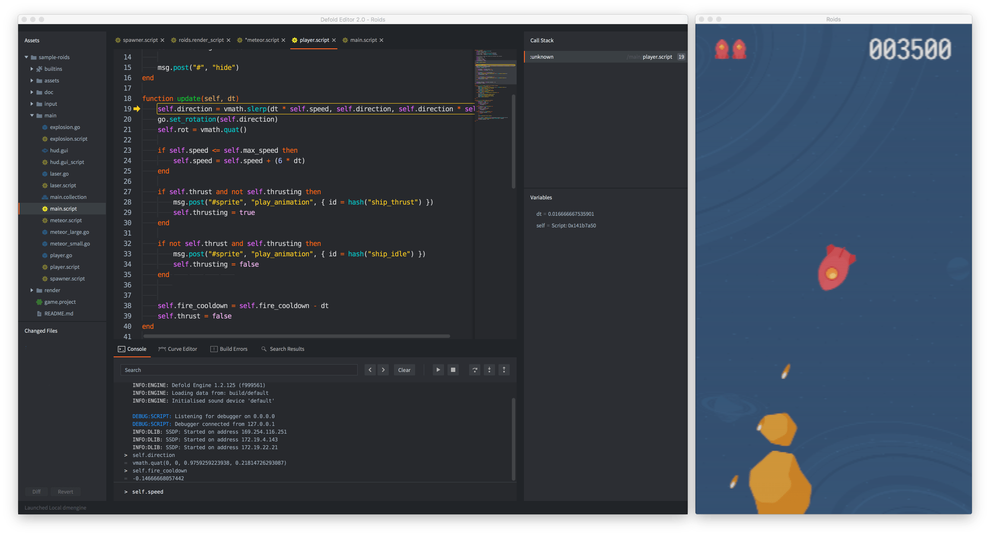

Как только отладчик подключен, можно контролировать выполнение игры через кнопки управления отладчиком в консоли или через меню <kbd>Debug</kbd>:

Break
: {width=60px .left}
  Приостанавливает выполнение Lua на следующей строке исходного кода. После этого можно исследовать состояние игры, продвигать игру шаг за шагом или продолжить ее выполнение до следующей точки останова. Текущая точка выполнения отмечается в редакторе кода:

  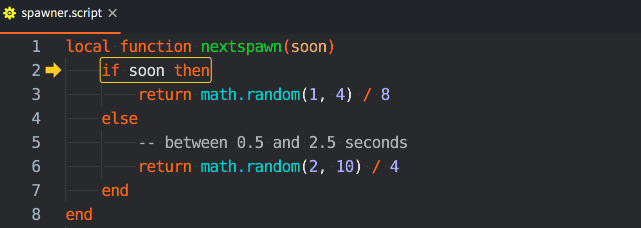

Continue
: {width=60px .left}
  Продолжает выполнение игры. Код игры будет выполняться до тех пор, пока не будет нажата пауза или пока выполнение не достигнет точки останова, которую вы установили. Если выполнение прерывается в установленной точке останова, точка выполнения отмечается в редакторе кода поверх маркера точки останова:

  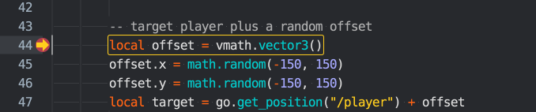

Stop
: {width=60px .left}
  Останавливает отладчик. Нажатие этой кнопки немедленно остановит отладчик, отсоединит его от игры и завершит запущенную игру..

Step Over
: {width=60px .left}
  Продвинуть выполнение программы на один шаг. Если выполнение включает в себя запуск другой Lua-функции, выполнение _не перейдет в функцию_, а продолжит выполнение и остановится на следующей строке ниже вызова функции. В данном примере, если пользователь нажмет "step over", отладчик выполнит код и остановится на операторе `end` ниже строки с вызовом функции `nextspawn()`:

  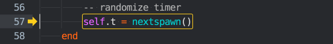

::: sidenote
Пошаговое выполнение следует строкам исходного кода Lua. Шаг может повторно попасть на ту же строку, например на новой итерации цикла, поэтому он не всегда переходит к следующей строке файла.
:::

Step Into
: {width=60px .left}
  Продвигает выполнение программы на один шаг. Если выполнение включает в себя запуск другой Lua-функции, то выполнение _перейдет в эту функцию_. Вызов функции добавляет запись в стек вызовов. Можно кликнуть по каждой записи в списке стека вызовов, чтобы просмотреть точку входа и содержимое всех переменных в этом замыкании. Здесь пользователь перешел в функцию `nextspawn()`:

  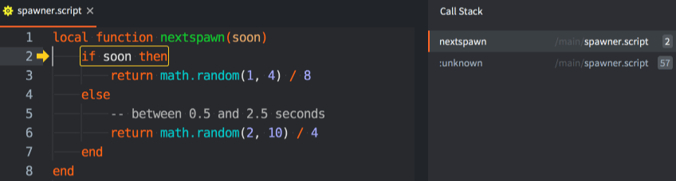

Step Out
: {width=60px .left}
  Продолжает выполнение до возврата из текущей функции. Если вы перешли к выполнению функции, нажатие кнопки "step out" продолжит выполнение до возвращения из функции.

Установка и очистка точек останова
: В Lua-коде можно установить произвольное количество точек останова. Когда игра запускается с подключенным отладчиком, она остановит выполнение в следующей точке останова и будет ждать дальнейших действий со стороны пользователя.

  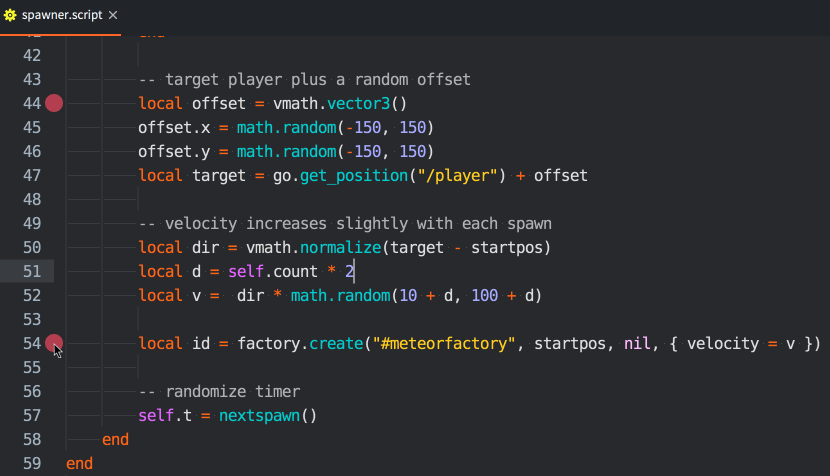

  Чтобы установить или убрать точку останова, кликните в колонке справа от номеров строк в редакторе кода. Также можно выбрать в меню <kbd>Edit ▸ Toggle Breakpoint</kbd>.

Включение и отключение точек останова
: Точки останова можно временно отключать, не удаляя их. В отключенном состоянии они игнорируются при выполнении, но их можно в любой момент снова включить. Щёлкните правой кнопкой мыши по точке останова в поле редактора кода и переключите флажок `Enabled`. Отключенные точки останова отображаются пустыми, чтобы было видно, что они неактивны.

  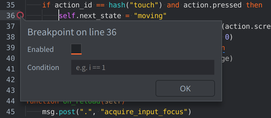

Условные точки останова
: Вы можете настроить точку останова с условием, которое должно быть истинным, чтобы точка сработала. Это условие может обращаться к локальным переменным, доступным на этой строке во время выполнения кода.

  

  Чтобы отредактировать условие точки останова, щёлкните правой кнопкой мыши в колонке справа от номеров строк в редакторе кода или выберите <kbd>Edit ▸ Edit Breakpoint</kbd> в меню.

Вычисление Lua-выражений
: Когда игра приостановлена, выберите кадр в *Call Stack*, введите выражение или оператор Lua в нижней части консоли и нажмите <kbd>Enter</kbd>. Вычисление использует локальные переменные, upvalues и глобальные переменные выбранного кадра. Результаты-таблицы включают вложенное содержимое.

  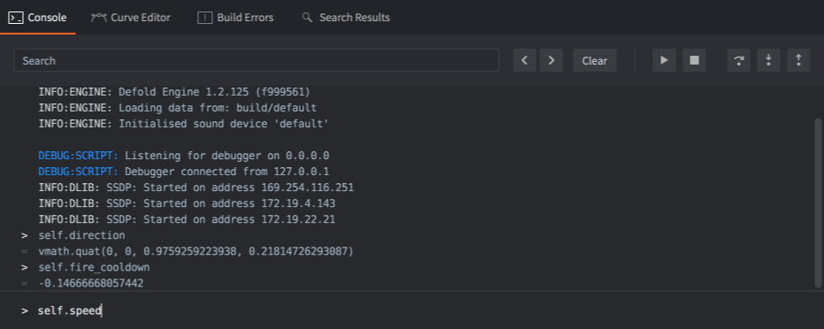

  Вы также можете изменять значения присваиванием, например `self.score = 100` в кадре, где доступна `self`. Вычисляемый код влияет на состояние игры так же, как код, выполняемый самой игрой.

Просмотр переменных
: Выберите кадр в *Call Stack*, чтобы просмотреть его локальные переменные и upvalues в представлении *Variables*. Разверните `_G` для просмотра глобальных переменных, а таблицы или `self` — для просмотра их полей. При пошаговом выполнении, переключении кадров и обновлении после вычисления редактор получает текущие значения, сохраняя развёрнутые пути, выделение и положение прокрутки.

Отсоединение отладчика
: Выберите <kbd>Debug ▸ Detach Debugger</kbd>, чтобы отсоединить отладчик от игры. Она немедленно продолжит работу. Используйте <kbd>Debug ▸ Start/Attach</kbd>, чтобы снова подключиться без перезапуска игры.

## Нативные подключения DAP {#native-dap-connections}

Движок предоставляет нативный сервер Debug Adapter Protocol (DAP) по TCP. Для внешнего DAP-клиента запустите прослушивание в нативном отладочном движке Defold или движке без графики, затем подключите клиент к адресу и порту движка. Редактор автоматически настраивает прослушивание при использовании <kbd>Debug ▸ Start/Attach</kbd>.

Текущий редактор не может подключаться к старым движкам, поддерживающим только MobDebug. Вызов `require "builtins.scripts.mobdebug"` в текущих версиях не нужен и недоступен.

### Запуск прослушивания {#starting-the-listener}

Сначала соберите проект. Из каталога проекта, содержащего `build/default/game.projectc`, запустите нативный отладочный движок со следующими [переопределениями конфигурации при запуске](/manuals/project-settings/#setting-config-values-on-engine-startup):

```sh
dmengine --config=debugger.enabled=1 \
  --config=debugger.port=8172 --config=debugger.wait=1
```

Подключите DAP-клиент к `127.0.0.1:8172`. Движок ожидает, пока клиент настроит точки останова, прежде чем выполнять стартовые скрипты.

| Параметр | По умолчанию | Назначение |
| --- | --- | --- |
| `debugger.enabled` | `0` | Установите `1`, чтобы начать прослушивание при запуске движка. |
| `debugger.address` | `127.0.0.1` | IPv4-адрес для прослушивания. По умолчанию принимаются подключения с того же компьютера. |
| `debugger.port` | `8172` | Порт TCP для прослушивания. Используйте `0` для выбора свободного порта. |
| `debugger.wait` | `0` | Установите `1`, чтобы дождаться настройки клиента отладчика перед выполнением стартовых скриптов. |

Эти значения также можно добавить в [раздел Debugger файла game.project](/manuals/project-settings/#debugger). Редактор автоматически настраивает прослушивание для <kbd>Debug ▸ Start/Attach</kbd>, поэтому ручная настройка нужна только при самостоятельном запуске прослушивания.

Журнал движка сообщает выбранные адрес и порт. При `debugger.wait=0` игра запускается сразу, и вы можете подключиться позднее. При `debugger.wait=1` она ждёт, пока клиент закончит настройку сеанса, включая точки останова. Для локального запуска с отладкой редактор автоматически выбирает свободный порт.

Отключение клиента возобновляет выполнение и оставляет прослушивание доступным для следующего подключения. Отключение во время ожидания стартовой конфигурации также снимает ожидание движка. Если начать прослушивание не удалось, движок записывает ошибку в журнал и продолжает запуск; можно повторить попытку из Lua с помощью `debugger.start(0)`, выбрав свободный порт.

### Включение прослушивания во время работы {#enabling-the-listener-while-running}

Чтобы включить прослушивание из скрипта без перезапуска игры:

```lua
if debugger then
    local port = debugger.start(0)
    print("DAP listener port:", port)
end
```

`debugger.start([port [, address]])` сразу возвращает порт прослушивания. Функция не ожидает клиента и не приостанавливает игру. Пропущенные аргументы используют `debugger.port` и `debugger.address`; значение `0` выбирает свободный порт. Повторные вызовы возвращают порт существующего слушателя, не изменяя его адрес или порт. Модуль `debugger` предоставляется нативными отладочными движками и движками без графики.

Порт должен быть целым числом от `0` до `65535`. Передайте `nil` первым аргументом, чтобы переопределить только адрес. Некорректные аргументы или невозможность привязать слушатель вызывают ошибку Lua.

### Удалённые цели {#remote-targets}

Для прямого подключения с другого компьютера привяжите слушатель к IPv4-интерфейсу устройства или к `0.0.0.0` (всем IPv4-интерфейсам). Например, используйте `debugger.start(8172, "0.0.0.0")` либо добавьте `--config=debugger.address=0.0.0.0` в приведённую выше команду запуска. Подключите клиент к фактическому IP-адресу устройства и разрешите TCP-доступ к порту прослушивания. `0.0.0.0` — адрес привязки, а не адрес для ввода в клиенте.

Редактор Defold автоматически запрашивает такую удалённую привязку и использует порт `8172 + project.instance_index` для удалённых целей. Он не может обнаружить динамически выбранный удалённый порт. Если вы уже запустили удалённый слушатель на localhost или другом порту, перезапустите движок перед подключением из редактора.

Отладчик может выполнять Lua-код и не использует аутентификацию. Разрешайте удалённый доступ только в доверенной сети разработки.

### Внешние клиенты {#external-clients}

Используйте клиент, поддерживающий прямое подключение к DAP-серверу по TCP. Настройте сопоставление исходников с папкой, содержащей `game.project` (аргумент подключения DAP `localRoot`). Сначала запустите слушатель движка, затем подключите клиент.

#### VS Code {#vs-code}

Установите [расширение Lua Debug](https://marketplace.visualstudio.com/items?itemName=actboy168.lua-debug) (`actboy168.lua-debug`), откройте в VS Code папку с `game.project` и добавьте эту конфигурацию в `.vscode/launch.json`:

```json
{
  "version": "0.2.0",
  "configurations": [
    {
      "name": "Attach to Defold Lua",
      "type": "lua",
      "request": "attach",
      "address": "127.0.0.1:8172",
      "debugServer": 8172,
      "localRoot": "${workspaceFolder}",
      "stopOnEntry": false
    }
  ]
}
```

Если VS Code открывает файл `.script`, `.gui_script` или `.render_script` как обычный текст, выберите **Lua** в индикаторе языка в строке состояния перед установкой точек останова.

Установите точку останова, например в функции `init()` скрипта. Запустите движок с помощью [команды запуска выше](#starting-the-listener), затем выберите **Attach to Defold Lua** в представлении **Run and Debug** VS Code. При `debugger.wait=1` движок выполняет стартовые скрипты после того, как клиент установит точки останова. Задайте `stopOnEntry` значение `true`, если также хотите приостановить выполнение на следующей строке Lua после подключения.

[Параметр `debugServer`](https://code.visualstudio.com/api/extension-guides/debugger-extension#development-setup-for-mock-debug) в VS Code подключается напрямую к локальному TCP-слушателю движка. Поле `address` требуется конфигурации подключения расширения Lua Debug. Если меняете порт прослушивания, обновите оба поля. `localRoot` должен указывать на папку проекта, чтобы клиент мог сопоставить имена исходников Lua движка с вашими файлами.

Для удалённого движка перенаправьте его DAP-порт на localhost и укажите перенаправленный порт в обоих полях либо используйте DAP-клиент, который подключается напрямую к удалённому хосту.

## Вкладка Breakpoints

  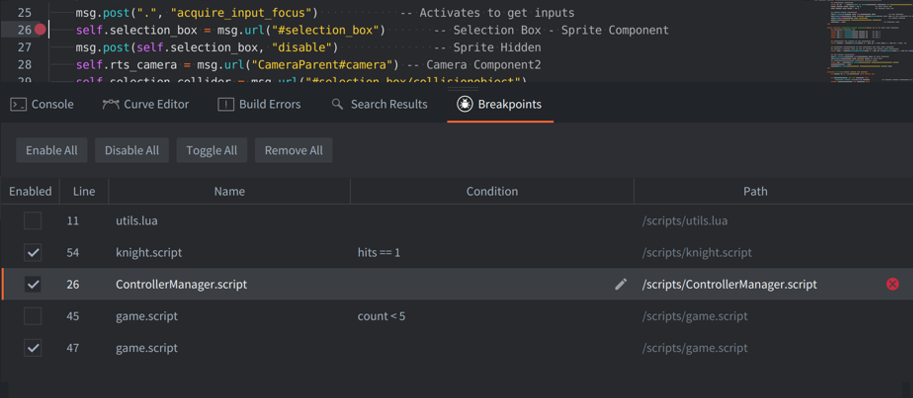

  При работе с несколькими точками останова в разных скриптах вкладка Breakpoints предоставляет централизованное место для управления всеми точками останова.

##### Управление отдельными точками останова

  Для работы с отдельными точками останова:
  - Нажмите на красную иконку корзины, чтобы удалить точку останова.
  - Дважды щёлкните по строке вне области условия, чтобы перейти к этой строке в Code View.
  - Дважды щёлкните по ячейке условия или нажмите на иконку карандаша, чтобы отредактировать условную точку останова.
  - Нажмите кнопку очистки X при наведении на ячейку условия, чтобы очистить условие.

##### Пакетные операции

  Выберите несколько точек останова с помощью Ctrl/Cmd+щелчка или Shift+щелчка, затем щёлкните правой кнопкой мыши, чтобы выполнить массовые действия. Можно одновременно редактировать условия для нескольких точек останова, переключать их активное состояние или полностью удалять их.

  Кнопки на панели инструментов позволяют разом включить, отключить или переключить все точки останова. Это полезно, если вы хотите запустить игру без остановок, но не хотите терять уже расставленные позиции точек останова. Когда отладочная сессия закончена, можно так же удалить их все сразу.

## Отладочная Lua-библиотека

Lua поставляется с библиотекой отладки, которая полезна в некоторых ситуациях, особенно если необходимо исследовать внутренности окружения Lua. За подробностями обращайтесь к [главе о Debug Library в руководстве Lua](http://www.lua.org/pil/contents.html#23).

## Чеклист для отладки

Если вы столкнулись с ошибкой или если ваша игра ведет себя не так, как ожидалось, вот контрольный список для отладки:

1. Проверьте вывод консоли и убедитесь в отсутствии ошибок времени выполнения.

2. Добавьте операторы `print` в код, чтобы убедиться, что код действительно выполняется.

3. Если он не запускается, проверьте, правильно ли вы выполнили настройки в редакторе, необходимые для запуска кода. Добавлен ли скрипт к нужному игровому объекту? Приобрел ли скрипт фокус ввода? Правильны ли триггеры ввода? Добавлен ли код шейдера к материалу? И т.д.

4. Если код зависит от значений переменных (например, в выражении if), либо примените `print` к этим значениям там, где они используются или проверяются, либо проверьте их с помощью отладчика.

Иногда поиск ошибки может быть сложным и трудоемким процессом, требующим от вас пройтись по коду бит за битом, проверяя все, сужая круг неисправного кода и устраняя источники ошибок. Лучше всего для этого подходит метод под названием "разделяй и властвуй":

1. Определите, какая половина (или меньше) кода должна содержать ошибку.
2. Снова выясните, какая половина из этой половины должна содержать баг.
3. Продолжайте сужать круг кода, который должен вызывать ошибку, пока не найдете ее.

Удачной охоты!

## Отладка проблем с физикой {#debugging-problems-with-physics}

Если возникли проблемы с физикой и столкновения работают не так, как ожидалось, рекомендуется включить отладку физики. Отметьте опцию *Debug* в секции *Physics* файла *game.project*:

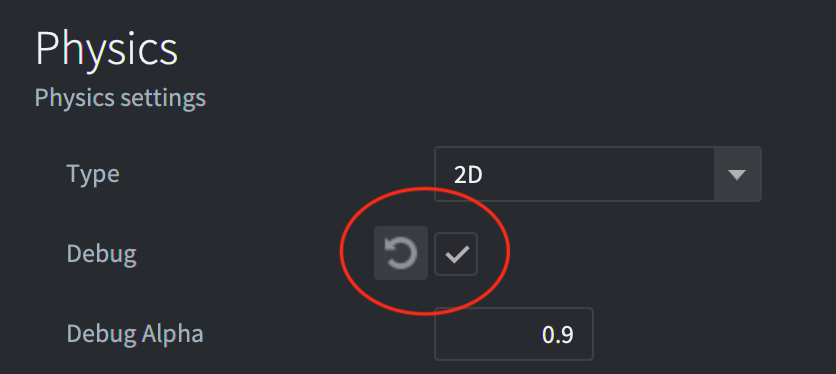

Когда эта опция включена, Defold отрисовывает все формы и контактные точки столкновений:

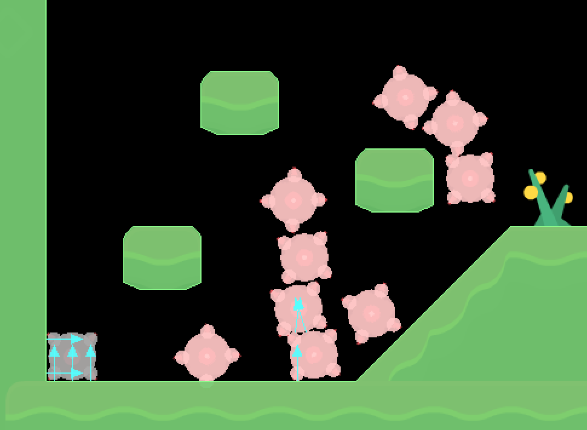
