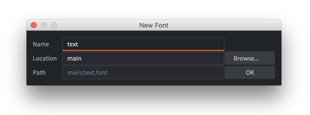
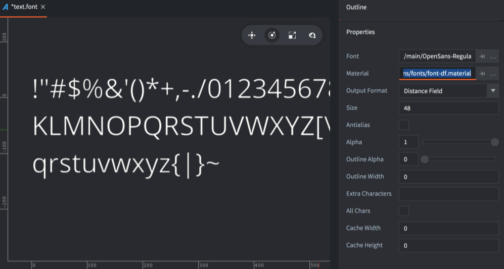
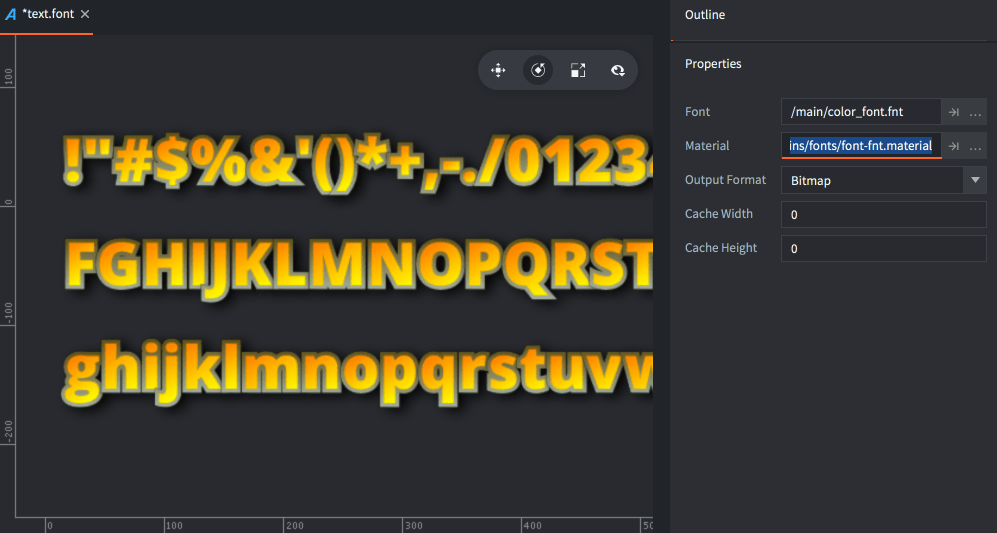
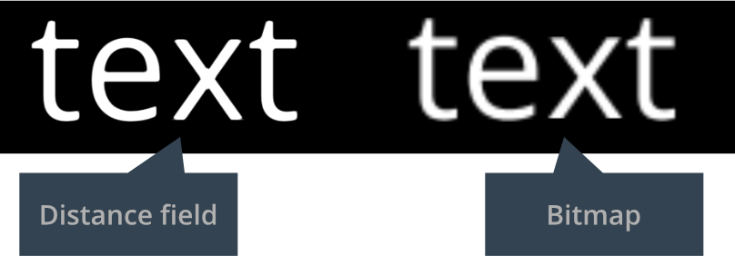
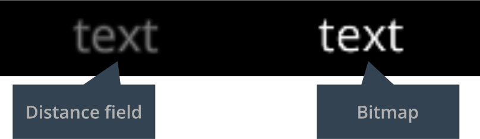

# Ресурс Font

Шрифты используются для визуализации текста в компонентах Label и GUI-нодах Text. Defold поддерживает несколько форматов файлов шрифтов:

- TrueType
- OpenType
- BMFont

И прежняя, и полная системы раскладки текста поддерживают контуры TrueType и OpenType CFF1/CFF2, включая генерацию во время выполнения из ресурсов `.ttf` и `.otf`.

О стилизации отдельных фрагментов текста и работе со ссылками и встроенными спрайтами см. в [руководстве по форматированной текстовой разметке](/manuals/font-richtext).

Для шрифтов TrueType и OpenType свойство *Mode* выбирает способ рендеринга глифов:

- **Bitmap** использует растровые изображения глифов.
- **SDF** (знаковое поле расстояний) хранит в текстуре расстояния до краёв глифов и позволяет более гибкое масштабирование, чем Bitmap.
- **Vector** отрисовывает форму глифов по данным кривых, сохраняя чёткость при масштабировании. Эффекты контура и тени по-прежнему используют растровые данные.

Новые ресурсы шрифтов используют режим **Vector** и генерацию глифов **Dynamic**. Существующие ресурсы сохраняют режим Bitmap или SDF. Источники BMFont всегда используют предоставленный растр.

Режим Vector требует поддержки текстур `RGBA16F` и `R32UI` и не поддерживается в OpenGL ES 2 или WebGL 1. Для неподдерживаемых графических адаптеров используйте шрифты Bitmap или SDF с соответствующими материалами; автоматического перехода с Vector на SDF нет. Настройка описана в разделе [Векторные шрифты](#vector-fonts).

## Офлайн- и runtime-шрифты {#offline-or-runtime-fonts}

Свойство *Glyph Generation* выбирает момент генерации данных глифов каждого шрифта:

- **Static** генерирует выбранные глифы при сборке (офлайн). *Characters* и *All Chars* определяют включаемые глифы. Исходный файл `.ttf` или `.otf` не включается в бандл для генерации во время выполнения.
- **Dynamic** включает исходный файл `.ttf` или `.otf` в бандл и генерирует глифы по требованию во время выполнения. *Prewarm Text* подготавливает глифы при загрузке шрифта. Остальные глифы могут генерироваться позднее по мере необходимости.

Шрифты SDF и Vector поддерживают оба варианта. Шрифты Bitmap и источники BMFont используют генерацию Static. Каждый ресурс шрифта настраивается независимо, поэтому проект может сочетать шрифты Static и Dynamic.

Динамическая генерация может уменьшить размер бандла и потребление памяти, особенно для шрифтов с большими наборами символов. Она требует полной системы раскладки текста в движке; см. [Включение runtime-шрифтов](#enabling-runtime-fonts).

<a id="text-layout-support-eg-right-to-left"></a>

## Поддержка раскладки текста (например, справа налево)

Runtime-шрифты также дают преимущество в виде полной поддержки раскладки текста, например письма справа налево.
Сейчас для этого используются библиотеки [HarfBuzz](https://github.com/harfbuzz/harfbuzz), [SheenBidi](https://github.com/Tehreer/SheenBidi), [libunibreak](https://github.com/adah1972/libunibreak) и [SkriBidi](https://github.com/memononen/Skribidi).

См. раздел [Включение runtime-шрифтов](/manuals/font#enabling-runtime-fonts)

Редактор использует систему рендеринга шрифтов движка для предпросмотра шрифтов и текста в сценах. Формирование глифов и раскладка справа налево требуют [runtime-шрифтов](#enabling-runtime-fonts) и параметра **Use full text layout system** в App Manifest. Для офлайн-шрифтов предпросмотр учитывает настройки шрифта **Characters** и **All Chars**.

## Коллекция шрифтов

Формат файла `.fontc` также называется коллекцией шрифтов. В офлайн-режиме с ним связан только один шрифт.
При использовании runtime-шрифтов с коллекцией шрифтов можно связать более одного файла шрифта (`.ttf` или `.otf`).

Это позволяет использовать одну коллекцию шрифтов при рендеринге нескольких текстов на разных языках, при этом сохраняя низкое потребление памяти.
Например, можно загрузить коллекцию с японским шрифтом, затем связать этот шрифт с текущим основным шрифтом и после этого выгрузить японскую коллекцию шрифтов.

## Создание шрифта

Чтобы создать шрифт для использования в Defold, создайте новый файл Font, выбрав в меню <kbd>File ▸ New...</kbd>, затем <kbd>Font</kbd>. Можно также <kbd>кликнуть ПКМ</kbd> в нужном расположении в *Assets* browser и выбрать <kbd>New... ▸ Font</kbd>.



Присвойте новому файлу шрифта имя и кликните <kbd>Ok</kbd>. Новый файл шрифта откроется в редакторе.

Перетащите необходимый шрифт в браузер *Assets* в подходящее для него расположение.

В свойстве *Font* укажите файл шрифта. Для источника `.ttf` или `.otf` выберите *Mode* и *Glyph Generation*, затем настройте остальные свойства по необходимости. Для генерации Dynamic также выполните [настройку runtime-шрифта](#enabling-runtime-fonts).


Для шрифтов Vector меняйте отображаемый размер текста через *Font Size* компонента Label или GUI-ноды Text. *Outline/Shadow Bitmap Size* управляет разрешением растров эффектов независимо от отображаемого размера текста.

Для шрифтов Bitmap и SDF задавайте *Size* в ресурсе шрифта для выбора размера генерируемых глифов. Размеры BMFont берутся из исходного файла `.fnt`. Чтобы изменить отображаемый размер этих шрифтов, масштабируйте компонент Label или GUI-ноду Text.

## Свойства {#properties}

*Font*
: Файл TTF, OTF или *`.fnt`*, используемый для генерирования данных о шрифте.

*Material*
: Материал для рендеринга этого шрифта. Он должен соответствовать режиму шрифта; см. [Материалы шрифтов](#font-materials).

*Mode*
: Метод рендеринга для источника `.ttf` или `.otf`: **Bitmap**, **SDF** или **Vector**. Заменяет прежнее свойство *Output Format*. Для источников BMFont свойство не отображается.

*Glyph Generation*
: **Static** генерирует данные глифов при сборке. **Dynamic** генерирует их во время выполнения и требует [полной системы раскладки текста](#enabling-runtime-fonts). Свойство доступно для шрифтов SDF и Vector. В режиме Bitmap оно зафиксировано на Static, а для источников BMFont не отображается.

*Render Mode*
: Расположение слоёв генерируемых шрифтов Bitmap. Свойство отображается только в режиме Bitmap для источников `.ttf` и `.otf`. Для SDF, Vector и источников BMFont Defold выбирает расположение слоёв автоматически.

  - **Single Layer** создаёт один четырёхугольник для каждого символа.
  - **Multi Layer** создаёт отдельные четырёхугольники для формы глифа, контура и тени. Слои отрисовываются сзади вперёд, что не позволяет символу перекрывать ранее отрисованные символы, если контур шире расстояния между глифами. Это также включает смещение тени из свойств *Shadow X/Y*.

*Size*
: Размер глифов в пикселях при генерации данных шрифта Bitmap или SDF. Для источников BMFont размер считывается из файла `.fnt` и здесь не редактируется.

*Outline/Shadow Bitmap Size*
: В режиме Vector заменяет *Size*. Управляет разрешением растра включённых эффектов контура и тени при генерации как Static, так и Dynamic. Свойство недоступно, если оба эффекта отключены, поскольку формы глифов используют данные кривых. Изменение *Font Size* компонента Label или GUI-ноды Text не меняет это общее разрешение растра.

*Antialias*
: Сглаживание глифов при генерации данных шрифта Bitmap. Отключите для попиксельного рендеринга. Свойство отображается только в режиме Bitmap для источников `.ttf` и `.otf`.

*Alpha*
: Прозрачность глифа. 0.0--1.0, где 0.0 означает прозрачность, а 1.0 --- непрозрачность.

*Outline Alpha*
: Прозрачность сгенерированного контура. 0.0--1.0.

*Outline Width*
: Ширина сгенерированного контура в пикселях. Установите значение 0 чтобы убрать контур.

*Shadow Alpha*
: Прозрачность сгенерированной тени. 0.0--1.0.

::: sidenote
Встроенный шейдер шрифтов Bitmap поддерживает тени в режимах *Single Layer* и *Multi Layer*. Для генерируемых шрифтов Bitmap в режиме *Single Layer*, которым не нужны тени, пользовательский материал может использовать `/builtins/fonts/font-singlelayer.fp`. Шрифты SDF и Vector требуют шейдеров, соответствующих их режиму; см. [Материалы шрифтов](#font-materials).
:::

*Shadow Blur*
: Степень размытия сгенерированной тени. Установите 0 для чёткой тени.

*Shadow X/Y*
: Горизонтальное и вертикальное смещение сгенерированной тени в пикселях. Для генерируемых шрифтов Bitmap используйте режим *Multi Layer*, чтобы применить эти смещения. Для шрифтов SDF и Vector Defold автоматически выбирает подходящие слои.

*Characters*
: При генерации Static — символы, включаемые в собранный шрифт. По умолчанию поле содержит печатные символы ASCII (коды 32-126). Добавляйте или удаляйте символы, чтобы управлять глифами, доступными во время выполнения.

*Prewarm Text*
: При генерации Dynamic заменяет *Characters*. Текст используется для генерации глифов и прогрева кэша при загрузке шрифта. Он не ограничивает набор символов, которые можно сгенерировать позднее. Прогрев текста также можно выполнить из скрипта через [`font.prewarm_text()`](/ref/font/#font.prewarm_text).

::: sidenote
Печатные ASCII символы:
space ! " # $ % & ' ( ) * + , - . / 0 1 2 3 4 5 6 7 8 9 : ; < = > ? @ A B C D E F G H I J K L M N O P Q R S T U V W X Y Z [ \ ] ^ _ \` a b c d e f g h i j k l m n o p q r s t u v w x y z { | } ~
:::

*All Chars*
: При генерации Static включает все глифы исходного шрифта вместо ограничения символами из *Characters*. Для шрифтов Dynamic свойство скрыто.

*Cache Width/Height*
: Ограничивает размер растрового кэша глифов, используемого шрифтами Bitmap и SDF, а также эффектами контура и тени Vector. Когда движок рендерит текст, он ищет глиф в кэше растра. Если его там нет, он будет добавлен в кэш перед рендерингом. Если кэш растра слишком мал, чтобы вместить все глифы, которые движок пытается отрендерить, возникает ошибка (`ERROR:RENDER: Out of available cache cells! Consider increasing cache_width or cache_height for the font.`).

  При значении 0 размер кэша устанавливается автоматически и может вырасти до 2048x4096.

## Материалы шрифтов {#font-materials}

Используйте материал, соответствующий режиму шрифта. GUI-ноды Text используют *Material* ресурса шрифта. Компоненты Label имеют отдельное свойство *Material*, которое также должно соответствовать шрифту:

| Режим или источник шрифта | Материал шрифта для GUI-текста | Материал компонента Label |
| --- | --- | --- |
| Bitmap | `/builtins/fonts/font.material` | `/builtins/fonts/label.material` |
| SDF | `/builtins/fonts/font-df.material` | `/builtins/fonts/label-df.material` |
| Vector | `/builtins/fonts/font-vector.material` | `/builtins/fonts/label-vector.material` |
| BMFont (`.fnt`) | `/builtins/fonts/font-fnt.material` | `/builtins/fonts/label-fnt.material` |

Изменение *Mode* в редакторе шрифта переключает соответствующие встроенные материалы Bitmap, SDF и Vector, если один из них уже назначен шрифту. Пользовательские материалы автоматически не заменяются. Также проверьте *Material* у всех компонентов Label, использующих этот шрифт.

## Векторные шрифты {#vector-fonts}

Векторные шрифты отрисовывают формы глифов по кривым, сохраняя чёткость при изменении отображаемого размера текста. Чтобы настроить шрифт с генерацией глифов во время выполнения:

1. Создайте ресурс `.font`, например `/fonts/ui.font`, и выберите источник TrueType или OpenType в свойстве *Font*. Для обычного текста можно использовать встроенный `/builtins/fonts/vera_mo_bd.ttf`.
2. Установите *Mode* в **Vector**, *Glyph Generation* в **Dynamic**, а *Material* в `/builtins/fonts/font-vector.material`. Это значения по умолчанию для новых ресурсов шрифтов.
3. Включите **Use full text layout system** в App Manifest, назначенном проекту. Настройте пользовательский движок согласно разделу [Включение runtime-шрифтов](#enabling-runtime-fonts).
4. Включите [Shader ▸ Exclude GLES 2.0](/manuals/project-settings/#exclude-gles-20) в *game.project*.
5. Назначьте шрифт компоненту [Label](/manuals/label/) либо добавьте его в *Fonts* GUI-сцены и выберите на [текстовой ноде](/manuals/gui-text/). Для Label также установите *Material* компонента в `/builtins/fonts/label-vector.material`. Задайте нужный отображаемый размер в *Font Size* компонента или ноды.

Формы векторных глифов используют текстуры кривых, однако включённые контуры и тени всё ещё генерируют растровые данные SDF и расходуют текстурную память кэша глифов. *Outline/Shadow Bitmap Size* задаёт разрешение этого растра независимо от *Font Size* компонента Label или GUI-ноды Text. Установите *Outline Alpha* и *Shadow Alpha* в `0`, если эффекты не нужны, чтобы избежать генерации их растровых данных.

### Цветные эмодзи {#color-emoji}

Векторные шрифты могут отображать цветные эмодзи COLRv1, включая цвета палитры, линейные и радиальные градиенты. Режимы Bitmap и SDF не отображают цвета COLRv1. Используйте настройку Dynamic Vector выше, затем добавьте шрифт эмодзи COLRv1 как резервный в коллекцию шрифтов. Обычный текст продолжит использовать исходный шрифт.

Например, скопируйте COLRv1 [шрифт Noto Color Emoji](https://github.com/google/fonts/blob/main/ofl/notocoloremoji/NotoColorEmoji-Regular.ttf) в проект как `/fonts/NotoColorEmoji-Regular.ttf`. Выбирайте версию COLRv1: другие шрифты эмодзи могут использовать иной цветовой формат, даже если их имя заканчивается на `.ttf`.

Добавьте `/fonts/NotoColorEmoji-Regular.ttf` в **Project ▸ Custom Resources** файла *game.project*. Если других пользовательских ресурсов нет, настройка выглядит так:

```ini
[project]
custom_resources = /fonts/NotoColorEmoji-Regular.ttf
```

Путь шрифта, записанный в Lua, сам по себе не включает файл шрифта в бандл. [Custom Resources](/manuals/project-settings/#custom-resources) делает исходный шрифт доступным для [`font.add_font()`](/ref/font/#font.add_font), который загружает его через систему ресурсов. При загрузке из бандла передавайте строковый путь исходного шрифта.

Добавляйте резервный шрифт один раз для каждого общего ресурса шрифта. Изменение затрагивает все компоненты Label и GUI-ноды Text, использующие этот шрифт; повторное добавление того же резервного шрифта вызывает ошибку. Если вы используете [пример Label](/manuals/label/#vector-fonts-and-color-emoji) и [пример GUI](/manuals/gui-text/#vector-fonts-and-color-emoji) с одним `.font`, согласуйте инициализацию так, чтобы резервный шрифт добавлялся один раз до прогрева или отображения текста любым из примеров. Примеры прогревают весь текст после добавления резервного шрифта и показывают его после успешного callback.

## Шрифты Distance Field

Шрифты Distance Field (карта расстояний) вместо растровых данных хранят расстояние до границы глифа в текстуре. Когда движок рендерит шрифт, требуется специальный шейдер, чтобы интерпретировать данные о расстоянии и использовать их для отрисовки глифа. Шрифты Distance Field более ресурсоемки, чем растровые, но обеспечивают большую гибкость в выборе размера.



Выберите **SDF** в *Mode* и **Static** или **Dynamic** в *Glyph Generation*. Используйте *`/builtins/fonts/font-df.material`* для шрифта и *`/builtins/fonts/label-df.material`* для компонентов Label либо пользовательские материалы, обрабатывающие данные поля расстояний.

## Растровые шрифты BMFont {#bitmap-bmfonts}

В дополнение к генерируемым растровым картам Defold поддерживает предварительно запеченные растровые шрифты формата "BMFont". Эти шрифты представляют собой PNG-изображение в виде страницы с глифами. Кроме того, файл *`.fnt`* содержит информацию о том, где на странице находится каждый глиф, а также информацию о размере и кернинге. (Следует учесть, что Defold не поддерживает XML-версию формата *`.fnt`*, который используется в Phaser и в некоторых других инструментах).

Эти типы шрифтов не обеспечивают повышения производительности по сравнению с растровыми шрифтами, генерируемыми из файлов TrueType или OpenType, но могут включать произвольную графику, расцветку и тени непосредственно в изображении.

Добавьте сгенерированные файлы *`.fnt`* и *`.png`* в проект Defold. Эти файлы должны находиться в одной папке. Создайте новый файл шрифта и задайте в свойстве *Font* файл *`.fnt`*. Defold использует предоставленный растр и считывает его размер из файла `.fnt`. *Mode* и *Glyph Generation* не отображаются для источников BMFont.

::: sidenote
Для создания BMFont следует воспользоваться инструментом для генерирования соответствующих файлов. Существует несколько вариантов:

* [Bitmap Font Generator](http://www.angelcode.com/products/bmfont/) --- только для Windows, предоставляется AngelCode.
* [Shoebox](http://renderhjs.net/shoebox/) --- бесплатное приложение на базе Adobe Air для Windows и macOS.
* [Hiero](https://github.com/libgdx/libgdx/wiki/Hiero) --- инструмент с открытым исходным кодом на языке Java.
* [Glyph Designer](https://71squared.com/glyphdesigner) --- коммерческий инструмент для macOS от 71 Squared.
* [bmGlyph](https://www.bmglyph.com) --- коммерческий инструмент для macOS от Sovapps.
:::



Установите *Material* шрифта в *`/builtins/fonts/font-fnt.material`*. Для компонентов Label используйте *`/builtins/fonts/label-fnt.material`*.

## Артефакты и рекомендации

Как правило, растровые шрифты лучше всего подходят для рендеринга без масштабирования. Они быстрее выводятся на экран, чем шрифты с картой расстояний.

Шрифты Distance Field очень хорошо реагируют на масштабирование. С другой стороны, растровые шрифты, будучи просто пиксельными изображениями, будут увеличиваться в размере, поэтому пиксели будут расти при масштабировании шрифта, что приведет к появлению блочных артефактов, то есть угловатости. Ниже приведен образец шрифта размером 48 пикселей, увеличенный в 4 раза.



При уменьшении масштаба растровые текстуры могут качественно и эффективно масштабироваться и сглаживаться средствами GPU. Растровый шрифт лучше сохраняет свой цвет, чем шрифт с картой расстояний. Вот масштаб того же образца шрифта размером 48 пикселей, уменьшенный до 1/5 размера:



Шрифты Distance Field должны быть отрендерены до целевого размера, достаточно большого для хранения информации о расстояниях и возможности описать кривые глифов шрифта. Это тот же шрифт, что и выше, но размером 18 пикселей и увеличенный в 10 раз. Разумеется, этого слишком мало для кодирования форм этого шрифта:


Если поддержка теней и контуров не требуется, установите соответствующие им значения альфа в 0. В противном случае данные о тенях и контурах все равно будут генерироваться, что приведет к излишнему потреблению памяти. В режиме Vector отключение обоих эффектов исключает генерацию их растровых данных; формы глифов продолжают использовать данные кривых.

## Кэш шрифта
Ресурсы шрифтов Bitmap и SDF используют текстуру кэша глифов и данные шрифта во время выполнения. Шрифты Vector хранят формы глифов как данные кривых и используют растровый кэш для включённых эффектов контура и тени. Описанное ниже расположение текстуры относится к шрифтам Bitmap и SDF.

* Данные о шрифте состоят из списка вхождений глифов, каждое из которых содержит некоторую базовую информацию о кернинге и растровые данные для этого глифа.
* Текстура --- это внутреннее название "кэша текстуры глифа", используемого при рендеринге текста для определенного шрифта.

Во время выполнения, при рендеринге текста, движок сначала обходит глифы подлежащие рендерингу, чтобы проверить, какие глифы доступны в кэше текстур. Для каждого глифа, отсутствующего в кэше текстур глифов, будет произведена загрузка текстуры из растровых данных, хранящихся в данных шрифта.

Каждый глиф размещается внутри кэша в соответствии с базовой линией шрифта, что позволяет шейдеру вычислять локальные текстурные координаты глифа в соответствующей ячейке кэша. Это означает, что вы можете добиться определенных текстовых эффектов, таких как градиенты или наложение текстуры, динамически. Движок передает показатели кэша шейдеру через специальную шейдерную константу `texture_size_recip`, которая содержит следующую информацию как векторные компоненты:

* `texture_size_recip.x` --- обратная ширина кэша
* `texture_size_recip.y` --- обратная высота кэша
* `texture_size_recip.z` --- отношение ширины ячейки кэша к ширине кэша
* `texture_size_recip.w` --- отношение высоты ячейки кэша к высоте кэша

Например, чтобы сгенерировать градиент в фрагментном шейдере, достаточно написать:

`float horizontal_gradient = fract(var_texcoord0.y / texture_size_recip.w);`

Подробнее об унифицированных шейдерных переменных см. В [руководстве по шейдерам](/manuals/shader).

## Включение runtime-шрифтов {#enabling-runtime-fonts}

Генерация во время выполнения настраивается отдельно для каждого ресурса шрифта:

1. Откройте ресурс `.font` и выберите источник TrueType (`.ttf`) или OpenType (`.otf`).
2. Установите *Mode* в **SDF** или **Vector**, а *Glyph Generation* в **Dynamic**.
3. Выберите соответствующие [материалы шрифта и Label](#font-materials).
4. Добавьте [App Manifest](/manuals/app-manifest), назначьте его в *Native Extensions ▸ App Manifest* файла *game.project* и включите **Use full text layout system**. Это собирает пользовательский движок с генерацией шрифтов во время выполнения и полной поддержкой раскладки текста.
5. Задайте в *Prewarm Text* текст, который будет отображён вскоре после загрузки шрифта. Для текста, нужного позднее, используйте [`font.prewarm_text()`](/ref/font/#font.prewarm_text) и дождитесь callback перед его отображением.

Новые ресурсы шрифтов уже используют режим Vector и генерацию Dynamic, но всё равно требуют указанной настройки App Manifest.

### Скриптование шрифтов

#### Предварительный прогрев кэша глифов

Шрифты Dynamic генерируют глифы, нужные *Prewarm Text*, при загрузке шрифта. Поле интерпретируется как текст для раскладки, поэтому кэш подготавливается для глифов, необходимых этому тексту. *All Chars* недоступен для шрифтов Dynamic.

Для шрифта Dynamic также можно вызвать `font.prewarm_text(font_collection, text, callback)`. Callback сообщает, когда все недостающие глифы добавлены в кэш и текст можно безопасно отобразить. Эта функция не работает со шрифтами Static.

### Добавление и удаление шрифтов из коллекции шрифтов

Для шрифтов Dynamic можно добавлять и удалять исходные шрифты (`.ttf` или `.otf`) из коллекции шрифтов.
Это полезно, если большой шрифт был разбит на несколько файлов для разных наборов символов (например, CJK).

::: important
Добавление шрифта в коллекцию шрифтов не приводит к автоматической загрузке или отображению всех глифов.
:::

```lua
function init(self)
    -- Получить целевую коллекцию шрифтов.
    self.font_collection = go.get("#label", "font")

    -- Получить первый шрифт, назначенный выбранной языковой коллекции.
    local language_collection = go.get("localization_japanese#label", "font")
    local font_info = font.get_info(language_collection)
    self.language_ttf_hash = font_info.fonts[1].path_hash

    -- Связать его с целевой коллекцией и увеличить счётчик ссылок на него.
    font.add_font(self.font_collection, self.language_ttf_hash)
end
```

```lua
function final(self)
    -- Удалить связь и освободить ссылку на шрифт.
    font.remove_font(self.font_collection, self.language_ttf_hash)
end
```

### Предварительный прогрев глифов

Чтобы корректно показать текст с runtime-шрифтом, соответствующие глифы должны быть разрешены. `font.prewarm_text()` делает это за вас.
Это асинхронная операция, и после её завершения и получения callback можно безопасно показывать любой текст, содержащий эти глифы.

::: important
Если кэш глифов переполнится, самый старый глиф в кэше будет вытеснен.
:::

```lua
font.prewarm_text(self.font_collection, info.text, function (self, request_id, result, err)
    if result then
      print("PREWARMING OK!")
      go.set(self.label, "text", info.text)
    else
      print("Error prewarming text:", err)
    end
  end)
```
