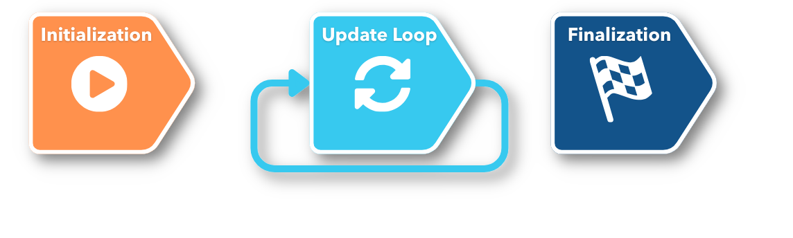
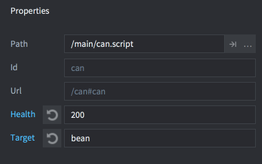

# Defold для пользователей Godot {#defold-for-godot-users}

Если вы уже работали с Godot, многое из того, что вам понадобится для создания игры в Defold, вам знакомо. Это руководство покажет, где ваш опыт поможет быстро освоиться и какие различия стоит учесть, чтобы избежать распространённых ошибок. Для сравнения мы использовали Godot 4.7.

## Введение {#introduction}

Defold — бесплатный кроссплатформенный движок для 2D- и 3D-игр с редактором для Windows, Linux и macOS. Полный исходный код движка и редактора доступен на [GitHub](https://github.com/defold/defold/). Вы можете собрать Defold самостоятельно или скачать готовую версию для своей ОС.

На первый взгляд Defold очень похож на Godot. В обоих движках вы собираете игру из частей, которые можно использовать повторно, и задаёте их поведение скриптами. В Godot для этого есть множество специализированных узлов. В Defold набор компонентов меньше, каждый из них решает более общую задачу, а игровую логику вы пишете на Lua в скриптах и модулях. Например, персонаж в Defold может состоять из игрового объекта со спрайтом или моделью, объектом столкновения и скриптом.

Defold отличается небольшим размером движка и экономно расходует ресурсы. Это особенно удобно для браузерных и мобильных игр. Некоторые ограничения движка задаются заранее, чтобы он мог сразу выделить необходимую память.

В Defold меньше готовых игровых и интерфейсных элементов, чем в Godot. Чтобы получить тот же результат, вы можете сочетать и расширять базовые компоненты. Разработчики Defold стремятся сохранить ядро движка как можно более лёгким. При необходимости можно ещё уменьшить его размер, исключив ненужные функции, или добавить новые с помощью нативных расширений и Lua-модулей. На [портале ассетов Defold](https://defold.com/assets/) есть сотни модулей, библиотек и расширений. С их помощью можно, например, создавать сложные пользовательские интерфейсы, настраивать собственный конвейер рендеринга или упрощать повседневные задачи разработки.

Подробнее о возможностях Defold читайте [на сайте движка](https://defold.com/product/).

## Установка {#installation}

1. Скачайте Defold для своей операционной системы со [страницы загрузки](https://defold.com/download/).
2. Распакуйте архив и запустите редактор.

Чтобы создать и запустить первый проект, не требуется устанавливать отдельный менеджер проектов или шаблоны экспорта. Инструкции для вашей платформы приведены в [руководстве по установке](/manuals/install/).

Обновлять Defold можно прямо из редактора. При переходе существующего проекта на новую версию ознакомьтесь с примечаниями к выпуску и проверьте игру на целевых платформах.

## Экран приветствия {#welcome-screen}

При запуске Defold открывается экран приветствия. Как и в менеджере проектов Godot, здесь можно открыть недавний проект или создать новый.


Для нового проекта в Defold можно выбрать одну из трёх отправных точек:

- **Templates** — пустые проекты и базовые шаблоны для конкретных платформ.
- **Tutorials** — учебные проекты с пошаговыми инструкциями.
- **Samples** — примеры и стартовые проекты, которые можно запустить и изучить.


В разделе Samples вы найдёте стартовые проекты и примеры, похожие на те, которые предлагает магазин ассетов Godot:


:[Hello World](../shared/hello-world.md)

---

## Обзор редактора Defold {#defold-editor-overview}

Основные панели редактора покажутся вам знакомыми, хотя у них другие названия и расположение. Для удобства сравнения мы расположили панели в редакторе Godot примерно так же, как они по умолчанию расположены в Defold:


| Godot | Defold | Назначение в редакторе Defold |
|---|---|---|
| Панель FileSystem | Assets | Позволяет управлять файлами и папками проекта. Структура в точности соответствует каталогу проекта на диске. |
| Окно 2D/3D и редакторы ресурсов | Main Editor | Вид редактора зависит от открытого файла: коллекция, GUI, атлас, скрипт и т. д. Рабочую область можно разделить на две панели. |
| Панель Scene | Outline | Показывает структуру открытого ресурса. Здесь вы видите только этот ресурс, а не всё дерево сцены запущенной игры. |
| Inspector | Properties | Показывает свойства выбранного игрового объекта, компонента или ресурса. |
| Output и Debugger | Tools | Здесь находятся вкладки Console, Build Errors, Search Results и отладчик. |
| Интеграция с системой контроля версий | Changed Files | Показывает изменения, если проект использует Git. |

В правом верхнем углу 3D-редактора Defold находится панель инструментов. Её элементы описаны в [руководстве по редактору сцены](/manuals/scene-editing/#toolbar-overview).

### Ориентация сцены в 2D и 3D {#2d-and-3d-scene-orientation}

:[Ориентация сцены в 2D и 3D](../shared/2d-and-3d-scene-orientation.md)

### Панели {#panes}

Панели Defold нельзя вынести в отдельные окна. Размер панели можно изменить, перетаскивая её границу. Чтобы скрыть или показать панели, используйте клавиши `F6`, `F7` и `F8` или меню `View`:


### Координаты {#coordinates}

В типичном 2D-проекте Defold со стандартным скриптом рендеринга и без компонента камеры в коллекции точка `(0, 0)` находится в левом нижнем углу игрового окна. Положительное направление оси Y — **вверх**, а оси X — вправо.

В обычной системе экранных координат Godot для 2D положительная ось Y направлена **вниз**. Учитывайте это различие, когда переносите координаты объектов или код движения.


В трёхмерной системе координат Godot положительная ось Y направлена вверх, как и в Defold. Defold использует единую трёхмерную систему координат для 2D- и 3D-игр. В 2D игра обычно разворачивается в плоскости XY с ортографической проекцией. При необходимости камеру можно настроить иначе.


Подробнее об устройстве редактора Defold читайте в [руководстве по редактору](/manuals/editor/).

---

## Ключевые понятия {#key-concepts}

В Godot вы собираете **сцены** из узлов. В Defold вы работаете с компонентами, игровыми объектами и коллекциями игровых объектов.

Например, в Godot можно создать персонажа из узла `Node2D` с дочерним узлом `Sprite2D`, прикрепить скрипт к корневому узлу и добавить персонажа в свою первую сцену (`Scene`).
В Defold для такого персонажа подойдёт игровой объект с компонентами `Sprite` и `Script`. Его вы поместите в коллекцию.


Подробно эти понятия описаны в [руководстве по структурным элементам Defold](/manuals/building-blocks/).

### Игровые объекты {#game-objects}

В Defold **игровой объект** (Game Object) служит *контейнером* для компонентов. У него есть:

- **идентификатор**,
- **трансформация** (положение, вращение, масштаб).

Игровой объект может выполнять ту же роль, что и `Node2D` или `Node3D` в Godot. В Defold нет отдельного типа игровых объектов для 2D. Все они, в том числе в 2D-играх, используют трёхмерные трансформации.

Игровому объекту в Defold можно назначить другой игровой объект в качестве родителя. Тогда дочерний объект наследует трансформации родителя. Задать иерархию можно в коллекции, а изменить — в том числе во время выполнения. Адрес игрового объекта при смене родителя сохраняется.

Игровой объект можно определить прямо в файле `.collection` как **встроенный** или добавить в коллекцию ссылку на многократно используемый прототип `.go`. Если изменить определение встроенного объекта, изменения коснутся только этой коллекции. Другие независимо заданные объекты сохранятся в прежнем виде. Если отредактировать прототип `.go`, обновятся все ссылающиеся на него экземпляры с учётом свойств, переопределённых для каждого из них. Несколько объектов, в том числе встроенных, могут ссылаться на один и тот же ресурс компонента. Изменения ресурса тогда затронут все объекты, которые его используют. Если сама коллекция используется несколько раз, изменения её встроенных объектов будут видны везде, где на неё ссылаются.

### Компоненты {#components}

Компоненты наделяют игровые объекты конкретными возможностями. Они могут отвечать, например, за внешний вид, физику, звук или игровую логику.

Добавьте игровому объекту компонент `Sprite`, чтобы вывести изображение, `Sound`, чтобы воспроизвести звук, или `Script`, чтобы выполнить код на Lua.

Компоненты принадлежат игровым объектам и не могут содержать дочерние компоненты. Чтобы построить иерархию, задайте отношения между родительскими и дочерними игровыми объектами в коллекции.

В отличие от Godot, в Defold нельзя изменить поведение компонента, прикрепив к нему скрипт. Вы можете настроить компонент на панели Properties или создать собственный с помощью нативного расширения, подобного GDExtension. Примеры таких компонентов — официальные [Rive](https://github.com/defold/extension-rive) и [Spine](https://github.com/defold/extension-spine), а также разработанные сообществом [Sprite Loop](https://github.com/Balkan-Ram-Games/spriteloop-defold) и [Object Interpolation](https://github.com/indiesoftby/defold-object-interpolation).

Скрипт в Defold — отдельный компонент, который можно добавить к любому игровому объекту. Одному объекту можно назначить несколько компонентов, в том числе несколько скриптов.

Компоненты не образуют вложенных иерархий и отделены от пользовательских скриптов. Благодаря такой организации данных Defold компактно размещает их в памяти.

| Узел Godot | Компонент Defold | Примечания |
|---|---|---|
| `Sprite2D` / `AnimatedSprite2D` | [Sprite](/manuals/sprite/) | Отображает 2D-текстуры и покадровую анимацию из атласа (текстуры с несколькими изображениями) или источника тайлов. |
| `Area2D` / `RigidBody2D` / `StaticBody2D` и их трёхмерные аналоги | [Объект столкновения](/manuals/physics-objects/) | Отвечает за физику и триггеры. Формы столкновений задаются прямо в компоненте. В отдельных дочерних узлах для них нет необходимости. Объект может быть статическим, динамическим, кинематическим или триггером. |
| Скрипт `.gd`, прикреплённый к узлу | Script | Содержит код на Lua, который задаёт игровую логику, обрабатывает ввод и управляет другими компонентами и игровыми объектами. |
| `TileMapLayer` | [Тайловая карта](/manuals/tilemap/) | Отрисовывает карту на сетке, используя источник тайлов и слои карты. |
| `Label` | [Текстовый узел GUI](/manuals/gui-text/) | Для текста интерфейса используйте текстовый узел GUI. Для надписи в игровом мире подойдёт [компонент Label](/manuals/label/). |
| `AudioStreamPlayer` | [Sound](/manuals/sound/) | Воспроизводит звук. Параметры Speed, Pan и Gain управляют скоростью воспроизведения, панорамой и усилением. |
| `Camera2D` / `Camera3D` | [Camera](/manuals/camera/) | Поддерживает ортографическую и перспективную проекции. |
| Иерархия `Control` / `CanvasLayer` | [GUI](/manuals/gui/) | В компоненте GUI есть своя иерархия узлов (например, Box, Text, Pie). Для работы с ними используется отдельный скрипт `.gui_script`. |
| `MeshInstance3D` | [Model](/manuals/model/) или [Mesh](/manuals/mesh/) | Model работает с импортированными 3D-моделями, а Mesh позволяет задать собственную геометрию из буфера. |
| `CPUParticles2D` / `GPUParticles2D` и их трёхмерные аналоги | [ParticleFX](/manuals/particlefx/) | Создаёт 2D- и 3D-частицы, настроенные в редакторе частиц Defold. |
| `PackedScene.instantiate()` | Factory / Collection Factory | В Defold есть отдельные компоненты, которые определяют, какие игровые объекты или коллекции можно создавать во время выполнения. |

### Коллекции и миры {#collections-and-worlds}

**Коллекция** описывает игровые объекты, их компоненты и связи между родительскими и дочерними объектами. Одну коллекцию можно вложить в другую, чтобы повторно использовать группу объектов. Это похоже на вложенные сцены Godot. Универсального механизма наследования сцен, как в Godot, в Defold нет. Для повторного использования подходят прототипы и коллекции, а их экземпляры можно настраивать с помощью свойств или скриптов.

Во время выполнения коллекция не существует как самостоятельный объект. У неё нельзя вызвать метод, и у самой коллекции нет соответствующего ей корневого узла. Файл коллекции описывает игровые объекты, компоненты и их иерархию, которые Defold создаст во время выполнения.

При запуске игры Defold читает файл `game.project`. Настройка **Bootstrap ▸ Main Collection** определяет, какая коллекция загрузится первой. Так создаётся начальный игровой мир. Объекты из вложенных коллекций входят в тот же мир.

Компонент **Collection Factory** (фабрика коллекций) создаёт группу игровых объектов и их компоненты в **существующем** мире, которому принадлежит фабрика.

Компонент **Collection Proxy** (прокси-коллекция) загружает отдельную коллекцию и создаёт **новый мир** с собственным пространством адресов и физической симуляцией. Выбор зависит от задачи. Чтобы враг взаимодействовал с геометрией текущего уровня, создайте его в существующем мире. Чтобы загрузить новый уровень, в том числе асинхронно, понадобится отдельный мир. Ниже мы рассмотрим оба случая.

В Godot `PackedScene` используется и для создания экземпляров, и для переключения сцен. Переключение сцен через `SceneTree` можно сравнить с загрузкой отдельного мира через прокси-коллекцию.

Сопоставим основные понятия:

| Godot | Defold | Примечания |
|---|---|---|
| `Node3D` с дочерними узлами | Игровой объект с компонентами | Компоненты определяют возможности и поведение. У игрового объекта есть собственные трансформация и идентификатор. |
| Трансформация `Node2D` / `Node3D` | Трансформация игрового объекта | Встроена в каждый игровой объект. |
| Сцена / `PackedScene` | Прототип игрового объекта (`.go`) или коллекция (`.collection`) | Прототип описывает один объект. Коллекция описывает иерархию объектов. |
| `PackedScene.instantiate()` | Фабрика или фабрика коллекций | Создаёт игровой объект или группу объектов в текущем мире и возвращает их идентификаторы. |
| Переключение сцен через `SceneTree` + `PackedScene.instantiate()` | Прокси-коллекция | Загружает отдельную коллекцию, создаёт для неё новый мир и размещает в нём игровые объекты. |

---

## Написание кода {#code-writing}

В редактор Defold встроен текстовый редактор для работы со скриптами и другими текстовыми файлами. Он поддерживает автодополнение, форматирование, просмотр структуры файла (раздел Structure с данными и функциями) и другие возможности. Подробнее читайте в разделе [«Использование встроенного редактора кода»](/manuals/writing-code/#using-the-built-in-code-editor).

Скрипты и все остальные текстовые файлы Defold можно открывать и во внешнем редакторе. В Defold есть средства интеграции с внешними инструментами, например с VS Code. Подробнее об этом читайте в разделе [«Использование внешнего редактора кода»](/manuals/writing-code/#using-an-external-code-editor).

### Lua и скрипты {#lua-and-scripts}

Игровые скрипты Defold пишут на Lua. Язык может напоминать GDScript, но между ними есть важные различия. Defold также поддерживает Teal — статически типизированный диалект Lua. В зависимости от целевой платформы можно использовать нативные расширения на C, C++, C#, Objective-C, Java и JavaScript. По назначению они похожи на GDExtension. Их мы рассмотрим отдельно.

В Defold вы будете работать в основном с такими Lua-файлами:

| Файл | Назначение |
|---|---|
| `.script` | Игровая логика и поведение. Для управления другими игровыми объектами и компонентами используются, в частности, API `go`, `factory`, `sprite`, `tilemap` и `physics`. |
| `.gui_script` | Логика пользовательского интерфейса с использованием API `gui`. |
| `.render_script` | Управление рендерингом через API `render`. |
| `.lua` | Lua-модули, загружаемые с помощью `require()`. Подходят для библиотек или вспомогательных функций, которые используются повторно. |

Таблицы Lua могут хранить данные, функции или и то и другое. Для организации кода не обязательно воспроизводить иерархию классов GDScript. Вынесите общую логику в модули и вызывайте её из скрипта, который отвечает за нужное поведение.

Скрипты Defold совместимы с Lua 5.1. Об особенностях языка и различиях между платформами читайте в руководстве [«Lua в Defold»](/manuals/lua/).

### Жизненный цикл приложения {#application-lifecycle}

Игра в Defold начинает работу с фазы инициализации и завершает её фазой финализации. Между ними каждый кадр выполняется цикл обновления, в котором движок обновляет трансформации и компоненты, выполняет код и обрабатывает сообщения.



Как и в Godot и других игровых движках, в Defold на разных этапах жизненного цикла движок вызывает специальные функции скрипта, написанные на Lua. Имена у них другие, но назначение вам знакомо:

| Godot | Defold | Примечания |
|---|---|---|
| `_ready()` | `init(self)` | Инициализация данных экземпляра и получение фокуса ввода, если он нужен. |
| `_process(delta)` | `update(self, dt)` | Обновление один раз за кадр. |
| `_physics_process(delta)` | `fixed_update(self, dt)` | Обновление с фиксированным шагом времени, если оно включено. |
| `_input(event)` | `on_input(self, action_id, action)` | Обработка ввода, поступившего слушателям ввода игрового объекта. |
| Обработчик сигнала | `on_message(self, message_id, message, sender)` | Получение сообщений от скриптов или компонентов движка. |
| `_exit_tree()` | `final(self)` | Освобождение ресурсов при завершении работы экземпляра скрипта. |

В Godot метод `_ready()` у дочерних узлов вызывается раньше, чем у родительского. В Defold порядок инициализации и обновления игровых объектов и компонентов не гарантируется. Если нужно согласовать их действия, используйте сообщения. Рассчитывать на то, что `init()` одного объекта выполнится раньше остальных, нельзя.

Если планируете использовать `fixed_update()`, задайте в `game.project` положительную частоту в поле **Engine ▸ Fixed Update Frequency**, например 60, и включите **Physics ▸ Use Fixed Timestep**.

Для действий, которые нужно выполнить после обычных обновлений и до отрисовки, в Defold есть `late_update(self, dt)`. Например, здесь удобно скорректировать положение камеры. При необходимости движок после этого ещё раз обновит трансформации.

Отключение и удаление компонента — разные операции.

Полную последовательность этапов и список функций обратного вызова для каждого типа скрипта вы найдёте в [руководстве по жизненному циклу приложения](/manuals/application-lifecycle/).

### Данные экземпляра и локальные переменные {#instance-data-vs-local-data}

Каждому экземпляру компонента Script в функции обратного вызова передаётся собственный `self`. В нём можно хранить состояние экземпляра, например `self.health` или `self.target`. Даже у двух скриптов одного игрового объекта значения `self` разные. К полям `self` обращаются как к полям таблицы, но сам он имеет тип userdata. Поэтому операции вроде `pairs(self)` не работают. В Godot для хранения состояния экземпляра служат переменные экземпляра (`var`).

Godot рассматривает каждый файл `.gd` как определение класса. Если прикрепить один файл `.gd` к десяти врагам, Godot создаст десять отдельных экземпляров класса. У каждого из них будут свои копии переменных, объявленных через var на верхнем уровне.

Когда в Defold загружается ресурс скрипта, файл `.script` выполняется как единый блок кода на Lua. Затем каждый экземпляр компонента Script получает собственный `self` в функциях жизненного цикла, например `init(self)` и `update(self, dt)`.

Локальная переменная, объявленная на верхнем уровне файла `.script` в Defold, ведёт себя иначе. Она общая для **всех экземпляров** этого скрипта. В Godot подобную роль выполняет статическая переменная (`static var`).


В этом примере, если присвоить `self.has_shield` одного экземпляра значение `true`, у остальных ничего не изменится. Локальная же переменная `color` общая для всех экземпляров, использующих этот файл скрипта. Изменение её значения может затронуть их все.

### Свойства {#properties}

Чтобы объявить редактируемое **свойство** экземпляра, используйте `go.property()`. В скрипте свойство доступно через `self`. Как и в случае с `@export`, его значение можно изменить в редакторе. В Defold оно появится на панели `Properties`:



Для сравнения, вот скрипт на **GDScript** в Godot, прикреплённый к `Node3D`:

```gdscript
extends Node3D

@export var speed: float = 100.0

func _process(delta):
    position.x += speed * delta
```

А так выглядит компонент Script на **Lua** в Defold:

```lua
go.property("speed", 100)

function update(self, dt)
    local position = go.get_position()
    position.x = position.x + self.speed * dt
    go.set_position(position)
end
```

Значение свойства доступно в Lua как `self.speed`. Его также можно передать при создании игрового объекта. Для трансформаций Defold использует `vector3` даже в 2D, поэтому координату Z всё равно нужно указать.

О поддерживаемых типах читайте в руководстве [«Свойства скриптов»](/manuals/script-properties/). Другие примеры приведены в руководстве [«Скрипты»](/manuals/script/).

---

## Сообщения и адресация {#messages-and-addressing}

Сигналы Godot позволяют объекту сообщить о событии всем подключённым слушателям. В Defold для связи между скриптами обычно отправляют сообщения по адресу игрового объекта или компонента.

Отправить сообщение можно из любого скрипта Defold с помощью `msg.post()`. Для получения и обработки сообщений в скрипте предусмотрена функция `on_message()`.


Например, персонаж может сообщать интерфейсу игры об изменении счёта.

В Godot узел `Player` (`Node2D`) использует скрипт `player.gd`. У соседнего узла `GUI` (`CanvasLayer`) тот же родитель. К нему прикреплён скрипт `gui.gd`, а внутри находится узел Label с именем `ScoreText`:


В Defold к игровому объекту `player` добавлен скрипт `player.script`. У игрового объекта `hud` есть компонент `gui` с текстовым узлом `score` и скриптом `hud.gui_script`:


### Отправка сообщений {#sending-messages}

В Godot узлы Player и GUI имеют общего родителя. Player подключает свой сигнал `score_changed` к методу скрипта GUI, который затем обновляет текст в Label.

**GDScript**, файл `player.gd`:

```gdscript
extends Node2D

signal score_changed(value: int)
var score: int = 0

func _ready() -> void:
    score_changed.connect(get_node("../GUI").set_score)

func collect() -> void:
    score += 1
    score_changed.emit(score)

func _unhandled_input(event: InputEvent) -> void:
    if event is InputEventKey and event.pressed and not event.echo:
        if event.keycode == KEY_SPACE:
            collect()
```

В Godot узел `Player` определяет сигнал `score_changed`. В `_ready()` он подключает этот сигнал к методу `set_score()` скрипта GUI. Каждый раз при вызове `collect()` счёт увеличивается, а новое значение передаётся вместе с сигналом.

В Defold привяжите клавишу **Space** к действию `collect` в настройках привязок ввода. Игровой объект `player` задаёт начальный счёт в `init()` и запрашивает фокус ввода. Когда вызывается `collect(self)`, скрипт увеличивает счёт и отправляет сообщение `score_changed` по адресу `/hud#gui`. Новое значение счёта передаётся в таблице сообщения.

**Lua**, файл `player.script`:

```lua
function init(self)
    self.score = 0
    msg.post(".", "acquire_input_focus")
end

local function collect(self)
    self.score = self.score + 1
    msg.post("/hud#gui", "score_changed", { value = self.score })
end

function on_input(self, action_id, action)
    if action_id == hash("collect") and action.pressed then
        collect(self)
    end
end
```

В Defold игроку не нужно заранее подключать сигнал к GUI, как в Godot. Достаточно отправить сообщение по адресу получателя. Относительная адресация Defold позволяет использовать одни и те же функции и скрипты повторно.

### Получение и обработка сообщений {#receiving-and-handling-messages}

Получив новое значение, GUI обновляет текст, в котором отображается счёт.

**GDScript**, файл `gui.gd`, прикреплённый к узлу `GUI` (`CanvasLayer`):

```gdscript
extends CanvasLayer

func set_score(value: int) -> void:
    $ScoreText.text = str(value)
```

Скрипт GUI получает переданное с сигналом значение через `set_score()` и обновляет дочерний узел Label с именем `ScoreText`. Сам игрок не обращается к надписи напрямую и не изменяет её.

В Defold GUI-скрипт сначала получает текстовый узел для отображения счёта с помощью `gui.get_node()`. Когда компонент GUI получает сообщение, скрипт в `on_message()` проверяет его идентификатор. Если это `score_changed`, он читает `message.value` и обновляет надпись с помощью `gui.set_text()`.

**Lua**, файл `hud.gui_script`, назначенный компоненту GUI:

```lua
function init(self)
    self.score_node = gui.get_node("score")
end

function on_message(self, message_id, message, sender)
    if message_id == hash("score_changed") then
        gui.set_text(self.score_node, tostring(message.value))
    end
end
```

Важно, что сообщение в Defold адресуется **компоненту** GUI. До текстового узла оно напрямую не доходит. GUI-скрипт, получивший сообщение, сам решает, как его использовать и какой узел обновить.

На обоих снимках экрана начальная надпись — `Score: 0`. При изменении счёта скрипты из примеров заменяют всю строку новым числовым значением.

Функция `msg.post()` ставит сообщение в очередь на доставку. Получатель не вызывается немедленно, и результат работы его скрипта не возвращается отправителю. Зачастую сообщение доставляется в том же кадре. Однако число проходов доставки ограничено, поэтому длинная цепочка может продолжиться в следующем кадре. Чтобы ответить, получатель может отправить новое сообщение по URL отправителя, переданному в `on_message()`. Подробнее об этом читайте в разделе [«Цепочки сообщений»](/manuals/message-passing/#message-chains).

Различается и способ оповестить нескольких слушателей. К сигналу Godot можно подключить несколько методов. При отправке сигнала уведомление получат все они. В Defold сообщение отправляется по конкретному адресу. Чтобы оповестить нескольких получателей, отправьте каждому отдельное сообщение или реализуйте в игре систему подписки.

### Как найти объект по адресу в Defold {#finding-an-object-addressing-in-defold}

В Defold нет универсального аналога `get_node()`, который возвращал бы Lua-объект, представляющий экземпляр другого скрипта. В функции движка, например `go.get_position()`, `go.set()` или `msg.post()`, вы передаёте идентификатор или **URL**.

URL в Defold состоит из трёх частей:

```lua
socket:/path#component
```

- **Socket** — игровой мир, например созданный при загрузке начальной коллекции или загруженный через прокси-коллекцию.
- **Path** — путь к игровому объекту внутри этого мира.
- **Component** — идентификатор компонента, принадлежащего этому объекту.

Вы можете указать URL целиком или опустить некоторые части, получив относительный адрес. Например, чтобы обратиться из скрипта к другому компоненту того же игрового объекта, достаточно указать только компонент. Вот несколько распространённых вариантов:

| Адрес | Значение |
|---|---|
| `"#sprite"` | Компонент sprite текущего игрового объекта. |
| `"/player#controller"` | Компонент controller игрового объекта player в текущем мире. |
| `"level:/player#controller"` | Компонент controller объекта player в загруженном мире с именем level. |
| `"."` | Сокращённый адрес текущего игрового объекта (`Game Object`). Сообщение доставляется его компонентам. |
| `"#"` | Сокращённый адрес текущего компонента `Script`. |

Вложенные коллекции могут добавлять префиксы к путям объектов. Однако адрес игрового объекта не меняется, если назначить ему родителя для наследования трансформаций.

Для объектов, создаваемых во время выполнения, сохраняйте в коде идентификаторы, возвращаемые `factory.create()` или `collectionfactory.create()`.

В Defold нет встроенного аналога групп Godot, позволяющих находить нужные объекты или вызывать `call_group()`. Для этого потребуется собственный реестр объектов или механизм рассылки сообщений.

Группы физических объектов в Defold служат для фильтрации столкновений. Маска определяет, с какими группами может сталкиваться объект. К передаче сообщений эти группы отношения не имеют.

Рекомендуем сразу прочитать руководства [«Адресация»](/manuals/addressing/) и [«Передача сообщений»](/manuals/message-passing/). Там вы найдёте ответы на многие вопросы, возникающие при работе над первым проектом.

---

## Автозагрузка и общее состояние {#autoloads-and-shared-state}

Когда нужно напрямую вызвать Lua-функцию, можно использовать Lua-модуль вместо системы сообщений Defold.

Если в Godot вы храните общие данные в узле с **автозагрузкой** (Autoload), в Defold эту задачу можно поручить Lua-модулю. Сохраните его, например, в `modules/game_state.lua` и загрузите с помощью `require "modules.game_state"`.

**GDScript**, файл `game_state.gd` зарегистрирован для автозагрузки с именем `GameState`:

```gdscript
extends Node
var score: int = 0
```

Аналог на **Lua**, файл `modules/game_state.lua`:

```lua
local M = { score = 0 }
return M
```

Теперь другой скрипт может использовать общие данные:

**GDScript**:

```gdscript
func add_point():
    GameState.score += 1
```

**Lua**:

```lua
local game_state = require "modules.game_state"

local function add_point()
    game_state.score = game_state.score + 1
end
```

Функция `require()` кеширует модуль, и все скрипты, которые его загружают, получают одну и ту же возвращённую таблицу. Скрипты игровых объектов, GUI и рендеринга используют общее состояние Lua. При выгрузке прокси-коллекции данные модуля сохраняются. Если при начале новой игры их нужно сбросить, сделайте это явно.

Lua-модуль в Defold не является игровым объектом. Движок не вызывает в нём функции жизненного цикла, обработки сообщений и ввода. Если в Godot узел с автозагрузкой выполняет логику в каждом кадре, воспроизводит звуки или управляет переходами между уровнями, поместите эту логику в скрипт игрового объекта коллекции. Вы также можете определить функцию в модуле и явно вызывать её из соответствующих функций жизненного цикла скрипта.

Lua-модуль `my_module`:

```lua
local M = {}

function M.init(self)
    print("My init")
end

return M
```

Скрипт на Lua:
```lua
local my_module = require "my_module"

function init(self)
    my_module.init(self)
end
```

Для данных, которые должны быть уникальны для каждого экземпляра, модуль может вернуть функцию, создающую новую таблицу. Полученную таблицу можно сохранить в `self`. Подробнее об этом и об особенностях горячей перезагрузки читайте в [руководстве по модулям](/manuals/modules/).

---

## Создание объектов и загрузка уровней {#spawning-objects-and-loading-levels}

### Фабрики {#factories}

Чтобы создать один игровой объект во время выполнения, добавьте компонент **Factory** и укажите в его свойстве **Prototype** нужный файл `.go`.

Для коллекций используйте компонент **Collection Factory**. По указанному файлу `.collection` он создаст группу объектов, сохранив отношения между родительскими и дочерними объектами.

Например, в Godot за создание пуль может отвечать узел `Node2D` в начале координат сцены. К нему прикреплён такой скрипт:

**GDScript**:

```gdscript
extends Node2D

const BULLET = preload("res://bullet.tscn")

func spawn_bullet():
    var bullet = BULLET.instantiate()
    bullet.position = Vector2(200, 100)
    add_child(bullet)
    return bullet
```

В Defold для этого у игрового объекта есть компонент-фабрика с идентификатором `bullet_factory`. Вызов `factory.create()` создаст объект по прототипу, указанному в свойстве `Prototype` этой фабрики:


На снимке экрана фабрика вызывается в `init()`. В примере ниже вспомогательная функция принимает позицию для нового объекта и возвращает его идентификатор:

**Lua**:

```lua
local function spawn_bullet()
    local position = vmath.vector3(200, 100, 0)
    local id = factory.create("#bullet_factory", position)
    return id
end
```

Функция в Defold возвращает **идентификатор** объекта. У самого идентификатора нет методов. Передавайте его в функции `go` или используйте для составления URL компонента. Например, `msg.url(nil, id, "controller")` вернёт адрес скриптового компонента созданного объекта, если компонент называется `controller`.

Фабрика коллекций возвращает таблицу, которая сопоставляет идентификаторы объектов в прототипе с идентификаторами созданных объектов. Сохраните её, чтобы потом удалить эти объекты:

```lua
local ids = collectionfactory.create("#collection_factory")
-- Later, when the spawned objects are no longer needed:
go.delete(ids)
```

В Godot `queue_free()` удаляет и дочерние узлы. В Defold `go.delete(id)` по умолчанию оставляет их на месте. Чтобы удалить объект вместе со всеми его текущими потомками, используйте `go.delete(id, true)`. Если передать таблицу от фабрики в `go.delete(ids)`, будут удалены перечисленные объекты. Другие объекты, ставшие их потомками позднее, сохранятся. При рекурсивном удалении по идентификатору корня, напротив, будут удалены все его текущие потомки, в том числе добавленные позднее. Подробнее см. [`go.delete()`](/ref/go/#go.delete).

Defold заранее выделяет память под заданное число игровых объектов и компонентов. Если новый объект не удаётся создать из-за превышения лимита, проверьте **Collection ▸ Max Instances** и лимиты соответствующих компонентов в `game.project`. Повышение всех лимитов увеличивает и расход памяти.

Подробнее о свойствах, трансформациях и динамической загрузке читайте в руководствах [«Фабрика»](/manuals/factory/) и [«Фабрика коллекций»](/manuals/collection-factory/).

### Прокси-коллекции {#collection-proxies}

Чтобы загружать коллекции, например при переходе между уровнями, добавьте компонент **Collection Proxy** к игровому объекту, который сохранится при переходе, и укажите нужный файл `.collection` в свойстве **Collection**.


Отправьте прокси сообщение `"load"` или `"async_load"` с помощью `msg.post()`. По завершении загрузки прокси ответит сообщением `"proxy_loaded"`. После этого отправьте сообщения `"init"` и `"enable"` по адресу, который передан в on_message в параметре `sender`. Так вы инициализируете и запустите загруженный мир.

Вы сами управляете тем, какие миры загружены и какие из них работают. В отличие от смены сцены в Godot, при загрузке новой коллекции текущий мир остаётся на месте. Чтобы убрать мир, отправьте соответствующей прокси-коллекции сообщение `"unload"`. Прокси автоматически отключит и финализирует мир, выгрузит его и ответит сообщением `"proxy_unloaded"`. Если нужно управлять этими этапами отдельно, можно самостоятельно отправить `"disable"` и `"final"`.

Объекты столкновения из разных миров, загруженных через прокси, не сталкиваются друг с другом, даже если оба мира одновременно загружены и видны на экране. При этом игровые объекты и компоненты в разных мирах могут обмениваться сообщениями, если указывать в URL сокет получателя.

Перед реализацией переходов прочитайте [руководство по прокси-коллекциям](/manuals/collection-proxy/). В нём описаны загрузка и выгрузка, передача ввода в загруженный мир и управление частотой его обновления.

## Ресурсы и ассеты проекта {#project-resources-and-assets}

Проект Defold — это папка, в которой хранятся `game.project`, скрипты и ресурсы. Панель **Assets** отображает структуру этой папки. Большинство ресурсов Defold описаны в текстовых файлах, поэтому внесённые изменения легко просмотреть в системе контроля версий.

При сборке игры или создании бандла Defold преобразует исходные ресурсы в форматы, используемые движком во время выполнения. Ресурсы, на которые ссылаются главная коллекция, фабрики и прокси-коллекции, образуют дерево зависимостей. Если просто положить файл в папку проекта, но нигде на него не сослаться, он не попадёт в бандл.

У пользовательских классов `Resource` и файлов `.tres` из Godot в Defold нет единого аналога. Для ресурсов движка используйте предусмотренные Defold типы, а для собственных игровых данных — таблицы Lua или файлы данных. [API `resource`](/ref/resource/) позволяет создавать и изменять поддерживаемые ресурсы во время выполнения.

У обычной фабрики ресурсы загружаются вместе с ней. Чтобы отложить загрузку, включите **Load Dynamically**. Когда ресурсы понадобятся, вы сможете асинхронно загрузить их с помощью `factory.load()` или `collectionfactory.load()`. Содержимое прокси-коллекции загружается по вашему запросу.

Загрузка ресурсов из установленного бандла по мере необходимости и их последующее скачивание — разные задачи. Механизм [Live Update](/manuals/live-update/) в Defold позволяет исключить часть контента из начального бандла и распространять её отдельно.

Подробнее читайте в [руководстве по управлению ресурсами](/manuals/resource/).

---

## Ввод {#input}

Аналог `InputMap` из Godot в Defold — файл `.input_binding`. В нём задаются привязки событий клавиатуры, геймпада, мыши, сенсорного экрана или текстового ввода к именованным действиям. Выберите файл привязок в разделе **Input ▸ Game Binding** файла `game.project`.


Чтобы игровой объект Defold получал события ввода, он должен **получить фокус ввода**. После этого объект попадёт в стек ввода, и его скрипты и GUI-компоненты смогут обрабатывать вызовы `on_input()`.

На снимке экрана пробел привязан к действию `collect`. В следующем независимом примере используется действие `fire`. Его тоже нужно добавить в файл привязок:

**GDScript**:

```gdscript
extends Node

func _input(event):
    if event.is_action_pressed("fire"):
        print("Fire")
```

**Lua**:

```lua
function init(self)
    msg.post(".", "acquire_input_focus")
end

function on_input(self, action_id, action)
    if action_id == hash("fire") and action.pressed then
        print("Fire")
    end
end
```

В зависимости от события таблица `action` содержит такие поля, как `pressed`, `released` и `value`.

Действие передаётся по стеку начиная со слушателя, который получил фокус последним. Верните `true` из `on_input()`, чтобы остановить передачу действия дальше по стеку, например после того, как меню обработало щелчок мыши.

При загрузке мира через прокси фокус ввода должны получить и объект с компонентом прокси, и слушатели внутри загруженного мира. Если пропустить один из этих шагов, исправно работавший скрипт может перестать получать ввод после смены уровня.

Подробнее об этом читайте в руководствах [«Ввод»](/manuals/input/), [«Мышь и сенсорный ввод»](/manuals/input-mouse-and-touch/) и [«Геймпады»](/manuals/input-gamepads/).

---

## Физика и столкновения {#physics-and-collisions}

Компонент **Collision Object** в Defold соответствует физическим телам Godot. В одном компоненте задаются физические параметры **и** формы столкновений. В файле `game.project` можно выбрать 2D- или 3D-физику. В манифесте приложения (App Manifest) также можно выбрать версию физического движка или полностью отключить физику.

В Defold есть четыре типа объектов столкновения:

| Godot | Тип в Defold | Примечания |
|---|---|---|
| `StaticBody2D` / `3D` | `Static` | Неподвижен. Динамические объекты реагируют на столкновения с ним. |
| `RigidBody2D` / `3D` | `Dynamic` | Физический движок моделирует движение и разрешает столкновения. |
| `CharacterBody2D` / `3D` | `Kinematic` | Физический движок сообщает данные о столкновениях, а за реакцию на них и их разрешение отвечает ваш код. |
| `Area2D` | `Trigger` | Сообщает только о входе и выходе. Физической реакции при этом не происходит. |

Кинематический объект в Defold ведёт себя иначе, чем `CharacterBody2D` с `move_and_slide()` в Godot. Defold обнаруживает контакты и передаёт данные в сообщении о столкновении. Движение и реакцию на контакт задаёт ваш скрипт. При разработке управления персонажем обратитесь к [руководству по разрешению столкновений](/manuals/physics-resolving-collisions/).

Для групп и масок в Defold используются имена вместо номеров слоёв столкновений. Чтобы столкновение было зарегистрировано, **в маску каждого объекта должна входить группа другого объекта**.


На снимке экрана игровой объект `danger` принадлежит группе `player`, а объект `player` — группе `danger`. Имена групп могут отличаться от идентификаторов объектов. Заданные маски по-прежнему позволяют этим двум группам взаимодействовать.

По умолчанию объект столкновения отправляет сообщения скриптам своего игрового объекта. Обрабатывайте `"collision_response"`, `"contact_point_response"` или `"trigger_response"` в функции `on_message()`. Поле `enter` в сообщении триггера позволяет отличить вход от выхода. Пока объекты соприкасаются, сообщения о столкновении и точках контакта могут приходить повторно. Каждое такое сообщение не обязательно означает новый удар.

Также можно обрабатывать физические события через [слушатель событий столкновений](/manuals/physics-events/). Выберите один из двух способов обработки событий: при использовании слушателя стандартная рассылка сообщений физики отключается.

В Defold доступны как простые, так и сложные формы столкновений. Подробности приведены в [руководстве по формам столкновений](/manuals/physics-shapes).


Подробнее о физике и соответствующих API читайте в руководствах [«Обзор физики»](/manuals/physics/), [«Объекты столкновения»](/manuals/physics-objects/), [«Сообщения о столкновениях»](/manuals/physics-messages/) и [«Проверка пересечений лучом»](/manuals/physics-ray-casts/).

---

## GUI {#gui}

Интерфейс игры в Defold создаётся в **компоненте GUI** на основе файла `.gui`. Внутри размещаются узлы GUI, например прямоугольники, текст и круговые секторы. Компонентом управляет отдельный `.gui_script`, примерно как скрипт, прикреплённый к `CanvasLayer` в Godot.

Эти узлы принадлежат интерфейсу и не входят в иерархию трансформаций игровых объектов. По умолчанию GUI отрисовывается поверх игры и не перемещается вместе с игровой камерой или объектом, на котором находится компонент GUI.

Назначьте компоненту `.gui_script`, чтобы управлять узлами с помощью `gui.get_node()`, `gui.set_text()` и других функций `gui`. API `gui` доступен только в GUI-скриптах, а API `go` — только в скриптах игровых объектов. Для связи между ними используйте сообщения, как в примере со счётом выше.

Шаблоны позволяют повторно использовать иерархию узлов из другого GUI. Это похоже на повторное использование узла в Godot.

Для построения интерфейса Defold предоставляет простые базовые узлы. Готовые виджеты, такие как Button или контейнеры компоновки в Godot, вы собираете сами. Например, для кнопки можно совместить прямоугольник и текст, а ввод обработать в GUI-скрипте. Чтобы проверить, находится ли указатель над кнопкой, используйте `gui.pick_node()`.

Defold также поддерживает **слои** GUI, похожие на слои `CanvasLayer` в Godot. В Defold слои имеют имена, а порядок отрисовки определяется их расположением в списке Layers.

Якоря, опорные точки, режимы адаптации и [макеты GUI](/manuals/gui-layouts/) помогают приспособить интерфейс к разным экранам. По назначению они похожи на контейнеры компоновки в Godot, но работают иначе.

Для большого или сложного интерфейса вы можете написать свои виджеты и код компоновки или воспользоваться библиотекой сообщества, например [Druid](https://defold.com/assets/druid/).

Подробности приведены в руководствах [«GUI»](/manuals/gui/) и [«GUI-скрипты»](/manuals/gui-script/).

## Анимация {#animation}

Вместо одного прямого аналога `AnimationPlayer` в Defold есть несколько средств анимации:

- **Покадровая анимация** воспроизводит последовательности изображений на спрайтах и прямоугольных узлах GUI.
- **Анимация моделей** воспроизводит импортированную скелетную анимацию на 3D-моделях.
- **Анимация свойств** интерполирует значения с помощью `go.animate()` или `gui.animate()`.
- **[Spine](https://github.com/defold/extension-spine)**, **[Rive](https://github.com/defold/extension-rive)** и **[SpriteLoop](https://github.com/Balkan-Ram-Games/spriteloop-defold)** — дополнительные форматы анимации, доступные через расширения.

### Tween и анимация свойств в Defold {#tweens-defold-property-animations}

Простому Tween в Godot хорошо соответствует анимация свойства в Defold. В обоих примерах ниже объект за полсекунды перемещается в точку с координатой `X = 200`:

**GDScript**, скрипт узла `Node2D`:

```gdscript
func move_to_target():
    var tween = create_tween()
    tween.set_trans(Tween.TRANS_QUAD)
    tween.set_ease(Tween.EASE_OUT)
    tween.tween_property(self, "position:x", 200.0, 0.5)
```

**Lua**, скрипт игрового объекта:

```lua
local function move_to_target()
    go.animate(".", "position.x", go.PLAYBACK_ONCE_FORWARD,
        200, go.EASING_OUTQUAD, 0.5)
end
```

Если последовательность изменяет несколько свойств, воспроизводит звуки или запускает игровые события, согласуйте шаги в Lua. В Defold пока нет отдельного редактора с временной шкалой анимации. Редактор кривых (Curve Editor) на панели Tools служит для изменения кривых свойств ParticleFX на протяжении жизни частицы.

Читайте руководства [«Анимация»](/manuals/animation/), [«Анимация свойств»](/manuals/property-animation/), [«Покадровая анимация»](/manuals/flipbook-animation/) и [«Анимация моделей»](/manuals/model-animation/). В обзорном руководстве также есть ссылки на расширения Spine и Rive.

## Тайловые карты {#tilemaps}

Компонент `Tilemap` использует **источник тайлов** — изображение из тайлов, расположенных по сетке. Во встроенном редакторе тайловых карт можно рисовать тайлами по слоям, а во время выполнения — изменять их через API `tilemap`.

Встроенный редактор тайловых карт Defold использует прямоугольную сетку. Наборы рельефа и правила автоматической расстановки тайлов из Godot пока нельзя перенести напрямую. Вы можете реализовать нужное поведение в коде или использовать внешний редактор карт с поддержкой экспорта в Defold, например [Tiled](https://doc.mapeditor.org/en/stable/manual/export-defold/?utm_source=defold&utm_medium=referral&utm_campaign=defold&utm_content=defold-website) или [TileSetter](https://www.tilesetter.org/docs/exporting?utm_source=defold&utm_medium=referral&utm_campaign=defold&utm_content=defold-website#defold).

Подробнее читайте в [руководстве по тайловым картам](/manuals/tilemap/).

---

## Конвейер рендеринга {#rendering-pipeline}

В Defold конвейером рендеринга можно полностью управлять из кода, используя собственный файл `.render`, скрипт `.render_script` и шейдеры. Встроенный конвейер подходит для большинства игр.

Стандартный скрипт рендеринга умеет отрисовывать обычные 2D- и 3D-сцены. Собственный `.render_script` позволяет управлять проходами отрисовки, целями рендеринга и другими операциями. С помощью предикатов рендеринга скрипт выбирает группы компонентов по тегам материалов. Defold из коробки поддерживает физически корректный рендеринг (PBR). Кроме того, сообщество разработало множество собственных конвейеров рендеринга и шейдеров.


В Defold шейдеры пишут на GLSL, а вершинная и фрагментная программы хранятся в отдельных файлах. В Godot используется собственный язык шейдеров, похожий на GLSL, со встроенными средствами движка. Поэтому шейдеры из Godot или других источников, например Shadertoy, может потребоваться адаптировать. Требования Defold описаны в [руководстве по шейдерам](/manuals/shader/).

**Материалы** в Defold объединяют вершинную и фрагментную программы (шейдеры), текстуры, а также константы и атрибуты шейдеров. За основу удобно взять стандартный материал из папки `builtins`.

Если вам нужно изменить стандартное поведение, прочитайте руководства [«Рендеринг»](/manuals/render/), [«Материалы»](/manuals/material/) и [«Шейдеры»](/manuals/shader/).

### Порядок отрисовки и слои {#draw-order-and-layers}

У целочисленного свойства `z_index` из Godot нет прямого аналога в Defold. В основе Defold лежит трёхмерный движок, поэтому он оперирует реальной пространственной координатой Z. Изменение Z не обязательно означает изменение глубины относительно камеры: результат зависит от настроек рендеринга.

При **стандартной** ортографической проекции Defold отрисовывает только объекты с координатой Z в пределах от −1,0 до 1,0. Для слоёв можно использовать дробные значения, например 0,1 или 0,2. Диапазон легко изменить, отправив сообщение скрипту рендеринга. В стандартной конфигурации Defold использует координату Z игрового объекта или его компонента Sprite для сортировки по глубине. Объекты с большими значениями Z отображаются поверх объектов с меньшими, что напоминает `z_index` из Godot. При переходе на перспективную камеру или изменении `.render_script` результат может быть другим.

Для узлов GUI мировая координата Z не определяет порядок отрисовки. По умолчанию компоненты GUI рисуются отдельным проходом после спрайтов игрового мира. Поэтому изменение Z узла GUI не перемещает его на передний или задний план. Узлы рисуются сверху вниз по иерархии GUI на панели Outline. Порядок можно переопределить с помощью слоёв GUI (`Layers`), чтобы объединить вызовы отрисовки. В этом отношении они похожи на слои `CanvasLayer`.

### Камеры и координаты {#cameras-and-coordinates}

Добавьте компонент `Camera` к игровому объекту. Перемещая этот объект, вы будете перемещать камеру. Для обычного 2D-вида настройте ортографическую проекцию, а для 3D — перспективную.

Стандартный скрипт рендеринга автоматически использует камеру, включённую последней. Если в сцене нет камер, движок отрисовывает 2D-вид с ортографической проекцией. Если камера одна, движок использует её. Можно начать с такой конфигурации и доработать рендеринг, когда этого потребует игра.

Камера определяет, как мировые координаты проецируются на экран. Обрабатывая события указателя в игровом мире, преобразуйте координаты с помощью функций [API камеры](/ref/camera/). Считать экранные координаты указателя мировыми нельзя. Для проверки попадания в узлы GUI по умолчанию по-прежнему используются координаты GUI.

Подробнее о проекциях, масштабировании и преобразовании координат читайте в [руководстве по камере](/manuals/camera/).

---

## Экспорт игры {#exporting-a-game}

В Defold экспорт игры называется **созданием бандла** (bundling). Откройте **Project ▸ Bundle**, выберите целевую платформу и настройте параметры бандла. Редактор предоставляет все инструменты сборки. Отдельно устанавливать что-либо наподобие шаблонов экспорта Godot не требуется.

В `game.project` хранятся настройки проекта и целевых платформ, в том числе главная коллекция, привязки ввода и размеры игрового окна. При выпуске игры учитывайте требования платформы и магазина, в том числе к подписи. Проектам с нативными расширениями нужно подключение к сети для сборки собственной версии движка через облачный сервис. При необходимости сервис сборки можно настроить локально.

Итоговый размер бандла зависит от ассетов, расширений и параметров сборки. Сформируйте отчёт `Build Report`, чтобы узнать, что именно вошло в игру.

Прочитайте руководства [«Создание бандлов»](/manuals/bundling/), [«Настройки проекта»](/manuals/project-settings/) и [«HTML5»](/manuals/html5/). Проверьте бандл на целевой платформе на раннем этапе, особенно если вы используете шейдеры, нативные расширения или платформенные сервисы.

## Библиотеки и расширения {#libraries-and-extensions}

Общие скрипты и ресурсы можно подключать к проекту Defold в виде **библиотечных зависимостей**. Добавьте URL архивов в `game.project` и загрузите библиотеки. Удобнее всего искать их на [портале ассетов Defold](https://defold.com/assets/). Расширение **Asset Store** позволяет искать и скачивать ассеты прямо из редактора Defold, как в Godot.

С помощью **скриптов редактора и элементов UI** можно добавлять команды и элементы интерфейса редактора, а также автоматизировать задачи. Так можно ускорить редактирование уровней, создание ресурсов, автоматическую расстановку тайлов и другие частые операции. Отчасти эти возможности соответствуют `EditorPlugin` и `@tool` в Godot, но в Defold используются собственный API `editor` и свой жизненный цикл.

**Нативные расширения** позволяют выйти за пределы Lua: сделать функции нативного кода доступными из скриптов, добавить новые компоненты или поддержку платформенных сервисов. Их роль похожа на роль GDExtension, но API и процесс сборки различаются.

См. руководства [«Библиотеки»](/manuals/libraries/), [«Скрипты редактора»](/manuals/editor-scripts/) и [«Нативные расширения»](/manuals/extensions/).

## Горячая перезагрузка {#hot-reload}

В Defold можно обновить ресурсы уже запущенной игры с помощью горячей перезагрузки. Соберите и запустите игру, отредактируйте поддерживаемый ресурс, сохраните его и выберите **File ▸ Hot Reload**. Горячая перезагрузка работает и с отладочной сборкой на устройстве, выбранном в качестве цели.

При перезагрузке скрипта функция `init()` повторно не вызывается. Данные экземпляра сохраняются, поэтому новое начальное значение не появится в `self` автоматически. Чтобы скорректировать имеющееся состояние, используйте `on_reload(self)`. Если нужно начать с нуля, пересоберите игру. Если Lua-модуль при перезагрузке возвращает новую таблицу, ссылки на старую таблицу в других скриптах не обновляются. Подробнее об этом читайте в [руководстве по модулям](/manuals/modules/).

См. также [руководство по горячей перезагрузке](/manuals/hot-reload/).

## Точки останова и отладка {#breakpoints-and-debugging}

Встроенный отладчик редактора позволяет ставить точки останова, выполнять код по шагам и просматривать значения переменных. Вывод запущенной игры доступен на вкладке Console, а ошибки сборки — на вкладке Build Errors. Профилировщик поможет исследовать время кадра, расход памяти и рендеринг. Отчёт о сборке покажет, сколько места каждый ресурс занимает в бандле.

См. руководства [«Отладка игровой логики»](/manuals/debugging-game-logic/) и [«Профилирование»](/manuals/profiling/).

## Автоматизация разработки {#automated-workflows}

Defold предоставляет несколько интерфейсов для автоматизации и разработки с помощью ИИ. Скрипты редактора автоматизируют повторяющиеся операции. Через HTTP API редактора, описанный в формате OpenAPI, внешние инструменты и ИИ-агенты могут изучать содержимое проекта, выполнять команды и запускать сборку. HTTP-сервис движка и расширение Automation Bridge позволяют просматривать состояние запущенной игры, имитировать ввод и делать снимки экрана. Вместе эти средства позволяют таким ИИ-агентам, как Codex, Claude Code и Cursor, изменять проект, собирать игру, проверять её поведение и исправлять ошибки, повторяя эти шаги по мере необходимости.

Подробнее читайте в руководствах [«Автоматизация»](/manuals/automation/), [«HTTP API редактора»](/manuals/editor-http-api/), [«Сервис движка»](/manuals/engine-service/) и [«Автоматизированное тестирование»](/manuals/automated-testing/).

---

## Распространённые ошибки {#common-pitfalls}

### Коллекцию принимают за корневой узел {#treating-a-collection-as-a-root-node}

Коллекция Defold описывает игровые объекты и отношения между ними. При запуске игры отдельного корневого объекта у самой коллекции не появится. Если требуется координировать объекты уровня, добавьте для этого игровой объект с собственным скриптом. См. раздел [«Коллекции и миры»](#collections-and-worlds).

### Удаляют только корень иерархии {#deleting-a-hierarchy}

В Godot `queue_free()` удаляет узел со всеми его потомками. В Defold `go.delete(id)` сохраняет дочерние объекты, если вы явно не запросили рекурсивное удаление. В разделе [«Фабрики»](#factories) приведён пример и показано, как удалить объекты, созданные фабрикой коллекций.

### Рассчитывают на наследование сцен {#expecting-scene-inheritance}

В Defold нет того же механизма наследования сцен, что и в Godot. Переопределять структуру производной сцены таким же способом не получится. Для повторного использования подходят прототипы и коллекции, а их экземпляры можно настроить с помощью свойств или скриптов. См. раздел [«Коллекции и миры»](#collections-and-worlds).

### Вызывают чужой скрипт по ссылке на объект {#calling-another-script-through-an-object-reference}

Идентификатор игрового объекта в Defold не открывает доступ к функциям другого экземпляра скрипта. Используйте сообщения для связи между компонентами или вынесите общие функции в Lua-модуль. См. разделы [«Сообщения и адресация»](#messages-and-addressing) и [«Автозагрузка и общее состояние»](#autoloads-and-shared-state).

### Хранят состояние экземпляра в локальной переменной верхнего уровня {#keeping-instance-state-in-a-top-level-local}

Локальная переменная, объявленная на верхнем уровне файла скрипта, общая для всех его экземпляров. Изменение её значения для одного экземпляра может затронуть остальные. Храните индивидуальное состояние в `self`, как описано в разделе [«Данные экземпляра и локальные переменные»](#instance-data-vs-local-data).

### Считают, что ввод включён автоматически {#assuming-input-is-enabled-automatically}

Прежде чем компоненты смогут получать события ввода, игровой объект должен получить фокус ввода. Если мир загружен через прокси, фокус нужен и объекту, содержащему прокси. Подробнее о привязках, фокусе и стеке ввода читайте в разделе [«Ввод»](#input).

### Ожидают автоматического скольжения кинематического объекта {#expecting-automatic-sliding-from-a-kinematic-collider}

Defold регистрирует контакты кинематических объектов столкновения, но не воспроизводит автоматически поведение `move_and_slide()` из Godot. За движение и реакцию на столкновения отвечает ваш скрипт. См. раздел [«Физика и столкновения»](#physics-and-collisions).

### Настраивают маску столкновений только у одного объекта {#configuring-only-one-collision-mask}

Столкновение не зарегистрируется, если лишь один объект настроен на взаимодействие с другим. В маске каждого объекта должна быть указана группа другого. См. раздел [«Физика и столкновения»](#physics-and-collisions).

### Копируют двумерные координаты без изменений {#copying-2d-coordinates-unchanged}

В Godot и в типичном 2D-проекте Defold ось Y направлена в противоположные стороны. Поэтому после переноса кода движения объект может пойти не туда. При использовании камеры экранные и мировые координаты тоже различаются. См. разделы [«Координаты»](#coordinates) и [«Камеры и координаты»](#cameras-and-coordinates).

### Пытаются сортировать узлы GUI по мировой координате Z {#using-world-z-to-sort-gui-nodes}

Изменение позиции узла GUI по оси Z в Defold не определяет очерёдность отрисовки. Управляйте ею через порядок узлов и слои GUI, как объясняется в разделе [«Порядок отрисовки и слои»](#draw-order-and-layers).

### Ожидают, что горячая перезагрузка перезапустит объект {#expecting-hot-reload-to-restart-the-object}

При горячей перезагрузке скрипта `init()` не вызывается повторно, и экземпляр может сохранить прежние значения. В разделе [«Горячая перезагрузка»](#hot-reload) описано, как работать с состоянием экземпляров и перезагрузкой модулей.

### Ожидают сброса общих данных при выгрузке уровня {#expecting-a-level-unload-to-clear-shared-state}

И данные узла с автозагрузкой в Godot, и кешированные данные Lua-модуля в Defold могут пережить смену уровня. При необходимости сбрасывайте общие данные явно. В отличие от узла с автозагрузкой, Lua-модуль не получает автоматических вызовов от движка. См. раздел [«Автозагрузка и общее состояние»](#autoloads-and-shared-state).

## Что дальше? {#where-to-go-from-here}

В [учебном центре Defold](https://defold.com/learn/) собраны руководства, примеры, уроки, видео, курсы и другие материалы. Они помогут сделать первые шаги и глубже разобраться в движке. Начните со следующих материалов:

- [Структурные элементы](/manuals/building-blocks/)
- [Адресация](/manuals/addressing/)
- [Передача сообщений](/manuals/message-passing/)
- [Примеры Defold](/examples/)
- [Уроки](/tutorials/)
- [Справочник API](/ref/go/)

Если у вас возникнут трудности, задайте вопрос на [форуме Defold](https://forum.defold.com/) или в [Discord](https://defold.com/discord/). Приложите небольшой проект и опишите, какое поведение из Godot вы хотите воспроизвести. Так другим будет проще вам помочь.
