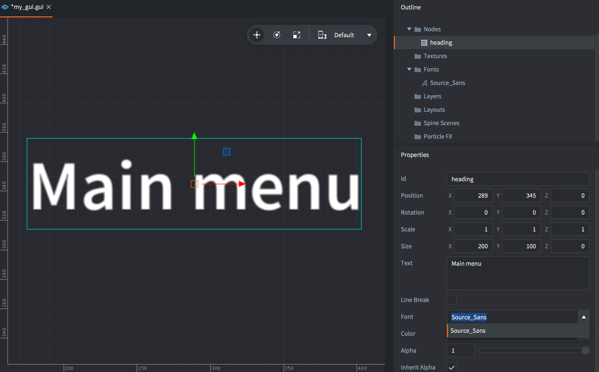
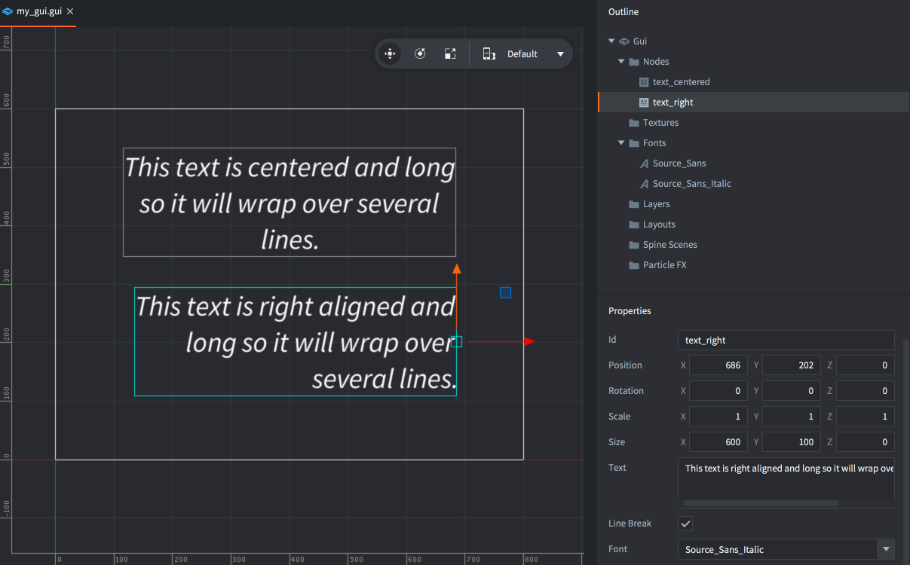

# GUI-нода Text

Defold поддерживает особый тип GUI-ноды, позволяющий отображать текст в GUI-сцене. Любой ресурс Font, добавленный в проект, может быть использован для рендеринга ноды Text.

Предпросмотр в редакторе поддерживает формирование глифов и раскладку справа налево с помощью системы рендеринга шрифтов движка. Необходимые настройки шрифта и App Manifest описаны в разделе [Поддержка раскладки текста](/manuals/font/#text-layout-support-eg-right-to-left).

## Добавление ноды Text

Шрифты, которые планируется использовать в GUI-нодах Text, должны быть добавлены в компонент GUI. Кликните ПКМ на папке *Fonts*, используйте контекстное меню <kbd>GUI</kbd> или нажмите соответствующее клавиатурное сокращение.



Нода Text обладает набором специфических свойств:

*Font*
: Любая созданная нода Text должна иметь настроенное свойство *Font*.

*Text*
: Отображаемый текст.

*Line Break*
: Выравнивание текста следует за настройкой пивота, и настройка этого свойства позволяет тексту располагаться на нескольких строках. Ширина ноды определяет, в каком месте текст будет перенесен.

## Векторные шрифты и цветные эмодзи {#vector-fonts-and-color-emoji}

Выполните [настройку векторного шрифта](/manuals/font/#vector-fonts), добавьте ресурс `.font` в *Fonts* GUI-сцены и выберите его на текстовой ноде. Установите *Material* ресурса шрифта в `/builtins/fonts/font-vector.material`. Управляйте отображаемым размером через *Font Size* ноды.

Для цветных эмодзи также выполните [настройку резервного COLRv1-шрифта и его включения в бандл](/manuals/font/#color-emoji). Создайте текстовую ноду с id `text`, оставьте её *Text* пустым и добавьте следующее в `.gui_script` GUI-сцены:

```lua
function init(self)
    local node = gui.get_node("text")
    local text = "Hello 😀 🍎 🚀"
    local font_resource = gui.get_font_resource(gui.get_font(node))
    -- Добавить резервный шрифт один раз для этого общего ресурса шрифта.
    font.add_font(font_resource, "/fonts/NotoColorEmoji-Regular.ttf")
    font.prewarm_text(font_resource, text, function(self, request_id, result, err)
        if result then
            gui.set_text(node, text)
        else
            print("Could not prepare GUI text:", err)
        end
    end)
end
```

[`gui.get_font()`](/ref/gui/#gui.get_font) возвращает имя шрифта внутри GUI-сцены; [`gui.get_font_resource()`](/ref/gui/#gui.get_font_resource) разрешает это имя в ресурс шрифта для `font.add_font()`. Другие ноды и Label, использующие этот ресурс, также получают резервный шрифт, поэтому инициализируйте его только один раз. Текст задаётся после успешного прогрева.

## Выравнивание

Настроив пивот ноды, можно изменить режим выравнивания текста.

*Center*
: Если пивот установлен в `Center`, `North` или `South`, текст выравнивается по центру.

*Left*
: Если пивот установлен в какой-либо из режимов `West`, текст выравнивается по левому краю.

*Right*
: Если пивот установлен в один из режимов `East`, текст выравнивается по правому краю.



## Воздействие на ноду Text в рантайме

Нода Text реагирует на любые общие функции манипуляции нодами по настройке размера, пивота, цвета и так далее. Существует несколько функций, предназначенных только для ноды Text:

* Чтобы изменить шрифт ноды Text, используйте функцию [`gui.set_font()`](/ref/gui/#gui.set_font).
* Чтобы изменить поведение переноса строки ноды Text, используйте функцию [`gui.set_line_break()`](/ref/gui/#gui.set_line_break).
* Чтобы изменить содержимое ноды Text, используйте функцию [`gui.set_text()`](/ref/gui/#gui.set_text).

```lua
function on_message(self, message_id, message, sender)
    if message_id == hash("set_score") then
        local s = gui.get_node("score")
        gui.set_text(s, message.score)
    end
end
```
