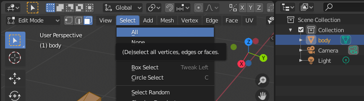
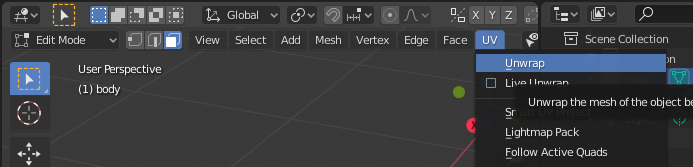
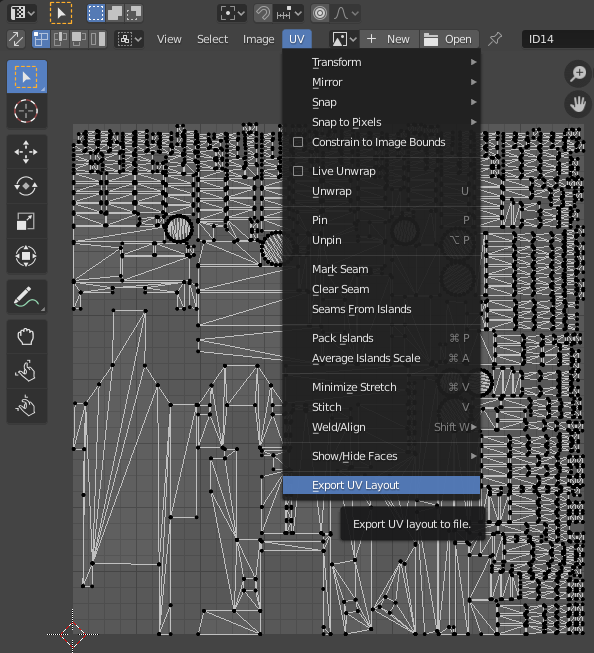
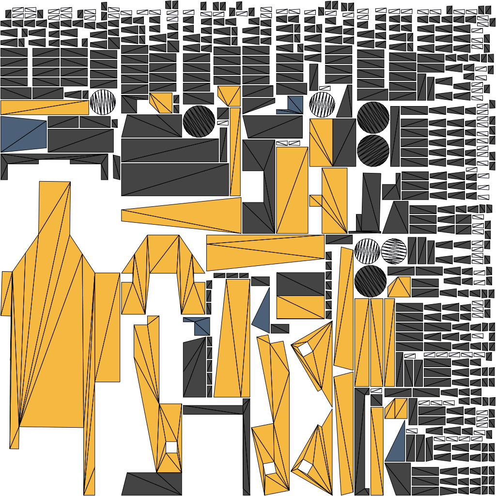

# Импортирование 3D-моделей
Defold поддерживает модели, скелеты и анимации в формате glTF 2.0 (GL Transmission Format). Для 3D-моделей используйте файлы *.gltf* или *.glb*. glTF -- современный формат, предназначенный для передачи и загрузки 3D-данных в игровых движках и приложениях реального времени.

С помощью таких инструментов, как Maya, 3ds Max, SketchUp и Blender, можно создавать 3D-модели или конвертировать их в glTF.

Blender -- это мощная и популярная программа для 3D-моделирования, анимации и рендеринга. Она работает под Windows, macOS и Linux и доступна бесплатно на [https://www.blender.org](https://www.blender.org).

## Импортирование в Defold
Чтобы импортировать модель, перетащите файл *.gltf* или *.glb* в панель *Assets* редактора Defold.

glTF может храниться двумя распространенными способами:

* *.glb* -- это один бинарный файл. Он содержит данные модели и также может содержать упакованные изображения текстур. Это удобно, когда модель нужно перемещать или хранить как один файл.
* *.gltf* -- это текстовый JSON-файл. Обычно он ссылается на отдельный файл *.bin* с данными сетки и отдельные изображения текстур, например *.png*, *.jpg* или *.ktx2*. При использовании этого варианта добавьте в проект все файлы, на которые есть ссылки, и сохраните их относительные пути.

Встроенные изображения можно использовать напрямую из файла glTF или GLB, не извлекая в отдельные ассеты. Внешние файлы изображений и буферов по-прежнему нужно импортировать вместе с моделью, сохраняя относительные пути.

::: sidenote
Defold сохраняет позиции и трансформации из импортированного файла glTF и не выполняет автоматическое центрирование модели при импорте. Предпросмотр в редакторе и среда выполнения используют импортированные трансформации согласованно: скиннинговые или привязанные к костям сетки сохраняют локальные трансформации относительно скелета, а жесткие сетки сохраняют размещение, сведенное к мировым координатам.

[Компонент Model](/manuals/model/#model-properties) позволяет выбрать одну именованную сетку из импортированной сцены. Если оставить поле *Mesh* пустым, используется вся сцена с сохранением описанных выше трансформаций. При выборе сетки используется её локальная геометрия без трансформаций узлов glTF, поэтому размещайте её с помощью трансформации компонента Model или игрового объекта.

Если модель, созданная в предыдущей версии Defold, меняет позицию или ориентацию после повторного импорта, исправьте трансформацию в Blender или другом инструменте создания контента и повторно экспортируйте файл *.gltf* или *.glb*.
:::

### Сжатая геометрия {#compressed-geometry}

Источники *.gltf* и *.glb* могут содержать геометрию, сжатую Draco или Meshopt. Поддерживаются следующие расширения сжатия glTF:

| Сжатие | Расширение glTF |
| --- | --- |
| Draco | `KHR_draco_mesh_compression` |
| Meshopt | `EXT_meshopt_compression` и `KHR_meshopt_compression` |

Экспортируйте или оптимизируйте ассет glTF 2.0 с одним из этих расширений, затем импортируйте его так же, как несжатую модель. Включите все внешние буферы и текстуры, сохранив относительные пути. Как обычно, назначьте импортированный файл в свойстве *Scene* компонента Model.

Defold декодирует сжатую геометрию при импорте и сборке. Полученная модель использует обычное представление геометрии Defold во время выполнения. Эта поддержка не включает сжатие Draco или Meshopt в работающем движке, а меньший исходный файл не гарантирует меньший бандл игры.

### Просмотр импортированной сцены {#browsing-the-imported-scene}

Разверните файл *.gltf* или *.glb* в панели *Assets*, чтобы просмотреть его сетки, сгенерированные материалы и встроенные изображения. Открытие сцены показывает предпросмотр с заданными в ней материалами и текстурами. Также можно открыть отдельную сетку для предпросмотра.

Ресурсы внутри файла доступны только для чтения. Чтобы создать редактируемый ресурс Model для сетки, скопируйте сетку и вставьте её в папку проекта. Полученный файл *.model* по-прежнему ссылается на импортированный glTF или GLB. Для изменения исходной геометрии или встроенных изображений отредактируйте ассет в программе создания контента и экспортируйте заново.

Скрипты редактора могут перечислять эти ресурсы с помощью `editor.resource_children(path)`. Пример рекурсивного обхода ресурсов в папках и файлах glTF/GLB см. в разделе [Обход ресурсов проекта](/manuals/editor-scripts/#traversing-project-resources).

### Текстуры KTX2 {#ktx2-textures}

Текстуры моделей могут использовать источники *.ktx2* — как внешние файлы или изображения, встроенные в *.gltf* или *.glb*. Импортируйте внешние файлы вместе с моделью. Встроенные изображения KTX2 отображаются внутри сцены в панели *Assets* и могут назначаться прямо в поля текстур материала или через <kbd>Auto Fill</kbd>.

[Профили текстур](/manuals/texture-profiles/#ktx2-source-textures) определяют, сохранять ли исходный формат KTX2 или преобразовывать его в настроенные выходные форматы. **Keep KTX2 Format** сохраняет формат кодирования исходника при включённом сжатии текстур, но обработка изображения всё равно может потребовать перекодирования. Проверьте поддержку формата на целевых устройствах и учитывайте возможную дополнительную потерю качества при повторном сжатии уже сжатой текстуры. См. [входные форматы и предпросмотр KTX2](/manuals/importing-graphics/#ktx2-textures).

## Использование модели {#using-a-model}
После импорта используйте модель в [компоненте Model](/manuals/model):

1. Создайте файл Model из панели *Assets* через <kbd>New... ▸ Model</kbd> или добавьте компонент Model непосредственно в игровой объект через <kbd>Add Component ▸ Model</kbd>.
2. Укажите в свойстве *Scene* импортированный файл *.gltf* или *.glb*.
3. Когда появится диалог *Auto Fill Model Fields?*, выберите <kbd>Auto Fill</kbd>, чтобы назначить сгенерированные материалы сцены и текстуры, на которые она ссылается. Это заменяет существующие привязки материалов и текстур. Выберите <kbd>Keep Current</kbd>, чтобы сохранить привязки; новая сцена всё равно будет выбрана.
4. Оставьте *Mesh* пустым для использования всей сцены либо выберите именованную сетку для использования только её локальной геометрии. Изменение выбора сетки может показать тот же диалог: выбор сетки предлагает её материалы, очистка выбора — все материалы сцены. <kbd>Keep Current</kbd> сохраняет привязки, применяя новый выбор сетки.
5. Для анимированной модели укажите в свойстве *Skeleton* файл *.gltf* или *.glb*, содержащий скелет. Часто это тот же файл, который используется для *Scene*, если сетка, скелет и анимации экспортированы вместе.
6. Создайте файл *Animation Set* для анимаций и назначьте его свойству *Animations*. Укажите *Default Animation*, если анимация должна запускаться автоматически.

Редактор предлагает заполнить привязки, когда выбранный источник glTF или GLB предоставляет материалы. Он разрешает и встроенные изображения, и внешние ссылки на изображения. Сгенерированные материалы используют встроенные шейдеры glTF; об освещении и поддерживаемых эффектах материалов см. в [руководстве по PBR](/manuals/physically-based-rendering/#built-in-pbr-materials).

### Назначение материалов и текстур вручную {#assigning-materials-and-textures-manually}

Если вы выбрали <kbd>Keep Current</kbd> или вам нужно собственное затенение, задайте подходящий материал в каждом свойстве *Material*. Встроенные материалы `gltf` предоставляют PBR-затенение; также доступны встроенные материалы `model` и собственные материалы. Варианты для статических моделей, моделей со скиннингом и инстансингом и их требования описаны в [руководстве по Model](/manuals/model/#material).

Назначьте каждую текстуру соответствующему полю текстуры материала. Можно использовать встроенное изображение, доступное внутри файла glTF или GLB в панели *Assets*, либо отдельный ассет изображения в проекте. Для материалов с несколькими сэмплерами сопоставьте каждую текстуру предназначенному ей сэмплеру; [руководство по PBR перечисляет имена встроенных сэмплеров glTF](/manuals/physically-based-rendering/#built-in-pbr-materials).

## Экспорт в glTF
Экспортированный файл *.gltf* или *.glb* содержит все вершины, ребра и грани, из которых состоит модель, а также _UV-координаты_ (какая часть изображения текстуры сопоставляется с определенной частью сетки), если они были определены, кости скелета и данные анимации.

* Подробное описание полигональных сеток можно найти по ссылке: http://en.wikipedia.org/wiki/Polygon_mesh.

* О UV-координатах и UV-развертке можно прочитать здесь: http://en.wikipedia.org/wiki/UV_mapping.

Defold накладывает некоторые ограничения на экспортированные анимационные данные:

* В настоящее время поддерживаются только запеченные анимации. Анимации должны содержать матрицы для каждой анимированной кости на каждом ключевом кадре, а не отдельные ключи для позиции, вращения и масштаба.

* Анимации интерполируются линейно. Если вы используете более сложную кривую интерполяции, анимации нужно предварительно запечь в экспортере.

### Требования
При экспорте модели учитывайте, что поддержка glTF может отличаться между инструментами и движками. Используйте glTF 2.0 и убедитесь, что у модели есть корректные UV-координаты, если она использует текстуры. Изображения могут быть встроены в файл glTF или GLB либо храниться в отдельных файлах, на которые ссылается сцена. При импорте модели в Defold включите все внешние файлы изображений и буферов.

Хотя наша цель -- полная поддержка формата glTF, это еще не реализовано полностью.
Если какой-либо функции не хватает, пожалуйста, отправьте запрос на добавление в [наш репозиторий](https://github.com/defold/defold/issues)

### Экспорт текстуры
Если хотите создать изображение текстуры вручную, экспортируйте UV-развёртку из Blender как шаблон. Начните с выбора сетки и всех её вершин:

Когда все вершины выбраны, выполните развертку меша, чтобы получить UV-развертку:

Затем можно экспортировать UV-развертку в изображение, которое будет использоваться в качестве текстуры:

### Экспорт из Blender
Экспортируйте модель из Blender через <kbd>File ▸ Export ▸ glTF 2.0 (.glb/.gltf)</kbd>.

Перед экспортом выберите объект или объекты и включите *Selected Objects*, если нужно экспортировать только выбранное.

Выберите один из вариантов *Format*:

* *glTF Binary (.glb)* создает один файл. Используйте этот вариант, когда модель должно быть удобно перемещать или хранить как один ассет.
* *glTF Separate (.gltf + .bin + textures)* создает отдельные файлы для описания модели, бинарных данных и текстур. Используйте этот вариант, когда нужно редактировать изображения текстур или назначать их в Defold отдельно.

Если модель содержит анимации, включите экспорт анимаций и убедитесь, что они запечены. Если модель использует текстуры, убедитесь, что у сетки есть UV-развертка и что изображения текстур экспортируются в формате, который Defold может импортировать, например PNG или JPEG.

