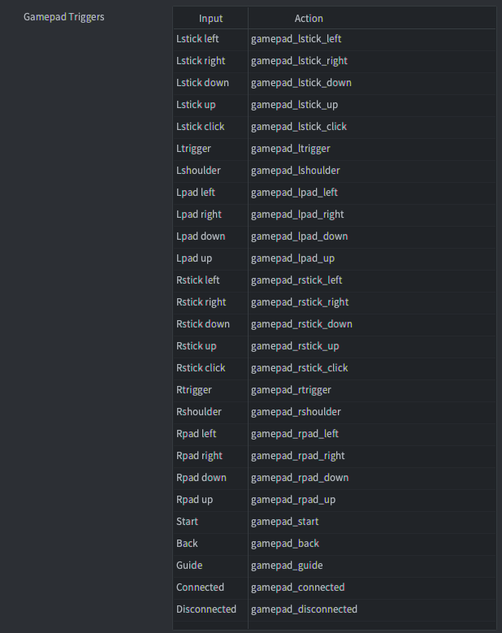
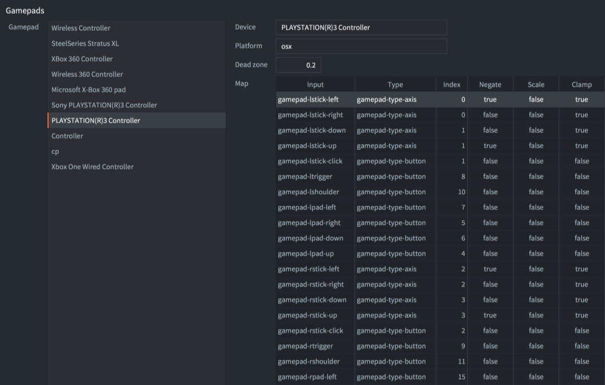
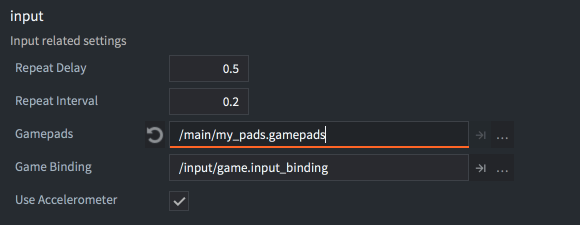

::: sidenote
Рекомендуется ознакомиться с общим принципом работы ввода в Defold, способами получения ввода и порядком получения ввода в файлах скрипта. Узнайте больше о системе ввода в [руководстве](/manuals/input).
:::

# Геймпады
Триггеры геймпада позволяют связать стандартный ввод геймпада с функциями игры. Для ввода данных с геймпада предусмотрены привязки для:

- Левый и правый стики (направление и щелчки)
- Левый и правый цифровые пэды. Правый пэд обычно переводится как кнопки "A", "B", "X" и "Y" на контроллере Xbox и кнопки "квадрат", "круг", "треугольник" и "крест" на контроллере Playstation соответственно.
- Левый и правый триггеры
- Левая и правая плечевые кнопки
- Кнопки "Start", "Back" и другие Кнопки управления



::: important
В приведенных ниже примерах используются действия, показанные на изображении выше. Как и в случае с любым другим вводом, вы можете называть свои действия по своему усмотрению.
:::

## Цифровые кнопки
Цифровые кнопки генерируют события `pressed`, `released` и `repeated`. Пример обнаружения для цифровой кнопки (нажата или отпущена):

```lua
function on_input(self, action_id, action)
    if action_id == hash("gamepad_lpad_left") then
        if action.pressed then
            -- начать движение влево
        elseif action.released then
            -- прекратить движение влево
        end
    end
end
```

## Аналоговые стики
Аналоговые стики генерируют непрерывные события ввода, даже, когда стик перемещается за пределы мертвой зоны, заданной в файле настроек геймпада (см. ниже). Пример определения ввода для аналогового стика:

```lua
function on_input(self, action_id, action)
    if action_id == hash("gamepad_lstick_down") then
        -- левый стик перемещён вниз
        print(action.value) -- значение между 0.0 и -1.0
    end
end
```

Аналоговые стики также генерируют события `pressed` и `released` при перемещении в кардинальных направлениях выше определенного порогового значения. Это позволяет использовать аналоговый стик в качестве цифрового ввода направления:

```lua
function on_input(self, action_id, action)
    if action_id == hash("gamepad_lstick_down") and action.pressed then
        -- левый стик перемещён в крайнее нижнее положение
    end
end
```

## Несколько геймпадов
Defold поддерживает несколько геймпадов через операционную систему хоста, действия устанавливают поле `gamepad` в таблице `action` на номер геймпада, с которого был осуществлен ввод:

```lua
function on_input(self, action_id, action)
    if action_id == hash("gamepad_start") then
        if action.gamepad == 0 then
          -- геймпад 0 хочет присоединиться к игре
        end
    end
end
```

## Соеденение и разоедининение
Привязки ввода геймпада также предоставляют две отдельные привязки с именами `Connected` и `Disconnected` для определения того, когда геймпад подключен (даже подключенный с самого начала) или отключен.

```lua
function on_input(self, action_id, action)
    if action_id == hash("gamepad_connected") then
        if action.gamepad == 0 then
          -- геймпад 0 подключён
        end
    elseif action_id == hash("gamepad_disconnected") then
        if action.gamepad == 0 then
          -- геймпад 0 отключён
        end
    end
end
```

## Нефильтрованые данные с геймпада {#raw-gamepads}

Привязки ввода геймпада также предоставляют отдельную привязку с именем `Raw` для передачи нефильтрованного (без примененной мертвой зоны) ввода кнопок, осей и шляп любого подключенного геймпада.

```lua
function on_input(self, action_id, action)
    if action_id == hash("raw") then
        pprint(action.gamepad_buttons)
        pprint(action.gamepad_axis)
        pprint(action.gamepad_hats)
    end
end
```

## Файл настроек геймпадов {#gamepads-settings-file}

Сопоставления геймпадов преобразуют кнопки, оси и крестовины контроллера в стандартные элементы управления, используемые привязками ввода. Defold объединяет два источника сопоставлений, настраиваемые в разделе *Input* файла *game.project*:

| Параметр | Формат сопоставления | По умолчанию |
| --- | --- | --- |
| [Gamepad Database](/manuals/project-settings/#gamepad-database) | Текстовая база в формате SDL, сопоставление по GUID контроллера | `/builtins/input/gamecontrollerdb.txt` |
| [Gamepads](/manuals/project-settings/#gamepads) | Прежние записи `.gamepads` по именам устройств и платформам | `/builtins/input/default.gamepads` |

Сопоставления из базы SDL и автоматические сопоставления платформы используют [Gamepad Deadzone](/manuals/project-settings/#gamepad-deadzone). Прежние записи `.gamepads` задают собственные мёртвые зоны. На Android контроллер без записи в базе может также получить [автоматическое сопоставление](#gamepads-on-android).

### Прежние сопоставления .gamepads {#legacy-gamepads-mappings}

Файл `.gamepads` может содержать сопоставления для нескольких контроллеров. Существующие сопоставления прежнего формата по-прежнему поддерживаются. Defold включает сопоставления для распространённых контроллеров в файле по умолчанию:



Если нужно создать сопоставление прежнего формата `.gamepads` на настольной платформе, используйте следующий инструмент. Для Android см. [Геймпады на Android](#gamepads-on-android).

[Скачать gdc.zip](https://forum.defold.com/t/big-thread-of-gamepad-testing/56032).

Он включает двоичные файлы для Windows, Linux и macOS. Запустите его из командной строки:

```sh
./gdc
```

Инструмент попросит вас нажать различные кнопки на подключенном контроллере. Затем он выведет новый файл gamepads с правильными отображениями для вашего контроллера. Сохраните новый файл или объедините его с существующим файлом gamepads, затем обновите настройки в *game.project*:



### Неопознанные геймпады {#unidentified-gamepads}

Если нет ни настроенного сопоставления, ни автоматического сопоставления платформы, геймпад создаёт только действия, привязанные к `Connected`, `Disconnected` и `Raw`. Можно добавить сопоставление контроллера или обрабатывать его необработанный ввод в игре.

Можно проверить, поступает ли входное действие от неопознанного геймпада, прочитав значение `gamepad_unknown` из `action`:

```lua
function on_input(self, action_id, action)
    if action_id == hash("connected") then
        if action.gamepad_unknown then
            print("The connected gamepad is unidentified and will only generate raw input")
        else
            print("The connected gamepad is known and will generate input actions for buttons and sticks")
        end
    end
end
```

## Геймпады в HTML5 {#gamepads-in-html5}
Геймпады поддерживаются в сборках HTML5 и генерируют те же события ввода, что и на других платформах. Поддержка геймпадов основана на [Gamepad API](https://www.w3.org/TR/gamepad/), который поддерживается в большинстве браузеров ([см. таблицу поддержки](https://caniuse.com/?search=gamepad)). Если браузер не поддерживает Gamepad API, Defold будет молча игнорировать любые триггеры геймпада в вашем проекте. Вы можете проверить, поддерживает ли браузер Gamepad API, проверив, существует ли функция `getGamepads` для объекта `navigator`:

```lua
local function supports_gamepads()
    return not html5 or (html5.run('typeof navigator.getGamepads === "function"') == "true")
end

if supports_gamepads() then
    print("Platform supports gamepads")
end
```

Если ваша игра запускается внутри `iframe`, вы также должны убедиться, что в `iframe` добавлено разрешение `gamepad`:

```html
<iframe allow="gamepad"></iframe>
```

### Стандартный геймпад

Если подключённый геймпад определяется браузером как стандартный геймпад, будет использоваться отображение для `Standard Gamepad` из [файла настроек геймпадов](/manuals/input-gamepads/#gamepads-settings-file) (отображение `Standard Gamepad` включено в файл `default.gamepads` в каталоге `/builtins`). Стандартный геймпад определяется как устройство с 16 кнопками и 2 аналоговыми стиками с раскладкой кнопок, аналогичной контроллерам PlayStation или Xbox (см. [определение и раскладку кнопок от W3C](https://w3c.github.io/gamepad/#dfn-standard-gamepad) для получения дополнительной информации). Если подключённый геймпад не определяется как стандартный, Defold будет искать отображение, соответствующее типу аппаратного геймпада в файле настроек геймпада.

## Геймпады в Windows
В Windows в настоящее время поддерживаются только контроллеры XBox 360. Чтобы подключить контроллер 360 к компьютеру с Windows, [убедитесь, что он правильно настроен](http://www.wikihow.com/Use-Your-Xbox-360-Controller-for-Windows).

## Геймпады на Android {#gamepads-on-android}

Геймпады поддерживаются в сборках Android и создают те же действия ввода, что и на других платформах. Defold использует настроенные [сопоставления геймпадов](#gamepads-settings-file) и может автоматически сопоставлять некоторые контроллеры, для которых нет подходящей записи.

Если контроллер не распознан или его элементы управления работают неверно, протестируйте его на устройстве Android и добавьте либо обновите сопоставление. Для диагностики см. [Неопознанные геймпады](#unidentified-gamepads) и [Необработанные данные геймпадов](#raw-gamepads).
