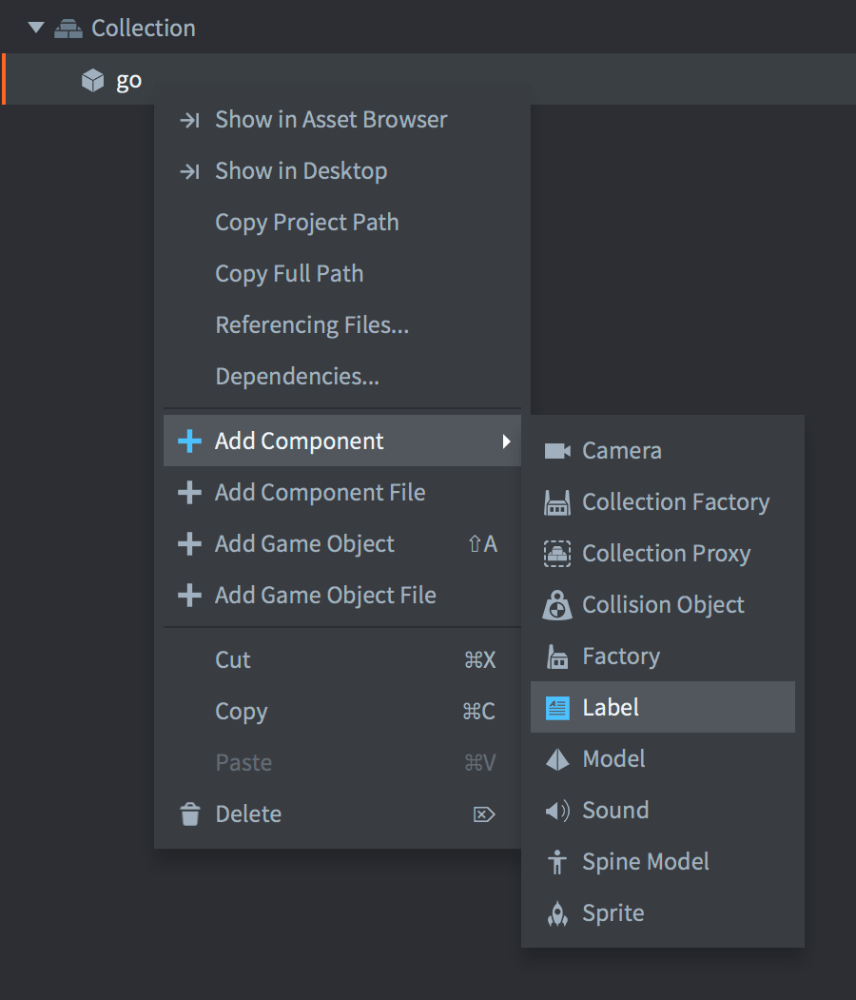
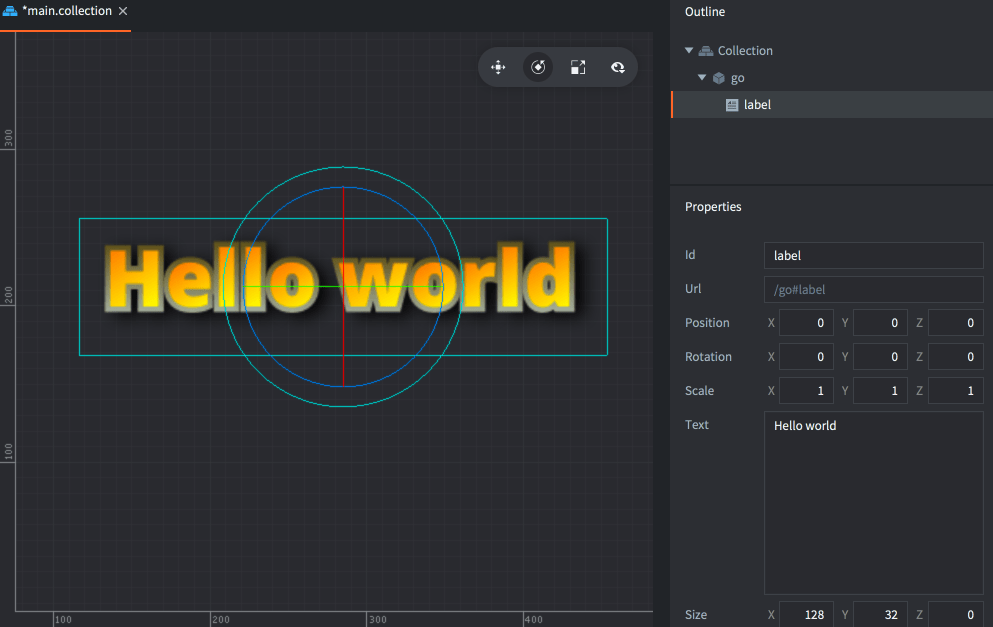
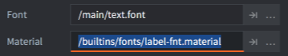
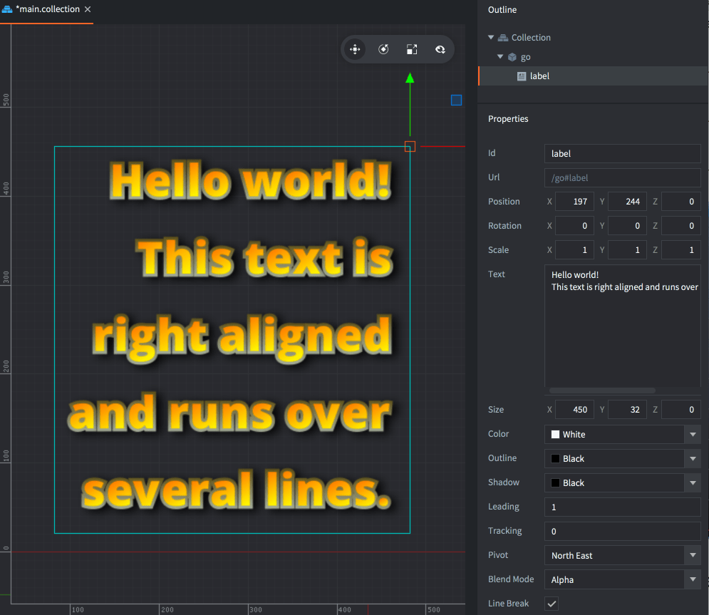

# Компонент Label

Компонент *Label* визуализирует фрагмент текста на экране в игровом пространстве. По умолчанию он упорядочивается и отрисовывается вместе со всей графикой спрайтов и тайлов. Компонент имеет набор свойств, определяющих способ визуализации текста. В Defold GUI поддерживает текст, но размещение элементов GUI в пространстве игры может оказаться сложной задачей. Текстовые метки эту задачу облегчают.

## Создание текстовой метки

Чтобы создать компонент Label, <kbd>кликните ПКМ</kbd> на игровом объекте и выберите <kbd>Add Component ▸ Label</kbd>.



(Если необходимо создать несколько текстовых меток из одного шаблона, лучше создать новый файл компонента Label: <kbd>кликните ПКМ</kbd> в папке в браузере *Assets* и выберите <kbd>New... ▸ Label</kbd>, затем добавьте этот файл в качестве компонента к любым игровым объектам.)



В свойстве *Font* укажите необходимый шрифт и убедитесь, что в свойстве *Material* установлен материал, соответствующий типу шрифта:



## Векторные шрифты и цветные эмодзи {#vector-fonts-and-color-emoji}

Для использования векторного шрифта выполните [настройку векторного шрифта](/manuals/font/#vector-fonts), назначьте ресурс `.font` в *Font* компонента Label и установите *Material* компонента в `/builtins/fonts/label-vector.material`. Управляйте отображаемым размером через *Font Size*.

Для цветных эмодзи также выполните [настройку резервного COLRv1-шрифта и его включения в бандл](/manuals/font/#color-emoji). Пример ниже предполагает Label с id `label` и скрипт на том же игровом объекте. Оставьте *Text* метки пустым, чтобы приветствие появилось только после подготовки глифов:

```lua
function init(self)
    local text = "Hello 😀 🍎 🚀"
    local font_resource = go.get("#label", "font")
    -- Добавить резервный шрифт один раз для этого общего ресурса шрифта.
    font.add_font(font_resource, "/fonts/NotoColorEmoji-Regular.ttf")
    font.prewarm_text(font_resource, text, function(self, request_id, result, err)
        if result then
            go.set("#label", "text", text)
        else
            print("Could not prepare label text:", err)
        end
    end)
end
```

Обычные буквы используют исходный шрифт, а эмодзи — добавленный цветной шрифт. Если этот ресурс шрифта используют другие Label или GUI-ноды Text, инициализируйте резервный шрифт в одном месте и используйте его совместно.

## Свойства текстовой метки

Помимо свойств *Id*, *Position*, *Rotation* и *Scale* существуют следующие специфичные для компонента свойства:

*Text*
: Текстовое содержимое метки.

*Size*
: Размер ограничивающей рамки текста. Если опция *Line Break* включена, ширина задает границу прерывания текста.

*Color*
: Цвет текста.

*Outline*
: Цвет обводки.

*Shadow*
: Цвет тени.

::: sidenote
Следует отметить, что в материале по умолчанию рендеринг теней отключен по соображениям производительности.
:::

*Leading*
: Коэффициент масштаба для межстрочного интервала. Значение 0 отменяет межстрочный интервал. По умолчанию 1.

*Tracking*
: Коэффициент масштаба для межбуквенного интервала. По умолчанию 0.

*Pivot*
: Опорная точка. Используется при изменении способа выравнивания текста (см. ниже).

*Blend Mode*
: Режим наложения, используемый при рендеринге текстовой метки.

*Line Break*
: Выравнивание текста происходит в соответствии с настройками опорной точки (пивота), а включение данной опции позволяет тексту перетекать в несколько строк. Ширина компонента определяет, в каком месте текст будет разрываться. Следует учитывать, что в тексте должен быть пробел, чтобы он мог прерываться.

*Font*
: Ресурс шрифта, используемый для этой метки.

*Material*
: Материал для рендеринга этой метки. Выберите материал, соответствующий режиму или источнику шрифта (Bitmap, SDF, Vector или BMFont). Соответствующие встроенные материалы Label перечислены в разделе [Материалы шрифтов](/manuals/font/#font-materials).

### Режимы наложения
:[blend-modes](../shared/blend-modes.md)

### Опорная точка и выравнивание

Настроив свойство *Pivot*, можно изменять режим выравнивания текста.

*Center*
: Если пивот установлен в значение `Center`, `North` или `South`, текст выравнивается по центру.

*Left*
: Если пивот установлен в какой-либо режим `West`, текст выравнивается по левому краю.

*Right*
: Если пивот установлен в какой-либо режим `East`, текст выравнивается по правому краю.



## Манипулирование при выполнении

Текстовыми метками можно манипулировать во время выполнения, получая и устанавливая текст метки, а также изменяя другие свойства.

`text`
: Текстовое содержимое метки (`string`). Доступно через `go.get()` и `go.set()`.

`color`
: Цвет метки (`vector4`)

`outline`
: Цвет обводки (`vector4`)

`shadow`
: Цвет тени (`vector4`)

`scale`
: Масштаб метки, либо `number` для равномерного масштабирования, либо `vector3` для масштабирования индивидуально по каждой из осей.

`size`
: Размер метки (`vector3`)

```lua
function init(self)
    -- Задать текст компоненту "my_label" в том же игровом объекте,
    -- что и этот скрипт.
    go.set("#my_label", "text", "New text")
    local text = go.get("#my_label", "text")
    print(text) -- New text
end
```

::: sidenote
Функции `label.set_text()` и `label.get_text()` считаются устаревшими; вместо них используется свойство `text`. Старые функции остаются доступными для совместимости. Прежняя функция установки текста ставит сообщение в очередь, тогда как `go.set()` обновляет текст немедленно.
:::

```lua
function init(self)
    -- Задать цвет компоненту "my_label" в том же игровом объекте,
    -- что и этот скрипт. Цвет представляется значением RGBA, хранящимся как тип vector4.
    local grey = vmath.vector4(0.5, 0.5, 0.5, 1.0)
    go.set("#my_label", "color", grey)

    -- ...и убрать обводку, установив ее альфу в 0...
    go.set("#my_label", "outline.w", 0)

    -- ...и увеличить масштаб в два раза по оси X.
    local scale_x = go.get("#my_label", "scale.x")
    go.set("#my_label", "scale.x", scale_x * 2)
end
```

## Конфигурация проекта

В файле *game.project* имеются несколько [проектных настроек](/manuals/project-settings#label), относящихся к текстовым меткам.
