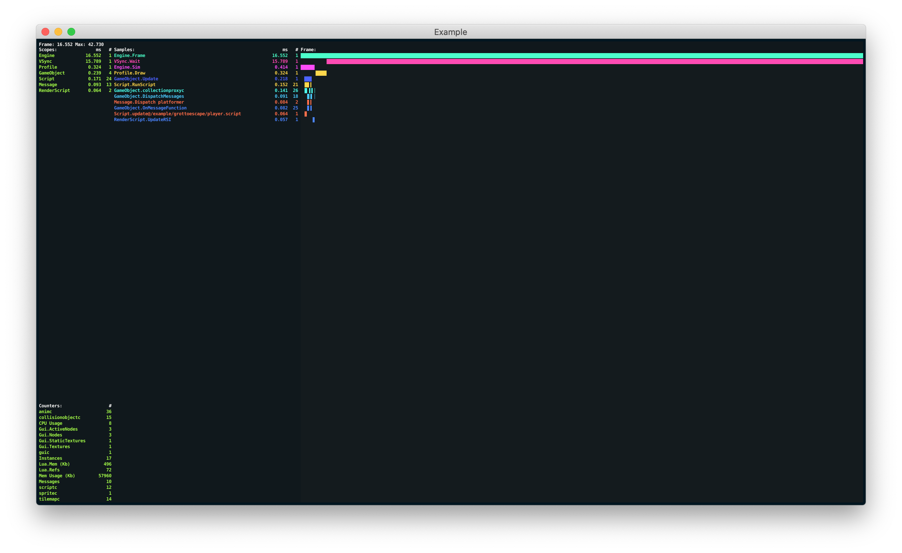
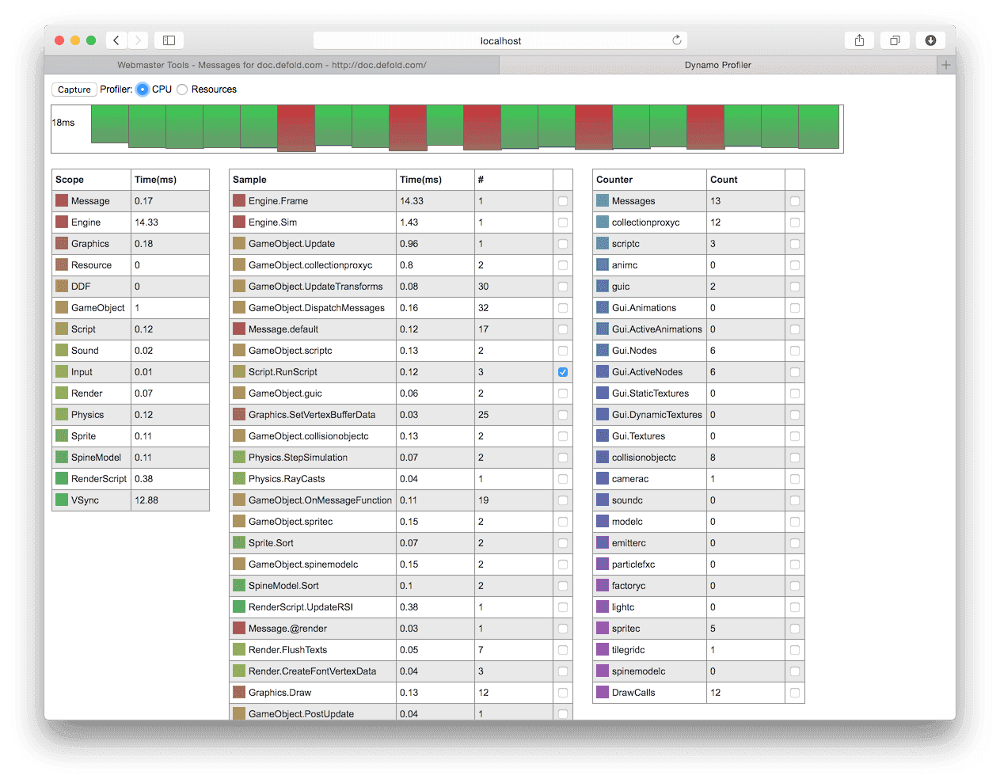
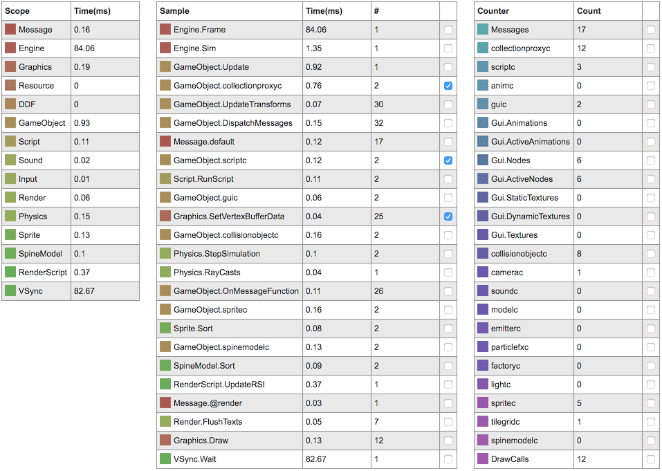
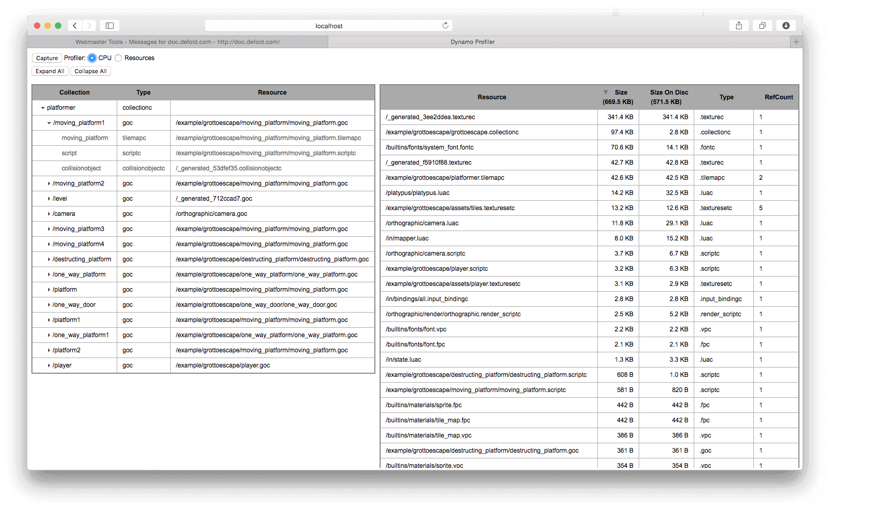
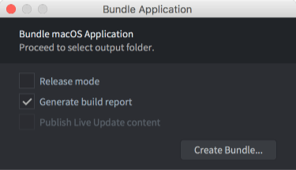
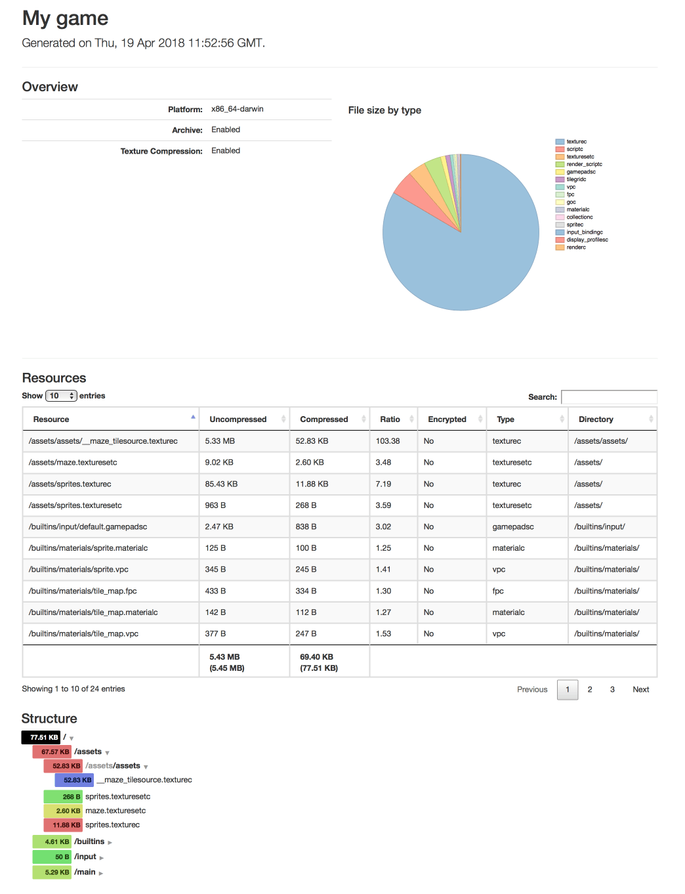
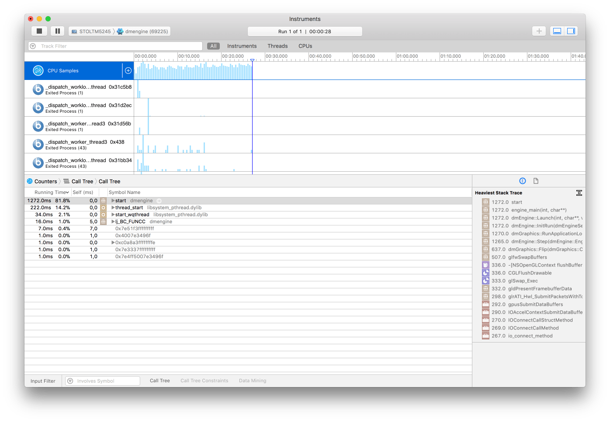
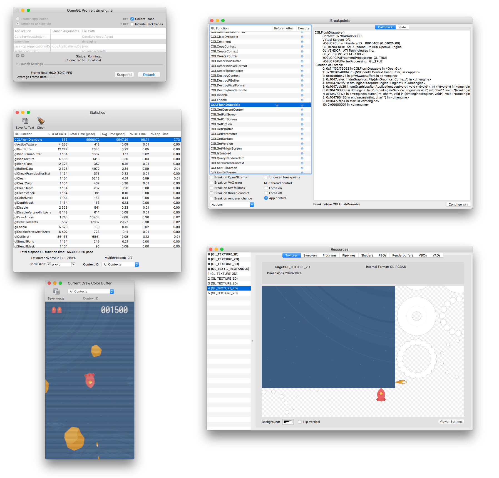
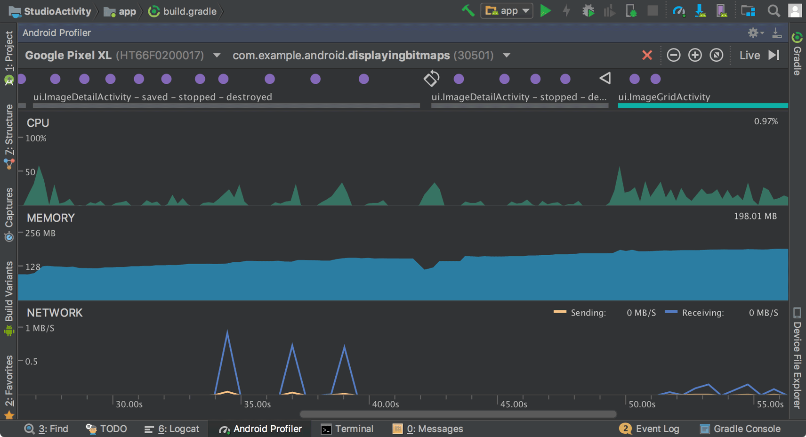
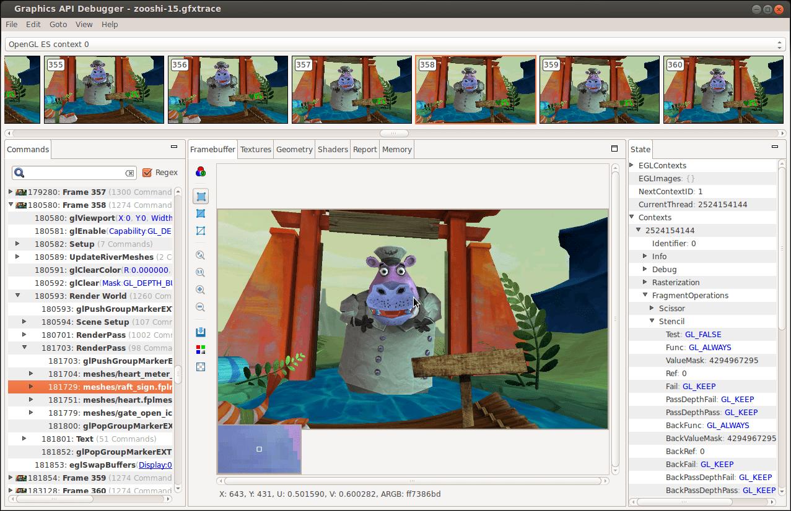

# Профилирование

Defold включает инструменты профилирования, интегрированные с движком и конвейером сборки. Они помогают находить проблемы с производительностью, памятью и использованием ресурсов. Данные профилирования во время выполнения могут использоваться несколькими средствами:

* Базовый профайлер и внутриигровой визуальный профайлер доступны на всех платформах.
* [Профайлер Remotery](https://github.com/Celtoys/Remotery) и интерактивный веб-профайлер кадров доступны на настольных и мобильных платформах.
* Отладочные сборки macOS с Metal могут сохранять [трассировки GPU](#metal-gpu-trace-capture) для изучения в Xcode.
* HTML5-сборки могут публиковать области Defold в Web Performance API браузера.

Параметр **Profiler** в [манифесте приложения](/manuals/app-manifest/#profiler) определяет, будет ли код профайлера скомпонован со сборкой. Значение по умолчанию **Debug Only**, **None** исключает его, а **Always** включает как в отладочные, так и в релизные сборки. Параметры `profiler` в *game.project* управляют поведением во время выполнения, но не возвращают в сборку исключённый код профайлера. В частности, **Track CPU** управляет выборкой использования CPU и не связан с выбором в манифесте приложения.

## Визуальный профилировщик среды выполнения

Сборки, включающие поддержку профайлера, имеют визуальный профилировщик среды выполнения, который оперативно показывает информацию поверх работающего приложения:

```lua
function on_reload(self)
    -- Переключить отображение визуального профилировщика при горячей перезагрузке.
    profiler.enable_ui(true)
end
```



Визуальный профилировщик предоставляет ряд различных функций, которые можно использовать для изменения способа отображения данных: 

```lua

profiler.set_ui_mode()
profiler.set_ui_view_mode()
profiler.view_recorded_frame()
```

Обратитесь к [справочнику по API профилировщика](/ref/profiler/) для получения дополнительной информации о функциях профилировщика. 

## Веб-профилировщик
Во время работы настольной или мобильной сборки с поддержкой профайлера через браузер доступны интерактивные профайлеры кадров и ресурсов.

### Профилировщик кадров Remotery
Профилировщик кадров позволяет выполнять выборку данных вашей игры во время выполнения и анализировать отдельные кадры в деталях. Чтобы получить доступ к профайлеру:

1. Запустите игру на целевом устройстве.
2. Выберите пункт меню <kbd> Debug ▸ Open Web Profiler</kbd>.

Профилировщик кадров разделён на несколько секций, каждая из которых предоставляет различные представления выполняемой игры. Нажмите кнопку Pause в правом верхнем углу, чтобы временно остановить обновление данных профайлера.



::: sidenote
Когда вы используете несколько целевых устройств одновременно, вы можете вручную переключаться между ними, изменив поле Connection Address в верхней части страницы, чтобы оно соответствовало URL-адресу Remotery профайлера, который отображается в консоли при запуске устройства:

```
INFO:ENGINE: Defold Engine 1.3.4 (80b1b73)
INFO:DLIB: Initialized Remotery (ws://127.0.0.1:17815/rmt)
INFO:ENGINE: Loading data from: build/default
```
:::

Временная шкала выборки (Sample Timeline)
: Временная шкала показывает кадры, захваченные в движке, одна горизонтальная шкала на каждый поток. Main — основной поток, где выполняется вся логика игры и большая часть кода движка. Remotery — поток самого профайлера, а Sound — поток микширования и воспроизведения звука. Вы можете масштабировать шкалу (колесиком мыши) и выбирать отдельные кадры, чтобы изучить их детали во представлении Frame Data.

  


Данные кадра (Frame Data)
: Представление Frame Data отображает таблицу с детальной разбивкой всех данных для выбранного кадра. Вы можете видеть, сколько миллисекунд затрачено на каждый участок движка.

  


Глобальные свойства (Global Properties)
: Представление Global Properties показывает таблицу счётчиков. Это облегчает, например, отслеживание количества вызовов отрисовки или количества компонентов определённого типа.

  

::: sidenote
Значение LuaMem показывает объём памяти в килобайтах, используемый Lua VM, согласно данным сборщика мусора Lua. Значение Memory показывает объём памяти в килобайтах, используемый движком.
:::

::: important
[Параметр Max Sample Count](/manuals/project-settings/#max-sample-count) ограничивает число выборок профайлера, записываемых в каждом потоке за кадр. Если профайлер сообщает о превышении предела, сначала проверьте код профилирования нативных расширений на незакрытую пару начала/конца области. Увеличивайте предел только в том случае, если допустимый кадр действительно содержит больше областей, чем разрешено текущим значением.
:::


### Профилировщик ресурсов
Профилировщик ресурсов позволяет инспектировать вашу игру во время её выполнения и детально анализировать использование ресурсов. Чтобы получить доступ к профайлеру:

1. Запустите отладочную сборку игры на целевом устройстве.
2. Откройте в браузере [адрес сервиса движка](/manuals/engine-service/#availability-and-port-discovery): `http://<address>:<port>/`. Используйте адрес и порт, сообщённые работающим движком в консоли.

Профилировщик ресурсов разделён на 2 секции: одна показывает иерархическое представление коллекций, игровых объектов и компонентов, созданных в данный момент в игре, а другая — все загруженные в память ресурсы.



Представление коллекций (Collection view)
: Показывает иерархический список всех игровых объектов и компонентов, созданных в данный момент в игре, и из какой коллекции они происходят. Это полезный инструмент, когда вам нужно понять, что и откуда создано в вашей игре.

Представление ресурсов (Resources view)
: Показывает все ресурсы, загруженные в память, их размер и количество ссылок на каждый ресурс. Это полезно при оптимизации использования памяти в вашем приложении.

#### Время загрузки ресурсов {#resource-loading-times}

Также можно проверить, сколько времени занимает загрузка отдельных ресурсов. Перед запуском игры включите [Resource → Profile](/manuals/project-settings/#profile) в *game.project*. В текстовом представлении настройка выглядит так:

```ini
[resource]
profile = 1
```

По умолчанию настройка отключена. Перезапустите игру после её включения, чтобы измерить загрузки при запуске. Каждая успешная или неудачная загрузка создаёт запись журнала уровня INFO с путём ресурса, общим временем и временем этапов preload, read, create, post-create, queue и wait. Попадания в кэш не создают новых записей о загрузке.

В профилировщике ресурсов нажмите **Capture**, затем **Show load times**, чтобы отобразить столбцы времени. **Capture** обновляет представление сохранённых измерений; эта кнопка не включает профилирование и не измеряет ранее выполненные загрузки задним числом.

| Столбец | Значение |
| --- | --- |
| **Load (ms)** | Полное время начальной загрузки, включая зависимости, работу post-create, очередь и ожидание. |
| **Preload (ms)** | Время подготовки ресурса в его callback preload. |
| **Read (ms)** | Время чтения данных ресурса. |
| **Create (ms)** | Время создания ресурса среды выполнения в его callback create. |

При отображении времени загрузки таблица сортируется по полному времени, начиная с самых медленных ресурсов. Нажмите заголовок столбца времени для сортировки по этому этапу; повторное нажатие меняет порядок на обратный. Полосы в столбце **Load** показывают полное время каждого ресурса относительно самого медленного из видимых. Нажмите **Hide load times**, чтобы снова скрыть столбцы.

Время загрузки и callbacks включает работу вложенных зависимостей. Не складывайте полное время разных ресурсов для вычисления времени запуска: одна работа может учитываться в измерениях нескольких ресурсов. Столбцы **Preload**, **Read** и **Create** также не охватывают всё время загрузки; дополнительные этапы доступны в журнале.

Длинное тире (`—`) означает отсутствие завершённого измерения, например если профилирование было отключено или начальная загрузка ещё не завершилась. Измеренный ноль отображается как `0.000`. Измерения описывают начальную загрузку: попадания в кэш и горячие перезагрузки не меняют их, а выгрузка ресурса удаляет сохранённое измерение.

## Захват трассировок GPU Metal {#metal-gpu-trace-capture}

[HTTP-сервис движка](/manuals/engine-service/#metal-gpu-trace-endpoint) может захватывать команды GPU Metal в документ *.gputrace* на macOS. Откройте завершённую трассировку в Xcode для изучения захваченных кадров. Эта возможность встроена в отладочный движок.

### Запуск и проверка поддержки {#launch-and-check-support}

Создайте [отладочный бандл](/manuals/bundling/#release-vs-debug) macOS с включённым нативным графическим бэкендом Metal. Если используется App Manifest, выберите вариант **Graphics (macOS)**, включающий Metal; см. [графические бэкенды](/manuals/app-manifest/#graphics).

Запустите исполняемый файл бандла из терминала с `METAL_CAPTURE_ENABLED=1` и выберите адаптер Metal. Замените путь к бандлу и имя исполняемого файла в этом примере:

```sh
METAL_CAPTURE_ENABLED=1 \
    "/absolute/path/MyGame.app/Contents/MacOS/MyGame" --graphics-adapter=metal
```

Переменная окружения должна быть установлена при запуске движка. Если установить её только в терминале для HTTP-запросов, захват в уже работающем движке не включится.

Во втором терминале используйте [порт сервиса движка из журнала](/manuals/engine-service/#availability-and-port-discovery). Следующие примеры используют `curl` и `jq`:

```sh
ENGINE_URL="http://127.0.0.1:<port>"
curl -fsS "$ENGINE_URL/openapi.json" | jq '.paths["/profiler/gputrace"]'
curl -sS -i "$ENGINE_URL/profiler/gputrace"
```

Маршрут регистрируется только на macOS. Значение `null` в документе OpenAPI означает, что движок его не предоставляет. Даже при наличии маршрута поддержка захвата зависит от графического адаптера и окружения запуска. `GET /profiler/gputrace` возвращает HTTP 501 с `error.code: "gputrace_unsupported"`, когда захват Metal недоступен. Перед продолжением убедитесь, что движок использует Metal и был запущен с `METAL_CAPTURE_ENABLED=1`. Поддерживаемый запрос возвращает HTTP 200 со статусом захвата.

### Захват и изучение кадров {#capture-and-inspect-frames}

Выберите доступный для записи абсолютный выходной путь с окончанием `.gputrace`, существующим родительским каталогом и без уже имеющейся трассировки по этому пути. Путь находится на компьютере, где работает движок. Для локального движка этот пример создаёт новый временный каталог и запрашивает один кадр:

```sh
GPU_TRACE_DIR=$(mktemp -d /tmp/defold-gputrace.XXXXXX)
GPU_TRACE_PATH="$GPU_TRACE_DIR/frame.gputrace"
GPU_TRACE_REQUEST=$(jq -n --arg path "$GPU_TRACE_PATH" '{path: $path, frames: 1}')
curl -fsS -X POST \
    -H 'Content-Type: application/json' \
    --data "$GPU_TRACE_REQUEST" \
    "$ENGINE_URL/profiler/gputrace" | jq
```

`frames` необязателен, по умолчанию равен `1` и принимает целые значения от `1` до `10000`. Захват начинается перед следующим отрисованным кадром и останавливается после отправки запрошенного числа полных кадров. Во время ожидания игра должна продолжать рендеринг. Одновременно может ожидать или выполняться только один захват; следующий запрос запуска возвращает HTTP 409 с `error.code: "gputrace_active"`.

При планировании захвата `POST` возвращает HTTP 200 с `ok: true` и `data.state: "pending"`. О завершении захвата сообщают последующие запросы статуса. Повторяйте запрос статуса, пока `data.state` не станет `complete`, `canceled` или `failed`:

```sh
curl -fsS "$ENGINE_URL/profiler/gputrace" | jq
```

| `data.state` | Значение |
| --- | --- |
| `idle` | Захват не запланирован. |
| `pending` | Захват ожидает начала рендеринга. |
| `capturing` | Захват активен; `data.frames_captured` сообщает число завершённых кадров. |
| `complete` | Захват завершён, трассировку можно открыть. |
| `canceled` | Ожидающий захват отменён до начала. |
| `failed` | Захват не удалось начать; нативная ошибка доступна в `data.error`. |

`GET` описывает текущий или последний захват. Проверяйте, что `data.path` совпадает с запрошенным путём. Неудачный захват также возвращает HTTP 200 с `ok: true`; определяйте результат по `data.state` и `data.error`. В автоматическом клиенте опрашивайте статус с задержкой и тайм-аутом.

После перехода состояния в `complete` откройте трассировку в Xcode на Mac, где работает движок:

```sh
open -a Xcode "$GPU_TRACE_PATH"
```

HTTP-эндпоинт возвращает статус; трассировка сохраняется по пути `data.path` на хосте движка. Для удалённого движка сначала получите завершённый документ с этого хоста, затем открывайте его локально.

### Отмена или остановка захвата {#cancel-or-stop-a-capture}

Чтобы отменить ожидающий захват или досрочно завершить активный:

```sh
curl -fsS -X DELETE "$ENGINE_URL/profiler/gputrace" | jq
```

Ожидающий захват переходит в состояние `canceled`. Для активного захвата `data.stop_requested` становится `true`, и захват завершается после отправки текущего отрисованного кадра. Продолжайте опрашивать `GET` до конечного состояния. `DELETE` оставляет на диске уже записанную трассировку. Если ожидающего или активного захвата нет, возвращается HTTP 409 с `error.code: "gputrace_inactive"`.

## Временная шкала производительности браузера HTML5

Для временной шкалы браузера HTML5 использует Web Performance API вместо Remotery. Чтобы записывать области Defold:

1. Убедитесь, что выбранный режим профайлера в манифесте приложения включает поддержку профайлера в используемом варианте сборки.
2. Включите **Performance Timeline Enabled** (`profiler.performance_timeline_enabled`) в *game.project*.
3. Запустите HTML5-сборку и откройте инструменты разработчика браузера.
4. Запишите сеанс на панели **Performance** браузера и изучите области Defold на полученной временной шкале.

Эта временная шкала браузера не связана ни с внутриигровым визуальным профайлером, ни с интерактивным веб-профайлером Remotery.


## Отчеты о сборке {#build-reports}
При бандлинге вашей игры есть возможность создать отчет о сборке. Это очень полезно, чтобы получить представление о размере всех ассетов, входящих в бандл вашей игры. Просто установите флажок *Generate build report* при бандлинге игры. 



Сборщик создаст файл с именем `report.html` рядом с бандлом игры. Откройте файл в веб-браузере, чтобы изучить отчет:



Раздел *Overview* дает общую визуальную разбивку размера проекта в зависимости от типа ресурса.

Раздел *Resources* показывает подробный список ресурсов, которые вы можете отсортировать по размеру, степени сжатия, шифрованию, типу и имени каталога. Используйте поле «search» для фильтрации отображаемых записей ресурсов. 

Раздел *Structure* показывает размеры в зависимости от того, как ресурсы организованы в файловой структуре проекта. Записи имеют цветовую кодировку от зеленого (легкий) до синего (тяжелый) в зависимости от относительного размера файла и содержимого каталога. 


## Внешние инструменты
В дополнение к встроенным инструментам доступен широкий спектр бесплатных высококачественных инструментов трассировки и профилирования. Ниже приведена их подборка:

ProFi (Lua)
: Мы не поставляем никаких встроенных профилировщиков Lua, но есть внешние библиотеки, которые достаточно просты в использовании. Чтобы узнать, на что ваши скрипты тратят время, либо вставьте замеры времени в свой код самостоятельно, либо используйте библиотеку профилирования Lua, такую как [ProFi](https://github.com/jgrahamc/ProFi).

  Обратите внимание, что профилировщики на чистом Lua добавляют довольно много накладных расходов с каждым устанавливаемым хуком. По этой причине вам следует немного опасаться временных профилей, которые вы получаете такими инструментами. Однако профили подсчета (Counting profiles) достаточно точны. 

Instruments (macOS и iOS) 
: Это анализатор производительности и визуализатор, который является частью Xcode. Он позволяет отслеживать и проверять поведение одного или нескольких приложений или процессов, изучать определенные функции устройства (например, Wi-Fi и Bluetooth) и многое другое. 

  

OpenGL profiler (macOS)
: Часть пакета "Additional Tools for Xcode", который можно загрузить из Apple (выберите <kbd>Xcode ▸ Open Developer Tool ▸ More Developer Tools...</kbd> в меню Xcode).

   Этот инструмент позволяет вам анализировать работающее Defold приложение и увидеть, как оно использует OpenGL. Он позволяет вам отслеживать вызовы функций OpenGL, устанавливать точки останова для функций OpenGL, исследовать ресурсы приложения (текстуры, программы, шейдеры и т. д.), просматривать содержимое буфера и проверять другие аспекты состояния OpenGL. 

  

Android Profiler (Android)
: https://developer.android.com/studio/profile/android-profiler.html

  Набор инструментов профилирования, который в реальном времени собирает данные о процессоре, памяти и сетевой активности вашей игры. Вы можете выполнять отслеживание выполнения кода методов на основе семплирования, захватывать heap дампы, просматривать выделение памяти и изучать детали файлов, передаваемых по сети. Для использования этого инструмента необходимо установить `android:debuggable="true"` в файле `AndroidManifest.xml`.

  

  Примечание. Начиная с Android Studio 4.1, также можно [запускать инструменты профилирования без запуска самой Android Studio](https://developer.android.com/studio/profile/android-profiler.html#standalone-profilers). 

Graphics API Debugger (Android)
: https://github.com/google/gapid

  Это набор инструментов, который позволяет вам проверять, настраивать и воспроизводить вызовы от приложения к графическому драйверу. Для использования этого инструмента необходимо установить `android:debuggable="true"` в `AndroidManifest.xml`.

  
