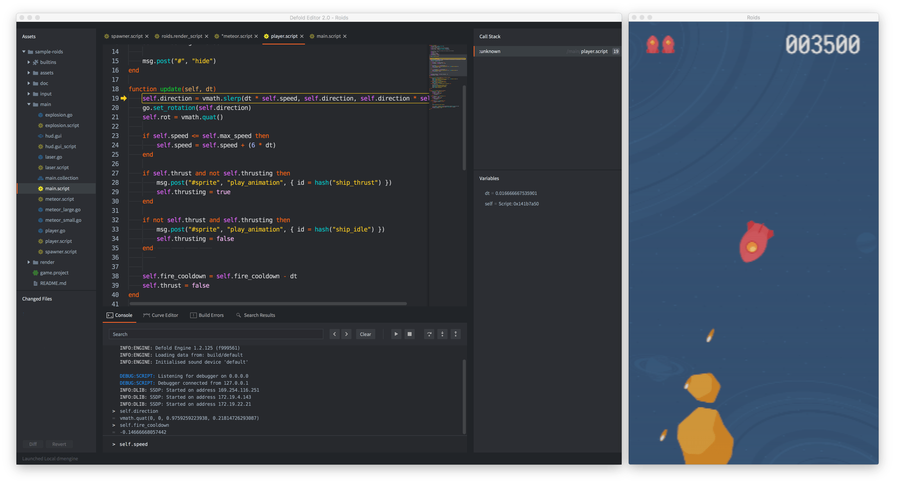
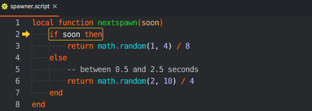
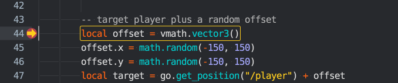
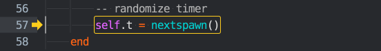
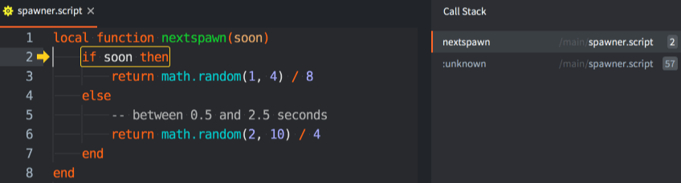
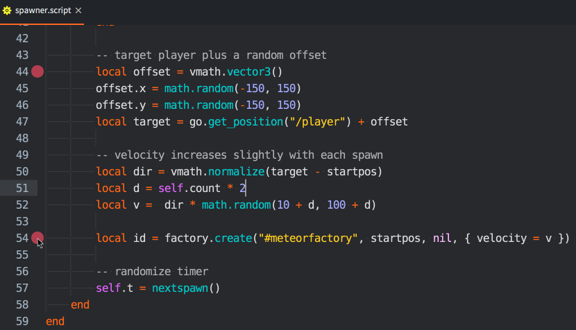
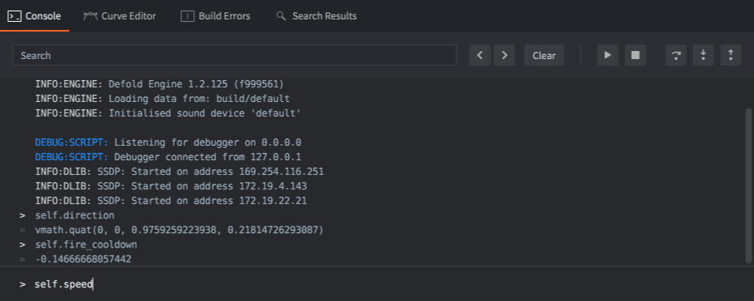
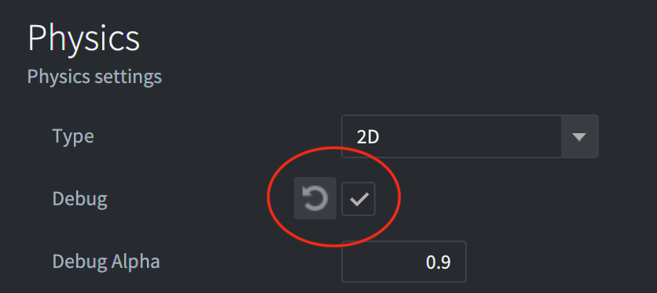
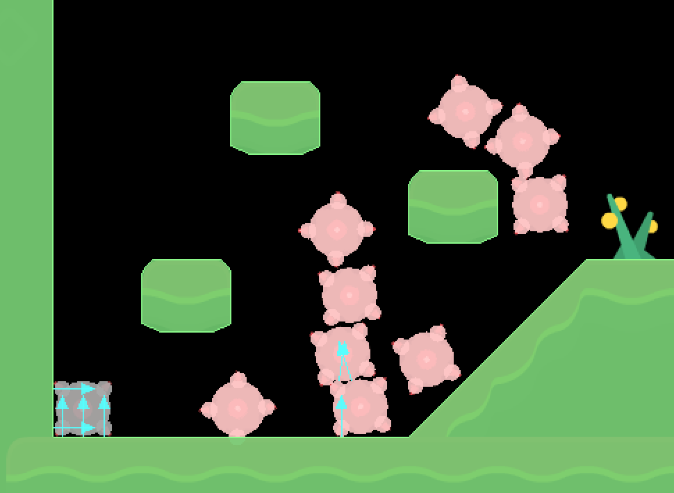

# 调试游戏逻辑 {#debugging-game-logic}

Defold 包含一个带有检查功能的集成 Lua 调试器。与内置的[分析工具](/manuals/profiling)一起，它是一个强大的工具，可以帮助您找到游戏逻辑中错误的原因或帮助分析性能问题。

## 打印和可视化调试 {#print-and-visual-debugging}

在 Defold 中调试游戏的最简单方法是使用[打印调试](http://en.wikipedia.org/wiki/Debugging#Techniques)。使用 `print()` 或 [`pprint()`](/ref/builtins#pprint) 语句来观察变量或指示执行流程。如果一个没有脚本的游戏对象表现异常，您可以只附加一个脚本，其唯一目的是调试。使用任何打印函数都会在编辑器的*控制台*视图和[游戏日志](/manuals/debugging-game-and-system-logs)中打印。

除了打印之外，引擎还可以在屏幕上绘制调试文本和直线。这是通过向 `@render` 套接字发布消息来完成的：

```lua
-- 在屏幕上用调试文本绘制 "my_val" 的值
msg.post("@render:", "draw_text", { text = "My value: " .. my_val, position = vmath.vector3(200, 200, 0) })

-- 在屏幕上绘制彩色文本
local color_green = vmath.vector4(0, 1, 0, 1)
msg.post("@render:", "draw_debug_text", { text = "Custom color", position = vmath.vector3(200, 180, 0), color = color_green })

-- 在屏幕上绘制玩家和敌人之间的调试线
local start_p = go.get_position("player")
local end_p = go.get_position("enemy")
local color_red = vmath.vector4(1, 0, 0, 1)
msg.post("@render:", "draw_line", { start_point = start_p, end_point = end_p, color = color_red })
```

可视化调试消息向渲染管线添加数据，并作为常规渲染管线的一部分进行绘制。

* `"draw_line"` 添加使用渲染脚本中的 `render.draw_debug3d()` 函数渲染的数据。
* `"draw_text"` 使用 `/builtins/fonts/debug/always_on_top.font` 字体渲染，该字体使用 `/builtins/fonts/debug/always_on_top_font.material` 材质。
* `"draw_debug_text"` 与 `"draw_text"` 相同，但它以自定义颜色渲染。

请注意，您可能希望每帧更新此数据，因此在 `update()` 函数中发布这些消息是个好主意。

## 运行调试器 {#running-the-debugger}

Lua 调试器可用于原生调试构建和无头构建。请使用与编辑器版本相同的 Defold 引擎。发布构建和 Web 构建不支持附加调试器。

选择 <kbd>Debug ▸ Start/Attach</kbd> 运行调试器。这会启动游戏并附加调试器，或者附加到正在运行的游戏。启动游戏进行调试时，编辑器会在启动脚本运行前设置已启用的断点，因此可以在启动前在 `init()` 中设置断点。

要附加到设备，请先在 <kbd>Project ▸ Targets</kbd> 下选择设备，再选择 <kbd>Debug ▸ Start/Attach</kbd>。附加后会在下一行 Lua 代码处暂停。编辑器会为支持的本地和远程目标自动建立调试器连接。连接要求请参阅[远程目标](#remote-targets)，或了解如何[连接外部调试器](#native-dap-connections)。



一旦调试器附加，您就可以通过控制台中的调试器控制按钮或通过 <kbd>Debug</kbd> 菜单控制游戏的执行：

Break
: {width=60px .left}
  在下一行源代码处暂停 Lua 执行。现在可以检查游戏状态、逐步执行游戏，或继续运行直到下一个断点。当前执行位置会标记在代码编辑器中：

  

Continue
: {width=60px .left}
  继续运行游戏。游戏代码将继续运行，直到您按下暂停或执行遇到您设置的断点。如果执行在设置的断点处中断，则执行点在代码编辑器中断点标记上方标记：

  

Stop
: {width=60px .left}
  停止调试器。按下此按钮将立即停止调试器，将其从游戏中断开并终止正在运行的游戏。

Step Over
: {width=60px .left}
  将程序执行推进一个步骤。如果执行涉及运行另一个 Lua 函数，执行_不会进入该函数_，而是继续运行并停止在函数调用下方的下一行。在此示例中，如果用户按下"step over"，调试器将执行代码并停止在调用 `nextspawn()` 函数的行下方的 `end` 语句处：

  

::: sidenote
单步执行遵循 Lua 源代码行。同一行可能被重复执行，例如循环再次迭代时，因此单步并不总是前进到文件中的下一行。
:::

Step Into
: {width=60px .left}
  将程序执行推进一个步骤。如果执行涉及运行另一个 Lua 函数，执行_将进入该函数_。调用该函数会在调用堆栈中添加一个条目。您可以单击调用堆栈列表中的每个条目来查看该闭包中的入口点和所有变量的内容。在这里，用户已经进入了 `nextspawn()` 函数：

  

Step Out
: {width=60px .left}
  继续执行直到从当前函数返回。如果您已经将执行步入一个函数，按下"step out"按钮将继续执行直到函数返回。

设置和清除断点
: 您可以在 Lua 代码中设置任意数量的断点。当游戏在附加了调试器的情况下运行时，它将在遇到的下一个断点处停止执行，并等待您的进一步交互。

  

  要设置或清除断点，请在代码编辑器中行号右侧的列中单击。您也可以从菜单中选择 <kbd>Edit ▸ Toggle Breakpoint</kbd>。

禁用和启用断点
: 可以临时禁用断点而不移除它们。禁用后，它们会在执行期间被忽略，但可以随时重新启用。在代码编辑器边栏中右键单击断点，然后切换 `Enabled` 复选框。禁用的断点会显示为空心状态，表示它们未激活。

  

设置条件断点
: 您可以将断点配置为包含需要评估为 true 才能触发断点的条件。该条件可以访问代码执行期间在该行可用的局部变量。

  

  要编辑断点条件，请在代码编辑器中行号右侧的列中右键单击，或从菜单中选择 <kbd>Edit ▸ Edit Breakpoint</kbd>。

评估 Lua 表达式
: 游戏暂停时，在 *Call Stack* 中选择一个栈帧，在控制台底部输入 Lua 表达式或语句，然后按 <kbd>Enter</kbd>。求值使用所选栈帧的局部变量、上值和全局变量。表类型的结果会包含其嵌套内容。

  

  您也可以通过赋值修改值，例如在可访问 `self` 的栈帧中执行 `self.score = 100`。求值的代码对游戏状态产生的影响，与游戏自身执行的代码相同。

检查变量
: 在 *Call Stack* 中选择栈帧，即可在 *Variables* 视图中检查其局部变量和上值。展开 `_G` 可检查全局变量，展开表或 `self` 可检查其字段。在单步执行、切换栈帧或求值后刷新时，编辑器会获取当前值，并保留展开路径、选择状态和滚动位置。

分离调试器
: 选择 <kbd>Debug ▸ Detach Debugger</kbd> 将调试器从游戏分离。游戏会立即继续运行。使用 <kbd>Debug ▸ Start/Attach</kbd> 可再次附加，无需重启游戏。

## 原生 DAP 连接 {#native-dap-connections}

引擎通过 TCP 提供原生调试适配器协议（DAP）服务器。使用外部 DAP 客户端时，先在原生 Defold 调试或无头引擎中启动监听器，再将客户端连接到引擎的地址和端口。使用 <kbd>Debug ▸ Start/Attach</kbd> 时，编辑器会自动设置监听器。

当前编辑器无法连接到仅支持 MobDebug 的旧引擎。当前版本不需要也不提供 `require "builtins.scripts.mobdebug"` 调用。

### 启动监听器 {#starting-the-listener}

先构建项目。在包含 `build/default/game.projectc` 的项目目录中，使用以下[启动配置覆盖项](/manuals/project-settings/#setting-config-values-on-engine-startup)运行原生调试引擎：

```sh
dmengine --config=debugger.enabled=1 \
  --config=debugger.port=8172 --config=debugger.wait=1
```

将 DAP 客户端连接到 `127.0.0.1:8172`。引擎会等待客户端配置断点后才运行启动脚本。

| 设置 | 默认值 | 用途 |
| --- | --- | --- |
| `debugger.enabled` | `0` | 设为 `1`，在引擎启动时启动监听器。 |
| `debugger.address` | `127.0.0.1` | 监听的 IPv4 地址。默认仅接受来自同一台计算机的连接。 |
| `debugger.port` | `8172` | TCP 监听端口。使用 `0` 选择可用端口。 |
| `debugger.wait` | `0` | 设为 `1`，在运行启动脚本前等待调试器客户端完成配置。 |

也可以将这些值添加到 [game.project 的 Debugger 部分](/manuals/project-settings/#debugger)。编辑器会为 <kbd>Debug ▸ Start/Attach</kbd> 自动配置监听器，因此仅在自行启动监听器时才需要手动配置。

引擎日志会报告所选地址和端口。使用 `debugger.wait=0` 时，游戏立即启动，您可以稍后附加。使用 `debugger.wait=1` 时，引擎会等待客户端完成会话配置（包括断点）。对于本地调试启动，编辑器会自动选择可用端口。

客户端断开连接后，执行会恢复，监听器仍可接受下次附加。在等待启动配置时断开连接也会让引擎继续运行。如果监听器无法启动，引擎会记录错误并继续启动；可以从 Lua 调用 `debugger.start(0)` 选择可用端口来重试。

### 在运行时启用监听器 {#enabling-the-listener-while-running}

要在不重启游戏的情况下从脚本启用监听器：

```lua
if debugger then
    local port = debugger.start(0)
    print("DAP listener port:", port)
end
```

`debugger.start([port [, address]])` 会立即返回监听端口，不等待客户端，也不暂停游戏。省略参数时使用 `debugger.port` 和 `debugger.address`；传入 `0` 则选择可用端口。重复调用会返回现有监听器的端口，不改变其地址或端口。`debugger` 模块由原生调试和无头引擎提供。

端口必须是 `0` 到 `65535` 之间的整数。仅覆盖地址时，将第一个参数设为 `nil`。参数无效或监听器绑定失败会引发 Lua 错误。

### 远程目标 {#remote-targets}

要从另一台计算机直接连接，请将监听器绑定到设备的 IPv4 接口或 `0.0.0.0`（所有 IPv4 接口）。例如，使用 `debugger.start(8172, "0.0.0.0")`，或在上述启动命令中加入 `--config=debugger.address=0.0.0.0`。将客户端连接到设备的实际 IP 地址，并允许访问该监听端口的 TCP 流量。`0.0.0.0` 是绑定地址，不是应在客户端中填写的地址。

Defold 编辑器会自动请求这种远程绑定，并对远程目标使用端口 `8172 + project.instance_index`。它无法发现动态选择的远程端口。如果您已经在 localhost 或其他端口启动远程监听器，请在从编辑器附加前重启引擎。

调试器可以执行 Lua 求值，且没有身份验证。仅在受信任的开发网络中启用远程访问。

### 外部客户端 {#external-clients}

请使用支持通过 TCP 直接附加到 DAP 服务器的客户端。将其源代码映射配置为包含 `game.project` 的目录（DAP 的 `localRoot` 附加参数）。先启动引擎监听器，再附加客户端。

#### VS Code

安装 [Lua Debug 扩展](https://marketplace.visualstudio.com/items?itemName=actboy168.lua-debug)（`actboy168.lua-debug`），在 VS Code 中打开包含 `game.project` 的目录，并将以下配置添加到 `.vscode/launch.json`：

```json
{
  "version": "0.2.0",
  "configurations": [
    {
      "name": "Attach to Defold Lua",
      "type": "lua",
      "request": "attach",
      "address": "127.0.0.1:8172",
      "debugServer": 8172,
      "localRoot": "${workspaceFolder}",
      "stopOnEntry": false
    }
  ]
}
```

如果 VS Code 将 `.script`、`.gui_script` 或 `.render_script` 文件作为纯文本打开，请先在状态栏的语言指示器中选择 **Lua**，再设置断点。

设置断点，例如在脚本的 `init()` 函数中。使用[上述启动命令](#starting-the-listener)启动引擎，然后在 VS Code 的 **Run and Debug** 视图中选择 **Attach to Defold Lua**。使用 `debugger.wait=1` 时，引擎会在客户端设置完断点后运行启动脚本。如果还希望在附加后的下一行 Lua 代码处暂停，请将 `stopOnEntry` 设为 `true`。

VS Code 的 [`debugServer` 设置](https://code.visualstudio.com/api/extension-guides/debugger-extension#development-setup-for-mock-debug)直接连接到引擎的本地 TCP 监听器。Lua Debug 扩展的附加配置要求填写 `address` 字段。如果改变监听端口，请同时更新这两个字段。`localRoot` 必须指向项目目录，以便客户端将引擎的 Lua 源代码名称映射到您的文件。

对于远程引擎，可以将其 DAP 端口转发到 localhost，并在这两个字段中填写转发端口；也可以使用直接连接远程主机的 DAP 客户端。

## 断点标签页 {#breakpoints-tab}

  

  当在多个脚本中使用多个断点时，Breakpoints 标签页提供了一个集中视图，可以在一个地方管理所有断点。

##### 单个断点控件 {#individual-breakpoint-controls}

  使用单个断点时：
  - 单击红色垃圾桶图标移除断点
  - 双击该行（条件区域之外）可跳转到代码视图中的对应行
  - 双击条件单元格或单击笔图标可编辑条件断点
  - 将鼠标悬停在条件单元格上时，单击 X 清除按钮可清除条件

##### 批量操作 {#batch-operations}

  使用 Ctrl/Cmd+单击或 Shift+单击选择多个断点，然后右键单击执行批量操作。您可以同时编辑多个断点的条件、切换它们的激活状态，或完全移除它们。

  工具栏按钮允许您一次启用、禁用或切换所有断点；当您想运行游戏而不中断、但又不想丢失断点位置时，这很有用。调试会话结束后也可以全部移除。

## Lua 调试库 {#lua-debug-library}

Lua 附带一个在某些情况下有用的调试库，特别是如果您需要检查 Lua 环境的内部。您可以在 [Lua 手册中关于调试库的章节](http://www.lua.org/pil/contents.html#23) 中找到更多相关信息。

## 调试检查清单 {#debugging-checklist}

如果您遇到错误或您的游戏行为不符合预期，这里有一个调试检查清单：

1. 检查控制台输出并验证没有运行时错误。

2. 向代码中添加 `print` 语句以验证代码确实在运行。

3. 如果代码没有运行，请检查您是否已在编辑器中完成了代码运行所需的正确设置。脚本是否添加到正确的游戏对象？您的脚本是否获取了输入焦点？输入触发器是否正确？着色器代码是否添加到材质？等等。

4. 如果您的代码依赖于变量的值（例如在 if 语句中），要么在使用或检查这些变量的位置 `print` 这些值，要么使用调试器检查它们。

有时查找错误可能是一个困难和耗时的过程，需要您逐位检查代码，检查所有内容并缩小有问题的代码范围并消除错误源。这最好通过称为"分而治之"的方法来完成：

1. 确定哪一半（或更少）的代码必须包含错误。
2. 再次确定那一半中的哪一半必须包含错误。
3. 继续缩小必须导致错误的代码范围，直到找到它为止。

祝您调试愉快！

## 调试物理问题 {#debugging-problems-with-physics}

如果您在物理方面遇到问题，碰撞没有按预期工作，建议启用物理调试。在 *game.project* 文件的 *Physics* 部分中勾选 *Debug* 复选框：



当此复选框启用时，Defold 将绘制所有碰撞形状和碰撞接触点：


