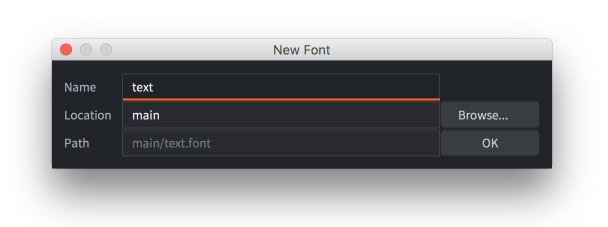
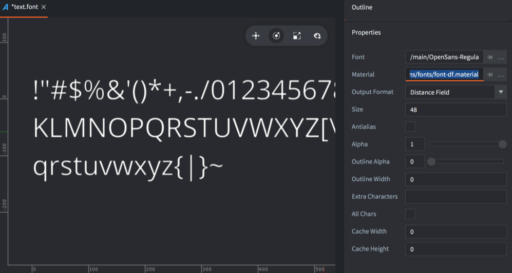
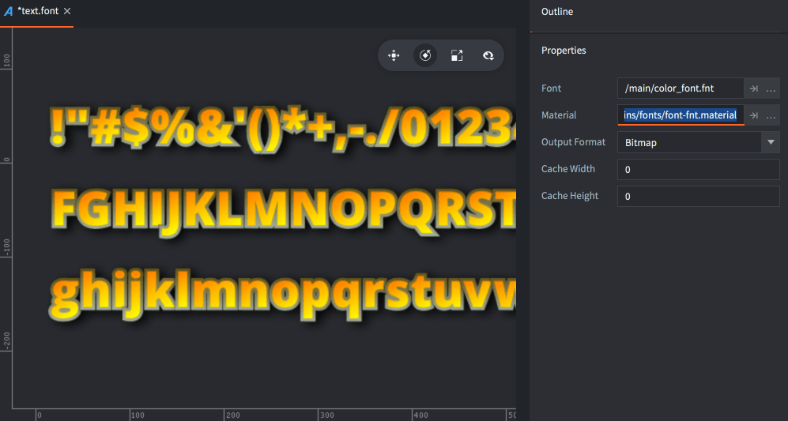
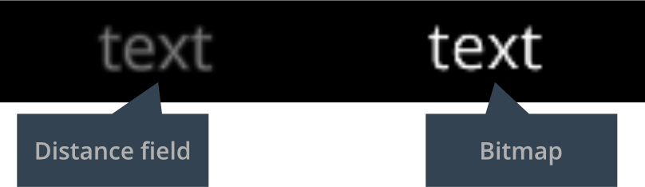

# 字体文件 {#font-files}

字体用于在标签组件和GUI文本节点上渲染文本。Defold支持多种字体文件格式：

- TrueType
- OpenType
- BMFont

旧版和完整文本布局引擎均支持 TrueType 轮廓及 OpenType CFF1/CFF2 轮廓，包括从 `.ttf` 和 `.otf` 资源进行运行时生成。

有关如何为单独的文本片段设置样式，以及使用链接和内嵌精灵，请参阅[富文本标记手册](/manuals/font-richtext)。

对于 TrueType 和 OpenType 字体，*Mode* 属性决定字形的渲染方式：

- **Bitmap** 使用栅格化的字形图像。
- **SDF**（有符号距离场）将到字形边缘的距离存储在纹理中，比 Bitmap 更适合缩放。
- **Vector** 根据曲线数据渲染字形表面，缩放时仍然保持清晰。轮廓和阴影效果仍使用位图数据。

新建字体资源采用 **Vector** 模式和 **Dynamic** 字形生成。现有字体资源保持其 Bitmap 或 SDF 模式。BMFont 源始终使用其提供的位图。

Vector 模式要求图形后端支持 `RGBA16F` 和 `R32UI` 纹理，不支持 OpenGL ES 2 或 WebGL 1。面向不支持的图形适配器时，请使用 Bitmap 或 SDF 字体及匹配的材质；Vector 不会自动回退到 SDF。设置方法请参阅[矢量字体](#vector-fonts)。

## 离线或运行时字体 {#offline-or-runtime-fonts}

*Glyph Generation* 属性决定每个字体的字形数据在何时生成：

- **Static** 在构建时（离线）生成所选字形。*Characters* 和 *All Chars* 控制包含哪些字形。不会将源 `.ttf` 或 `.otf` 文件打包用于运行时生成。
- **Dynamic** 将源 `.ttf` 或 `.otf` 文件打包，并在运行时按需生成字形。*Prewarm Text* 会在字体加载时准备字形。其他字形可以稍后按需生成。

SDF 和 Vector 字体支持这两种选择。Bitmap 字体和 BMFont 源使用 Static 生成。每个字体资源独立配置，因此项目可以混用 Static 和 Dynamic 字体。

动态生成可以减少包体大小和运行时内存占用，尤其适用于字符集较大的字体。它要求引擎包含完整文本布局系统；请参阅[启用运行时字体](#enabling-runtime-fonts)。

## 文本布局支持（例如从右到左） {#text-layout-support-eg-right-to-left}

运行时字体还支持完整文本布局，例如从右到左。
我们目前使用 [HarfBuzz](https://github.com/harfbuzz/harfbuzz)、[SheenBidi](https://github.com/Tehreer/SheenBidi)、[libunibreak](https://github.com/adah1972/libunibreak) 和 [SkriBidi](https://github.com/memononen/Skribidi) 这些库。

参见[启用运行时字体](/manuals/font#enabling-runtime-fonts)

编辑器使用引擎的字体渲染器预览字体和场景中的文本。文本塑形和从右到左的布局需要[运行时字体](#enabling-runtime-fonts)，并启用 App Manifest 中的 **Use full text layout system** 选项。对于离线字体，预览会遵循字体的 **Characters** 和 **All Chars** 设置。

## 字体集合 {#font-collection}

`.fontc` 文件格式也称为字体集合。在离线模式下，它只关联一个字体。
使用运行时字体时，可以将多个字体文件（`.ttf` 或 `.otf`）关联到字体集合。

这允许在渲染多种语言的文本时使用一个字体集合，同时保持较低的内存占用。
例如，加载包含日文字体的集合，然后将该字体关联到当前主字体，再卸载日文字体集合。

## 创建字体 {#creating-a-font}

要在Defold中创建字体，请从菜单中选择<kbd>文件 ▸ 新建...</kbd>，然后选择<kbd>字体</kbd>。您也可以在*资源*浏览器中<kbd>右键点击</kbd>一个位置，然后选择<kbd>新建... ▸ 字体</kbd>。



给新字体文件命名并点击<kbd>确定</kbd>。新字体文件现在在编辑器中打开。

将您想要使用的字体拖放到*资源*浏览器中，并将其放在合适的位置。

将 *Font* 属性设为字体文件。对于 `.ttf` 或 `.otf` 源，选择 *Mode* 和 *Glyph Generation*，再按需配置其余属性。动态生成还需要完成[运行时字体设置](#enabling-runtime-fonts)。


对于 Vector 字体，使用标签组件或 GUI 文本节点上的 *Font Size* 改变显示文本大小。*Outline/Shadow Bitmap Size* 单独控制效果位图的分辨率，不受显示文本大小影响。

对于 Bitmap 和 SDF 字体，在字体资源中设置 *Size* 来选择生成的字形大小。BMFont 的大小来自源 `.fnt` 文件。要改变这些字体的显示大小，请缩放标签组件或 GUI 文本节点。

## 属性 {#properties}

*字体*
: 用于生成字体数据的TTF、OTF或*`.fnt`*文件。

*材质*
: 渲染该字体时使用的材质。必须与字体模式匹配；请参阅[字体材质](#font-materials)。

*Mode*
: `.ttf` 或 `.otf` 源的渲染技术：**Bitmap**、**SDF** 或 **Vector**。此属性替代原来的 *Output Format*。BMFont 源不显示此属性。

*Glyph Generation*
: **Static** 在构建时生成字形数据。**Dynamic** 在运行时生成，并要求[完整文本布局系统](#enabling-runtime-fonts)。SDF 和 Vector 字体可以设置此属性。Bitmap 模式固定为 Static；BMFont 源不显示此属性。

*渲染模式*
: 生成的 Bitmap 字体的图层排列方式。仅在 `.ttf` 和 `.otf` 源的 Bitmap 模式下显示。对于 SDF、Vector 和 BMFont 源，Defold 自动选择图层排列方式。

  - **Single Layer** 为每个字符生成一个四边形。
  - **Multi Layer** 为字形形状、轮廓和阴影分别生成四边形。各层从后向前渲染，避免轮廓宽于字形间距时，字符遮挡此前渲染的字符。这也启用了 *Shadow X/Y* 属性指定的阴影偏移。

*大小*
: 生成 Bitmap 或 SDF 字体数据时使用的字形像素大小。对于 BMFont 源，大小从 `.fnt` 文件读取，无法在此编辑。

*Outline/Shadow Bitmap Size*
: 在 Vector 模式下，此属性替代 *Size*。它控制 Static 和 Dynamic 生成中已启用的轮廓和阴影效果的位图分辨率。两种效果都未启用时，此属性禁用，因为字形表面使用曲线数据。改变标签或 GUI 文本节点的 *Font Size* 不会改变这个共享的位图分辨率。

*抗锯齿*
: 生成 Bitmap 字体数据时是否对字形进行抗锯齿。像素精确渲染请禁用此项。仅在 `.ttf` 和 `.otf` 源的 Bitmap 模式下显示。

*透明度*
: 字形的透明度。0.0--1.0，其中0.0表示透明，1.0表示不透明。

*轮廓透明度*
: 生成的轮廓的透明度。0.0--1.0。

*轮廓宽度*
: 生成的轮廓的宽度，以像素为单位。设置为0表示无轮廓。

*阴影透明度*
: 生成的阴影的透明度。0.0--1.0。

::: sidenote
内置 Bitmap 字体着色器在 *Single Layer* 和 *Multi Layer* 渲染模式下均支持阴影。对于使用 *Single Layer* 渲染且不需要阴影的生成式 Bitmap 字体，自定义材质可以使用 `/builtins/fonts/font-singlelayer.fp`。SDF 和 Vector 字体需要匹配其模式的着色器；请参阅[字体材质](#font-materials)。
:::

*阴影模糊*
: 应用于生成阴影的模糊程度。设为 0 可得到清晰的阴影。

*阴影X/Y*
: 生成阴影的水平和垂直像素偏移。对于生成式 Bitmap 字体，请使用 *Multi Layer* 渲染模式应用这些偏移。Defold 会为 SDF 和 Vector 字体自动选择适合的图层。

*字符*
: Static 生成时，构建的字体所包含的字符。此字段默认包含 ASCII 可打印字符（字符代码 32-126）。通过添加或移除字符，控制运行时可用的字形。

*Prewarm Text*
: Dynamic 生成时，此属性替代 *Characters*。字体加载时，使用此文本生成字形并预热缓存。它不限制之后可以生成哪些字符。也可以从脚本使用 [`font.prewarm_text()`](/ref/font/#font.prewarm_text) 预热文本。

::: sidenote
ASCII可打印字符是：
space ! " # $ % & ' ( ) * + , - . / 0 1 2 3 4 5 6 7 8 9 : ; < = > ? @ A B C D E F G H I J K L M N O P Q R S T U V W X Y Z [ \ ] ^ _ \` a b c d e f g h i j k l m n o p q r s t u v w x y z { | } ~
:::

*所有字符*
: Static 生成时，包含源字体中所有可用字形，而不只限于 *Characters*。Dynamic 字体会隐藏此属性。

*缓存宽度/高度*
: 限制 Bitmap 和 SDF 字体以及 Vector 轮廓、阴影效果使用的字形缓存位图大小。引擎渲染文本时会在缓存位图中查找字形。如果不存在，就会在渲染前将其加入缓存。如果缓存位图太小，无法容纳所有需要渲染的字形，则会报错（`ERROR:RENDER: Out of available cache cells! Consider increasing cache_width or cache_height for the font.`）。

  如果设置为0，缓存大小将自动设置，最大增长到2048x4096。

## 字体材质 {#font-materials}

请使用与字体模式匹配的材质。GUI 文本节点使用字体资源的 *Material*。标签组件有独立的 *Material* 属性，也必须与字体匹配：

| 字体模式或源 | GUI 文本的字体材质 | 标签组件材质 |
| --- | --- | --- |
| Bitmap | `/builtins/fonts/font.material` | `/builtins/fonts/label.material` |
| SDF | `/builtins/fonts/font-df.material` | `/builtins/fonts/label-df.material` |
| Vector | `/builtins/fonts/font-vector.material` | `/builtins/fonts/label-vector.material` |
| BMFont (`.fnt`) | `/builtins/fonts/font-fnt.material` | `/builtins/fonts/label-fnt.material` |

如果字体已使用相应的内置 Bitmap、SDF 或 Vector 材质，在字体编辑器中改变 *Mode* 会切换到匹配的内置材质。自定义材质不会自动替换。还应检查使用该字体的所有标签组件的 *Material* 属性。

## 矢量字体 {#vector-fonts}

矢量字体根据曲线渲染字形表面，因此显示文本大小改变时仍然保持清晰。要设置在运行时生成字形的字体：

1. 创建 `.font` 资源，例如 `/fonts/ui.font`，并在其 *Font* 属性中选择 TrueType 或 OpenType 源。普通文本可以使用内置的 `/builtins/fonts/vera_mo_bd.ttf`。
2. 将 *Mode* 设为 **Vector**，*Glyph Generation* 设为 **Dynamic**，*Material* 设为 `/builtins/fonts/font-vector.material`。这些是新建字体资源的默认值。
3. 在指定给项目的 App Manifest 中启用 **Use full text layout system**。按照[启用运行时字体](#enabling-runtime-fonts)配置自定义引擎。
4. 在 *game.project* 中启用 [Shader ▸ Exclude GLES 2.0](/manuals/project-settings/#exclude-gles-20)。
5. 将字体分配给[标签](/manuals/label/)，或将其添加到 GUI 场景的 *Fonts* 并在[文本节点](/manuals/gui-text/)上选择它。对于标签，还需将组件的 *Material* 设为 `/builtins/fonts/label-vector.material`。将组件或节点的 *Font Size* 设为所需的显示大小。

Vector 字形表面使用曲线纹理，但已启用的轮廓和阴影仍会生成 SDF 位图数据并占用字形缓存纹理内存。*Outline/Shadow Bitmap Size* 设置此位图分辨率，与标签或 GUI 文本节点的 *Font Size* 无关。不需要这些效果时，将 *Outline Alpha* 和 *Shadow Alpha* 设为 `0`，可避免生成相应的位图数据。

### 彩色表情符号 {#color-emoji}

Vector 字体可以渲染 COLRv1 彩色表情符号，包括调色板颜色、线性渐变和径向渐变。Bitmap 和 SDF 模式不渲染 COLRv1 颜色。先按上述方法设置 Dynamic Vector 字体，再将 COLRv1 表情符号字体作为后备字体添加到字体集合。普通文本继续使用原来的字体。

例如，将 COLRv1 [Noto Color Emoji 字体](https://github.com/google/fonts/blob/main/ofl/notocoloremoji/NotoColorEmoji-Regular.ttf)复制到项目中，保存为 `/fonts/NotoColorEmoji-Regular.ttf`。请选择 COLRv1 版本：其他表情符号字体即使文件名以 `.ttf` 结尾，也可能使用不同的颜色格式。

在 *game.project* 的 **Project ▸ Custom Resources** 中追加 `/fonts/NotoColorEmoji-Regular.ttf`。没有其他自定义资源时，设置如下：

```ini
[project]
custom_resources = /fonts/NotoColorEmoji-Regular.ttf
```

在 Lua 中写出字体路径不会使字体文件自动被打包。[Custom Resources](/manuals/project-settings/#custom-resources) 使这个源字体可供 [`font.add_font()`](/ref/font/#font.add_font) 使用，后者通过资源系统加载它。从包中加载时，请传入源字体的字符串路径。

每个共享字体资源只需添加一次后备字体。此变化会影响使用该字体的所有标签和 GUI 文本节点，重复添加相同后备字体会引发错误。如果[标签示例](/manuals/label/#vector-fonts-and-color-emoji)和 [GUI 示例](/manuals/gui-text/#vector-fonts-and-color-emoji)共用同一个 `.font`，请协调初始化，在任一示例预热或显示文本前只添加一次后备字体。这些示例会在添加后备字体后预热完整文本，并在回调成功时显示。

## 距离场字体 {#distance-field-fonts}

距离场字体在纹理中存储到字形边缘的距离，而不是位图数据。当引擎渲染字体时，需要特殊的着色器来解释距离数据并使用它来绘制字形。距离场字体比位图字体更消耗资源，但允许更大的尺寸灵活性。



在 *Mode* 中选择 **SDF**，并在 *Glyph Generation* 中选择 **Static** 或 **Dynamic**。字体使用 *`/builtins/fonts/font-df.material`*，标签组件使用 *`/builtins/fonts/label-df.material`*，或使用能处理距离场数据的自定义材质。

## 位图BMFonts {#bitmap-bmfonts}

除了生成的位图外，Defold还支持预烘焙的位图"BMFont"格式字体。这些字体由包含所有字形的PNG字体表组成。此外，*`.fnt`*文件包含有关在表上可以找到每个字形的位置以及大小和字距调整信息的信息。（请注意，Defold不支持Phaser和其他一些工具使用的*`.fnt`*格式的XML版本）

这些类型的字体与从TrueType或OpenType字体文件生成的位图字体相比没有性能改进，但可以在图像中直接包含任意图形、颜色和阴影。

将生成的 *`.fnt`* 和 *`.png`* 文件添加到 Defold 项目中，并放在同一目录。创建新字体文件，将 *Font* 属性设为 *`.fnt`* 文件。Defold 使用所提供的位图，并从 `.fnt` 文件读取大小。BMFont 源不显示 *Mode* 和 *Glyph Generation*。

::: sidenote
要创建BMFont，您需要使用能够生成适当文件的工具。存在几个选项：

* [Bitmap Font Generator](http://www.angelcode.com/products/bmfont/)，AngelCode提供的仅限Windows的工具。
* [Shoebox](http://renderhjs.net/shoebox/)，免费的基于Adobe Air的应用程序，适用于Windows和macOS。
* [Hiero](https://libgdx.com/wiki/tools/hiero)，基于Java的开源工具。
* [Glyph Designer](https://71squared.com/glyphdesigner)，71 Squared的商业macOS工具。
* [bmGlyph](https://www.bmglyph.com)，Sovapps的商业macOS工具。
:::



将字体的 *Material* 设为 *`/builtins/fonts/font-fnt.material`*。标签组件使用 *`/builtins/fonts/label-fnt.material`*。

## 伪影和最佳实践 {#artifacts-and-best-practices}

通常，当字体在没有缩放的情况下渲染时，位图字体是最好的。它们比距离场字体渲染到屏幕的速度更快。

距离场字体对放大效果非常好。另一方面，位图字体只是像素化图像，随着字体缩放，大小会增加，像素会增长，导致块状伪影。以下是字体大小48像素，放大4倍的示例：


缩小时，位图纹理可以被GPU很好地有效地缩小和抗锯齿。位图字体比距离场字体更好地保持其颜色。以下是相同示例字体在48像素大小下的放大视图，缩小到原始大小的1/5：



距离场字体需要渲染到足够大的目标大小，以保存能够表达字体字形曲线的距离信息。这是与上面相同的字体，但在18像素大小下放大10倍。很明显，这太小而无法编码这种字体的形状：


如果不需要阴影或轮廓支持，将相应的 alpha 值设为零。否则仍会生成阴影和轮廓数据，占用不必要的内存。在 Vector 模式下，禁用这两种效果可避免生成其位图数据；字形表面仍使用曲线数据。

## 字体缓存 {#font-cache}
Bitmap 和 SDF 字体资源在运行时使用字形缓存纹理和字体数据。Vector 字体将字形表面存储为曲线数据，并为已启用的轮廓和阴影效果使用位图缓存。下文描述的纹理布局适用于 Bitmap 和 SDF 字体。

* 字体数据由字形条目列表组成，每个条目包含一些基本的字距调整信息和该字形的位图数据。
* 纹理在内部称为"字形缓存纹理"，它将在为特定字体渲染文本时使用。

在运行时渲染文本时，引擎将首先循环遍历要渲染的字形，以检查纹理缓存中有哪些字形可用。字形纹理缓存中缺少的每个字形都将触发从字体数据中存储的位图数据进行纹理上传。

每个字形根据字体基线在内部放置在缓存中，这使得能够在着色器中计算字形在其相应缓存单元内的局部纹理坐标。这意味着您可以动态实现某些文本效果，如渐变或纹理叠加。引擎通过一个名为`texture_size_recip`的特殊着色器常量将缓存的度量标准暴露给着色器，该常量在向量组件中包含以下信息：

* `texture_size_recip.x` 是缓存宽度的倒数
* `texture_size_recip.y` 是缓存高度的倒数
* `texture_size_recip.z` 是缓存单元宽度与缓存宽度的比率
* `texture_size_recip.w` 是缓存单元高度与缓存高度的比率

例如 - 要在着色器片段中生成渐变，只需编写：

`float horizontal_gradient = fract(var_texcoord0.y / texture_size_recip.w);`

有关着色器uniform的更多信息，请参阅[着色器手册](/manuals/shader)。

## 启用运行时字体 {#enabling-runtime-fonts}

运行时生成按字体资源分别配置：

1. 打开 `.font` 资源，选择 TrueType（`.ttf`）或 OpenType（`.otf`）源。
2. 将 *Mode* 设为 **SDF** 或 **Vector**，*Glyph Generation* 设为 **Dynamic**。
3. 选择匹配的[字体和标签材质](#font-materials)。
4. 添加 [App Manifest](/manuals/app-manifest)，在 *game.project* 的 *Native Extensions ▸ App Manifest* 中指定它，并启用 **Use full text layout system**。这会构建支持运行时字体生成和完整文本布局的自定义引擎。
5. 将 *Prewarm Text* 设为字体加载后即将显示的文本。对于稍后需要的文本，使用 [`font.prewarm_text()`](/ref/font/#font.prewarm_text)，并等待其回调后再显示。

新建字体资源已采用 Vector 模式和 Dynamic 生成，但仍需要上述 App Manifest 配置。

### 字体脚本 {#font-scripting}

#### 预热字形缓存 {#prewarming-glyph-cache}

Dynamic 字体会在加载时生成 *Prewarm Text* 所需的字形。该字段被当作待布局的文本，因此缓存会准备文本需要的字形。Dynamic 字体不提供 *All Chars*。

也可以对 Dynamic 字体调用 `font.prewarm_text(font_collection, text, callback)`。回调会告知您所有缺失字形都已加入缓存，可以安全显示文本。此函数不能用于 Static 字体。

### 向字体集合添加/移除字体 {#addingremoving-fonts-to-a-font-collection}

对于 Dynamic 字体，可以向字体集合添加或移除源字体（`.ttf` 或 `.otf`）。
当大字体已被拆分为多个文件用于不同字符集时（例如CJK），这很有用。

::: important
向字体集合添加字体不会自动加载或渲染所有字形。
:::

```lua
function init(self)
    -- 获取目标字体集合。
    self.font_collection = go.get("#label", "font")

    -- 获取分配给所选语言字体集合的第一个字体。
    local language_collection = go.get("localization_japanese#label", "font")
    local font_info = font.get_info(language_collection)
    self.language_ttf_hash = font_info.fonts[1].path_hash

    -- 将其关联到目标集合，并增加引用计数。
    font.add_font(self.font_collection, self.language_ttf_hash)
end
```

```lua
function final(self)
    -- 移除关联并释放字体引用。
    font.remove_font(self.font_collection, self.language_ttf_hash)
end
```

### 预热字形 {#prewarming-glyphs}

要正确显示运行时字体的文本，需要解析字形。`font.prewarm_text()` 会为您完成这件事。
这是一个异步操作，完成并收到回调后，就可以安全地继续显示包含这些字形的任何消息。

::: important
如果字形缓存已满，缓存中最旧的字形会被逐出。
:::

```lua
font.prewarm_text(self.font_collection, info.text, function (self, request_id, result, err)
    if result then
      print("PREWARMING OK!")
      go.set(self.label, "text", info.text)
    else
      print("Error prewarming text:", err)
    end
  end)
```
