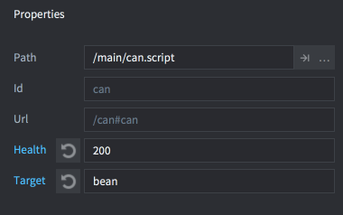

# 面向 Godot 用户的 Defold {#defold-for-godot-users}

如果你用过 Godot，制作 Defold 游戏所需的许多知识你已经掌握了。本指南介绍如何利用这些经验在 Defold 中快速上手，也会指出两个引擎的不同之处，帮助你避开常见的误区。本文使用的 Godot 版本为 4.7。

## 简介 {#introduction}

Defold 是一款免费的跨平台游戏引擎，可用于制作 2D 和 3D 游戏，编辑器支持 Windows、Linux 和 macOS。引擎和编辑器的完整源代码都可以在 [GitHub](https://github.com/defold/defold/) 上找到。你可以自行构建，也可以下载适用于你操作系统的版本。

乍看之下，Defold 和 Godot 很相似。两者都允许你用可复用的单元搭建游戏，再通过脚本添加行为。Godot 提供了许多各有专长的节点。Defold 的组件种类较少，适用范围更广，具体的游戏行为由 Lua 脚本和模块实现。例如，在 Defold 中，一个玩家角色可以是一个游戏对象，包含精灵或模型、碰撞对象和脚本几个组件。

Defold 注重减小运行时体积并高效利用资源，这对网页游戏和移动游戏尤为有用。引擎的一些容量上限需要预先设置，以便提前分配内存。

与 Godot 相比，Defold 中现成的游戏机制和界面元素可能少一些，但你可以组合或扩展底层组件来实现同样的效果。Defold 尽可能让核心引擎保持轻量。你可以剔除不需要的功能以进一步缩小体积，也可以通过原生扩展和 Lua 模块扩充功能。[Defold 资源门户](https://defold.com/assets/)提供了数百个模块、库和扩展，可以帮助你构建复杂的用户界面和更高级的渲染管线，也可以简化开发中的某些工作。

更多 Defold 功能详见[产品介绍](https://defold.com/product/)。

## 安装 {#installation}

1. 从[下载页面](https://defold.com/download/)下载适用于你操作系统的 Defold。
2. 解压并启动编辑器。

你可以直接创建并运行第一个项目，无需单独安装启动器或导出模板。各平台的具体说明见[安装手册](/manuals/install/)。

Defold 可以直接在编辑器中更新。升级已有项目时，请查看发行说明，并在目标平台上测试游戏。

## 欢迎界面 {#welcome-screen}

启动 Defold 后，你可以在欢迎界面打开最近的项目或新建项目。这个界面的用途类似于 Godot 的项目管理器。


在 Defold 中创建新项目时，可以选择以下入口：

- **Templates** 提供基础空项目和面向特定平台的项目模板。
- **Tutorials** 提供带有操作指引的入门项目。
- **Samples** 提供可以直接运行和探索的示例与起步项目。


Defold 的 Samples 中包含起步项目和示例，类似于 Godot 资源商店里的入门套件和示例：


:[Hello World](../shared/hello-world.md)

---

## Defold 编辑器概览 {#defold-editor-overview}

尽管名称和位置有所不同，主要面板应该都很眼熟。为了方便对照，我们调整了 Godot 编辑器的面板，使其布局接近 Defold 的默认布局：


| Godot | Defold | Defold 编辑器中的用途 |
|---|---|---|
| FileSystem 面板 | Assets | 管理项目中的文件和文件夹，与磁盘上的项目目录一一对应。 |
| 2D/3D 视图和资源编辑器 | 主编辑区 | 根据打开的文件显示集合、GUI、图集、脚本等内容。可拆分为两个面板。 |
| Scene 面板 | Outline | 显示当前资源的结构，不代表运行时的全局场景树。 |
| Inspector | Properties | 显示所选对象、组件或资源的属性。 |
| Output 和 Debugger | Tools | 包含 Console、Build Errors、Search Results 和调试器。 |
| 版本控制集成 | Changed Files | 在使用 Git 的项目中显示文件变更。 |

Defold 的 3D 编辑器右上角还有一个工具栏，详见[场景编辑手册](/manuals/scene-editing/#toolbar-overview)。

### 2D 和 3D 场景方向 {#2d-and-3d-scene-orientation}

:[2D 和 3D 场景方向](../shared/2d-and-3d-scene-orientation.md)

### 面板 {#panes}

Defold 的面板不能分离成独立窗口，但可以拖动边缘来调整大小。你也可以用 `F6`、`F7` 和 `F8` 切换面板的可见性，或在 `View` 菜单中操作：


### 坐标 {#coordinates}

在 2D 项目中，如果使用默认渲染脚本，集合里也没有相机组件，坐标 `(0, 0)` 就位于游戏窗口左下角，Y 轴正方向**向上**，X 轴正方向向右。

在 Godot 常用的 2D 屏幕坐标系中，Y 轴正方向**向下**。移植位置数据或移动代码时，需要留意这一差异。


在 Godot 的 3D 坐标系中，Y 轴正方向向上，与 Defold 相同。Defold 的 2D 和 3D 游戏共用同一个三维坐标系。典型的 2D 游戏使用 XY 平面和正交投影，也可以按需调整相机配置。


有关 Defold 编辑器的更多细节，请参阅[编辑器概览手册](/manuals/editor/)。

---

## 关键概念 {#key-concepts}

在 Godot 中，你用节点构建**场景**。在 Defold 中，你使用组件、游戏对象以及由游戏对象组成的集合来构建游戏。

例如，在 Godot 中，你可以用一个 `Node2D` 节点和一个 `Sprite2D` 子节点搭建玩家角色，把脚本挂在根节点上，然后把角色放入第一个 `Scene`。
在 Defold 中，你可以创建一个包含 `Sprite` 和 `Script` 组件的游戏对象来表示玩家，再将它放入集合中。


有关这些概念的详细说明，请参阅[构建块手册](/manuals/building-blocks/)。

### 游戏对象 {#game-objects}

在 Defold 中，**游戏对象**是容纳组件的*容器*，它提供：

- **标识**
- **变换**（位置、旋转、缩放）

游戏对象的作用类似于 Godot 中的 `Node2D` 或 `Node3D`。Defold 没有单独的 2D 游戏对象类型。所有游戏对象都使用 3D 变换，包括 2D 游戏中的对象。

在 Defold 中，你可以把一个游戏对象设为另一个的子对象，让它继承父对象的变换。你既可以在集合中安排父子关系，也可以在运行时修改。更改父对象不会改变游戏对象的地址。

在集合中，你可以直接在 `.collection` 文件里定义**嵌入式**游戏对象，也可以引用可复用的 `.go` 原型来添加对象。编辑嵌入式对象的定义只会修改该集合，不会影响其他独立定义的对象。修改 `.go` 原型会更新引用它的实例，但实例单独覆盖的属性除外。多个对象（包括嵌入式对象）也可以引用同一份组件资源，因此编辑这类资源可能会影响其他使用它的对象。如果集合本身被复用，修改其中的嵌入式对象后，所有引用该集合的地方都会体现出变化。

### 组件 {#components}

组件是各有专门用途的构建块，可以为游戏对象提供外观、物理、音频或行为等功能。

例如，给游戏对象添加 `Sprite` 组件以显示图像，添加 `Sound` 组件以播放音频，或添加 `Script` 组件以运行 Lua 代码。

组件属于游戏对象，组件本身不能包含子组件。要构建层级结构，可以在集合中将游戏对象设为另一个游戏对象的子对象。

你也不能像在 Godot 中那样，通过附加脚本来修改组件的行为。你可以在 Properties 中调整组件，也可以像使用 GDExtension 一样，通过原生扩展创建自定义组件。Defold 自定义组件的例子有官方提供的 [Rive](https://github.com/defold/extension-rive) 和 [Spine](https://github.com/defold/extension-spine)，以及社区提供的 [Sprite Loop](https://github.com/Balkan-Ram-Games/spriteloop-defold) 和 [Object Interpolation](https://github.com/indiesoftby/defold-object-interpolation)。

在 Defold 中，脚本本身是一个独立组件，可以添加到任何游戏对象上。同一个游戏对象可以装有多个组件，也可以装有多个脚本。

组件之间没有嵌套关系，又与自定义脚本解耦，因此 Defold 可以采用面向数据的设计，在内存中紧凑、高效地存放组件。

| Godot 节点 | Defold 组件 | 说明 |
|---|---|---|
| `Sprite2D` / `AnimatedSprite2D` | [精灵](/manuals/sprite/) | 使用图集（一张包含多幅图像的纹理）或瓦片图源渲染 2D 纹理和翻页动画。 |
| `Area2D` / `RigidBody2D` / `StaticBody2D` 及其 3D 对应类型 | [碰撞对象](/manuals/physics-objects/) | 处理物理和触发器。碰撞形状直接定义在组件内部，无需创建独立的子节点。可选类型包括静态、动态、运动学和触发器。 |
| 挂在节点上的 `.gd` 脚本 | Script | 通过 Lua 代码实现游戏逻辑、处理输入，并控制其他组件和游戏对象。 |
| `TileMapLayer` | [瓦片地图](/manuals/tilemap/) | 使用瓦片图源和瓦片地图图层渲染网格地图。 |
| `Label` | [GUI 文本节点](/manuals/gui-text/) | 在界面中用 GUI 文本显示文字。在游戏世界中显示文字时，使用[标签组件](/manuals/label/)。 |
| `AudioStreamPlayer` | [声音](/manuals/sound/) | 播放音频。可设置 Speed（速度）、Pan（声像）和 Gain（增益）。 |
| `Camera2D` / `Camera3D` | [相机](/manuals/camera/) | 支持正交和透视投影。 |
| `Control` 节点层级 / `CanvasLayer` | [GUI](/manuals/gui/) | Defold 的 GUI 组件有独立的节点层级（如 Box、Text、Pie），并使用专门的 `.gui_script` 处理界面逻辑。 |
| `MeshInstance3D` | [模型](/manuals/model/)或[网格](/manuals/mesh/) | 模型组件支持导入的 3D 内容，网格组件支持使用缓冲区数据定义的自定义几何体。 |
| `CPUParticles2D` / `GPUParticles2D` 及其 3D 对应类型 | [粒子特效](/manuals/particlefx/) | 发射在 Defold 粒子编辑器中配置的 2D 或 3D 粒子。 |
| `PackedScene.instantiate()` | Factory / Collection Factory | Defold 分别使用这两种组件指定运行时可以生成的游戏对象或集合。 |

### 集合与世界 {#collections-and-worlds}

**集合**描述游戏对象、它们的组件以及对象之间的父子关系。在一个集合中包含另一个集合，就可以复用一组对象，类似于 Godot 的嵌套场景。Defold 没有 Godot 那样通用的场景继承机制。你可以复用原型和集合，再通过属性或脚本定制实例。

集合文件本身并不是运行时实体。运行时没有一个可供调用方法的集合对象，也没有表示集合本身的根节点。集合文件保存的是定义，引擎根据这些定义在运行时创建游戏对象、组件及其层级结构。

Defold 启动游戏时会读取 `game.project` 文件，加载其中 **Bootstrap ▸ Main Collection** 指定的第一个集合，由此建立初始游戏世界。嵌套集合中的对象也会成为这个世界的一部分。

**集合工厂（Collection Factory）** 会在工厂所在的**现有世界**中实例化一组游戏对象及其组件。

**集合代理（Collection Proxy）** 会加载一个独立的集合，创建一个拥有自己地址命名空间和物理模拟的**新世界**。生成一个需要与当前关卡地形互动的敌人，与加载一个全新的关卡（可能需要异步加载），适用的组件不同。下文会分别介绍这两种操作。

Godot 在实例化和切换场景时都使用 `PackedScene`。用 `SceneTree` 切换场景，类似于在 Defold 中用集合代理加载一个独立的世界。

下表汇总了这些概念：

| Godot | Defold | 说明 |
|---|---|---|
| 带子节点的 `Node3D` | 带组件的游戏对象 | 组件提供功能和行为，游戏对象提供变换和标识。 |
| `Node2D` / `Node3D` 的变换 | 游戏对象的变换 | 每个游戏对象都自带变换。 |
| 场景 / `PackedScene` | 游戏对象原型（`.go`）或集合（`.collection`） | 原型描述一个对象。集合描述一组对象及其层级关系。 |
| `PackedScene.instantiate()` | 工厂或集合工厂 | 在当前世界创建单个或一组游戏对象，并返回它们的标识符。 |
| 使用 `SceneTree` 和 `PackedScene.instantiate()` 切换场景 | 集合代理 | 加载并创建一个独立的新世界，在其中生成游戏对象。 |

---

## 代码编写 {#code-writing}

Defold 编辑器自带文本编辑器，可以编辑所有文本文件和脚本。它支持自动补全、代码格式化、Structure 视图（显示数据与函数的结构）等功能。详见[使用内置代码编辑器](/manuals/writing-code/#using-the-built-in-code-editor)。

你也可以在外部编辑器中打开 Defold 的所有文本文件和脚本。Defold 提供了多项集成功能，方便你在 VS Code 等外部工具中开发。详见[使用外部代码编辑器](/manuals/writing-code/#using-an-external-code-editor)。

### Lua 与脚本 {#lua-and-scripts}

Defold 使用 Lua 编写游戏脚本。Lua 与 GDScript 看起来可能相似，但也有一些重要差异。Defold 还支持 Lua 的静态类型方言 Teal。和 GDExtension 类似，Defold 也支持原生扩展。根据目标平台的不同，扩展可用 C、C++、C#、Objective-C、Java 或 JavaScript 编写，下文会另行介绍。

在 Defold 中，你主要会接触以下几种 Lua 文件：

| 文件 | 用途 |
|---|---|
| `.script` | 实现游戏逻辑和行为，通过 `go`、`factory`、`sprite`、`tilemap`、`physics` 等 API 控制其他游戏对象和组件。 |
| `.gui_script` | 专用于 GUI，通过 `gui` API 定义界面行为。 |
| `.render_script` | 通过 `render` API 实现渲染。 |
| `.lua` | 可通过 `require()` 加载的可复用 Lua 模块，例如代码库或工具脚本。 |

Lua 表既可以存放数据，也可以存放函数，二者还可以共存。组织代码时，无需照搬 GDScript 的类层级。把可复用的逻辑放进模块，由负责相应行为的脚本调用即可。

Defold 脚本兼容 Lua 5.1。有关语言差异和各平台的细节，请参阅 [Defold 中的 Lua](/manuals/lua/)。

### 应用生命周期 {#application-lifecycle}

Defold 游戏从初始化开始，到终结阶段结束。在这两个阶段之间，引擎每帧运行一次更新循环，更新变换和组件、执行代码并处理消息。


与 Godot 等游戏引擎类似，Defold 会在应用生命周期的各个阶段调用相应的 Lua 脚本回调。虽然回调名称不同，但它们的职责应该很熟悉：

| Godot | Defold | 说明 |
|---|---|---|
| `_ready()` | `init(self)` | 初始化实例数据，并按需获取输入焦点。 |
| `_process(delta)` | `update(self, dt)` | 每帧更新一次。 |
| `_physics_process(delta)` | `fixed_update(self, dt)` | 启用固定时间步长后，以固定步长更新。 |
| `_input(event)` | `on_input(self, action_id, action)` | 处理发给对象输入监听器的输入。 |
| 信号回调 | `on_message(self, message_id, message, sender)` | 接收来自脚本或引擎组件的消息。 |
| `_exit_tree()` | `final(self)` | 脚本实例结束生命周期时进行清理。 |

Godot 先调用子节点的 `_ready()`，再调用父节点的。Defold 不保证不同游戏对象和组件之间的初始化或更新顺序。用消息协调对象，避免依赖某个对象的 `init()` 先执行。

要使用 `fixed_update()`，请在 `game.project` 中将 **Engine ▸ Fixed Update Frequency** 设为正值（如 60），并启用 **Physics ▸ Use Fixed Timestep**。

Defold 还提供 `late_update(self, dt)`，用于在常规更新之后、渲染之前执行诸如调整相机之类的操作。必要时，引擎仍会在此回调之后最后更新一次变换。

禁用组件和删除组件是两种不同的操作。

有关完整执行顺序以及各类脚本可用的回调，请参阅[应用生命周期手册](/manuals/application-lifecycle/)。

### 实例数据与局部数据 {#instance-data-vs-local-data}

每个脚本组件实例都会在回调中收到自己的 `self`，用于保存 `self.health`、`self.target` 等实例状态。即使是同一个游戏对象上的两个脚本组件，各自的 `self` 也相互独立。`self` 是支持按字段访问的 userdata，不是 Lua 表，因此不能使用 `pairs(self)` 这样的操作。Godot 中的实例变量（`var`）作用相近。

Godot 将每个 `.gd` 文件视为类的蓝图。把同一个 `.gd` 文件挂到 10 个敌人身上，Godot 就会实例化 10 个不同的类对象，每个都有自己的一份顶层 var 变量。

Defold 在加载脚本资源时，会将 `.script` 文件作为一段 Lua 代码执行。每个脚本组件实例都有自己的 `self`，引擎会在调用 `init(self)`、`update(self, dt)` 等生命周期回调时将它传入。

在 Defold 的 `.script` 文件顶层声明的局部变量则不同。使用该脚本的**所有实例**共享同一份变量。这相当于 Godot 中的静态变量（`static var`）。


在上例中，将一个实例的 `self.has_shield` 改为 `true` 不会影响其他实例。局部变量 `color` 则由使用该脚本文件的实例共享，修改它可能会影响所有这些实例。

### 属性 {#properties}

使用 `go.property()` 可以为实例声明可编辑的**属性**，通过 `self` 读取。和 `@export` 一样，这会在编辑器中公开一个值。在 Defold 中，可以在 `Properties` 面板看到这些属性：



下面用两个例子作对照。先看挂在 Godot 的 `Node3D` 上的 **GDScript**：

```gdscript
extends Node3D

@export var speed: float = 100.0

func _process(delta):
    position.x += speed * delta
```

在 Defold 中，对应的 **Lua** 代码作为脚本组件添加：

```lua
go.property("speed", 100)

function update(self, dt)
    local position = go.get_position()
    position.x = position.x + self.speed * dt
    go.set_position(position)
end
```

在 Lua 中可以通过 `self.speed` 访问该属性，也可以在生成对象时传入它的值。在 Defold 中，即使是 2D 游戏，变换也使用 `vector3`，所以仍需指定 Z 坐标。

支持的属性类型见[脚本属性](/manuals/script-properties/)，更多示例见[脚本](/manuals/script/)。

---

## 消息与寻址 {#messages-and-addressing}

在 Godot 中，对象可以发出信号，将事件通知已连接的监听器。Defold 脚本通常通过向游戏对象或组件的地址发送消息来通信。

在 Defold 中，任何脚本都可以用 `msg.post()` 发送消息，也可以在自己的 `on_message()` 回调中接收和处理消息。


例如，玩家可以通知 HUD 更新分数。

在 Godot 中，`Player`（`Node2D`）使用 `player.gd`。它的同级节点 `GUI`（`CanvasLayer`）使用 `gui.gd`，并包含一个名为 `ScoreText` 的 Label 节点：


在 Defold 中，`player` 游戏对象带有 `player.script`。`hud` 游戏对象上有一个 `gui` 组件，其中包含名为 `score` 的文本节点，并使用 `hud.gui_script`：


### 发送消息 {#sending-messages}

在 Godot 中，Player 和 GUI 是同级节点。Player 将自己的 `score_changed` 信号连接到 GUI 脚本中的一个方法，由这个方法更新 Label。

**GDScript**，`player.gd`：

```gdscript
extends Node2D

signal score_changed(value: int)
var score: int = 0

func _ready() -> void:
    score_changed.connect(get_node("../GUI").set_score)

func collect() -> void:
    score += 1
    score_changed.emit(score)

func _unhandled_input(event: InputEvent) -> void:
    if event is InputEventKey and event.pressed and not event.echo:
        if event.keycode == KEY_SPACE:
            collect()
```

在 Godot 中，`Player` 定义了一个名为 `score_changed` 的信号。在 `_ready()` 中，它将信号连接到 GUI 脚本的 `set_score()` 方法。每次调用 `collect()` 时，玩家得分增加，并通过信号发出新分数。

在 Defold 中，先在输入绑定中将 **Space**（空格键）绑定到 `collect` 动作。`player` 在 `init()` 中将分数初始化，并请求输入焦点以接收输入事件。调用 `collect(self)` 时，脚本增加分数，把 `score_changed` 消息发往 `/hud#gui`，并在消息表中附上新分数。

**Lua**，`player.script`：

```lua
function init(self)
    self.score = 0
    msg.post(".", "acquire_input_focus")
end

local function collect(self)
    self.score = self.score + 1
    msg.post("/hud#gui", "score_changed", { value = self.score })
end

function on_input(self, action_id, action)
    if action_id == hash("collect") and action.pressed then
        collect(self)
    end
end
```

在 Defold 中，Player 无需像在 Godot 中那样预先将信号连接到 GUI，只要把消息发送到接收方的地址即可。配合 Defold 的相对寻址，你就可以编写可复用的函数和脚本。

### 接收和处理消息 {#receiving-and-handling-messages}

接下来，GUI 收到新的分数并更新显示的文字。

**GDScript**，`gui.gd`，挂在 `GUI`（`CanvasLayer`）节点上：

```gdscript
extends CanvasLayer

func set_score(value: int) -> void:
    $ScoreText.text = str(value)
```

GUI 脚本的 `set_score()` 方法收到信号传来的值，随即更新名为 `ScoreText` 的 Label 子节点。Player 无需直接访问或修改 Label。

Defold 的 GUI 脚本先用 `gui.get_node()` 取得显示分数的文本节点。GUI 组件收到消息时，`on_message()` 会检查消息标识符。如果标识符是 `score_changed`，脚本就会读取 `message.value`，再用 `gui.set_text()` 更新文本。

**Lua**，分配给 GUI 组件的 `hud.gui_script`：

```lua
function init(self)
    self.score_node = gui.get_node("score")
end

function on_message(self, message_id, message, sender)
    if message_id == hash("score_changed") then
        gui.set_text(self.score_node, tostring(message.value))
    end
end
```

注意，Defold 消息发送到 GUI **组件**，并不直接发送到显示分数的文本节点。接收方的 GUI 脚本自行决定如何处理消息、更新哪个文本节点。

两张截图中的初始文本都是 `Score: 0`。在这些示例脚本中，分数变化后，整段文本都会被替换为新的数值。

`msg.post()` 会将消息放入队列，等待后续分发。它不会立刻调用接收方，也不会返回接收方脚本的处理结果。消息通常在同一帧内分发，但这并非保证。每帧的分发轮数有限，较长的消息链可能会延续到下一帧。如果需要答复，接收方可以使用传入 `on_message()` 的发送方 URL 回发一条消息。详见[消息链](/manuals/message-passing/#message-chains)。

通知多个监听器时，两者也有不同。Godot 的一个信号可以连接多个方法，发出信号时会通知所有已连接的监听器。在 Defold 中，一条消息只发往一个地址。要通知多个接收方，可以让发送方逐一发送消息，或者在游戏中实现订阅机制。

### 查找对象：Defold 中的寻址 {#finding-an-object-addressing-in-defold}

Defold 没有 `get_node()` 这类可以直接返回另一个脚本实例的 Lua 对象的通用方法。要操作对象，请把标识符或 **URL** 传给引擎 API，例如 `go.get_position()`、`go.set()` 或 `msg.post()`。

Defold 的 URL 由三部分组成：

```lua
socket:/path#component
```

- **Socket（套接字）** 标识一个世界，例如启动时加载主集合所创建的世界，或通过集合代理加载的世界。
- **Path（路径）** 标识该世界中的一个游戏对象。
- **Component（组件）** 标识该游戏对象上的一个组件。

你可以使用完整的 URL，也可以省略其中一部分来构成相对地址。例如，脚本要访问同一游戏对象上的组件时，只需指定组件部分。常见的地址形式如下：

| 地址 | 含义 |
|---|---|
| `"#sprite"` | 当前游戏对象上名为 sprite 的精灵组件。 |
| `"/player#controller"` | 当前世界中 player 对象上名为 controller 的组件。 |
| `"level:/player#controller"` | 已加载的 level 世界中 player 对象上名为 controller 的组件。 |
| `"."` | 当前游戏对象（`Game Object`）的简写。发送到该地址的消息会交给它的各个组件。 |
| `"#"` | 当前脚本（`Script`）组件的简写。 |

嵌套集合可能会为对象路径添加前缀，但为了继承变换而设置父子关系不会改变对象的地址。

对于动态生成的对象，请在代码中保存 `factory.create()` 或 `collectionfactory.create()` 返回的标识符。

Defold 没有直接对应于 Godot 分组的内置机制。如果你原来用分组查询游戏对象或使用 `call_group()`，就需要自己维护对象的登记表或实现消息路由。

Defold 碰撞对象的物理分组用于过滤碰撞：掩码指定当前分组可以与哪些其他分组碰撞。物理分组与消息传递无关。

建议在入门时就阅读[寻址](/manuals/addressing/)和[消息传递](/manuals/message-passing/)手册。第一个项目中遇到的许多问题，都能在那里找到答案。

---

## 自动加载与共享状态 {#autoloads-and-shared-state}

除了用 Defold 的消息系统通信，你也可以通过 Lua 模块直接调用 Lua 函数。

如果你在 Godot 中使用**自动加载（Autoload）** 保存共享数据，在 Defold 中可以用 Lua 模块来做这件事。例如，将模块保存为 `modules/game_state.lua`，然后使用 `require "modules.game_state"` 加载。

**GDScript**，将 `game_state.gd` 注册为名为 `GameState` 的自动加载项：

```gdscript
extends Node
var score: int = 0
```

对应的 **Lua** 模块 `modules/game_state.lua`：

```lua
local M = { score = 0 }
return M
```

随后，其他脚本就能使用这份共享数据：

**GDScript**：

```gdscript
func add_point():
    GameState.score += 1
```

**Lua**：

```lua
local game_state = require "modules.game_state"

local function add_point()
    game_state.score = game_state.score + 1
end
```

`require()` 会缓存模块，因此各调用方共享模块返回的表。游戏对象脚本、GUI 脚本和渲染脚本共享 Lua 状态。卸载集合代理时，模块数据不会重置。需要的话，可以在开始新游戏时显式重置数据。

Defold 的 Lua 模块不是游戏对象，不会收到生命周期、消息或输入回调。如果你曾通过自动加载节点每帧执行逻辑、播放声音或管理关卡切换，可以将这些行为写入集合中某个对象的脚本。也可以在模块中定义函数，再由脚本的生命周期回调显式调用。

Lua 模块 `my_module`：

```lua
local M = {}

function M.init(self)
    print("My init")
end

return M
```

Lua 脚本：
```lua
local my_module = require "my_module"

function init(self)
    my_module.init(self)
end
```

要为各个实例分别保存数据，模块可以返回一个用于创建新表的函数，你可以将这个函数创建的表存入 `self`。更多细节及热重载的注意事项，请参阅[模块手册](/manuals/modules/)。

---

## 生成对象与加载关卡 {#spawning-objects-and-loading-levels}

### 工厂 {#factories}

要在 Defold 中生成单个游戏对象，可以添加一个**工厂（Factory）** 组件，并将其 **Prototype** 属性设为相应的 `.go` 文件。

类似地，添加一个**集合工厂（Collection Factory）** 并指定 `.collection` 文件，就可以一次生成一组对象，同时保留它们之间的父子关系。

例如，在下面的 Godot 示例中，生成器是位于场景原点的 `Node2D`，由挂在它上面的脚本实例化子弹：

**GDScript**：

```gdscript
extends Node2D

const BULLET = preload("res://bullet.tscn")

func spawn_bullet():
    var bullet = BULLET.instantiate()
    bullet.position = Vector2(200, 100)
    add_child(bullet)
    return bullet
```

在 Defold 中，我们给游戏对象添加一个 ID 为 `bullet_factory` 的工厂组件，再调用 `factory.create()`，生成该工厂的 `Prototype` 所引用的游戏对象：


截图中的代码在 `init()` 里调用工厂。下面的辅助函数演示如何传入生成位置并返回对象标识符：

**Lua**：

```lua
local function spawn_bullet()
    local position = vmath.vector3(200, 100, 0)
    local id = factory.create("#bullet_factory", position)
    return id
end
```

这个 Defold 函数返回的是对象**标识符**，不能在它上面调用对象方法。你可以把它传给 `go` 函数，也可以用 `msg.url(nil, id, "controller")` 构造组件的 URL，前提是生成的对象上有名为 `controller` 的脚本组件。

集合工厂返回一个表，将原型中的对象 ID 映射到新生成的对象 ID。保存这个表，就可以在以后删除这些对象：

```lua
local ids = collectionfactory.create("#collection_factory")
-- Later, when the spawned objects are no longer needed:
go.delete(ids)
```

与 Godot 的 `queue_free()` 不同，`go.delete(id)` 默认不会递归删除子对象。要删除一个对象及其当前的所有后代，请使用 `go.delete(id, true)`。把工厂返回的表传给 `go.delete(ids)` 会删除表中列出的对象，但不会递归删除后来添加到这些对象下面的其他子对象。如果从已知根对象开始递归删除，它当时所包含的其他后代也都会被删除。详见 [`go.delete()`](/ref/go/#go.delete)。

Defold 会预先为游戏对象和组件分配容量。如果因为达到上限而无法生成对象，请检查 `game.project` 中的 **Collection ▸ Max Instances** 以及相关组件的上限。提高所有上限也会增加内存用量。

关于属性、变换与动态加载，请参阅[工厂](/manuals/factory/)和[集合工厂](/manuals/collection-factory/)手册。

### 集合代理 {#collection-proxies}

在 Defold 中，要加载集合（例如加载关卡），可以在一个持续存在的游戏对象上添加**集合代理（Collection Proxy）** 组件，将其 **Collection** 属性设为相应的 `.collection` 文件。


要加载集合，请将 `"load"` 或 `"async_load"` 消息通过 `msg.post()` 发给代理。加载完成后，代理会回复 `"proxy_loaded"` 消息。这时，你可以发送 `"init"` 和 `"enable"` 来初始化并启动这个世界。目标地址由 on_message 回调的 `sender` 参数提供。

你可以显式控制哪些世界加载到内存、哪些世界正在运行。加载新世界并不会像 Godot 切换场景那样自动替换当前场景。要卸载其他集合并移除相应世界，请发送 `"unload"` 消息。代理会先自动禁用并终结这个世界，随后将其卸载并回复 `"proxy_unloaded"`。如果需要分别控制这些阶段，也可以单独发送 `"disable"` 和 `"final"`。

即使通过不同代理加载的两个世界同时显示在屏幕上，它们的碰撞对象也不会彼此发生碰撞。不过，两个世界的游戏对象和组件仍然可以互发消息，只需在 URL 中包含目标世界的套接字。

实现关卡切换前，建议阅读[集合代理手册](/manuals/collection-proxy/)。其中介绍了加载、卸载、输入转发以及如何控制已加载世界的更新频率。

## 项目资源和资产 {#project-resources-and-assets}

Defold 项目是一个包含 `game.project`、脚本及资源的文件夹。**Assets** 面板与该文件夹的目录结构一致。大多数 Defold 资源定义都是文本文件，方便你在版本控制系统中查看变更。

构建或打包游戏时，Defold 会将源资源编译为运行时格式。主集合、工厂和集合代理引用的资源构成一棵依赖树。仅将文件放在项目文件夹中还不够，没有被引用的文件不会被打进游戏包。

Godot 自定义的 `Resource` 类和 `.tres` 文件在 Defold 中没有统一的对应类型。引擎所用的内容可以用 Defold 提供的资源类型表示，游戏自定义的数据则可以保存在 Lua 表或数据文件中。借助 [`resource` API](/ref/resource/)，你还可以在运行时创建或修改受支持的资源。

普通工厂所用的资源会随工厂一同加载。若要推迟加载，可启用 **Load Dynamically**，再使用 `factory.load()` 或 `collectionfactory.load()` 异步准备资源。集合代理所引用的内容则会在你请求时加载。

稍后从游戏包中加载内容，与稍后再下载内容是两件事。Defold 的 [Live Update](/manuals/live-update/) 支持将部分内容排除在初始游戏包之外，再单独提供。

更多细节请参阅[资源管理手册](/manuals/resource/)。

---

## 输入 {#input}

Godot 的 `InputMap` 对应于 Defold 的 `.input_binding` 文件。你可以将输入设备的触发条件（键盘、手柄、鼠标、触摸或文本输入）绑定到动作名称，并在 `game.project` 的 **Input ▸ Game Binding** 中选定绑定文件。


在 Defold 中，负责接收输入的游戏对象必须先**获取输入焦点**，这样它才会进入输入栈。随后，它的脚本和 GUI 组件就能收到 `on_input()` 回调。

截图中空格键绑定到了 `collect`。下面这个独立的示例使用名为 `fire` 的动作，你也需要把它加入输入绑定：

**GDScript**：

```gdscript
extends Node

func _input(event):
    if event.is_action_pressed("fire"):
        print("Fire")
```

**Lua**：

```lua
function init(self)
    msg.post(".", "acquire_input_focus")
end

function on_input(self, action_id, action)
    if action_id == hash("fire") and action.pressed then
        print("Fire")
    end
end
```

根据输入类型的不同，`action` 表中可能包含 `pressed`、`released` 和 `value` 等字段。

输入从最近获得焦点的监听器开始沿栈传递。要消耗当前动作，让回调返回 `true` 即可。例如，菜单处理了点击后，就可以在 `on_input()` 中返回这个值。

如果世界由集合代理加载，除了该世界内部的监听器外，持有代理的对象也必须获取输入焦点。切换关卡后，原本正常工作的输入脚本突然收不到输入，常见原因就是漏掉了其中一步。

更多细节请参阅[输入手册](/manuals/input/)、[鼠标和触摸](/manuals/input-mouse-and-touch/)与[手柄](/manuals/input-gamepads/)。

---

## 物理与碰撞 {#physics-and-collisions}

Defold 的**碰撞对象（Collision Object）** 对应于 Godot 的物理体。物理设置**和**碰撞形状都在同一个组件中。你可以在 `game.project` 中选择使用 2D 或 3D 物理，还可以通过 App Manifest 选择物理引擎版本，或完全禁用物理功能。

Defold 提供四种碰撞对象类型：

| Godot | Defold 类型 | 说明 |
|---|---|---|
| `StaticBody2D` / `3D` | `Static` | 自身不移动，动态对象会对它作出物理响应。 |
| `RigidBody2D` / `3D` | `Dynamic` | 由物理引擎模拟运动并解决碰撞。 |
| `CharacterBody2D` / `3D` | `Kinematic` | 物理引擎提供碰撞数据，由你的代码处理并解决碰撞。 |
| `Area2D` | `Trigger` | 仅报告进入和离开事件，不产生物理响应。 |

Defold 的运动学对象与 Godot 的 `CharacterBody2D` 在移动方式上有所不同，没有后者的 `move_and_slide()` 行为。Defold 检测接触，并在碰撞响应消息中提供相应数据。具体怎么移动、如何响应接触，则由脚本决定。编写角色控制器时，请参阅[解决碰撞手册](/manuals/physics-resolving-collisions/)。

分组和掩码通过名称指定，不使用编号的碰撞层。只有当**两个对象各自的掩码都包含对方的分组**时，引擎才会报告碰撞。


截图中，名为 `danger` 的游戏对象使用 `player` 分组，而名为 `player` 的对象使用 `danger` 分组。分组名称不必与游戏对象的 ID 相同。按照图中的掩码设置，这两个分组仍然可以发生碰撞。

默认情况下，碰撞对象会向同一游戏对象上的脚本发送消息。要处理 `"collision_response"`、`"contact_point_response"` 或 `"trigger_response"`，请在 `on_message()` 中编写相应逻辑。触发器消息包含 `enter` 字段，用于区分进入和离开。两个对象持续接触时，碰撞消息和接触点消息可能会反复发送，因此不能把每条消息都当作一次新的撞击。

你也可以通过[碰撞事件监听器](/manuals/physics-events/)处理物理事件。两种方式需要择一使用。设置监听器后，它会取代默认的物理消息分发机制，碰撞对象将不再发送这些消息。

Defold 支持多种基本碰撞形状和复杂碰撞形状，详见[碰撞形状手册](/manuals/physics-shapes)。


更多信息和相关 API 请参阅[物理概览](/manuals/physics/)、[碰撞对象](/manuals/physics-objects/)、[碰撞消息](/manuals/physics-messages/)和[射线投射](/manuals/physics-ray-casts/)。

---

## GUI {#gui}

在 Defold 中，用户界面位于从 `.gui` 文件创建的 **GUI 组件**内。你可以在其中排列方框、文本和扇形等 GUI 节点。GUI 组件使用专门的 `.gui_script` 控制，类似于挂在 Godot `CanvasLayer` 节点上的脚本。

这些节点属于 GUI 自身，不属于游戏对象的变换层级。默认情况下，GUI 绘制在游戏画面之上，不会随游戏相机或承载 GUI 组件的游戏对象移动。

为组件指定 `.gui_script` 后，就可以用 `gui.get_node()`、`gui.set_text()` 等 `gui` 函数控制节点。`gui` API 仅供 GUI 脚本使用，`go` API 仅供游戏对象脚本使用。两类脚本之间可以通过消息通信，如前面的计分示例所示。

利用模板，你可以复用另一个 GUI 的节点层级，类似于在 Godot 中复用节点。

Defold 提供用于搭建界面的基础节点，没有预设 Godot 的 Button 或布局容器那样的一整套控件。例如，要制作一个按钮，可以组合方框和文本节点，在 GUI 脚本中处理输入，用 `gui.pick_node()` 判断指针是否位于按钮上。

Defold 的 GUI 也支持**图层（Layers）**，类似于 Godot `CanvasLayer` 中的层。Defold 图层用名称而非数字来标识，它们在 Layers 列表中的顺序决定了绘制顺序。

锚点、轴心、调整模式和 [GUI 布局](/manuals/gui-layouts/)可以帮助界面适配不同屏幕。这些功能与 Godot 的布局容器有相似之处，但用途并不完全相同。

如果界面比较庞大或复杂，你可以编写自己的布局和控件代码，也可以使用 [Druid](https://defold.com/assets/druid/) 等社区库。

更多细节请参阅 [GUI](/manuals/gui/) 和 [GUI 脚本](/manuals/gui-script/)手册。

## 动画 {#animation}

Godot 的 `AnimationPlayer` 在 Defold 中没有单一的对应组件，你可以根据需要选用以下动画工具：

- **翻页动画**在精灵或 GUI 方框节点上播放图像序列。
- **模型动画**在 3D 模型上播放导入的骨骼动画。
- **属性动画**使用 `go.animate()` 或 `gui.animate()` 对属性值进行插值。
- 还可以通过扩展使用 **[Spine](https://github.com/defold/extension-spine)**、**[Rive](https://github.com/defold/extension-rive)** 或 **[SpriteLoop](https://github.com/Balkan-Ram-Games/spriteloop-defold)** 等动画格式。

### 补间动画与 Defold 属性动画 {#tweens-defold-property-animations}

Godot 中简单的 Tween 在 Defold 中可以用属性动画实现。下面两个示例都让对象在半秒内移动到 `X = 200`：

**GDScript**，挂在 `Node2D` 上：

```gdscript
func move_to_target():
    var tween = create_tween()
    tween.set_trans(Tween.TRANS_QUAD)
    tween.set_ease(Tween.EASE_OUT)
    tween.tween_property(self, "position:x", 200.0, 0.5)
```

**Lua**，写在游戏对象脚本中：

```lua
local function move_to_target()
    go.animate(".", "position.x", go.PLAYBACK_ONCE_FORWARD,
        200, go.EASING_OUTQUAD, 0.5)
end
```

如果动画序列需要修改多个属性、播放声音或触发游戏事件，请用 Lua 安排各个步骤。Defold 目前没有专门用于编排动画时间线的编辑器。Tools 面板里的 Curve Editor 用来编辑粒子特效（ParticleFX）中属性随粒子生命周期变化的曲线。

参阅[动画概览](/manuals/animation/)、[属性动画](/manuals/property-animation/)、[翻页动画](/manuals/flipbook-animation/)和[模型动画](/manuals/model-animation/)。概览中还提供了 Spine 和 Rive 扩展的链接。

## 瓦片地图 {#tilemaps}

Defold 的 `Tilemap` 组件使用包含瓦片网格的**瓦片图源**。你可以在内置瓦片地图编辑器中按图层绘制瓦片，也可以在运行时通过 `tilemap` API 修改它们。

Defold 的内置瓦片地图使用矩形网格。Godot 的地形集和自动铺设瓦片规则目前无法直接移植。你可以用代码实现所需行为，也可以使用能导出到 Defold 的外部地图工具，例如 [Tiled](https://doc.mapeditor.org/en/stable/manual/export-defold/?utm_source=defold&utm_medium=referral&utm_campaign=defold&utm_content=defold-website) 或 [TileSetter](https://www.tilesetter.org/docs/exporting?utm_source=defold&utm_medium=referral&utm_campaign=defold&utm_content=defold-website#defold)。

详见[瓦片地图手册](/manuals/tilemap/)。

---

## 渲染管线 {#rendering-pipeline}

Defold 的渲染管线可以完全由脚本控制，支持自定义 `.render` 文件、`.render_script` 和着色器。内置的默认渲染管线适用于大多数游戏。

Defold 默认的渲染脚本能处理常见的 2D 和 3D 内容。自定义 `.render_script` 可以控制绘制阶段、渲染目标和其他渲染操作。渲染脚本可以使用渲染谓词，根据材质标签选择要绘制的组件。Defold 开箱即支持基于物理的渲染（PBR），社区也提供了许多自定义渲染管线和着色器。


Defold 使用 GLSL 着色器，分别用独立的文件存放顶点和片元程序。Godot 使用一种类似 GLSL 的专用着色语言，带有引擎特有的内置变量和函数。从 Godot 或 Shadertoy 等来源移植着色器时，可能需要调整代码。有关 Defold 的着色器要求，请参阅[着色器手册](/manuals/shader/)。

Defold 的**材质**将顶点程序、片元程序（着色器）、纹理以及着色器的常量和属性关联起来。`builtins` 文件夹中包含默认材质，可以在它们的基础上进行修改。

需要更改默认渲染行为时，可参阅[渲染](/manuals/render/)、[材质](/manuals/material/)和[着色器](/manuals/shader/)。

### 绘制顺序与图层 {#draw-order-and-layers}

Godot 的整数 `z_index` 没有直接对应的 Defold 属性。沿 Z 轴移动物体时，其深度如何变化取决于渲染设置。Defold 底层是一个 3D 引擎，使用实际的空间 Z 坐标，而非 Godot 那样专门用于 2D 排序的整数。

在 Defold **默认**的正交投影设置下，只会渲染 Z 坐标在 -1.0 到 1.0 之间的对象，可以用 0.1、0.2 这样的小数来分层，也可以向渲染脚本发送消息来改变这个范围。在该范围内，简单的默认设置会根据游戏对象或精灵组件实际的 Z 坐标排序，Z 值较大的对象绘制在 Z 值较小的对象上面。因此，用起来与 Godot 的 `z_index` 相似。如果改用透视相机或修改 `.render_script`，排序方式可能会改变。

Defold 的 GUI 节点忽略世界 Z 坐标。默认情况下，引擎绘制完世界中的精灵后，才在独立的绘制阶段渲染 GUI 组件。改变 GUI 节点的 Z 坐标不会影响绘制顺序。GUI 的绘制次序取决于节点在 Outline 的 GUI 层级中从上到下的排列，以及 GUI 的 `Layers`。图层可以覆盖节点顺序，让绘制调用能够合批，在这点上与 `CanvasLayer` 的图层有些类似。

### 相机与坐标 {#cameras-and-coordinates}

在游戏对象上添加 `Camera` 组件，移动游戏对象即可移动相机。典型的 2D 视图使用正交投影，3D 视图可以使用透视投影。

使用默认渲染脚本时，引擎会自动选用最后启用的相机。如果没有相机，默认渲染为 2D 正交视图。如果只有一个已启用的相机，就会使用该相机。你可以先按此设置开始工作，在游戏需要时再定制渲染。

相机会改变世界坐标到屏幕坐标的映射。在游戏世界中处理指针输入时，请使用[相机 API](/ref/camera/) 提供的坐标转换函数，不要直接把指针坐标当作世界坐标。默认情况下，检测指针是否命中 GUI 节点时仍使用 GUI 坐标。

投影、缩放与坐标转换的细节见[相机手册](/manuals/camera/)。

---

## 导出游戏 {#exporting-a-game}

Defold 把导出游戏称为**打包（bundling）**。选择 **Project ▸ Bundle**，选定目标平台并配置打包选项。编辑器提供了所需的构建工具，无需像在 Godot 中那样另行安装导出模板。

`game.project` 保存项目和平台设置，包括主集合、输入绑定和显示尺寸等。发布时仍需满足相应平台的签名和商店要求。使用原生扩展的项目需要联网，通过云端构建服务构建自定义引擎。你也可以自行配置本地构建服务。

最终安装包的大小取决于资产、扩展和构建设置。生成 `Build Report` 可以查看游戏包具体包含了哪些内容。

参阅[打包](/manuals/bundling/)、[项目设置](/manuals/project-settings/)和 [HTML5](/manuals/html5/)。尽早在目标平台上测试打好的游戏包，尤其是用到了着色器、原生扩展或平台服务时。

## 库与扩展 {#libraries-and-extensions}

Defold 项目可以添加**库依赖（Library Dependencies）**，复用库里的脚本和资源。在 `game.project` 中填入库的归档文件 URL，然后获取依赖。推荐从 Defold [资源门户](https://defold.com/assets/)查找这些库。还可以安装名为 **Asset Store** 的编辑器扩展，像使用 Godot 一样直接在 Defold 编辑器中搜索并下载资产。

要定制编辑器，可以使用**编辑器脚本与 UI（Editor Scripts and UI）** 添加命令、自动执行任务或创建自定义界面，加快关卡编辑、资源创建、自动铺设瓦片等日常工作。它们能实现 Godot 的 `EditorPlugin` 和 `@tool` 的部分功能，但使用的是 Defold 自己的 `editor` API 和生命周期。

如果需要 Lua 之外的引擎功能，可以使用**原生扩展（Native Extensions）** 向脚本公开原生代码，或添加新组件及平台集成。它们的作用与 GDExtension 相似，API 和构建流程则各不相同。

参阅[库](/manuals/libraries/)、[编辑器脚本](/manuals/editor-scripts/)和[原生扩展](/manuals/extensions/)。

## 热重载 {#hot-reload}

Defold 可以对正在运行的游戏进行热重载。构建并运行游戏后，编辑支持热重载的资源并保存，然后选择 **File ▸ Hot Reload** 即可更新游戏。将设备上运行的调试构建设为目标后，也可以对其进行热重载。

重载脚本不会再次调用 `init()`。已有的实例数据会保留，因此新写入初始化代码的值不会自动出现在 `self` 上。你可以用 `on_reload(self)` 调整现有状态，也可以重新构建，让游戏从头开始。如果 Lua 模块重载后返回一个新表，其他脚本保存的旧表引用不会自动更新。详见[模块手册](/manuals/modules/)。

参阅[热重载手册](/manuals/hot-reload/)。

## 断点与调试 {#breakpoints-and-debugging}

编辑器的内置调试器支持设置断点、单步执行和检查变量。运行时输出显示在 Console 中，构建问题则显示在 Build Errors 中。性能分析器可以帮助你查看帧耗时、内存用量和渲染情况，构建报告则说明哪些资源占用了游戏包的空间。

参阅[调试游戏逻辑](/manuals/debugging-game-logic/)和[性能分析](/manuals/profiling/)。

## 自动化工作流 {#automated-workflows}

Defold 提供了多种支持自动化工作流和 AI 辅助开发的接口。编辑器脚本可以自动执行重复任务。编辑器的 HTTP API 提供 OpenAPI 文档，让外部工具和 AI 智能体可以检查项目、执行命令和触发构建。引擎的 HTTP 服务与 Automation Bridge 扩展则支持在运行时检查游戏、模拟输入和截屏。借助这些工具，Codex、Claude Code 和 Cursor 等 AI 编程智能体可以反复修改项目、构建游戏、测试行为并修复问题。

详见[自动化](/manuals/automation/)、[编辑器 HTTP API](/manuals/editor-http-api/)、[引擎服务](/manuals/engine-service/)和[自动化测试](/manuals/automated-testing/)。

---

## 常见误区 {#common-pitfalls}

### 把集合当作根节点 {#treating-a-collection-as-a-root-node}

Defold 集合描述了游戏对象及其相互关系，运行时不会创建一个代表集合的根对象。如果需要协调关卡中的对象，可以添加一个带有自己脚本的游戏对象来负责这项工作。参阅[集合与世界](#collections-and-worlds)。

### 删除带有子对象的层级 {#deleting-a-hierarchy}

在 Godot 中，`queue_free()` 会连同节点的后代一起删除。在 Defold 中，除非显式要求递归删除，否则 `go.delete(id)` 会保留子游戏对象。示例及清理集合工厂生成对象的方法见[工厂](#factories)。

### 以为场景可以继承 {#expecting-scene-inheritance}

Defold 的工作流与 Godot 的场景继承不同，你不能以相同的方式自由改写派生场景的结构。你可以复用原型和集合，再通过属性或脚本定制实例。参阅[集合与世界](#collections-and-worlds)。

### 通过对象引用调用另一个脚本 {#calling-another-script-through-an-object-reference}

Defold 的游戏对象标识符不能用来任意访问另一个脚本实例中的函数。组件之间可以用消息通信，需共享的函数可以放入 Lua 模块。参阅[消息与寻址](#messages-and-addressing)和[自动加载与共享状态](#autoloads-and-shared-state)。

### 把实例状态保存在顶层局部变量中 {#keeping-instance-state-in-a-top-level-local}

使用同一个脚本文件的实例共享该文件的顶层局部变量。为一个实例修改这种变量，可能会影响其他实例。每个实例独有的状态应保存在 `self` 中，详见[实例数据与局部数据](#instance-data-vs-local-data)。

### 认为输入会自动启用 {#assuming-input-is-enabled-automatically}

Defold 游戏对象必须先获取输入焦点，它的组件才能接收输入。通过集合代理加载世界时，持有代理的对象也需要获取焦点。绑定、焦点和输入栈的工作方式见[输入](#input)。

### 以为运动学碰撞体会自动滑动 {#expecting-automatic-sliding-from-a-kinematic-collider}

Defold 会检测运动学碰撞对象的接触，但不会自动提供 Godot 的 `move_and_slide()` 行为。你需要在脚本中实现移动和碰撞响应。参阅[物理与碰撞](#physics-and-collisions)。

### 只给一方配置碰撞掩码 {#configuring-only-one-collision-mask}

仅配置其中一个对象与另一个对象交互时，引擎不会报告碰撞。两个对象各自的掩码都必须包含对方的分组。参阅[物理与碰撞](#physics-and-collisions)。

### 照搬 2D 坐标 {#copying-2d-coordinates-unchanged}

Godot 和典型 Defold 2D 项目中的 Y 轴方向相反，直接移植的移动代码可能让对象朝相反方向移动。使用相机时，还要区分屏幕坐标和世界坐标。参阅[坐标](#coordinates)与[相机与坐标](#cameras-and-coordinates)。

### 使用世界 Z 坐标为 GUI 节点排序 {#using-world-z-to-sort-gui-nodes}

在 Defold 中，改变 GUI 节点的 Z 坐标不会改变绘制顺序。请通过 GUI 节点的顺序和图层控制绘制，详见[绘制顺序与图层](#draw-order-and-layers)。

### 以为热重载会重新初始化对象 {#expecting-hot-reload-to-restart-the-object}

热重载脚本时不会重新执行 `init()`，已有的实例状态可能保留之前的值。有关如何处理状态和重载模块，请参阅[热重载](#hot-reload)。

### 以为卸载关卡会清除共享状态 {#expecting-a-level-unload-to-clear-shared-state}

Godot 自动加载节点中的状态和已缓存的 Lua 模块中的状态都可以跨关卡保留，需要时请显式重置共享数据。与自动加载节点不同，Lua 模块不会自动收到回调。参阅[自动加载与共享状态](#autoloads-and-shared-state)。

## 接下来可以学什么？ {#where-to-go-from-here}

[Defold 学习中心](https://defold.com/learn/)汇集了手册、示例、教程、视频和课程等资源，既可以帮助你入门，也适合深入了解 Defold。建议从以下内容开始：

- [构建块](/manuals/building-blocks/)
- [寻址](/manuals/addressing/)
- [消息传递](/manuals/message-passing/)
- [Defold 示例](/examples/)
- [教程](/tutorials/)
- [API 参考](/ref/go/)

遇到困难时，可以到 [Defold 论坛](https://forum.defold.com/)或 [Discord](https://defold.com/discord/) 提问。附上一个小型示例项目，说明想复现的 Godot 行为，会更方便其他人提供帮助。
