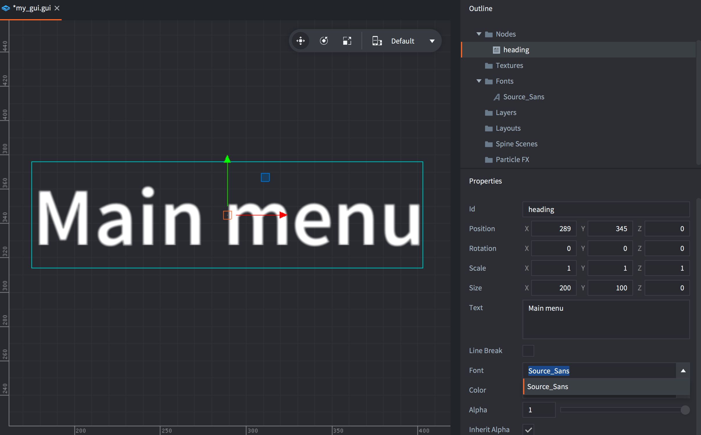
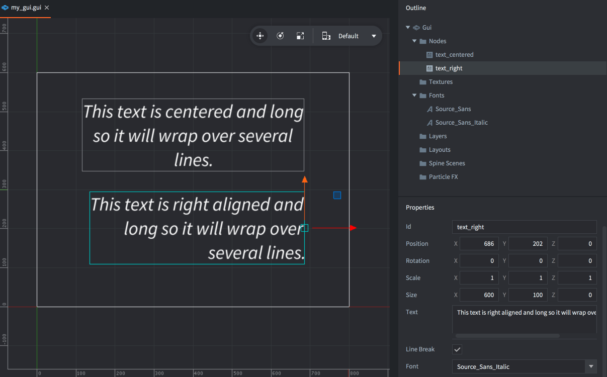

# GUI文本节点 {#gui-text-nodes}

Defold支持一种特定类型的GUI节点，允许在GUI场景中渲染文本。项目中添加的任何字体资源都可以用于文本节点渲染。

编辑器预览使用引擎的字体渲染器，支持文本塑形和从右到左的布局。有关所需的字体和 App Manifest 设置，请参阅[文本布局支持](/manuals/font/#text-layout-support-eg-right-to-left)。

## 添加文本节点 {#adding-text-nodes}

您希望在GUI文本节点中使用的字体必须添加到GUI组件中。可以右键单击*Fonts*文件夹，使用<kbd>GUI</kbd>顶部菜单或按相应的键盘快捷键。



文本节点具有一组特殊属性：

*Font*
: 您创建的任何文本节点都必须设置*Font*属性。

*Text*
: 此属性包含显示的文本。

*Line Break*
: 文本对齐遵循 pivot 设置，设置此属性允许文本流到多行。节点的宽度决定文本将在何处换行。

## 矢量字体与彩色表情符号 {#vector-fonts-and-color-emoji}

按照[矢量字体设置](/manuals/font/#vector-fonts)，将 `.font` 资源添加到 GUI 场景的 *Fonts*，并在文本节点上选择它。将字体资源的 *Material* 设为 `/builtins/fonts/font-vector.material`。使用节点的 *Font Size* 控制显示大小。

对于彩色表情符号，还需完成 [COLRv1 后备字体和打包设置](/manuals/font/#color-emoji)。创建 id 为 `text` 的文本节点，将其 *Text* 留空，并将以下代码添加到 GUI 场景的 `.gui_script`：

```lua
function init(self)
    local node = gui.get_node("text")
    local text = "Hello 😀 🍎 🚀"
    local font_resource = gui.get_font_resource(gui.get_font(node))
    -- 为这个共享字体资源添加后备字体，只需添加一次。
    font.add_font(font_resource, "/fonts/NotoColorEmoji-Regular.ttf")
    font.prewarm_text(font_resource, text, function(self, request_id, result, err)
        if result then
            gui.set_text(node, text)
        else
            print("Could not prepare GUI text:", err)
        end
    end)
end
```

[`gui.get_font()`](/ref/gui/#gui.get_font) 返回字体在 GUI 场景中的名称；[`gui.get_font_resource()`](/ref/gui/#gui.get_font_resource) 将此名称解析为 `font.add_font()` 使用的字体资源。共用该资源的其他节点和标签也会获得后备字体，因此只初始化一次。预热成功后才设置文本。

## 对齐 {#alignment}

通过设置节点 pivot，您可以更改文本的对齐模式。

*Center*
: 如果 pivot 设置为`Center`、`North`或`South`，则文本居中对齐。

*Left*
: 如果 pivot 设置为任何`West`模式，则文本左对齐。

*Right*
: 如果 pivot 设置为任何`East`模式，则文本右对齐。



## 运行时修改文本节点 {#modifying-text-nodes-in-runtime}

文本节点响应任何通用的节点操作函数，用于设置大小、pivot、颜色等。存在一些仅用于文本节点的函数：

* 要更改文本节点的字体，请使用[`gui.set_font()`](/ref/gui/#gui.set_font)函数。
* 要更改文本节点的换行行为，请使用[`gui.set_line_break()`](/ref/gui/#gui.set_line_break)函数。
* 要更改文本节点的内容，请使用[`gui.set_text()`](/ref/gui/#gui.set_text)函数。

```lua
function on_message(self, message_id, message, sender)
    if message_id == hash("set_score") then
        local s = gui.get_node("score")
        gui.set_text(s, message.score)
    end
end
```
