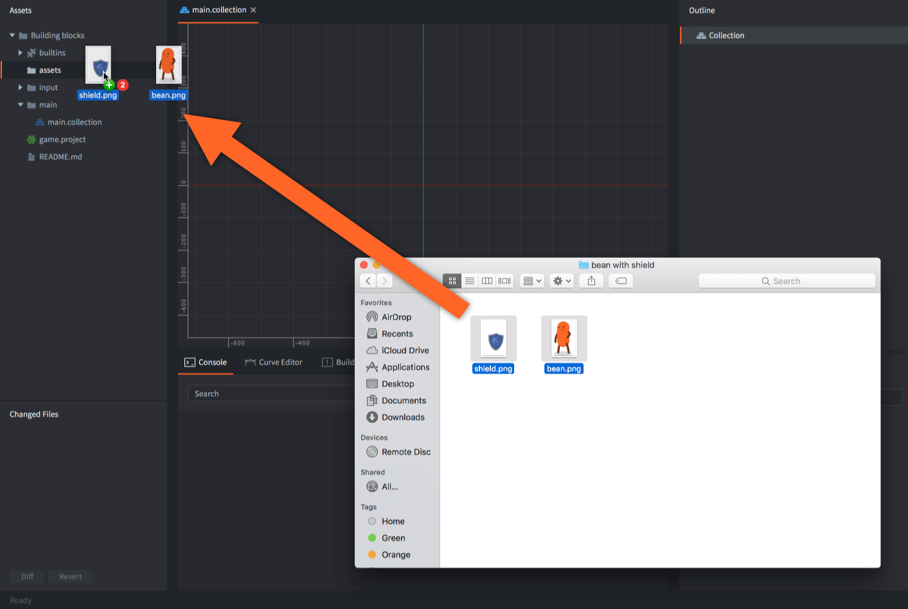

# 资源导入和编辑 {#importing-and-editing-assets}

游戏项目通常包含大量外部资源，这些资源是在各种专业程序中制作的，用于制作图形、3D模型、声音文件、动画等。Defold专为这样的工作流程而构建：您在外部工具中工作，然后在它们完成后将资源导入到Defold中。

## 导入资源 {#importing-assets}

Defold需要项目中使用的所有资源都位于项目层次结构中的某个位置。因此，您需要先导入所有资源，然后才能使用它们。要导入资源，只需将文件从计算机的文件系统中拖出，然后放到Defold编辑器的*Assets*面板中的适当位置。

::: sidenote
图集和图块源使用 PNG 或 JPEG 图像。PNG 支持 RGB、RGBA 和索引色（调色板）图像。还可以导入 [KTX2 源纹理](/manuals/importing-graphics/#ktx2-textures)作为模型纹理。
:::

## 使用资源 {#using-assets}

当资源导入到Defold后，它们可以被Defold支持的各种组件类型使用：

* 图像可用于创建2D游戏中常用的多种视觉组件。阅读更多关于[如何导入和使用2D图形的内容](/manuals/importing-graphics)。
* 声音可以被[声音组件](/manuals/sound)用来播放声音。
* 字体被[标签组件](/manuals/label)和GUI中的[文本节点](/manuals/gui-text)使用。
* glTF 模型（*.gltf* 和 *.glb*）可以通过[模型组件](/manuals/model)显示带动画的 3D 模型。在 *Assets* 面板中展开这些文件，可浏览网格、生成的材质和内嵌图像。内嵌图像可直接使用；外部引用的图像和缓冲区必须作为独立项目文件一同导入。也支持 [Draco 和 Meshopt 压缩的几何体](/manuals/importing-models/#compressed-geometry)，并在导入/构建时解码。在模型组件中选择场景或网格时，编辑器可能提示自动填充其材质和纹理绑定。选择 <kbd>Auto Fill</kbd> 可应用这些绑定并替换现有绑定，选择 <kbd>Keep Current</kbd> 则保留原有绑定。更多内容请参阅[如何导入和使用 3D 模型](/manuals/importing-models)。

## 编辑外部资源 {#editing-external-assets}

Defold不提供用于图像、声音文件、模型或动画的编辑工具。此类资源需要在Defold之外的专业工具中创建，然后导入到Defold。Defold会自动检测项目文件中任何资源的更改，并相应地更新编辑器视图。

## 编辑Defold资源 {#editing-defold-assets}

编辑器将所有Defold资源保存在基于文本的文件中，这些文件易于合并。它们也易于使用简单脚本创建和修改。有关更多信息，请参阅[此论坛帖子](https://forum.defold.com/t/deftree-a-python-module-for-editing-defold-files/15210)。但请注意，我们不发布文件格式详细信息，因为它们偶尔会更改。您也可以使用[编辑器脚本](/manuals/editor-scripts/)来挂钩编辑器中的某些生命周期事件，以运行脚本来生成或修改资源。

通过文本编辑器或外部工具处理Defold资源文件时应格外小心。如果引入错误，可能会阻止文件在Defold编辑器中打开。

某些外部工具，如[Tiled](/assets/tiled/)和[Tilesetter](https://www.tilesetter.org/beta)，可用于自动生成Defold资源。
