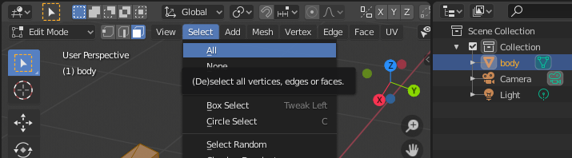
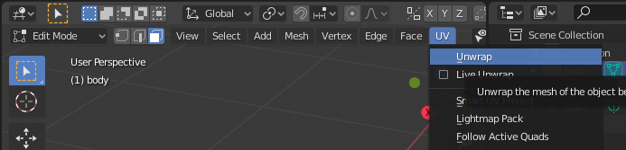
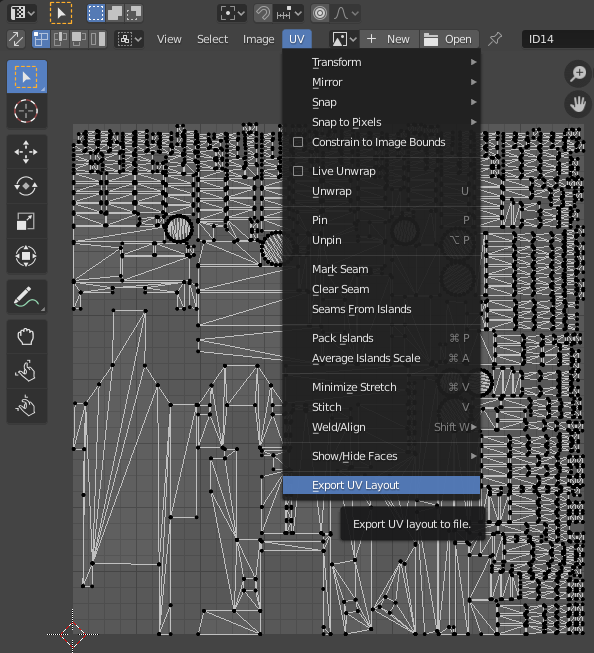
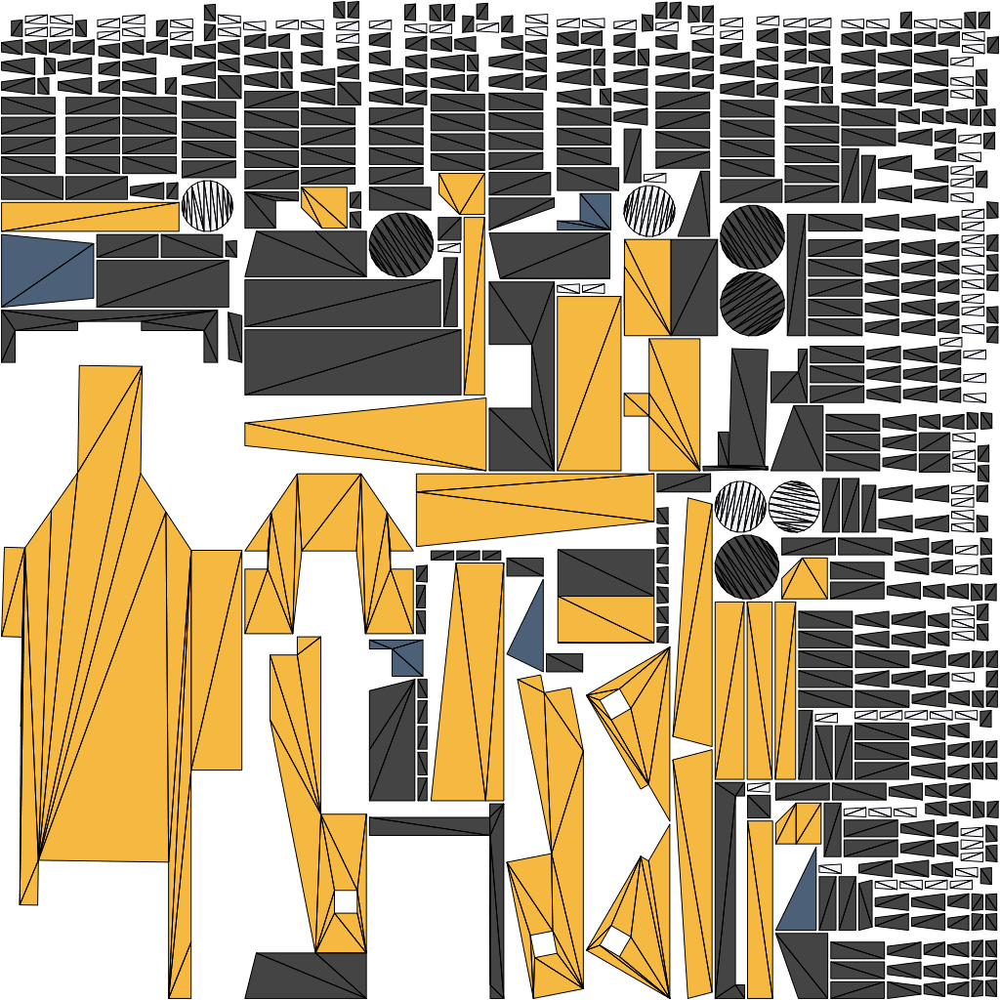

# 导入3D模型 {#importing-3d-models}
Defold 支持 glTF 2.0（GL Transmission Format）格式的模型、骨骼和动画。3D 模型请使用 *.gltf* 或 *.glb* 文件。glTF 是一种现代格式，专为在游戏引擎和实时应用中传输和加载 3D 数据而设计。

您可以使用 Maya、3ds Max、SketchUp 和 Blender 等工具来创建 3D 模型，或将模型转换为 glTF。

Blender 是一款功能强大且流行的 3D 建模、动画和渲染程序。它可在 Windows、macOS 和 Linux 上运行，并可从 [https://www.blender.org](https://www.blender.org) 免费获取。

## 导入到Defold {#importing-to-defold}
要导入模型，请将 *.gltf* 或 *.glb* 文件拖放到 Defold 编辑器的 *Assets* 面板中。

glTF 常见有两种存储方式：

* *.glb* 是单个二进制文件。它包含模型数据，也可能包含打包的纹理图像。当您希望以单个文件移动或存储模型时，这种方式很方便。
* *.gltf* 是基于文本的 JSON 文件，通常引用独立的网格数据 *.bin* 文件，以及 *.png*、*.jpg* 或 *.ktx2* 等独立纹理图像。使用此形式时，请将所有引用文件添加到项目中，并保持相对路径不变。

glTF 或 GLB 文件中的内嵌图像可以直接使用，无需提取为独立资源。外部图像和缓冲区文件仍必须与模型一同导入，并保留其相对路径。

::: sidenote
Defold 保留导入的 glTF 文件中的位置和变换，不会在导入时自动将模型重新居中。编辑器预览和运行时以相同方式使用导入的变换：蒙皮网格或以骨骼为父级的网格保留相对于骨架的局部变换，刚性网格则保留展平后的世界空间位置。

[模型组件](/manuals/model/#model-properties)可以从导入场景中选择单个命名网格。将 *Mesh* 字段留空会使用整个场景，并保留上述变换。选择一个网格时，使用其局部几何体，不应用 glTF 节点变换，因此请通过模型组件或游戏对象的变换放置它。

如果使用旧版 Defold 创建的模型在重新导入后位置或方向发生变化，请在 Blender 或其他创作工具中修正变换，然后重新导出 *.gltf* 或 *.glb* 文件。
:::

### 压缩几何体 {#compressed-geometry}

*.gltf* 和 *.glb* 源可以包含使用 Draco 或 Meshopt 压缩的几何体。支持的 glTF 压缩扩展如下：

| 压缩方式 | glTF 扩展 |
| --- | --- |
| Draco | `KHR_draco_mesh_compression` |
| Meshopt | `EXT_meshopt_compression` 和 `KHR_meshopt_compression` |

使用其中一种扩展导出或优化 glTF 2.0 资源，再按未压缩模型相同的步骤导入。包含所有外部缓冲区和纹理，并保留相对路径。像往常一样，将导入的文件分配给模型组件的 *Scene* 属性。

Defold 在导入和构建时解码压缩几何体。生成的模型使用 Defold 常规的运行时几何体表示。这并不意味着运行中的引擎启用了 Draco 或 Meshopt 压缩，源文件更小也不保证游戏包更小。

### 浏览导入的场景 {#browsing-the-imported-scene}

在 *Assets* 面板中展开 *.gltf* 或 *.glb* 文件，可浏览网格、生成的材质和内嵌图像。打开场景可使用其定义的材质和纹理进行预览。也可以打开单个网格进行预览。

文件内部暴露的资源为只读。要为某个网格创建可编辑的模型资源，请复制网格并粘贴到项目目录。生成的 *.model* 文件仍引用导入的 glTF 或 GLB 文件。要改变源几何体或内嵌图像，请在创作工具中编辑资源并重新导出。

编辑器脚本可以使用 `editor.resource_children(path)` 枚举这些资源。递归访问目录及 glTF/GLB 文件内资源的示例，请参阅[遍历项目资源](/manuals/editor-scripts/#traversing-project-resources)。

### KTX2 纹理 {#ktx2-textures}

模型纹理可使用 *.ktx2* 源，既可以是外部文件，也可以是 *.gltf* 或 *.glb* 文件中的内嵌图像。外部文件应与模型一起导入。内嵌 KTX2 图像显示在 *Assets* 面板的场景下，可以直接分配给材质纹理字段，也可以通过 <kbd>Auto Fill</kbd> 分配。

[纹理配置文件](/manuals/texture-profiles/#ktx2-source-textures)决定保留 KTX2 源格式还是转换为配置的输出格式。启用纹理压缩时，**Keep KTX2 Format** 保留源编码格式，但图像处理仍可能要求重新编码。请检查目标设备是否支持该格式，并考虑对已压缩纹理再次压缩可能带来的额外质量损失。请参阅 [KTX2 输入格式和预览](/manuals/importing-graphics/#ktx2-textures)。

## 使用模型 {#using-a-model}
导入模型后，请在[模型组件](/manuals/model)中使用它：

1. 在 *Assets* 面板中通过 <kbd>New... ▸ Model</kbd> 创建 Model 文件，或通过 <kbd>Add Component ▸ Model</kbd> 将 Model 组件直接添加到游戏对象。
2. 将 *Scene* 属性设为导入的 *.gltf* 或 *.glb* 文件。
3. 出现 *Auto Fill Model Fields?* 对话框时，选择 <kbd>Auto Fill</kbd> 分配场景生成的材质和引用的纹理。这会替换现有的材质和纹理绑定。选择 <kbd>Keep Current</kbd> 可保留绑定；新的场景选择仍然生效。
4. 将 *Mesh* 留空以使用整个场景，或选择命名网格以只使用其局部几何体。改变网格选择时可能出现相同对话框：选择网格会提供其材质，清除选择则提供场景中的全部材质。<kbd>Keep Current</kbd> 在应用新网格选择的同时保留绑定。
5. 对于动画模型，将 *Skeleton* 属性设为包含骨架的 *.gltf* 或 *.glb* 文件。网格、骨架和动画一同导出时，这通常与 *Scene* 使用的是同一文件。
6. 为动画创建 *Animation Set* 文件，并将其分配给 *Animations* 属性。如果希望自动开始某个动画，请设置 *Default Animation*。

当选中的 glTF 或 GLB 源提供材质时，编辑器会提示填充绑定。它会解析内嵌图像和外部图像引用。生成的材质使用内置 glTF 着色器；有关光照和支持的材质效果，请参阅 [PBR 手册](/manuals/physically-based-rendering/#built-in-pbr-materials)。

### 手动分配材质和纹理 {#assigning-materials-and-textures-manually}

如果选择 <kbd>Keep Current</kbd>，或需要自定义着色，请为每个 *Material* 属性设置适合的材质。内置 `gltf` 材质提供 PBR 着色，也可以使用内置 `model` 材质或您自己的材质。有关静态、蒙皮和实例化变体及其要求，请参阅[模型手册](/manuals/model/#material)。

将每个纹理分配给对应的材质纹理字段。可以使用 *Assets* 面板中 glTF 或 GLB 文件下暴露的内嵌图像，也可以使用项目中的独立图像资源。对于含多个采样器的材质，请将每个纹理匹配到预期采样器；[PBR 手册列出了内置 glTF 采样器名称](/manuals/physically-based-rendering/#built-in-pbr-materials)。

## 导出为glTF {#exporting-to-gltf}
导出的 *.gltf* 或 *.glb* 文件包含构成模型的所有顶点、边和面，以及 _UV 坐标_（如果已定义，则表示纹理图像的哪部分映射到网格的特定部分）、骨架中的骨骼和动画数据。

* 关于多边形网格的详细描述可以在 http://en.wikipedia.org/wiki/Polygon_mesh 找到。

* UV 坐标和 UV 映射在 http://en.wikipedia.org/wiki/UV_mapping 中有描述。

Defold 对导出的动画数据施加了一些限制：

* Defold 目前只支持烘焙动画。动画需要为每个关键帧的每个动画骨骼提供矩阵，而不是将位置、旋转和缩放作为单独的键。

* 动画也是线性插值的。如果您使用更高级的曲线插值，动画需要由导出器预先烘焙。

### 要求 {#requirements}
导出模型时，请注意不同工具和引擎对 glTF 的支持可能不同。使用 glTF 2.0；如果模型使用纹理，确保其 UV 坐标正确。图像可以内嵌在 glTF 或 GLB 文件中，也可以保存为场景引用的独立文件。将模型导入 Defold 时，请包含所有外部图像和缓冲区文件。

虽然我们的目标是完全支持 glTF 格式，但我们还没有完全实现。
如果缺少某个功能，请在[我们的仓库](https://github.com/defold/defold/issues)中为其提出功能请求。

### 导出纹理 {#exporting-a-texture}
如果要手动制作纹理图像，可以从 Blender 导出 UV 布局作为模板。先选择网格及其全部顶点：

当所有顶点被选中后，您可以展开网格以获取 UV 布局：

然后您可以继续将 UV 布局导出为可用作纹理的图像：

### 使用Blender导出 {#exporting-using-blender}
使用 <kbd>File ▸ Export ▸ glTF 2.0 (.glb/.gltf)</kbd> 从 Blender 导出模型。

导出前选择一个或多个对象，如果只想导出所选对象，请启用 *Selected Objects*。

选择一个 *Format* 选项：

* *glTF Binary (.glb)* 会创建一个文件。当您希望模型易于作为单个资源移动或存储时，请使用此选项。
* *glTF Separate (.gltf + .bin + textures)* 会为模型描述、二进制数据和纹理创建单独文件。当您希望编辑纹理图像或在 Defold 中单独分配它们时，请使用此选项。

如果模型包含动画，请启用动画导出并确保动画已烘焙。如果模型使用纹理，请确保网格已有 UV 展开，并且纹理图像导出为 Defold 可以导入的格式，例如 PNG 或 JPEG。

