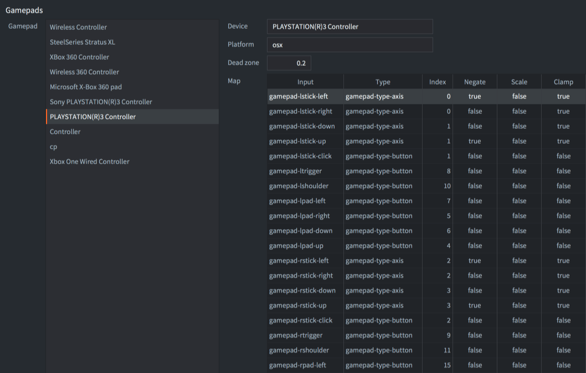
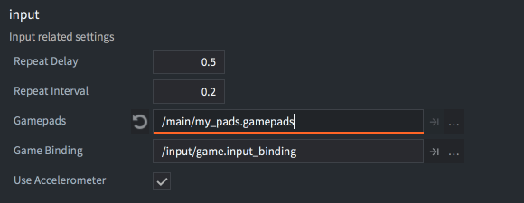

::: sidenote
建议您先熟悉Defold中输入的一般工作方式，如何接收输入以及输入在脚本文件中的接收顺序。有关输入系统的更多信息，请参阅[输入系统概述手册](/manuals/input)。
:::

# Gamepads
游戏手柄触发器允许您将标准游戏手柄输入绑定到游戏功能。游戏手柄输入提供以下绑定：

- 左右摇杆（方向和点击）
- 左右数字板。右数字板通常对应Xbox控制器上的"A"、"B"、"X"和"Y"按钮，以及PlayStation控制器上的"方块"、"圆圈"、"三角"和"十字"按钮。
- 左右扳机键
- 左右肩键
- 开始、返回和指南按钮


::: important
下面的示例使用了上图中显示的操作。与所有输入一样，您可以自由命名输入操作。
:::

## 数字按钮 {#digital-buttons}
数字按钮生成`pressed`、`released`和`repeated`事件。以下示例显示如何检测数字按钮的输入（按下或释放）：

```lua
function on_input(self, action_id, action)
    if action_id == hash("gamepad_lpad_left") then
        if action.pressed then
            -- 开始向左移动
        elseif action.released then
            -- 停止向左移动
        end
    end
end
```

## 模拟摇杆 {#analog-sticks}
当摇杆移动到手柄设置文件中定义的死区之外时，模拟摇杆会生成连续的输入事件（见下文）。以下示例显示如何检测模拟摇杆的输入：

```lua
function on_input(self, action_id, action)
    if action_id == hash("gamepad_lstick_down") then
        -- 左摇杆向下移动
        print(action.value) -- 0.0到-1.0之间的值
    end
end
```

模拟摇杆在移动到超过特定阈值的主要方向时也会生成`pressed`和`released`事件。这使得将模拟摇杆也用作数字方向输入变得容易：

```lua
function on_input(self, action_id, action)
    if action_id == hash("gamepad_lstick_down") and action.pressed then
        -- 左摇杆被移动到极端向下位置
    end
end
```

## 多个游戏手柄 {#multiple-gamepads}
Defold通过主机操作系统支持多个游戏手柄，操作会将 `action` 表的`gamepad`字段设置为输入来源的游戏手柄编号：

```lua
function on_input(self, action_id, action)
    if action_id == hash("gamepad_start") then
        if action.gamepad == 0 then
          -- 游戏手柄0想要加入游戏
        end
    end
end
```

## 连接和断开 {#connect-and-disconnect}
游戏手柄输入绑定还提供两个名为`Connected`和`Disconnected`的独立绑定，用于检测游戏手柄何时连接（包括从一开始就连接的手柄）或断开。

```lua
function on_input(self, action_id, action)
    if action_id == hash("gamepad_connected") then
        if action.gamepad == 0 then
          -- 游戏手柄0已连接
        end
    elseif action_id == hash("gamepad_disconnected") then
        if action.gamepad == 0 then
          -- 游戏手柄0已断开连接
        end
    end
end
```

## 原始游戏手柄 {#raw-gamepads}

游戏手柄输入绑定还提供一个名为`Raw`的独立绑定，用于提供任何连接的游戏手柄的未过滤（未应用死区）的按钮、轴和方向键输入。

```lua
function on_input(self, action_id, action)
    if action_id == hash("raw") then
        pprint(action.gamepad_buttons)
        pprint(action.gamepad_axis)
        pprint(action.gamepad_hats)
    end
end
```

## 游戏手柄设置文件 {#gamepads-settings-file}

手柄映射将控制器的按钮、轴和方向帽转换为输入绑定使用的标准控件。Defold 结合 *game.project* 的 *Input* 部分中配置的两种映射来源：

| 设置 | 映射格式 | 默认值 |
| --- | --- | --- |
| [Gamepad Database](/manuals/project-settings/#gamepad-database) | SDL 格式的文本数据库，根据控制器 GUID 匹配 | `/builtins/input/gamecontrollerdb.txt` |
| [Gamepads](/manuals/project-settings/#gamepads) | 针对设备名称和平台的旧版 `.gamepads` 条目 | `/builtins/input/default.gamepads` |

SDL 数据库映射和平台自动映射使用 [Gamepad Deadzone](/manuals/project-settings/#gamepad-deadzone)。旧版 `.gamepads` 条目定义自己的死区。在 Android 上，没有数据库条目的控制器也可能获得[自动映射](#gamepads-on-android)。

### 旧版 .gamepads 映射 {#legacy-gamepads-mappings}

一个 `.gamepads` 文件可以包含多个控制器的映射。现有的旧版映射仍然受支持。Defold 在默认文件中包含了常见控制器的映射：



如果需要在桌面平台上创建旧版 `.gamepads` 映射，可以使用以下工具。Android 的说明请参阅 [Android 上的手柄](#gamepads-on-android)。

[Click to download gdc.zip](https://forum.defold.com/t/big-thread-of-gamepad-testing/56032).

这个工具包含 Windows, Linux 和 macOS 的可运行文件. 命令行启动方法:

```sh
./gdc
```

该工具将要求您按下连接控制器上的不同按钮。然后，它将输出一个新的游戏手柄文件，其中包含您控制器的正确映射。保存新文件，或将其与现有的游戏手柄文件合并，然后在*game.project*中更新设置：



### 未识别的游戏手柄 {#unidentified-gamepads}

当配置映射和平台自动映射均不可用时，手柄仅生成绑定到 `Connected`、`Disconnected` 和 `Raw` 的动作。可以添加控制器映射，或在游戏中处理其原始输入。

可以通过从 `action` 中读取`gamepad_unknown`值来检查游戏手柄的输入操作是否来自未知游戏手柄：

```lua
function on_input(self, action_id, action)
    if action_id == hash("connected") then
        if action.gamepad_unknown then
            print("The connected gamepad is unidentified and will only generate raw input")
        else
            print("The connected gamepad is known and will generate input actions for buttons and sticks")
        end
    end
end
```

## HTML5中的游戏手柄 {#gamepads-in-html5}
HTML5构建中支持游戏手柄，并生成与其他平台相同的输入事件。游戏手柄的支持基于[游戏手柄API](https://www.w3.org/TR/gamepad/)，大多数浏览器都支持此API（[参考此支持图表](https://caniuse.com/?search=gamepad)）。如果浏览器不支持游戏手柄API，Defold将静默忽略项目中的任何游戏手柄触发器。您可以通过检查`navigator`对象上是否存在`getGamepads`函数来检查浏览器是否支持游戏手柄API：

```lua
local function supports_gamepads()
    return not html5 or (html5.run('typeof navigator.getGamepads === "function"') == "true")
end

if supports_gamepads() then
    print("Platform supports gamepads")
end
```

如果您的游戏在`iframe`内运行，您还必须确保`iframe`已添加`gamepad`权限：

```html
<iframe allow="gamepad"></iframe>
```

### 标准游戏手柄 {#standard-gamepad}

如果连接的游戏手柄被浏览器识别为标准游戏手柄，它将使用[游戏手柄设置文件](/manuals/input-gamepads/#gamepads-settings-file)中的`Standard Gamepad`映射（在`/builtins`中的`default.gamepads`文件中包含`Standard Gamepad`映射）。标准游戏手柄定义为具有16个按钮和2个模拟摇杆，按钮布局类似于PlayStation或Xbox控制器（有关更多信息，请参阅[W3C定义和按钮布局](https://w3c.github.io/gamepad/#dfn-standard-gamepad)）。如果连接的游戏手柄未被识别为标准游戏手柄，Defold将在游戏手柄设置文件中查找与硬件游戏手柄类型匹配的映射。

## Windows上的游戏手柄 {#gamepads-on-windows}
在Windows上，目前只支持XBox 360控制器。要将360控制器连接到Windows机器，[请确保正确设置](http://www.wikihow.com/Use-Your-Xbox-360-Controller-for-Windows)。

## Android上的游戏手柄 {#gamepads-on-android}

Android 构建支持手柄，产生与其他平台相同的输入动作。Defold 使用配置的[手柄映射](#gamepads-settings-file)，并可为某些没有匹配条目的控制器自动映射。

如果控制器无法识别或控件不正确，请在 Android 设备上测试，并添加或更新其映射。故障排查请参阅[无法识别的手柄](#unidentified-gamepads)和[原始手柄输入](#raw-gamepads)。
