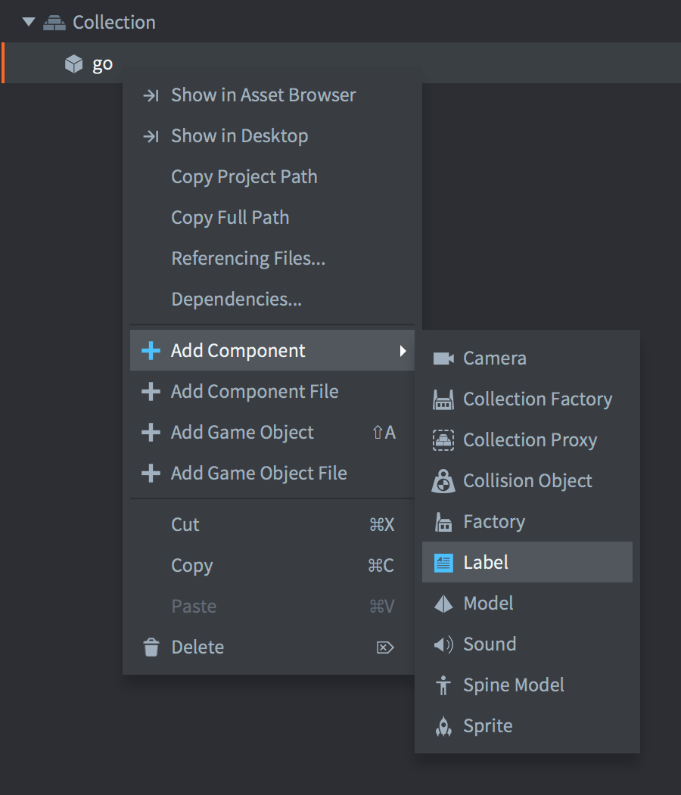
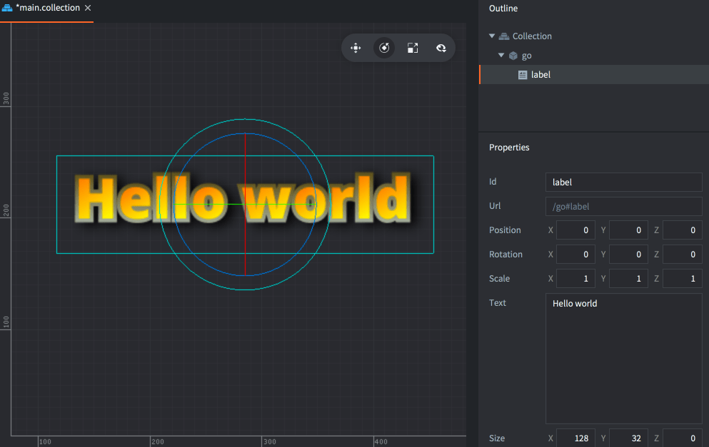
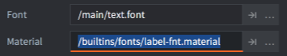
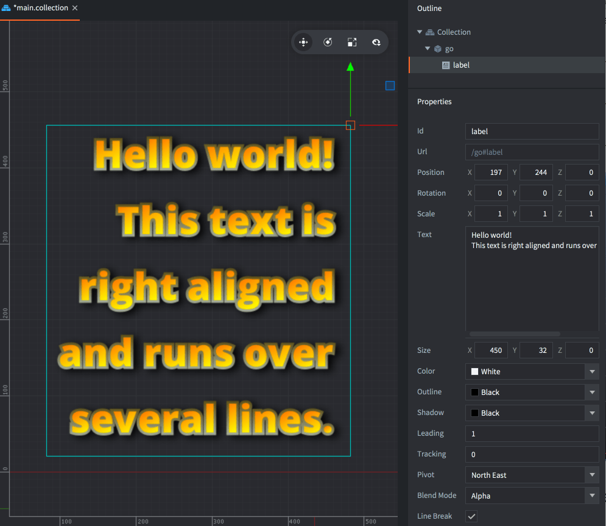

# Label

*Label* 组件在游戏空间中渲染一段文本。默认情况下，它会与所有精灵和图块图形一起排序和绘制。该组件有一组属性，用于控制文本的渲染方式。Defold的GUI支持文本，但在游戏世界中放置GUI元素可能比较棘手。Labels使这一过程变得更加简单。

## 创建 label {#creating-a-label}

要创建一个 Label 组件, 在游戏对象上 <kbd>右键点击</kbd> 选择 <kbd>Add Component ▸ Label</kbd>.



(如果你想从同一模板实例化多个label，也可以创建一个新的label组件文件：在*Assets*浏览器中的文件夹上<kbd>右键点击</kbd>并选择<kbd>New... ▸ Label</kbd>，然后将该文件作为组件添加到任何游戏对象)



将*Font*属性设置为您想要使用的字体，并确保将*Material*属性设置为与字体类型相匹配的材质：



## 矢量字体与彩色表情符号 {#vector-fonts-and-color-emoji}

要使用 Vector 字体，请按照[矢量字体设置](/manuals/font/#vector-fonts)，将 `.font` 资源分配给标签的 *Font* 属性，并将标签的 *Material* 设为 `/builtins/fonts/label-vector.material`。使用 *Font Size* 控制显示大小。

对于彩色表情符号，还需完成 [COLRv1 后备字体和打包设置](/manuals/font/#color-emoji)。以下示例假定有一个 id 为 `label` 的标签，并且同一游戏对象上附有脚本。将标签的 *Text* 留空，只在字形准备完成后显示问候语：

```lua
function init(self)
    local text = "Hello 😀 🍎 🚀"
    local font_resource = go.get("#label", "font")
    -- 为这个共享字体资源添加后备字体，只需添加一次。
    font.add_font(font_resource, "/fonts/NotoColorEmoji-Regular.ttf")
    font.prewarm_text(font_resource, text, function(self, request_id, result, err)
        if result then
            go.set("#label", "text", text)
        else
            print("Could not prepare label text:", err)
        end
    end)
end
```

普通字母使用原来的字体，表情符号使用添加的彩色字体。如果其他标签或 GUI 文本节点共用该字体资源，请在一个位置初始化后备字体并复用它。

## Label 属性 {#label-properties}

除了*Id*、*Position*、*Rotation*和*Scale*属性外，还存在以下组件特有属性：

*Text*
: 标签的文本内容。

*Size*
: 文本边界框的大小。如果设置了*Line Break*，宽度将指定文本应在何处换行。

*Color*
: 文本的颜色.

*Outline*
: 轮廓的颜色。

*Shadow*
: 阴影的颜色。

::: sidenote
请注意，默认材质出于性能原因禁用了阴影渲染。
:::

*Leading*
: 行间距的缩放数值。0值表示没有行间距。默认为1。

*Tracking*
: 字间距的缩放数值。默认为0。

*Pivot*
: 文本的轴心点。使用此属性来更改文本对齐方式（见下文）。

*Blend Mode*
: 渲染标签时使用的混合模式。

*Line Break*
: 文本对齐遵循轴心点设置，设置此属性允许文本流到多行。组件的宽度决定文本换行的位置。请注意，文本中必须有空格才能换行。

*Font*
: 用于此标签的字体资源。

*Material*
: 渲染该标签时使用的材质。请选择与字体模式或源（Bitmap、SDF、Vector 或 BMFont）匹配的材质。对应的内置标签材质请参阅[字体材质](/manuals/font/#font-materials)。

### 混合模式 {#blend-modes}
:[blend-modes](../shared/blend-modes.md)

### 轴心点和对齐 {#pivot-and-alignment}

通过设置*Pivot*属性，您可以更改文本的对齐模式。

*Center*
: 如果轴心点设置为`Center`、`North`或`South`，则文本居中对齐。

*Left*
: 如果轴心点设置为任何`West`模式，则文本左对齐。

*Right*
: 如果轴心点设置为任何`East`模式，则文本右对齐。



## 运行时操作 {#runtime-manipulation}

您可以在运行时通过获取和设置标签文本以及其他各种属性来操作标签。

`text`
: 标签的文本内容（`string`），可通过 `go.get()` 和 `go.set()` 访问。

`color`
: 标签颜色（`vector4`）

`outline`
: 标签轮廓颜色（`vector4`）

`shadow`
: 标签阴影颜色（`vector4`）

`scale`
: 标签缩放，可以是用于均匀缩放的`number`，或者是用于沿各轴单独缩放的`vector3`。

`size`
: 标签大小（`vector3`）

```lua
function init(self)
    -- 设置 "my_label" 组件的文本；该组件与此脚本
    -- 位于同一个游戏对象中。
    go.set("#my_label", "text", "New text")
    local text = go.get("#my_label", "text")
    print(text) -- New text
end
```

::: sidenote
`label.set_text()` 和 `label.get_text()` 已弃用，请改用 `text` 属性。旧函数仍保留以维持兼容。旧的 setter 会将消息加入队列，而 `go.set()` 会立即更新文本。
:::

```lua
function init(self)
    -- 设置与此脚本在同一游戏对象中的"my_label"组件的颜色。
    -- 颜色是存储在vector4中的RGBA值。
    local grey = vmath.vector4(0.5, 0.5, 0.5, 1.0)
    go.set("#my_label", "color", grey)

    -- ...通过将其alpha设置为0来移除轮廓...
    go.set("#my_label", "outline.w", 0)

    -- ...沿x轴将其缩放2倍。
    local scale_x = go.get("#my_label", "scale.x")
    go.set("#my_label", "scale.x", scale_x * 2)
end
```

## 项目配置 {#project-configuration}

*game.project*文件中有一些与标签相关的[项目设置](/manuals/project-settings#label)。
