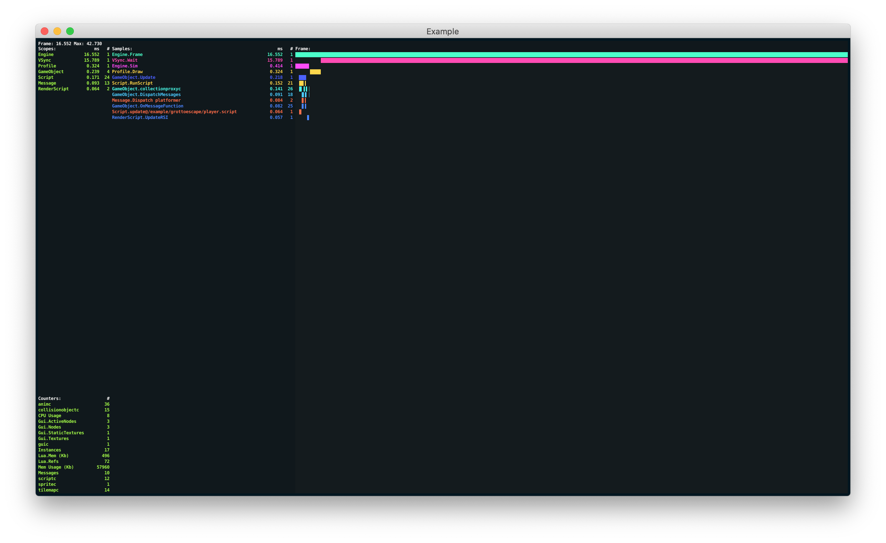
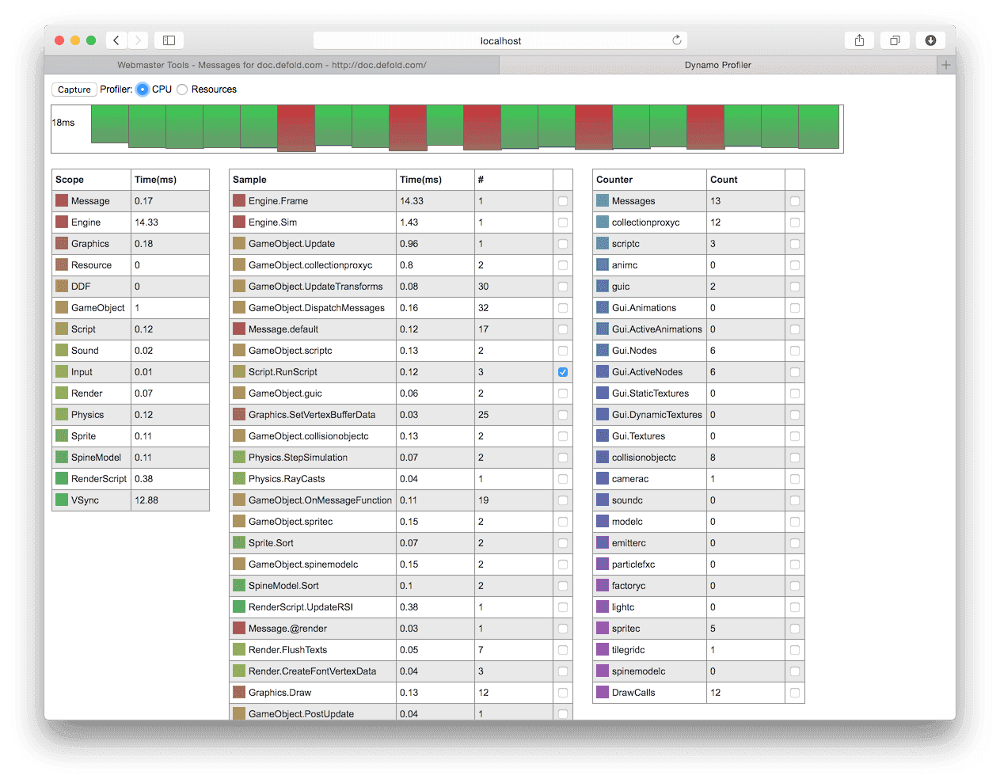
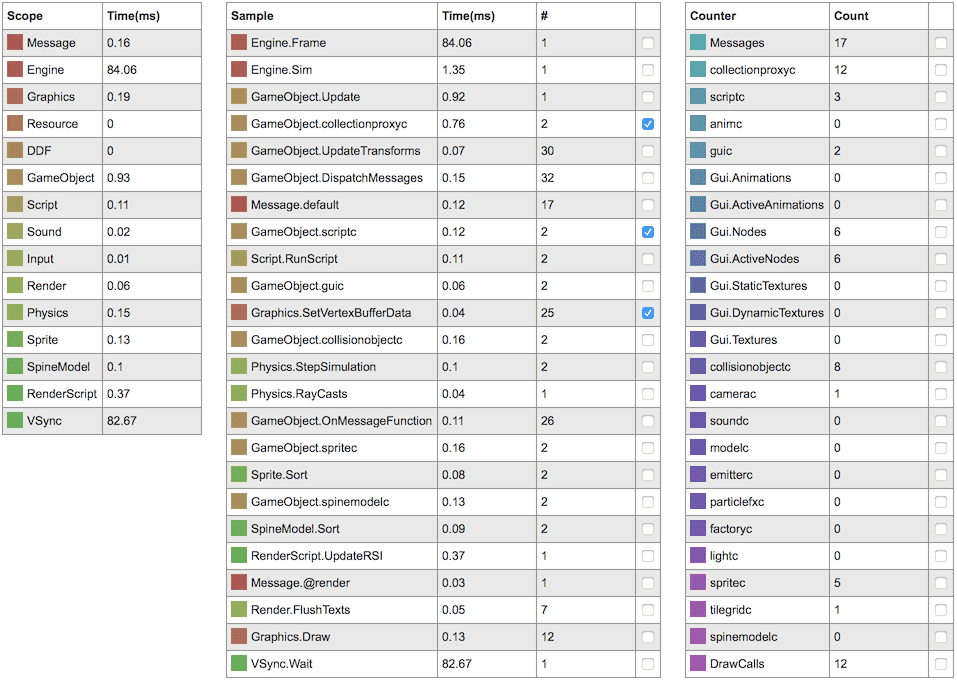
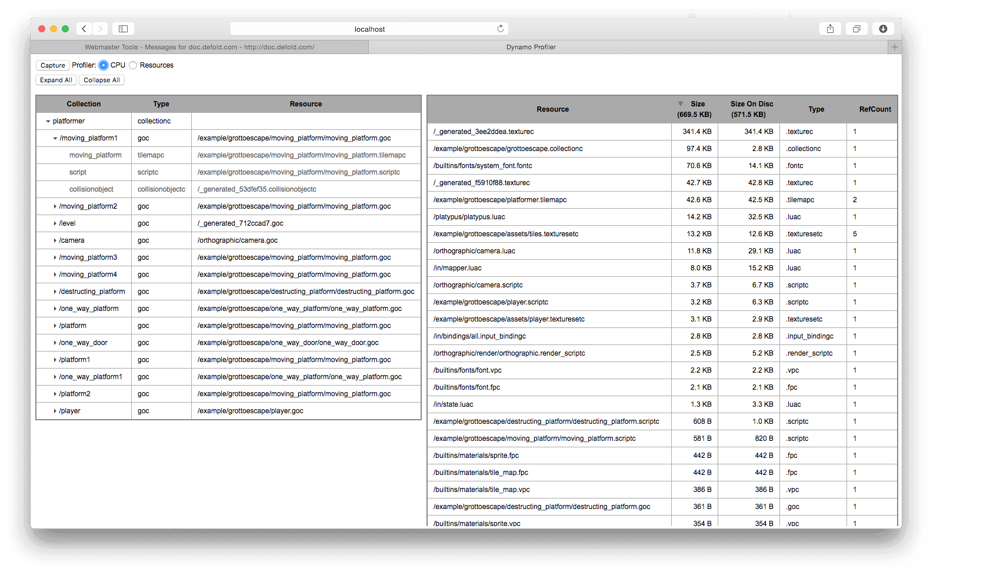
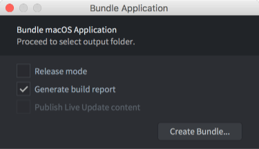
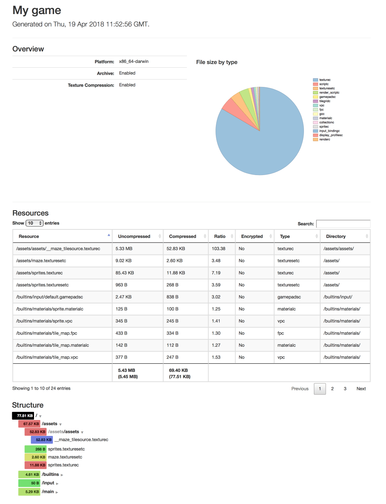
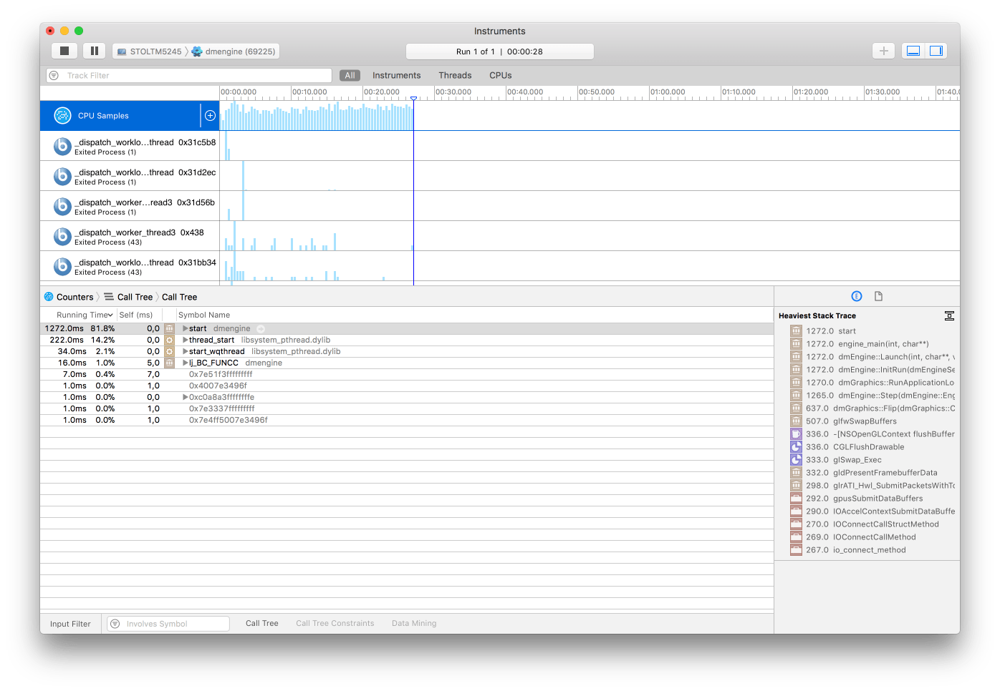
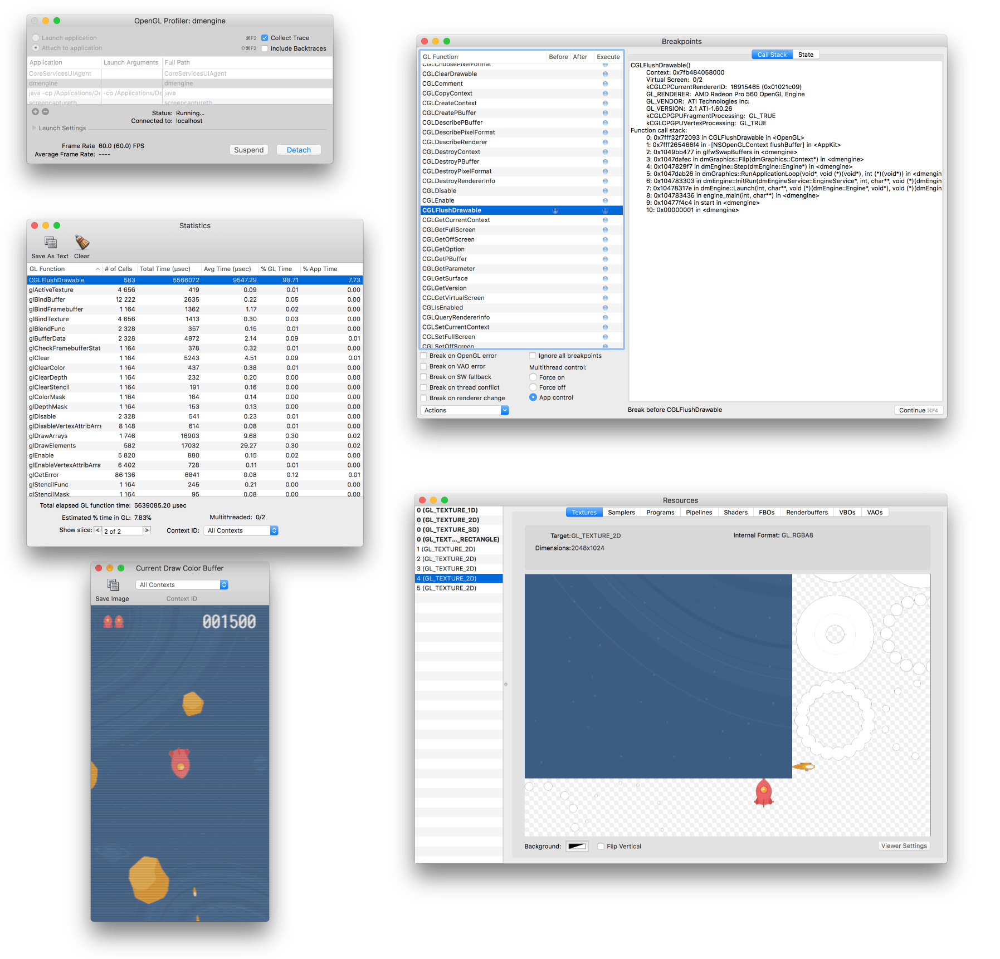
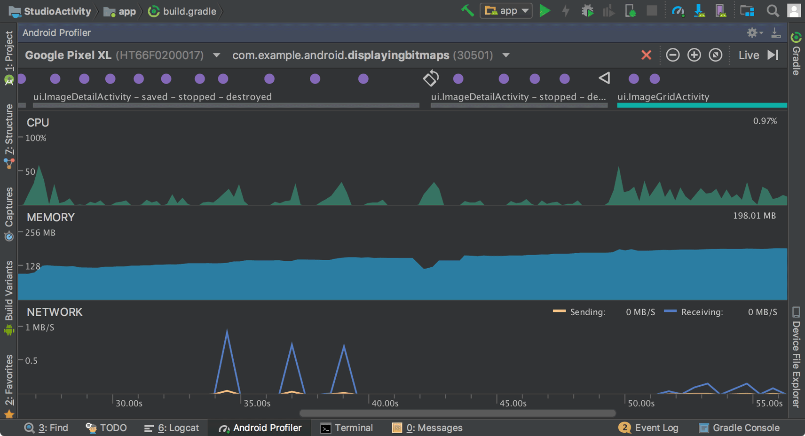
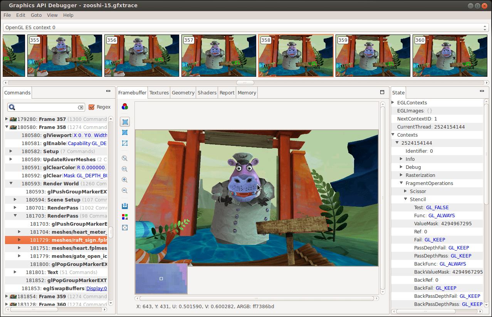

# 性能分析 {#profiling}

Defold 包含与引擎和构建流程集成的性能分析工具，用于查找性能、内存和资源使用问题。运行时性能分析数据可由多种功能使用：

* 基础分析器和游戏内可视化分析器适用于所有平台。
* [Remotery 分析器](https://github.com/Celtoys/Remotery)和交互式 Web 帧分析器适用于桌面和移动平台。
* 使用 Metal 的 macOS 调试构建可以保存 [GPU 跟踪](#metal-gpu-trace-capture)，以便在 Xcode 中检查。
* HTML5 构建可将 Defold scope 发布到浏览器的 Web Performance API。

[App Manifest](/manuals/app-manifest/#profiler) 中的 **Profiler** 设置控制是否将分析器代码链接到构建中。**Debug Only** 是默认值，**None** 会排除分析器，**Always** 则在 Debug 和 Release 构建中都包含它。*game.project* 中的 `profiler` 设置控制运行时行为，但不会将已排除的分析器代码重新链接到构建中。尤其是 **Track CPU** 控制 CPU 使用率采样，它与 App Manifest 选项相互独立。

## 运行时可视化性能分析器 {#the-runtime-visual-profiler}

包含分析器支持的构建具有运行时可视化分析器，可将实时信息叠加显示在运行中的应用程序上：

```lua
function on_reload(self)
    -- 在热重载时切换可视化性能分析器。
    profiler.enable_ui(true)
end
```



可视化性能分析器提供了许多不同的功能，可用于改变可视化性能分析器呈现其数据的方式：

```lua

profiler.set_ui_mode()
profiler.set_ui_view_mode()
profiler.view_recorded_frame()
```

有关性能分析器功能的更多信息，请参阅[性能分析器 API 参考](/ref/profiler/)。

## Web 性能分析器 {#the-web-profiler}
运行包含分析器支持的桌面或移动构建时，可以通过浏览器访问交互式帧分析器和资源分析器。

### Remotery 帧性能分析器 {#remotery-frame-profiler}
帧性能分析器允许您在游戏运行时对其进行采样，并详细分析各个帧。要访问性能分析器：

1. 在目标设备上启动您的游戏。
2. 选择 <kbd> Debug ▸ Open Web Profiler</kbd> 菜单。

帧性能分析器分为几个部分，都提供对运行游戏的不同视图。按右上角的暂停按钮可以暂时停止性能分析器更新视图。



::: sidenote
当您同时使用多个目标时，可以通过更改页面顶部的连接地址字段以匹配目标启动时控制台中显示的 Remotery 性能分析器 URL 来手动切换它们：

```
INFO:ENGINE: Defold Engine 1.3.4 (80b1b73)
INFO:DLIB: Initialized Remotery (ws://127.0.0.1:17815/rmt)
INFO:ENGINE: Loading data from: build/default
```
:::

采样时间轴
: 采样时间轴将显示在引擎中捕获的数据帧，每个线程一个水平时间轴。Main 是运行所有游戏逻辑和大部分引擎代码的主线程。Remotery 用于性能分析器本身，Sound 用于声音混合和播放线程。您可以放大和缩小（使用鼠标滚轮）并选择单个帧以在帧数据视图中查看帧的详细信息。

  


帧数据
: 帧数据视图是一个表格，其中当前选定帧的所有数据都被分解为详细信息。您可以查看在每个引擎作用域中花费了多少毫秒。

  


全局属性
: 全局属性视图显示一个计数器表。它们使您可以轻松地，例如，跟踪绘制调用的数量或特定类型组件的数量。

  

::: sidenote
LuaMem 值是 Lua 垃圾回收器报告的 Lua VM 内存用量，单位为千字节。Memory 是引擎使用的内存量，单位也为千字节。
:::

::: important
[Max Sample Count 设置](/manuals/project-settings/#max-sample-count)限制每个线程每帧记录的分析器样本数。如果分析器报告超出限制，请先检查原生扩展的性能分析代码中是否有未配对的 scope begin/end。只有当正常帧确实包含超过配置限制的 scope 时才提高上限。
:::

### 资源性能分析器 {#resource-profiler}
资源性能分析器允许您在游戏运行时检查它并详细分析资源使用情况。要访问性能分析器：

1. 在目标设备上启动游戏的调试构建。
2. 在浏览器中打开[引擎服务地址](/manuals/engine-service/#availability-and-port-discovery)：`http://<address>:<port>/`。请使用运行中引擎在控制台中报告的地址和端口。

资源性能分析器分为 2 个部分，一个显示游戏中当前实例化的集合、游戏对象和组件的层次视图，另一个显示所有当前加载的资源。



集合视图
: 集合视图显示游戏中当前实例化的所有游戏对象和组件的层次列表，以及它们来自哪个集合。当您需要深入了解并了解在任何给定时间在游戏中实例化了什么以及对象来自何处时，这是一个非常有用的工具。

资源视图
: 资源视图显示当前加载到内存中的所有资源、它们的大小以及对每个资源的引用数量。当您需要了解在任何给定时间加载到内存中的内容时，这对于优化应用程序中的内存使用非常有用。

#### 资源加载耗时 {#resource-loading-times}

还可以检查单个资源的加载耗时。在启动游戏前，在 *game.project* 中启用 [Resource → Profile](/manuals/project-settings/#profile)。文本视图中的设置如下：

```ini
[resource]
profile = 1
```

此设置默认禁用。启用后重启游戏，才能测量启动时的加载。每次加载完成或失败，都会写入一条 INFO 级别日志，包含资源路径、总时间，以及预加载、读取、创建、创建后处理、排队和等待阶段的耗时。缓存命中不会生成新的加载记录。

在资源分析器中点击 **Capture**，再点击 **Show load times** 显示耗时列。**Capture** 刷新的是保留测量数据的视图，不会启用分析，也不会追溯测量此前的加载。

| 列 | 含义 |
| --- | --- |
| **Load (ms)** | 首次加载的总耗时，包括依赖、创建后处理、排队和等待。 |
| **Preload (ms)** | 在资源预加载回调中准备资源的时间。 |
| **Read (ms)** | 读取资源数据的时间。 |
| **Create (ms)** | 在创建回调中创建运行时资源的时间。 |

显示加载耗时后，表格按总加载时间排序，最慢的资源在前。点击某个耗时列标题可按该阶段排序，再次点击可反转顺序。**Load** 列的条形表示各项总耗时相对于当前可见最慢资源的比例。点击 **Hide load times** 可再次隐藏这些列。

加载和回调耗时包含嵌套依赖工作。不要将各资源总耗时相加来计算启动时间，因为同一工作可能出现在多个资源的测量中。**Preload**、**Read** 和 **Create** 列也未涵盖总加载时间的全部组成；日志提供了其他阶段。

长破折号（`—`）表示没有已完成的测量值，例如未启用分析或首次加载尚未完成。测得的零显示为 `0.000`。这些测量描述首次加载：缓存命中和热重载不会改变它们，卸载资源则会移除其保留的测量结果。

## Metal GPU 跟踪捕获 {#metal-gpu-trace-capture}

[引擎 HTTP 服务](/manuals/engine-service/#metal-gpu-trace-endpoint)可以在 macOS 上将 Metal GPU 命令捕获为 *.gputrace* 文档。在 Xcode 中打开完成的跟踪可检查捕获的帧。此功能内置于调试引擎。

### 启动并检查支持情况 {#launch-and-check-support}

创建包含原生 Metal 图形后端的 macOS [Debug 包](/manuals/bundling/#release-vs-debug)。如果使用 App Manifest，请选择包含 Metal 的 **Graphics (macOS)** 选项；请参阅[图形后端](/manuals/app-manifest/#graphics)。

从终端启动包中的可执行文件，设置 `METAL_CAPTURE_ENABLED=1` 并选择 Metal 适配器。请替换示例中的包路径和可执行文件名称：

```sh
METAL_CAPTURE_ENABLED=1 \
    "/absolute/path/MyGame.app/Contents/MacOS/MyGame" --graphics-adapter=metal
```

必须在引擎启动时设置此环境变量。仅在用于发送 HTTP 请求的终端中设置它，不会为已运行的引擎启用捕获。

在第二个终端中，使用[日志中打印的引擎服务端口](/manuals/engine-service/#availability-and-port-discovery)。以下示例使用 `curl` 和 `jq`：

```sh
ENGINE_URL="http://127.0.0.1:<port>"
curl -fsS "$ENGINE_URL/openapi.json" | jq '.paths["/profiler/gputrace"]'
curl -sS -i "$ENGINE_URL/profiler/gputrace"
```

此路由仅在 macOS 上注册。OpenAPI 文档中的条目为 `null` 表示该引擎未提供此路由。即使路由存在，捕获支持仍取决于图形适配器和启动环境。Metal 捕获不可用时，`GET /profiler/gputrace` 返回 HTTP 501，并包含 `error.code: "gputrace_unsupported"`。继续前，请确认引擎使用 Metal，且启动时设置了 `METAL_CAPTURE_ENABLED=1`。支持的请求返回 HTTP 200 和捕获状态。

### 捕获并检查帧 {#capture-and-inspect-frames}

选择以 `.gputrace` 结尾的可写绝对输出路径，父目录必须存在，且该路径不能已有跟踪文件。此路径位于运行引擎的计算机上。对于本地引擎，以下示例创建新的临时目录并请求捕获一帧：

```sh
GPU_TRACE_DIR=$(mktemp -d /tmp/defold-gputrace.XXXXXX)
GPU_TRACE_PATH="$GPU_TRACE_DIR/frame.gputrace"
GPU_TRACE_REQUEST=$(jq -n --arg path "$GPU_TRACE_PATH" '{path: $path, frames: 1}')
curl -fsS -X POST \
    -H 'Content-Type: application/json' \
    --data "$GPU_TRACE_REQUEST" \
    "$ENGINE_URL/profiler/gputrace" | jq
```

`frames` 可选，默认为 `1`，接受 `1` 到 `10000` 的整数。捕获会在下一次渲染帧前开始，并在提交了所需数量的完整帧后停止。等待期间应保持游戏渲染。同一时间只能有一个等待或活动捕获；再次发送启动请求会返回 HTTP 409，并包含 `error.code: "gputrace_active"`。

捕获被安排后，`POST` 返回 HTTP 200，包含 `ok: true` 和 `data.state: "pending"`。后续状态请求会报告捕获完成情况。重复请求状态，直到 `data.state` 变为 `complete`、`canceled` 或 `failed`：

```sh
curl -fsS "$ENGINE_URL/profiler/gputrace" | jq
```

| `data.state` | 含义 |
| --- | --- |
| `idle` | 尚未安排捕获。 |
| `pending` | 捕获正在等待渲染开始。 |
| `capturing` | 捕获正在进行；`data.frames_captured` 报告已完成的帧数。 |
| `complete` | 捕获已完成，可以打开跟踪文件。 |
| `canceled` | 等待中的捕获在开始前被取消。 |
| `failed` | 捕获无法开始；请检查 `data.error` 中的原生错误。 |

`GET` 描述当前或最近一次捕获。请检查 `data.path` 是否与请求的路径匹配。捕获失败时仍返回 HTTP 200 和 `ok: true`；必须检查 `data.state` 与 `data.error` 判断结果。自动客户端应以一定间隔轮询，并设置超时。

状态为 `complete` 后，在运行引擎的 Mac 上用 Xcode 打开跟踪：

```sh
open -a Xcode "$GPU_TRACE_PATH"
```

HTTP 端点返回状态；跟踪文件保存在引擎主机的 `data.path`。对于远程引擎，请先从该主机取回完成的文档，再在本地打开。

### 取消或停止捕获 {#cancel-or-stop-a-capture}

取消等待中的捕获，或提前结束活动捕获：

```sh
curl -fsS -X DELETE "$ENGINE_URL/profiler/gputrace" | jq
```

等待中的捕获变为 `canceled`。对于活动捕获，`data.stop_requested` 变为 `true`，并在提交当前渲染帧后结束捕获。继续轮询 `GET`，直到进入终止状态。`DELETE` 保留已写入磁盘的跟踪。如果没有等待或活动捕获，则返回 HTTP 409，并包含 `error.code: "gputrace_inactive"`。

## HTML5 浏览器性能时间线 {#html5-browser-performance-timeline}

HTML5 的浏览器时间线使用 Web Performance API，而不是 Remotery。要记录 Defold scope：

1. 确保所选 App Manifest 分析器模式在当前运行的构建变体中包含分析器支持。
2. 在 *game.project* 中启用 **Performance Timeline Enabled**（`profiler.performance_timeline_enabled`）。
3. 启动 HTML5 构建并打开浏览器开发者工具。
4. 在浏览器的 **Performance** 面板中录制会话，然后在生成的时间线中查看 Defold scope。

此浏览器时间线与游戏内可视化分析器和交互式 Remotery Web 分析器均相互独立。


## 构建报告 {#build-reports}
打包游戏时，可以选择创建构建报告。这对于了解游戏包中所有资产的大小非常有用。只需在打包游戏时勾选*生成构建报告*复选框。



构建器将在游戏包旁边生成一个名为`report.html`的文件。在 Web 浏览器中打开该文件以检查报告：



*概述*根据资源类型提供项目大小的整体视觉分解。

*资源*显示您可以按大小、压缩比、加密、类型和目录名称排序的资源的详细列表。使用"搜索"字段过滤显示的资源条目。

*结构*部分显示基于资源在项目文件结构中组织的大小。条目根据文件和目录内容的相对大小从绿色（轻）到蓝色（重）进行颜色编码。


## 外部工具 {#external-tools}
除了内置工具外，还有各种免费的高质量跟踪和性能分析工具可用。以下是其中的一些选择：

ProFi (Lua)
: 我们不提供任何内置的 Lua 性能分析器，但有足够容易使用的外部库。要找出您的脚本在哪里花费时间，可以在代码中自己插入时间测量，或者使用像 [ProFi](https://github.com/jgrahamc/ProFi) 这样的 Lua 性能分析库。

  请注意，纯 Lua 性能分析器会为它们安装的每个钩子增加相当多的开销。因此，您应该对从这样的工具获得的计时配置文件持谨慎态度。不过，计数配置文件是足够准确的。

Instruments (macOS and iOS)
: 这是 Xcode 的一部分的性能分析器和可视化工具。它允许您跟踪和检查一个或多个应用程序或进程的行为，检查设备特定功能（如 Wi-Fi 和蓝牙）等等。

  

OpenGL 性能分析器 (macOS)
: 您可以从 Apple 下载的"Xcode 附加工具"包的一部分（在 Xcode 菜单中选择 <kbd>Xcode ▸ Open Developer Tool ▸ More Developer Tools...</kbd>）。

  此工具允许您检查正在运行的 Defold 应用程序并查看它如何使用 OpenGL。它允许您跟踪 OpenGL 函数调用，在 OpenGL 函数上设置断点，调查应用程序资源（纹理、程序、着色器等），查看缓冲区内容，并检查 OpenGL 状态的其他方面。

  

Android 性能分析器 (Android)
: https://developer.android.com/studio/profile/android-profiler.html

  一组性能分析工具，可捕获游戏 CPU、内存和网络活动的实时数据。您可以执行基于采样的代码执行方法跟踪，捕获堆转储，查看内存分配，并检查网络传输文件的详细信息。使用该工具需要您在`AndroidManifest.xml`中设置 `android:debuggable="true"`。

  

  注意：从 Android Studio 4.1 开始，也可以[在不启动 Android Studio 的情况下运行性能分析工具](https://developer.android.com/studio/profile/android-profiler.html#standalone-profilers)。

Graphics API 调试器 (Android)
: https://github.com/google/gapid

  这是一组工具，允许您检查、调整和重放从应用程序到图形驱动程序的调用。要使用该工具需要您在`AndroidManifest.xml`中设置 `android:debuggable="true"`。

  
