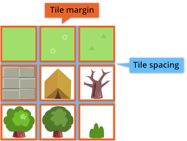
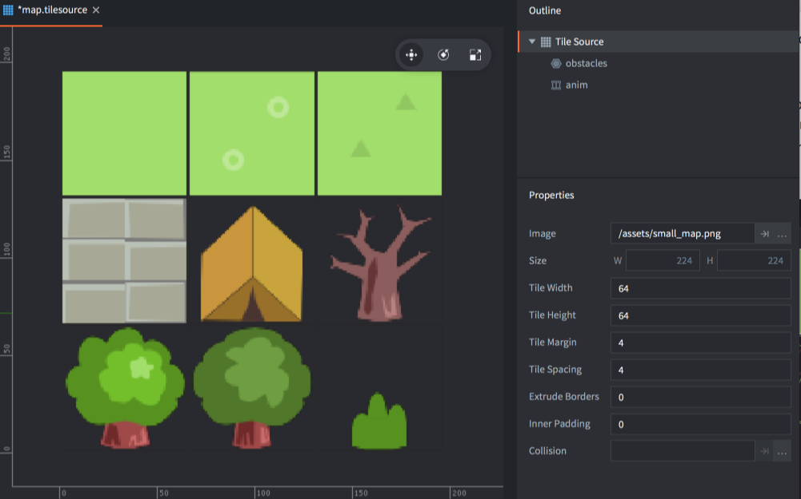
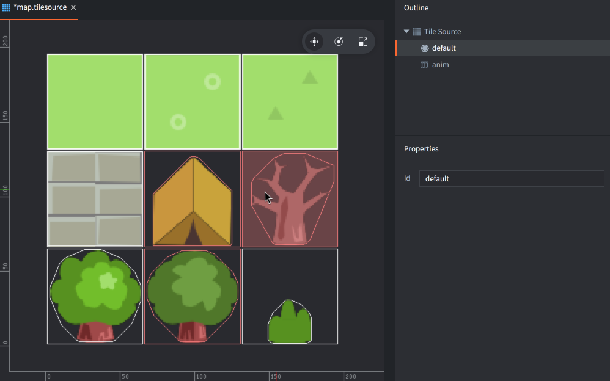

# 瓦片图源 {#tile-source}

*瓦片图源(Tile Source)* 可以被 [瓦片地图组件](/manuals/tilemap) 用于在网格区域上绘制瓦片，也可以作为 [精灵(Sprite)](/manuals/sprite) 或 [粒子效果组件](/manuals/particlefx) 的图形源。您还可以在瓦片地图中使用瓦片图源中的 *碰撞形状* 进行 [碰撞检测和物理模拟](/manuals/physics)（[示例](/examples/tilemap/collisions/)）。

## 创建瓦片图源 {#creating-a-tile-source}

您需要一张包含所有瓦片的图像。每个瓦片必须具有完全相同的尺寸，并以网格形式放置。Defold 支持瓦片之间的 _间距_ 和每个瓦片周围的 _边距_。

一旦创建了源图像，您就可以创建瓦片图源：

- 将图像导入到您的项目中，方法是将其拖拽到 *Assets* 浏览器中的项目位置。
- 创建一个新的瓦片图源文件（在 *Assets* 浏览器中 <kbd>右键点击</kbd> 一个位置，然后选择 <kbd>New... ▸ Tile Source</kbd>）。
- 为新文件命名。
- 文件现在会在瓦片图源编辑器中打开。
- 点击 *Image* 属性旁边的浏览按钮并选择您的图像。现在您应该在编辑器中看到该图像。
- 调整 *Properties* 以匹配源图像。当一切设置正确时，瓦片将完美对齐。

Size
: 源图像的大小。

Tile Width
: 每个瓦片的宽度。

Tile Height
: 每个瓦片的高度。

Tile Margin
: 每个瓦片周围的像素数（上图中橙色区域）。

Tile Spacing
: 每个瓦片之间的像素数（上图中蓝色区域）。

Inner Padding
: 指定在游戏运行时使用的最终纹理中，应自动在瓦片周围添加多少空像素。

Extrude Border
: 指定在游戏运行时使用的最终纹理中，瓦片边缘像素应自动复制多少次。

Collision
: 指定用于自动为瓦片生成碰撞形状的图像。

## 瓦片图源翻页动画 {#tile-source-flip-book-animations}

在图块源中定义动画时，通过动画的 *Frames* 属性选择播放的图块。图块可按任意顺序排列，也可重复，无需重新排列源图像。所有新建图块源都有一个名为“`anim`”的默认动画。可以在 *Outline* 中<kbd>右键单击</kbd>图块源根节点，选择 <kbd>Add ▸ Animation</kbd> 添加新动画。

选择动画会显示动画 *属性*。

Id
: 动画的标识符。对于瓦片图源必须是唯一的。

Frames
: 按动画顺序排列的图块编号，以逗号分隔。编号从左上角的 1 开始，逐行向右、向下，直到右下角。可以重复图块编号，也可以使用包含端点的正向或反向范围。

| Frames | 展开后的序列 |
| --- | --- |
| `1, 3, 6, 3` | `1, 3, 6, 3` |
| `1-4, 8` | `1, 2, 3, 4, 8` |
| `4-2` | `4, 3, 2` |

编辑器会将至少三帧的连续序列显示为范围。例如，`1, 2, 3` 变为 `1-3`，而 `1, 2` 仍显示为两个图块编号。帧顺序和重复项都会保留。列表必须至少包含一帧，且每个图块编号都必须存在于源图像中。

*Frames* 替代了 *Start Tile* 和 *End Tile*。编辑器会将旧图块源文件中的有效范围转换为帧列表。编辑器脚本请使用 `frames` 整数数组，而不是 `start_tile` 和 `end_tile`；请参阅[编辑图块源](/manuals/editor-scripts/#editing-tilesources)。

Playback
: 指定动画如何播放 *Frames* 列表：

  - `None` 完全不播放，只显示第一帧图像。
  - `Once Forward` 从第一帧到最后一帧播放一次动画。
  - `Once Backward` 从最后一帧到第一帧播放一次动画。
  - `Once Ping Pong` 从第一张图像播放到最后一张，再返回到第二张图像，共播放一次。
  - `Loop Forward` 重复播放动画，从第一帧到最后一帧。
  - `Loop Backward` 重复播放动画，从最后一帧到第一帧。
  - `Loop Ping Pong` 重复播放动画，从第一帧到最后一帧，然后再回到第一帧。

Fps
: 动画的播放速度，以每秒帧数（FPS）表示。

Flip horizontal
: 水平翻转动画。

Flip vertical
: 垂直翻转动画。

## 瓦片图源碰撞形状 {#tile-source-collision-shapes}

Defold 使用在 *Collision* 属性中指定的图像为每个瓦片生成一个 _凸_ 形状。该形状将勾勒出瓦片具有颜色信息的部分，即不是 100% 透明的部分。

通常，使用与包含实际图形相同的图像进行碰撞是明智的，但您可以自由指定单独的图像，如果您想要与视觉效果不同的碰撞形状。当您指定碰撞图像时，预览会更新，每个瓦片上都有一个轮廓，指示生成的碰撞形状。

瓦片图源 *Outline* 列出了您已添加到瓦片图源的碰撞组。新的瓦片图源文件将添加一个 "default" 碰撞组。您可以通过在 *Outline* 中 <kbd>右键点击</kbd> 瓦片图源根节点并选择 <kbd>Add ▸ Collision Group</kbd> 来添加新组。

要选择应属于特定组的瓦片形状，请在 *Outline* 中选择该组，然后单击您希望分配给该组的每个瓦片。瓦片和形状的轮廓将使用组的颜色着色。颜色在编辑器中自动分配给组。

要从碰撞组中移除瓦片，请在 *Outline* 中选择瓦片图源根元素，然后单击该瓦片。
